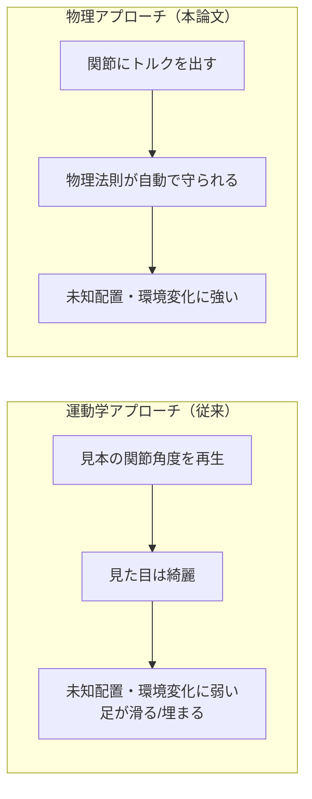
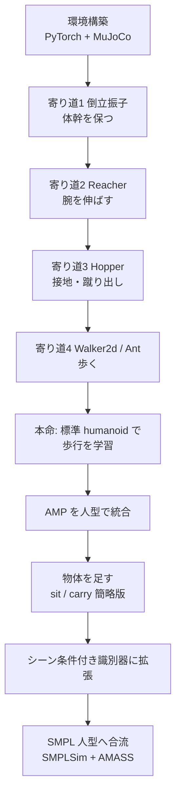

# 00. はじめに — 物理キャラクタはなぜ「シーン」を相手にするのか

## この章でわかること

- 論文「Synthesizing Physical Character-Scene Interactions」が解こうとしている問題
- なぜ既存手法では足りなかったのか（運動学モデル vs 物理モデル）
- この教科書の進め方と、ゲームエンジニアにとっての「おいしいところ」

---

## 1. 問題設定: 「椅子に座る」はなぜ難しいのか

ゲームの中でキャラクタに椅子へ座らせることを考えます。ゲームエンジニアなら、次のどれかを思い浮かべるでしょう。

- 座るアニメーションクリップを用意し、椅子の位置に合わせて再生する
- モーションキャプチャ（MoCap）をリターゲットして貼り付ける
- ステートマシンで「歩く → 接近 → 座る」を切り替える

これは**運動学（キネマティクス）**的なアプローチです。キャラクタの関節角度を直接動かし、見た目を成立させます。

ところが次のような状況で運動学的アプローチは破綻します。

- 椅子の高さ・形・位置が毎回違う（パラメータの組み合わせが無限）
- キャラクタが座りかけた瞬間に椅子を横にずらされる（環境が動く）
- 物を運ぶとき、箱は手に「くっついて」いない。手の力で押さえ、摩擦で支えている

運動学モデルは「**見本の動き**」を再現するのが得意ですが、「**物理法則を守りながら、未知の配置に適応する**」のが苦手です。そこで本論文は**物理シミュレーション**を使います。

## 2. 論文の主張を一行で

> **物理シミュレーションされたキャラクタが、シーンの中で自然に「座る／横になる／物を運ぶ」を学習する。教師データのラベル付けは不要。少数の実演から、形も大きさも違う多数の物体に一般化する。**

キーワードを先に置いておきます（詳しくは第I部で）。

| 用語 | 一言でいうと | 詳しくは |
| --- | --- | --- |
| 強化学習（RL） | 試行錯誤で報酬を最大化する方策を学ぶ | 第01章 |
| 方策 $\pi$ | 「この状態ならこの行動」を決める関数 | 第01章 |
| 模倣学習 | 見本の動きを真似る | 第03章 |
| 敵対的学習 | 本物と偽物を見分ける識別器で品質を引き上げる | 第04章 |
| AMP | 敵対的学習で「動きの自然さ」を学ぶ枠組み | 第05章 |
| シーン条件付き識別器 | 物体の情報も見て「自然さ」を判定する（本論文の中核） | 第08章 |

## 3. なぜこの論文が「一歩先」なのか

本論文以前の代表的な手法には、次のような限界がありました（第II部で詳しく扱います）。

- **NSM / SAMP などのデータ駆動運動学モデル**（Starke et al. 2019, Hassan et al. 2021）
  高品質だが、訓練時に見たことのない配置に弱く、物体を貫通したり足が滑ったりする。
- **物理ベースの階層制御**（Chao et al. 2019）
  物理は守るが、動作が不安定で、対象物体に座れず転倒することが多い。
- **モーショントラッキング**（Peng et al. 2018 ほか）
  1つの参照モーションに忠実だが、複数のスキルを組み合わせて切り替えるのが苦手。

本論文は、**AMP（Adversarial Motion Priors, Peng et al. 2021）** を土台にします。

> Xue Bin Peng, Ze Ma, Pieter Abbeel, Sergey Levine, Angjoo Kanazawa.
> **AMP: Adversarial Motion Priors for Stylized Physics-Based Character Control.**
> ACM TOG 40(4), 2021. <https://arxiv.org/abs/2104.02180>

AMP は「大量のラベルなしモーションから、動きの“自然さ”だけを識別器で学ぶ」枠組みです。本論文はこれに対し、**識別器と方策の両方に“シーン（物体）の情報”を条件付ける**点が新しい、と主張します（3つの貢献は第07章で整理します）。

## 4. なぜ「ゲームエンジニア」に読む価値があるか

- **物理とアニメーションの交差点**にある技術です。あなたが知っている PD 制御や剛体物理が、そのまま部品として登場します（第06章）。
- **キャラクタ AI の新しい作り方**です。手書きステートマシンやクリップ再生の代わりに、「報酬を設計し、機械に試行錯誤させる」発想を学べます。
- **物体を持ち上げる・置く**といった操作系の表現に直結します。最近のゲーム・ツール（例: 物理ベースアニメーション）でも使われ始めています。

## 5. この教科書の進め方

- **第I部** で、機械学習に初めて触れるゲームエンジニア向けに、必要な用語をゼロから説明します。数式は出てきますが、1つずつ日本語で意味を添えます。
- **第II部** で、論文そのものを読みます。式(1)〜(15)を再構成し、付録Aの報酬関数までかみ砕きます。
- **第III部** で、MuJoCo と PyTorch を使った小規模な実装を step by step で作ります。**人型（humanoid）を本線**に、途中で簡単な「寄り道」課題を挟みます。各寄り道では必ず「それが人型タスクの何につながるか」を説明します。
- **付録** に、用語集、関連技術としての拡散モデル、演習、データやライセンスの注意を置きます。

### 第III部のロードマップ（先に全体像）

各寄り道が「何につながるか」の対応は次の通りです。

| 寄り道 | 学ぶこと | 人型タスク（sit / carry / lie down）へのつながり |
| --- | --- | --- |
| 倒立振子 | 姿勢の維持 | 体幹バランス。立つ・座るの前提 |
| Reacher | 腕の目標追従 | 手を伸ばす・箱を持つ |
| Hopper | 接地と蹴り出し | 歩行・立ち上がり |
| Walker2d / Ant | 周期運動と歩容 | 物体へ歩いて近づく |

## 6. 記法の確認

数式はこのように書きます。初出では必ず日本語の意味を添えます。

$$
J(\pi) = \mathbb{E}_{p(\tau|\pi)}\left[\sum_{t=0}^{T-1} \gamma^t r_t\right]
$$

- $J(\pi)$ … 方策 $\pi$ の良さ（期待収益、大きいほど良い）
- $\tau$ … 軌跡（1エピソード分の状態と行動の系列）
- $\gamma$ … 割引率（未来の報酬をどれだけ重視するか、0〜1）
- $r_t$ … 時刻 $t$ の報酬

記号に慣れていない場合は、第01章を読んでから戻ってくると読みやすくなります。

## まとめ

- 本論文は、**物理キャラクタがシーンの中で自然に振る舞う**ための学習法を提案する。
- 従来の運動学的手法は未知の配置・環境変化に弱い。物理＋学習でこれを克服する。
- 中核は **AMP をシーン（物体）に条件付ける**ことと、**物体のランダム化で一般化する**こと。
- この教科書は 基礎 → 論文 → 実装 → 付録 の順で、ゲームエンジニアの知識を足場に説明する。

## 演習

1. あなたが知っているゲームで「キャラクタが環境の物体と相互作用する」場面を1つ挙げ、それが運動学的に作られているか、物理的に作られているかを考察してみましょう。
2. 椅子の高さが毎回ランダムに変わるゲームを考えるとき、運動学アプローチと本論文のアプローチのどちらが向くか、理由とともに述べましょう。

---

次章: [01. 強化学習の基礎](01_強化学習の基礎.md)
