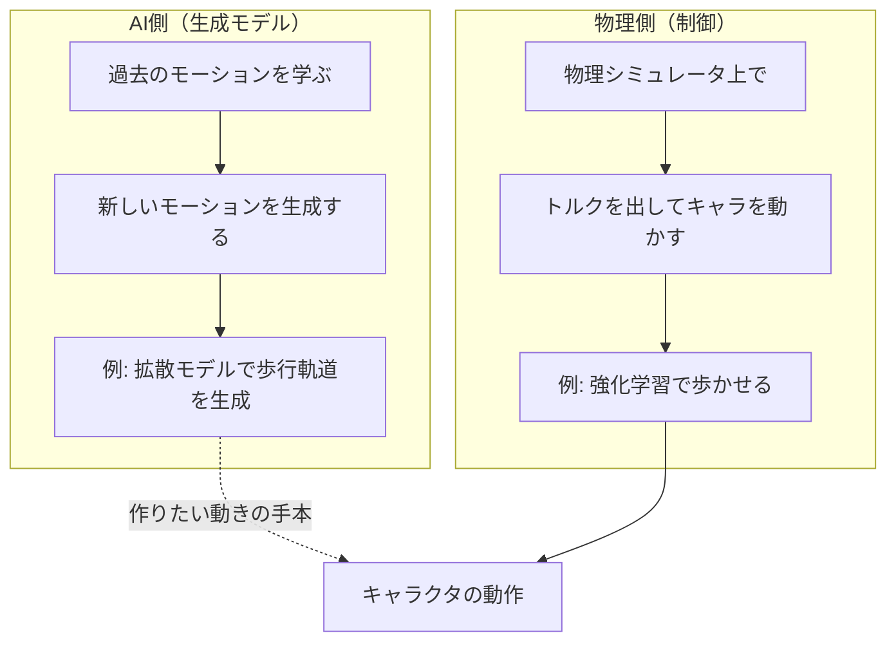
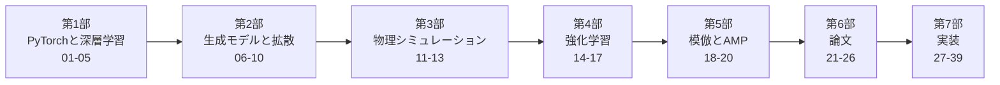
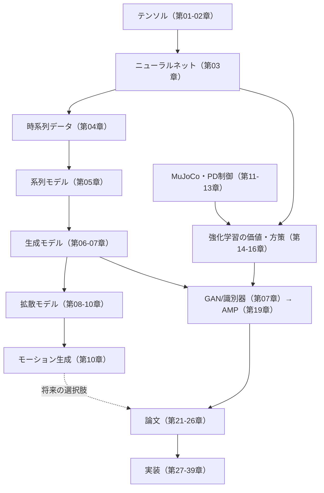

# 00. はじめに — アニメーションAIの学習パス

## この章でわかること

- アニメーションAIが「AI側」と「物理側」の2つの技術から成ること
- この本の学習パス（PyTorch → 時系列 → 生成/拡散 → 物理 → RL → 模倣/AMP → 論文）
- 各段階が「何につながるか」
- 記法と進め方

## 前提

- なし。Python を少し触ったことがあれば十分です。

---

## 1. アニメーションAIは2つの柱でできている

ゲームのキャラクタを「学習で動かす」技術は、大きく2種類に分かれます。

- **AI側（生成モデル）**: 「こういう動きが自然」という分布をデータから学び、新しい動きを**生成**します。画像生成で有名な**拡散モデル（Diffusion）**が、モーションでも使われます。
- **物理側（制御）**: 物理シミュレータの中で、キャラクタに**力を加えて**目標の動きをさせます。ここで主役になるのが**強化学習（RL）**と、その上に成り立つ**模倣学習（AMP / DeepMimic）**です。

この本の到達点である論文は、**物理側**の手法（AMP）を発展させたものです。ただし、あなたが知りたい「拡散モデルでモーションを作る」も、AI側の重要な柱として本編でしっかり扱います。

## 2. この本の学習パス

| 部 | 学ぶこと | 何につながるか |
| --- | --- | --- |
| 第1部 | Python・NumPy・PyTorch・ニューラルネット・時系列データ | すべての土台。モーション＝時系列を扱う力 |
| 第2部 | 生成モデル・VAE・GAN・**拡散モデル** | モーション生成。GAN は後の AMP の布石 |
| 第3部 | MuJoCo・剛体・PD制御 | 物理キャラクタを動かす土台 |
| 第4部 | 強化学習・PPO | 「報酬を最大化する制御」を学ぶ |
| 第5部 | 模倣学習・DeepMimic・AMP | 見本の動きを物理キャラで再現 |
| 第6部 | 論文（シーン相互作用） | 物体と相互作用するキャラ制御 |
| 第7部 | 実装 | 手を動かして再現 |

**なぜこの順番か**: いきなり強化学習の理論から入ると、機械学習が初めての人には抽象的すぎます。まず**PyTorch で数値を動かし**、**データ（時系列）を扱い**、**生成モデルを体験**してから、物理と RL に進むほうが、体で理解できます。

## 3. 各段階が「何につながるか」の全体地図

- **拡散モデル**（第08〜10章）と **GAN/識別器**（第07章）は、実は数学的な縁があります。「生成器と識別器を競わせる」GAN の考え方は、論文の **AMP の識別器**にそのまま使われます。第2部で GAN を学ぶと、第5部の AMP がすっと入ります。
- **時系列データ**の扱い（第04章）は、モーション生成でも強化学習（系列のロールアウト）でも共通の基礎になります。

## 4. 読者が持っている知識との対応

| あなたが知っていること | 本で対応する概念 |
| --- | --- |
| ゲームループ（毎フレーム更新） | 強化学習のステップ、シミュレーションの1ステップ |
| 剛体物理・当たり判定 | MuJoCo の剛体リンク・接触 |
| アニメーションのブレンド | モーションの時系列データ、補間 |
| 状態機械（ステートマシン） | 方策 $\pi$（状態→行動） |
| 物理アーマチュア | 関節リンク＋PD制御 |

## 5. 記法の約束

- 数式の記号は、初出時に必ず日本語で意味を書きます。
  - 例: 状態 $s_t$（時刻 $t$ にキャラクタと環境がどうなっているかの数値のまとまり）
- コードは **擬似コード**（`pseudo`）と実装コード（Python）を区別します。
- 図は Mermaid で書くので、対応ビューアで図として表示されます。
- 章末に「つながり」＝その内容が最終的に何に役立つかを書きます。

## 6. 進め方のコツ

1. **手を動かす**: 第1部以降、コードは `src/ml_lern/` にあります。写経して動かすと理解が速まります。
2. **「つながり」を意識する**: 各章末の「つながり」を読み、今どこにいるかを確認しましょう。
3. **わからなくても進む**: 第1部は何度も戻れる土台です。一度通してから戻るのも有効です。

## 環境について

- この環境は aarch64・CPU・CUDAなし・メモリ約5GiB。**IsaacGym は動きません**。
- 第1〜2部（PyTorch・拡散）は CPU で十分動きます。
- 第3部以降の物理・RL は MuJoCo（CPU）で動きます。
- 依存導入: `uv sync --extra train --extra viz`

## まとめ

- アニメーションAIは「AI側（生成）」と「物理側（制御）」の2つの柱。
- 本は PyTorch → 時系列 → 生成/拡散 → 物理 → RL → 模倣/AMP → 論文 の順。
- 第2部で学ぶ GAN と拡散は、後の AMP とモーション生成につながる。
- まずは PyTorch で数値を動かすところから。

## 手を動かそう

> **一歩目**: 環境をのぞいてみる。`uv sync --extra train` の後、`uv run python scripts/f01_tensors.py` と `uv run python scripts/p01_mujoco_basics.py` を実行する。

テンソルと自動微分の結果（AI側の入口）と、MuJoCo の環境の次元（物理側の入口）が一度に見られます。最初に両方触っておくと、以降の位置づけが掴めます。

**いじってみる**: `p01_mujoco_basics.py` の `inspect_spaces("Humanoid-v5")` を `"Ant-v5"` に変えて、状態・行動の次元がどう変わるか見る。

**夢が広がる**:
- 自分のゲームから「これは学習で作りたい」と思うキャラ動作を1つ選び、AI側（生成）か物理側（制御）かをノートに書く。
- その動作を、この教科書の何章で扱うかを地図にする（例: 「歩行」→第32・35章、「物を運ぶ」→第36章）。
- 「1年後、この動作を実機/実ゲームで動かせている」姿を想像して、到達点を決める。

**再現レシピ**: [レシピ01（付録E）](付録E_再現レシピ_AI側.md#recipe-01)（コメント付きの再現コードで試せます）

## 演習

1. 「AI側」と「物理側」のキャラクタ制御の違いを、自分の言葉で説明してみましょう。
2. あなたが作りたいキャラクタの動きを1つ挙げ、それが AI側・物理側のどちらで作りたいか考えてみましょう。

---

次章: [01. Python と NumPy](01_PythonとNumPy.md)
