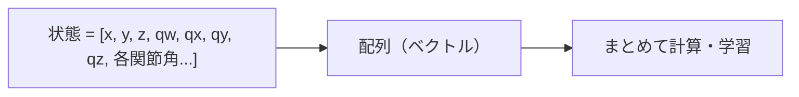
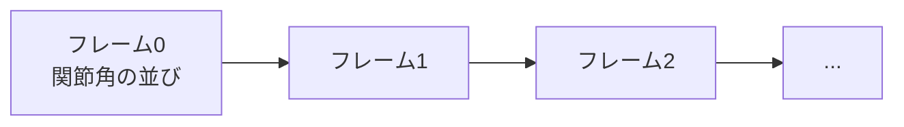
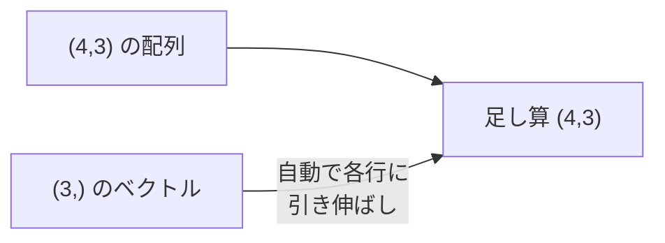

# 01. Python と NumPy — 数値の「箱」を扱う

## この章でわかること

- なぜアニメーションAIで配列（多次元配列）が中心になるのか
- NumPy の配列（`ndarray`）の作り方・形（shape）・型（dtype）
- スライス・ブロードキャスト・行列積といった基本操作
- 「ループを書かずに一括計算する」という発想（ベクトル化）
- キャラクタの状態やモーションを配列でどう表すか

## 前提

- Python の基本（変数、関数、リスト、for 文）

## つながり

- ここで学ぶ多次元配列は、**この後すべての章のデータの形**になります。
- 特に「モーション＝ `(フレーム数, 関節数×特徴)`」という形（第04章）や、状態ベクトル（第14章）に直結します。

---

## 1. なぜ「配列」なのか

ゲームエンジニアなら、キャラクタの状態を次のように持つはずです。

- 位置 (x, y, z)
- 回転 (quaternion の 4 要素)
- 各関節の角度（関節の数だけ）
- 各関節の速度

これらは全部「数の並び」＝**配列**です。機械学習では、こうした数値の集まりをまとめて配列で扱います。理由は単純で、**一括して計算できる**からです。



NumPy は Python で配列を高速に扱うための標準ライブラリです。PyTorch のテンソル（第02章）はほぼ「NumPy 配列＋自動微分＋GPU対応」です。つまり、NumPy を押さえれば PyTorch はすぐ理解できます。

## 2. 配列を作る

```python
import numpy as np

# 1次元配列（ベクトル）
pos = np.array([1.0, 2.0, 3.0])
print(pos.shape)      # (3,)   「3要素」という形
print(pos.dtype)      # float64

# 2次元配列（行列）
mat = np.array([[1, 2, 3],
                [4, 5, 6]])
print(mat.shape)      # (2, 3)  「2行3列」

# よく使う生成
zeros = np.zeros((4, 3))          # 4行3列の 0
ones = np.ones((2,))              # 長さ2の 1
eye = np.eye(3)                   # 3x3 単位行列
rand = np.random.rand(2, 3)       # [0,1) の乱数
```

**`shape`（形）は最重要**です。「これは何行何列か」を常に意識するくせをつけましょう。アニメーションAIのバグの多くは「形の取り違え」です。

## 3. 配列の形でモーションを表す

ここが本題です。**アニメーションは時系列データ**です。1フレームごとに姿勢（関節の並び）があり、それが何フレームも続きます。



これを配列で表すと、次の形になります。

```
motion.shape = (フレーム数, 関節数 × 特徴量)
```

例えば 120 フレーム、22 関節、各関節の特徴量が 3 軸回転（3）＋角速度（3）＝6 なら:

```python
motion = np.zeros((120, 22 * 6))     # (120, 132)
print(motion.shape)                  # (120, 132)
```

学習では、これをさらに**まとめて**扱います（バッチ）。

```
data.shape = (バッチサイズ, フレーム数, 関節数 × 特徴量)
```

| 次元 | 記号 | 意味 |
| --- | --- | --- |
| 第0次元 | $B$ | バッチサイズ（同時に扱うサンプル数） |
| 第1次元 | $T$ | フレーム数（時間の長さ） |
| 第2次元 | $F$ | 特徴量（関節数 × 各関節の値の数） |

この形（$B, T, F$）は第04章で詳しく扱います。ここでは「配列が何次元で、各次元が何を意味するか」を意識できれば十分です。

> **つながり**: 画像は `(チャンネル, 高さ, 幅)` の3次元ですが、モーションは `(バッチ, 時間, 特徴量)` の3次元です。**時間**の軸があるのがポイントです（第04・05章）。

## 4. インデックスとスライス

配列から一部を取り出す操作です。`:`（コロン）が「全部」を意味します。

```python
motion = np.zeros((120, 132))     # (フレーム, 特徴)

frame0 = motion[0]                # 先頭フレーム (132,)
first_10 = motion[:10]            # 先頭10フレーム (10, 132)
last_frame = motion[-1]           # 末尾 (132,)
subset = motion[10:20, 0:6]       # フレーム10-19, 特徴0-5 (10, 6)
```

- `motion[:10]` … 先頭から10フレーム
- `motion[10:20]` … 10〜19フレーム
- `motion[:, 0]` … 全フレームの0番目の特徴（列）

ゲームのたとえ: スライスは「この区間のクリップを切り出す」操作です。

## 5. ブロードキャスト — 形が違っても計算できる

NumPy の強力な機能が**ブロードキャスト**です。形の違う配列同士を、自動的に引き伸ばして計算します。

```python
bias = np.array([1.0, 2.0, 3.0])       # 形 (3,)
data = np.zeros((4, 3))                # 形 (4, 3)

result = data + bias                   # (4,3) + (3,) → (4,3)
# 各行に bias が足される
```



**なぜ重要か**: 正規化（平均を引く、標準偏差で割る）などで頻繁に使います。

```python
# 特徴ごとに正規化する（各列を平均0・分散1に）
mean = data.mean(axis=0)      # 列ごとの平均 (3,)
std = data.std(axis=0)        # 列ごとの標準偏差 (3,)
normalized = (data - mean) / (std + 1e-8)   # ブロードキャストで一括
```

> `axis=0` は「0番目の次元（行）をまとめる」＝列ごとに集計、という意味です。

## 6. 行列積と総和

- **要素ごとの積** `*`: 同じ位置同士を掛ける。
- **行列積** `@`: 線形代数の行列積（ニューラルネットの計算で使う）。

```python
a = np.array([[1, 2], [3, 4]])   # (2,2)
b = np.array([[5, 6], [7, 8]])   # (2,2)

print(a * b)     # 要素ごと: [[5,12],[21,32]]
print(a @ b)     # 行列積: [[19,22],[43,50]]
```

総和・平均は軸を指定して計算します。

```python
x = np.array([[1, 2, 3], [4, 5, 6]])   # (2,3)
x.sum()          # 全部: 21
x.sum(axis=0)    # 列ごと: [5, 7, 9]
x.sum(axis=1)    # 行ごと: [6, 15]
x.mean(axis=0)   # 列ごとの平均: [2.5, 3.5, 4.5]
```

## 7. 形を変える・つなげる

学習では、形を頻繁に変換します。

```python
x = np.zeros((120, 22, 3))     # (フレーム, 関節, xyz)

flat = x.reshape(120, 66)      # 関節×xyz を1本に: (120, 66)
back = flat.reshape(120, 22, 3)  # 戻す

t = x.transpose(1, 0, 2)       # 次元の順番を入れ替え: (22, 120, 3)
joined = np.concatenate([x, x], axis=0)   # 0次元で連結: (240, 22, 3)
stacked = np.stack([x, x], axis=0)         # 新しい次元として積む: (2, 120, 22, 3)
```

- `reshape` … 中身の並びは保ったまま形だけ変える。
- `transpose` … 次元の順番を入れ替える（時間と関節を入れ替える等）。
- `concatenate` … 既存の軸でつなぐ。`stack` … 新しい軸を作って積む。

**注意**: `reshape` は「データの並び順」を保ちます。`(フレーム, 関節, 3)` を `(フレーム, 関節*3)` にするのは自然ですが、順序を間違えると意味が壊れます。

## 8. 乱数とシード

機械学習は乱数だらけです（重みの初期化、データのシャッフル、探索）。**再現性**のためにシードを固定します。

```python
rng = np.random.default_rng(seed=42)   # 乱数生成器
print(rng.random(3))                    # 毎回同じ結果になる
print(rng.integers(0, 10, size=5))      # 0〜9 の整数を5個
print(rng.normal(0, 1, size=(2, 2)))    # 正規分布（平均0, 標準偏差1）
```

- `seed` を固定すると、実験を再現できます。
- 論文の結果を再現するとき、シードは重要です。

## 9. なぜ「ループを書かない」のか — ベクトル化

Python の for 文は遅いです。NumPy は「C言語のループ」で一括計算するため、**桁違いに速い**ことがあります。

```python
# 遅い: Python のループ
total = 0.0
for i in range(1_000_000):
    total += i

# 速い: NumPy の一括計算
total = np.arange(1_000_000).sum()
```

ゲームエンジニアには「**計算をまとめてバッチ処理する**」発想として馴染むでしょう。GPU（多数のコア）やベクトル命令（SIMD）を使うには、この「一括計算」が前提になります。

> **つながり**: 第02章の PyTorch は、この「一括計算」をさらに GPU で行えるようにしたものです。第04章のミニバッチ学習も、この考え方の応用です。

## 10. 実装コード

この章に対応するコードは `src/ml_lern/foundations/tensors_demo.py` と `scripts/f01_tensors.py` にあります。

```python
from ml_lern.foundations.tensors_demo import motion_shape_demo, normalization_demo

motion_shape_demo()      # モーションの (フレーム, 特徴) を確認
normalization_demo()     # ブロードキャストで正規化
```

実行:

```bash
uv run python scripts/f01_tensors.py
```

## 11. つまずきやすいポイント

| 症状 | 原因・対処 |
| --- | --- |
| 形が合わずエラー | `print(x.shape)` を挟んで確認する |
| `*` と `@` の取り違え | 要素ごと積は `*`、行列積は `@` |
| 予想外のブロードキャスト | 形を揃える（`reshape`/`[..., None]`） |
| reshape でデータが壊れる | 並び順を確認。必要なら `transpose` してから |
| 結果が毎回変わる | 乱数に `seed` を固定する |

## まとめ

- アニメーションAIのデータは多次元配列。**形（shape）**を常に意識する。
- モーションは `(フレーム, 関節×特徴)`、学習では `(バッチ, 時間, 特徴)`（$B, T, F$）。
- ブロードキャスト・スライス・reshape・transpose・行列積が基本操作。
- ループを書かず**一括計算**するのが NumPy の流儀。これが PyTorch・GPU につながる。

## 演習

1. `np.zeros((10, 4, 2))` の配列の形を答え、各次元が何を表すか自由に設定してみましょう。
2. 形 `(8, 3)` の配列と形 `(3,)` のベクトルを足すと、結果は何形になりますか。また、形 `(8, 1)` と `(3,)` を足すと何形になりますか。
3. `(120, 22, 3)` のモーションを「時間の軸と関節の軸を入れ替える」操作を書いてみましょう。
4. シードを変えると乱数の結果が変わることを、実際に確認しましょう。

---

次章: [02. PyTorch の基礎](02_PyTorchの基礎.md)
