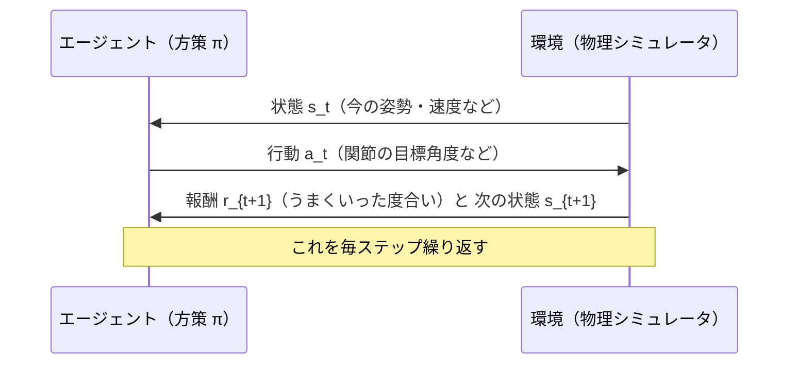

# 01. 強化学習の基礎

## この章でわかること

- 強化学習（RL）の登場人物：エージェント、環境、状態、行動、報酬
- 方策 $\pi$、価値関数 $V, Q$、アドバンテージの意味
- 「エピソード」「割引率」「MDP」といった用語
- ゲームのループと RL のループがどう対応するか

## 前提

- ゲームの更新ループ（毎フレーム、入力→更新→描画）をイメージできること
- 高校数学程度の確率・期待値（わからなくても、都度説明します）

---

## 1. 強化学習とは何か — ゲーム AI との違い

ゲームの AI は、ふつう「**ルールを人間が書く**」ものです。敵は索敵範囲を判定し、範囲内なら追いかける、といった条件分岐を並べます。

強化学習は発想が逆です。

> **人間は「何を達成したいか（報酬）」だけを書く。どう動くか（方策）は機械が試行錯誤で見つける。**

たとえば「前に進めば進むほど報酬」を与えるだけで、四足歩行のロボットが自分で歩き方を獲得します。これが RL です。

## 2. 登場人物: エージェントと環境

RL の世界は2つの主体でできています。



| 用語 | 記号 | 意味 | ゲームでの対応 |
| --- | --- | --- | --- |
| エージェント | — | 学習して上手くなる側 | キャラクタ本体＋制御プログラム |
| 環境 | — | 応答を返す相手 | 物理エンジン＋マップ＋物体 |
| 状態 | $s_t$ | 時刻 $t$ の状況を表す数値のまとまり | キャラの座標・回転・速度・関節角など |
| 行動 | $a_t$ | 時刻 $t$ に取れる操作 | 「関節を何度にせよ」という指令 |
| 報酬 | $r_t$ | その行動の良さ（スカラー） | 「目標に近づいたら +1」など |
| 方策 | $\pi$ | 状態→行動 の決め方 | キャラクタの “思考ルーチン” |
| ステップ | $t$ | 時間の刻み（1フレーム相当） | ゲームの1フレーム |

**重要**: 状態 $s$ は「**方策が意思決定に使えるすべての情報**」です。キャラクタから見えない情報（プレイヤーの隠しパラメータなど）は状態に含めません。この「何を状態に入れるか」の設計は、後の第09章（114次元の状態）で効いてきます。

## 3. エピソードと軌跡

RL はふつう「**1回の挑戦（エピソード）**」を何度も繰り返します。

- **エピソード**: 初期状態から始まり、終了条件（目標達成・転倒・時間切れ）まで続く1区切り。
- **軌跡（trajectory）$\tau$**: 1エピソード中の系列

$$
\tau = (s_0, a_0, r_1, s_1, a_1, r_2, \dots, s_{T-1}, a_{T-1}, r_T)
$$

ゲームに置き換えると、「ステージ開始からクリア（またはゲームオーバー）まで」が1エピソードです。

## 4. 報酬と収益、そして割引

エピソード中の報酬を合計したものを**収益（return）**と呼びます。

$$
G_t = r_{t+1} + r_{t+2} + r_{t+3} + \cdots
$$

ところが、単純な合計には問題があります。未来の報酬をすべて同じ重みで足すと、エピソードが長い場合に発散したり、学習が不安定になります。そこで**割引率** $\gamma \in [0, 1)$ を掛けて、未来の報酬を少しずつ軽く見ます。

$$
G_t = r_{t+1} + \gamma\, r_{t+2} + \gamma^2\, r_{t+3} + \cdots = \sum_{k=0}^{\infty} \gamma^k r_{t+1+k}
$$

- $\gamma = 0$ … 目先の報酬しか見ない（短絡的）
- $\gamma = 0.99$ … 未来の報酬もほぼ同等に重視（長期的）

直感: 「今日の100円」と「1年後の100円」なら、今日のほうが価値が高い。$\gamma$ はその「目減り」を表します。

## 5. 方策 $\pi$ — キャラクタの思考ルーチン

方策は「状態から行動を決める関数」です。確率で選ぶ場合と、決定的に選ぶ場合があります。

$$
a_t \sim \pi(\cdot \mid s_t) \quad\text{（確率的方策）}
\qquad\text{または}\qquad
a_t = \mu(s_t) \quad\text{（決定的方策）}
$$

- 確率的方策: 同じ状態でも少し違う行動を取る。探索が自然にできる。
- 決定的方策: 同じ状態なら必ず同じ行動。シンプルだが探索が弱い。

本論文で使う方策は**ガウス分布**に基づく確率的方策です（第02章・第06章）。

$$
\pi(a_t \mid s_t, g_t) = \mathcal{N}\!\big(\mu(s_t, g_t),\ \Sigma\big)
$$

- $\mu$ … ニューラルネットが出力する平均（狙いの行動）
- $\Sigma$ … ばらつき（共分散）。本論文では**手動で固定**する（第09章で再確認）
- $g_t$ … 目標（goal）。「どこに座れ」といったタスク指定

## 6. 価値関数 $V$ と $Q$ — 「この状況、あとでどれだけ得か」

学習を効率化するために「状態の良さ」を評価する関数を使います。

- **状態価値関数 $V^\pi(s)$**: 状態 $s$ から方策 $\pi$ で進んだときの、期待収益。
- **行動価値関数 $Q^\pi(s, a)$**: 状態 $s$ で行動 $a$ を取ったあと、方策 $\pi$ で進んだときの期待収益。

$$
V^\pi(s) = \mathbb{E}_\pi\!\left[G_t \mid s_t = s\right],
\qquad
Q^\pi(s, a) = \mathbb{E}_\pi\!\left[G_t \mid s_t = s,\ a_t = a\right]
$$

ゲームのたとえ: チェスの局面の「形勢判断」が $V$ です。同じ盤面でも、良い手（$a$）を打てば $Q$ が高い。この価値関数は、学習の「ぶれ」を減らすために、方策の更新で基準値として使われます（第02章のアドバンテージ）。

## 7. アドバンテージ — 「平均より、どれだけ良い手だったか」

RL では「この行動は平均的な行動より良かったか？」が重要です。これを表すのがアドバンテージです。

$$
A^\pi(s, a) = Q^\pi(s, a) - V^\pi(s)
$$

- $A > 0$: 平均より良い行動 → その行動の確率を上げたい
- $A < 0$: 平均より悪い行動 → 確率を下げたい

「良し悪しの基準」を引くことで、良い行動だけを強く学べます。実際の値の推定には GAE（第02章）を使います。

## 8. MDP — 問題の「型」

ここまでの設定をきちんと定式化したものが**マルコフ決定過程（MDP）**です。

$$
\mathcal{M} = (\mathcal{S}, \mathcal{A}, P, R, \gamma)
$$

- $\mathcal{S}$ … 状態の集合（本論文では 114 次元ベクトルの集合）
- $\mathcal{A}$ … 行動の集合（28 次元ベクトルの集合）
- $P(s' \mid s, a)$ … 遷移確率（行動すると状態がどう変わるか。物理シミュレータがこれに相当）
- $R(s, a)$ … 報酬関数
- $\gamma$ … 割引率

「**マルコフ性**」とは、次にどうなるかが **今の状態だけで決まる**（過去の履歴に依らない）という仮定です。物理シミュレーションは、位置・速度・関節角がすべて状態に入っていれば、ほぼマルコフ的とみなせます（速度まで状態に含めるのはこのためです）。

## 9. RL のループを擬似コードで読む

すべてを1つのループにまとめます。

```pseudo
方策 π と 価値関数 V をランダムに初期化する
繰り返し（エピソード）:
    状態 s を初期化する
    繰り返し（ステップ）:
        a ~ π(·|s)                # 方策で行動を選ぶ（少しランダムに）
        s', r = 環境.step(a)      # 物理を進める。報酬を計算する
        バッファに (s, a, r, s') を記録する
        s = s'
        終了条件を満たしたら抜ける
    # 一定量たまったらパラメータを更新する（→ 第02章 PPO）
    π ← π を 良かった行動を増やす向きに更新
    V ← V を 実際の収益に近づける向きに更新
```

ポイントは「**貯めてからまとめて更新する**」ことです。1ステップごとに更新すると学習が不安定になるため、何千ステップ分をためて更新します（本論文も同様）。

## 10. 探索と活用のトレードオフ

RL に必ずついて回るジレンマです。

- **活用（exploitation）**: 今わかっている一番良い行動を選ぶ。安心だが、新しい発見がない。
- **探索（exploration）**: あえて違う行動も試す。新しい発見があるが、損をすることもある。

確率的方策（ガウス分布の $\Sigma$）は、この探索を自然に実現します。$\Sigma$ が大きいほど大胆に探索します。

## 11. 何が「難しい」のか

ゲームエンジニアが RL を触ると、しばしば驚く難しさがあります。

1. **報酬設計**: 目的を報酬に翻訳するのが難しい。「自然に座る」を数値化するには工夫が要る（第12章）。
2. **報酬ハッキング**: 意図しない抜け道を学習する。例: 「前に進めたら報酬」で、跳ねながら転げる。
3. **サンプル効率**: 何百万ステップも必要。1回の学習に CPU で何時間〜何日もかかる。
4. **局所解**: 「その場で足踏み」のような中途半端な解に落ち着く。

本論文がAMPを使う理由は、主に 2（報酬ハッキング）と 4（自然さ）への対策です。「自然な動き」を報酬で細かく書く代わりに、**見本から学ばせる**のです。

## まとめ

- RL は「報酬だけ与えて、方策を試行錯誤で獲得させる」枠組み。
- 状態 $s_t$、行動 $a_t$、報酬 $r_t$、方策 $\pi$、価値 $V, Q$、アドバンテージ $A$ が基本語彙。
- 割引率 $\gamma$ で未来の報酬を軽く見る。マルコフ性を仮定して MDP として定式化する。
- 「貯めてから更新」「探索と活用のトレードオフ」「報酬設計の難しさ」が実践の勘所。

## 演習

1. 迷路探索を RL で解くとき、状態・行動・報酬をそれぞれ何にすればよいか設計してみましょう。
2. 「敵を倒せば報酬」だけを与えたら、起こりうる報酬ハッキングを1つ考えてみましょう。
3. 割引率 $\gamma$ を 0.9 と 0.99 にしたとき、「何ステップ先まで実質的に重視するか」を $1/(1-\gamma)$ の目安で比較してみましょう（ヒント: 0.9 なら約10、0.99 なら約100）。

---

次章: [02. 方策勾配とPPO](02_方策勾配とPPO.md) ／ 前章: [00. はじめに](00_はじめに.md)
