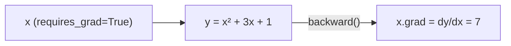
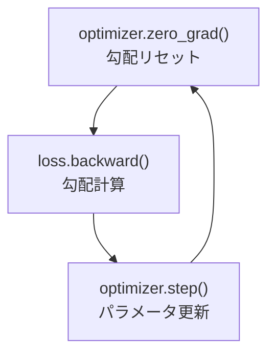

# 02. PyTorch の基礎 — テンソルと自動微分

## この章でわかること

- PyTorch のテンソル（NumPy 配列との違い）
- デバイス（CPU/GPU）の扱い
- **自動微分（autograd）**: 勾配を自動で計算する仕組み
- `nn.Module` と `nn.Linear` でニューラルネットの部品を作る
- オプティマイザと最小の学習（線形回帰）

## 前提

- 第01章（NumPy・多次元配列・ブロードキャスト）

## つながり

- テンソルと自動微分は、**この後のすべてのニューラルネット**（方策・識別器・拡散モデル）の土台です。
- 「勾配を計算してパラメータを更新する」という流れは、第03章の学習ループ、そして第16章の PPO にそのまま使われます。

---

## 1. PyTorch のテンソル

PyTorch の **テンソル**は、ほぼ「NumPy 配列＋自動微分＋GPU対応」です。基本的な操作は NumPy と同じです。

```python
import torch

# 配列から作る
x = torch.tensor([1.0, 2.0, 3.0])
print(x)            # tensor([1., 2., 3.])
print(x.shape)      # torch.Size([3])
print(x.dtype)      # torch.float32

# よく使う生成（NumPy と対応）
z = torch.zeros(2, 3)          # 2行3列の0
o = torch.ones(4)              # 長さ4の1
r = torch.rand(2, 3)           # [0,1) の一様乱数
n = torch.randn(2, 3)          # 標準正規乱数
```

| NumPy | PyTorch |
| --- | --- |
| `np.array(...)` | `torch.tensor(...)` |
| `np.zeros(...)` | `torch.zeros(...)` |
| `x.reshape(...)` | `x.reshape(...)` |
| `a @ b` | `a @ b` |
| `x.sum(axis=0)` | `x.sum(dim=0)` |

> 違い: NumPy は `axis=`、PyTorch は `dim=` を使います。どちらも「どの次元で集計するか」の指定です。

## 2. デバイス（CPU / GPU）

PyTorch の大きな売りは GPU を使えることです。テンソルは「どの装置の上にあるか（**デバイス**）」を持ちます。

```python
device = "cuda" if torch.cuda.is_available() else "cpu"
x = torch.randn(1000, 1000, device=device)
print(x.device)
```


**注意**: 計算するテンソルは**同じデバイス**にないとエラーになります。

```python
a = torch.randn(3)                        # CPU
b = torch.randn(3, device="cuda")         # GPU（この環境では不可）
# c = a + b   # エラー！ デバイスが違う
```

> この環境は **GPU なし（CUDA 不可）** なので、常に CPU を使います。第16章以降のコードも `device="cpu"` が既定です。

## 3. 自動微分（autograd）— この章の核心

機械学習の本質は「**損失を小さくするようにパラメータを動かす**」ことです。そのためには「パラメータを少し動かすと損失がどう変わるか」＝**勾配（gradient）**が要ります。

PyTorch は**自動微分（autograd）**でこれを自動計算します。これが NumPy に対する最大の利点です。

```python
x = torch.tensor(2.0, requires_grad=True)   # 勾配を追跡する
y = x ** 2 + 3 * x + 1                       # y = x^2 + 3x + 1
y.backward()                                 # 勾配を計算
print(x.grad)                                # dy/dx = 2x + 3 = 7
```



ポイント:

- `requires_grad=True` を付けたテンソルは、それを使った計算が**記録**されます。
- `y.backward()` で、`y` から逆向きに勾配を計算します（**誤差逆伝播**）。
- `x.grad` に勾配が入ります。

**直感**: `x=2` のとき $y = 4 + 6 + 1 = 11$。$x$ をほんの少し増やすと $y$ はどれだけ増えるか？ その増加率が勾配（=7）です。勾配が正なら $x$ を*減らす*と $y$ が下がる、という情報が得られます。

> **つながり**: ニューラルネットには数百万のパラメータがありますが、`backward()` はそれら全部の勾配を一度に計算します。「勾配の逆向きに少し動かす」を繰り返すのが学習です（第03章）。

## 4. 勾配降下法の1ステップを手で書く

最小の例で「学習」を体験します。$y = wx + b$ の $w, b$ をデータに合わせます。

```python
import torch

# 本当の関係: y = 3x + 2 に少しノイズを足したデータ
x = torch.randn(100, 1)
y_true = 3.0 * x + 2.0 + 0.1 * torch.randn(100, 1)

# パラメータ（学習する対象）
w = torch.zeros(1, requires_grad=True)
b = torch.zeros(1, requires_grad=True)

lr = 0.1   # 学習率
for step in range(200):
    y_pred = w * x + b                    # 予測
    loss = ((y_pred - y_true) ** 2).mean()  # 二乗誤差（損失）
    loss.backward()                       # 勾配を計算
    with torch.no_grad():                 # 更新は勾配計算の外で
        w -= lr * w.grad                  # 勾配の逆向きに動かす
        b -= lr * b.grad
        w.grad.zero_()                    # 勾配をリセット
        b.grad.zero_()

print(w.item(), b.item())   # だいたい 3.0 と 2.0 に近づく
```

ここで重要な3つの操作:

1. `loss.backward()` … 勾配を計算
2. `w -= lr * w.grad` … 勾配の逆向きに少し動かす（**勾配降下法**）
3. `w.grad.zero_()` … 勾配をリセット（次のステップのため）

> **落とし穴**: `zero_()` を忘れると勾配が積み重なって壊れます。PyTorch を使い始めた人が必ずハマる点です。

## 5. `nn.Module` でモデルを部品化する

毎回 `w * x + b` と書くのは大変なので、PyTorch は**モジュール**という仕組みを用意しています。ニューラルネットの層（全結合など）が部品として用意されています。

```python
import torch.nn as nn

class TinyNet(nn.Module):
    def __init__(self):
        super().__init__()
        self.fc1 = nn.Linear(4, 8)    # 入力4 → 隠れ8
        self.fc2 = nn.Linear(8, 1)    # 隠れ8 → 出力1
        self.act = nn.ReLU()

    def forward(self, x):
        h = self.act(self.fc1(x))
        return self.fc2(h)

net = TinyNet()
y = net(torch.randn(2, 4))            # まとめて2サンプル推論
print(y.shape)                        # (2, 1)
```

- `nn.Module` を継承し、`__init__` で層を作り、`forward` で計算を書く。
- `nn.Linear(in, out)` … 全結合層（重みとバイアスを内部に持つ）。
- `net(x)` と書くと `forward(x)` が呼ばれます。

パラメータは自動で集められます。

```python
for name, p in net.named_parameters():
    print(name, p.shape)
```

## 6. オプティマイザ — 更新を楽にする

勾配降下の更新を毎回手書きするのは面倒なので、**オプティマイザ**に任せます。

```python
optimizer = torch.optim.Adam(net.parameters(), lr=1e-3)

for step in range(200):
    y_pred = net(x)
    loss = nn.functional.mse_loss(y_pred, y_true)
    optimizer.zero_grad()    # 勾配リセット
    loss.backward()          # 勾配計算
    optimizer.step()         # パラメータ更新
```

これが**学習ループの型（かた）**です。この4行（`zero_grad → backward → step`）は、この先ずっと使い続けます。



`Adam` は代表的なオプティマイザで、勾配の大きさに応じて学習率を自動調整してくれます。まずは Adam か SGD を使えば十分です。

## 7. モデルの保存と読み込み

学習したパラメータを保存・再開します。

```python
torch.save(net.state_dict(), "model.pt")     # 保存
net2 = TinyNet()
net2.load_state_dict(torch.load("model.pt")) # 読み込み
```

> `state_dict()` は「パラメータの辞書」です。モデルの構造（クラス）と合わせて使います。

## 8. 実装コード

この章に対応するコード:

- `src/ml_lern/foundations/tensors_demo.py` … テンソル操作・自動微分のデモ
- `src/ml_lern/foundations/nn_basics.py` … 線形回帰と MLP の学習

```bash
uv run python scripts/f01_tensors.py    # テンソルと自動微分
uv run python scripts/f02_mlp.py        # 最小の学習
```

## 9. つまずきやすいポイント

| 症状 | 原因・対処 |
| --- | --- |
| `RuntimeError: ... requires_grad` | 更新は `torch.no_grad()` の中で行う |
| 勾配が毎回同じ/巨大 | `zero_grad()` 忘れ |
| デバイス不一致のエラー | 全テンソルを同じ `device` に |
| `nan` になる | 学習率が大きすぎる、`log(0)` など |
| テンソルとリストの混同 | `torch.stack`/`torch.tensor` でテンソル化 |

## まとめ

- PyTorch のテンソルは「NumPy＋自動微分＋デバイス」。
- `requires_grad=True` → `loss.backward()` で勾配が `x.grad` に入る。
- 学習の型は `zero_grad → backward → step`。
- `nn.Module` で層を部品化し、オプティマイザで更新する。
- この環境は CPU のみ。`device="cpu"` を使う。

## 手を動かそう

> **一歩目**: 自分のゲームの数式を1つ、PyTorch で自動微分する。例: ジャンプ到達高さ `h = v^2/(2g)` を、勾配で最大化する。

```python
import torch
v = torch.tensor(1.0, requires_grad=True)
g = 9.8
h = v**2 / (2*g)
h.backward()
print(v.grad)          # dh/dv = v/g > 0 → v を増やすと h が上がる
```

**いじってみる**: `v` を勾配の向きに少しずつ動かす（`v.data += 0.1 * v.grad` を `zero_grad` 付きで繰り返す）と、`h` が上がるのを確認する。`g` も `requires_grad=True` にすると、重力を下げる方向の勾配も出る。

**夢が広がる**:
- ゲームバランス（ダメージ式・成長曲線）のパラメータを、「目標に合うよう自動調整」する。
- 砲弾・弓矢の軌道パラメータを、当たるように勾配で最適化する。
- アニメの補間パラメータを、自然に見えるよう自動で合わせる。

**再現レシピ**: [レシピ03（付録E）](付録E_再現レシピ_AI側.md#recipe-03)（コメント付きの再現コードで試せます）

## 演習

1. `x = torch.tensor(3.0, requires_grad=True)` として `y = x**3` を定義し、`y.backward()` の後の `x.grad` を予想してから確認しましょう（ヒント: $3x^2$）。
2. 上の線形回帰で `lr` を 0.001 と 1.0 にしたとき、結果がどう変わるか試しましょう。
3. `nn.Linear(4, 8)` の重みとバイアスの形を `named_parameters()` で確認しましょう。
4. `zero_grad()` を意図的に外すと、損失がどうなるか観察しましょう。

---

次章: [03. ニューラルネットと学習](03_ニューラルネットと学習.md) ／ 前章: [01. Python と NumPy](01_PythonとNumPy.md)
