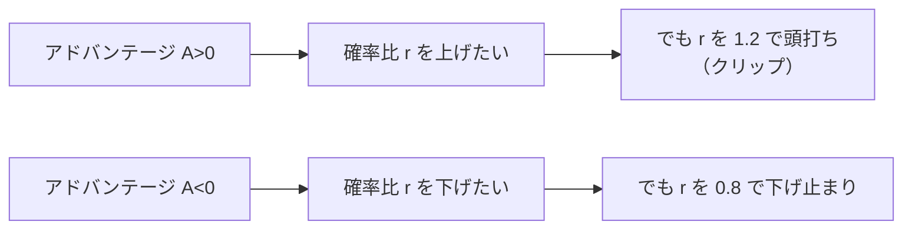

# 02. 方策勾配とPPO

## この章でわかること

- 「方策をどうやって良くするか」の基本原理（方策勾配定理）
- アドバンテージ、GAE という実用的な推定法
- PPO がなぜ RL の定番なのか、その仕組み（クリップ付き目的関数）
- 本論文が PPO を使う理由

## 前提

- 第01章（状態・行動・報酬・方策・価値・アドバンテージ）

---

## 1. 問題: 方策のパラメータをどう更新するか

方策 $\pi_\theta$ は、パラメータ $\theta$（ニューラルネットの重み）で決まります。私たちがやりたいのは、**期待収益を最大化する $\theta$ を見つける**ことです。

$$
\max_\theta\ J(\theta) = \mathbb{E}_{\tau \sim p(\tau|\pi_\theta)}\!\left[\sum_{t=0}^{T-1} \gamma^t r_t\right]
$$

ここでの障害は、報酬が**行動の結果として間接的に**決まることです。「この重みをちょっと変えたら、報酬がどう変わるか」をどうやって知るのでしょうか。

## 2. 方策勾配定理 — 「良かった行動の確率を上げる」

答えは驚くほどシンプルです。

> **うまくいった（アドバンテージが正の）行動は、その確率を上げる。まずくいった行動は、確率を下げる。**

これを定式化したのが**方策勾配定理**です。

$$
\nabla_\theta J(\theta)
= \mathbb{E}_{\tau \sim p(\tau|\pi_\theta)}\!\left[\sum_{t=0}^{T-1} \nabla_\theta \log \pi_\theta(a_t \mid s_t)\ \hat{A}_t\right]
$$

読み方は次の通りです。

- $\nabla_\theta \log \pi_\theta(a_t \mid s_t)$ … 「その行動の確率を上げる向き」
- $\hat{A}_t$ … その行動がどれだけ良かったか（アドバンテージの推定値）
- 掛け算して足す … 良かった行動の確率を上げる方向に $\theta$ を動かす

アドバンテージが正なら「その行動の確率 $\log\pi$ を増やす」方向に、負なら減らす方向に勾配が流れます。これが RL の心臓部です。

直感: ゲームで「勝てたプレイの選択を少し増やし、負けたプレイの選択を少し減らす」ことを、確率の世界で行っています。

## 3. アドバンテージの推定 — GAE

$\hat{A}_t$ の推定には工夫が要ります。素朴には $A_t = Q(s_t,a_t) - V(s_t)$ ですが、$Q$ を直接学ぶのは分散が大きく不安定です。そこで使うのが **GAE（Generalized Advantage Estimation）** です。

まず、1ステップごとの「予想外れ」を**TD誤差**と呼びます。

$$
\delta_t = r_{t+1} + \gamma V(s_{t+1}) - V(s_t)
$$

- 「実際に得た報酬＋次の状態の価値」と「今の状態の価値の予想」の差。
- プラスなら「思ったより良かった」。

GAE は TD誤差を複数ステップ分、指数関数的に重み付けして足します。

$$
\hat{A}_t^{\text{GAE}(\gamma,\lambda)}
= \sum_{l=0}^{\infty} (\gamma\lambda)^l\, \delta_{t+l}
$$

- $\lambda \in [0,1]$ … バイアスと分散のトレードオフを決める。
  - $\lambda = 0$ … 1ステップ TD誤差のみ（バイアス大、分散小）
  - $\lambda = 1$ … モンテカルロに近い（バイアス小、分散大）
- 実用上は $\lambda \approx 0.95$ がよく使われます。

逆順に計算できるので実装は簡単です。

```pseudo
# バッファを後ろから走査して GAE を計算する
gae = 0
for t = T-1 downto 0:
    delta = r[t] + gamma * V(s[t+1]) * (1 - done[t]) - V(s[t])
    gae   = delta + gamma * lambda * (1 - done[t]) * gae
    A[t]  = gae
    Return[t] = A[t] + V(s[t])   # 価値関数の教師信号
```

## 4. 価値関数の学習

価値関数 $V_\phi(s)$ は、実際に得られた収益に近づくように学習します。教師あり回帰と同じです。

$$
\min_\phi\ \mathbb{E}\!\left[\big(V_\phi(s_t) - \hat{G}_t\big)^2\right]
$$

ここで $\hat{G}_t = \hat{A}_t + V(s_t)$ は「実績ベースの収益の推定」です。価値関数が正確だと GAE も正確になり、方策更新が安定します。

## 5. 素朴な方策勾配の問題点

方策勾配をそのまま使うと、更新幅の調整が難しく、**1回の更新で方策が壊れる**ことがあります。方策が大きく変わると、集めたデータがもう「古い方策のデータ」になり、勾配の前提（今の方策でサンプルした）が崩れるからです。

そこで「**一度に大きく変えすぎない**」という制約を入れるのが PPO です。

## 6. PPO の考え方 — クリップ付き目的関数

PPO（Proximal Policy Optimization, Schulman et al. 2017）は、新旧の方策の比を導入します。

$$
r_t(\theta) = \frac{\pi_\theta(a_t \mid s_t)}{\pi_{\theta_{\text{old}}}(a_t \mid s_t)}
$$

- $r_t(\theta) = 1$ … 新旧でその行動の確率が同じ
- $r_t(\theta) > 1$ … 新方策のほうがその行動を選びやすい

この比を使って、次の目的関数を**最大化**します。

$$
L^{\text{CLIP}}(\theta) = \mathbb{E}_t\!\left[\min\Big(r_t(\theta)\hat{A}_t,\ \ \mathrm{clip}\big(r_t(\theta), 1-\epsilon, 1+\epsilon\big)\hat{A}_t\Big)\right]
$$

- $\epsilon$ … クリップ幅（例: 0.2）。比を $[1-\epsilon, 1+\epsilon]$ に制限する。
- $\min$ … 良くなる方向でも「クリップを超えると得しない」ようにする。

直感: アドバンテージが正の行動の確率を上げたいが、**一度に $\epsilon$ 以上は上げさせない**。逆に負なら下げるが、これも制限する。これで「行き過ぎ」を防ぎます。



## 7. 完全な PPO の目的関数

実際には、価値関数の損失と、探索を保つためのエントロピー項を足します。

$$
L(\theta, \phi) = \underbrace{L^{\text{CLIP}}(\theta)}_{\text{方策}}
- c_1 \underbrace{\big(V_\phi(s_t) - \hat{G}_t\big)^2}_{\text{価値関数}}
+ c_2 \underbrace{\mathcal{H}\big[\pi_\theta(\cdot\mid s_t)\big]}_{\text{エントロピー（探索）}}
$$

- $c_1$ … 価値関数の重み（例: 0.5）
- $c_2$ … エントロピーの重み（例: 0.001）。大きいほど探索的。
- $\mathcal{H}$ … エントロピー。行動のばらつき（不確かさ）の大きさ。

価値関数の項がマイナスなのは、損失を**最小化**したいからです（$-(\text{誤差})$ を最大化＝誤差を最小化）。

## 8. PPO のアルゴリズム全体

```pseudo
初期化: 方策 π_θ, 価値関数 V_φ
for イテレーション = 1..N:
    # 1) 現方策でデータを集める（並列環境でまとめて）
    for env in 並列環境 (例: 4096個):
        s[env] を初期化
    ロールアウトを T ステップ分ためる
    for t = 1..T:
        a = π_θ(·|s) をサンプルして環境を step
        バッファに (s, a, r, s', done) を記録
    # 2) アドバンテージを計算（GAE）
    A, Return = compute_gae(バッファ, V_φ)
    # 3) 数エポック、ミニバッチで更新
    for epoch = 1..K:
        for minibatch in バッファをシャッフル:
            L = PPO目的関数（クリップ付き）
            θ, φ を勾配で更新
    # 4) 目的のため古い確率比の基準を更新
    π_old ← π_θ
```

ポイントは「**同じデータで何度も（K エポック）更新する**」ことです。これは PPO がサンプル効率を高める仕組みで、クリップがあるからこそ複数回の更新が安全になります。

## 9. なぜ本論文は PPO を使うのか

- **安定性**: 物理キャラクタの制御は報酬が暴れやすく、更新が不安定だと即転倒する。PPO のクリップが効く。
- **並列化との相性**: IsaacGym のような並列シミュレータで大量にサンプルを集め、まとめて更新する流れが自然。
- **実績**: AMP（Peng et al. 2021）をはじめ、物理キャラクタ制御のデファクト標準。

本論文の学習ループは「PPO で方策と価値関数を更新しつつ、識別器も同時に更新する」という形になります（識別器は第04〜05章）。

## 10. 学習がうまくいかないときの勘所

| 症状 | よくある原因 | 対処 |
| --- | --- | --- |
| 報酬が全く上がらない | 報酬設計ミス、状態に必要情報がない | 報酬を見直す、状態を増やす |
| 途中まで上がって急落 | 更新が大きすぎる | 学習率↓、クリップ幅↓、エポック数↓ |
| カクカクした動き | 報酬ハッキング、自然さの欠如 | スタイル報酬を入れる（AMP） |
| 学習が遅い | サンプル不足、並列数不足 | 並列環境を増やす |

## まとめ

- 方策勾配定理: 「良い行動の確率を上げる」方向にパラメータを動かす。
- アドバンテージは GAE で安定に推定する（$\lambda \approx 0.95$）。
- 価値関数は収益を回帰で学ぶ。正確だと学習が安定する。
- PPO は確率比をクリップして「一度に変えすぎない」ようにする。定番で強力。
- 本論文は PPO を土台に、識別器によるスタイル報酬（AMP）を加える。

## 演習

1. クリップ幅 $\epsilon = 0.2$ のとき、確率比 $r$ はどの範囲に制限されるか述べましょう。
2. アドバンテージが正の行動について、確率比が $1+\epsilon$ を超えたとき、クリップ付き目的関数はどちらの値（$r\hat{A}$ か $\mathrm{clip}(r)\hat{A}$）を選ぶか、理由とともに答えましょう（ヒント: $\min$ の働き）。
3. GAE で $\lambda = 0$ と $\lambda = 1$ のとき、それぞれ何に近づくか述べましょう。

---

次章: [03. 模倣学習](03_模倣学習.md) ／ 前章: [01. 強化学習の基礎](01_強化学習の基礎.md)
