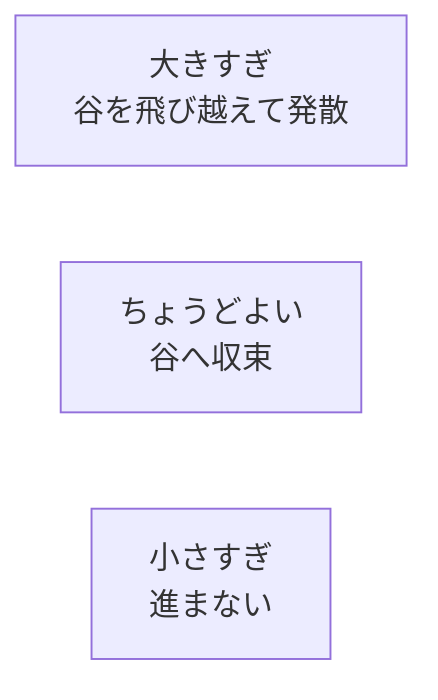
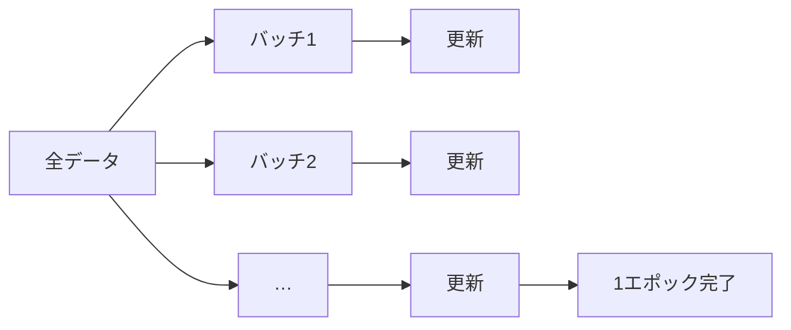

# 03. ニューラルネットと学習 — 関数をデータから作る

## この章でわかること

- ニューラルネットは「複雑な関数をデータから作る道具」であること
- ニューロン・層・MLP（多層パーセプトロン）の仕組み
- 損失関数（MSE・クロスエントロピー）の選び方
- ミニバッチ学習・学習率・エポック
- 過学習と検証データ

## 前提

- 第02章（テンソルと自動微分、学習ループの型）
- 第01章（配列の形）

## つながり

- 全結合ネットワーク（MLP）は、**方策 $\pi$・価値関数・識別器**（第14〜19章）そのものです。
- 損失と学習の考え方は、拡散モデル（第08章）にも共通します。

---

## 1. ニューラルネットは「関数あてはめ」

ニューラルネットの本質は、**入力から出力への複雑な関数を、データから作る**ことです。


- $\theta$ … パラメータ（重みとバイアス）。これが学習で調整されます。
- 「データに合うように $f$ を調整する」＝パラメータを勾配降下で更新する（第02章）。

ゲームエンジニアのたとえ: 「複雑な当たり判定や AI の判断を、if 文で書く代わりに、データに合うように自動調整される関数にやらせる」イメージです。

## 2. ニューロン — 重み付き和と活性化

1つのニューロンは、**重み付きの和を取って、非線形関数（活性化関数）を通す**だけです。

$$
y = \text{act}\!\left(\sum_i w_i x_i + b\right)
$$

- $w_i$ … 重み、$b$ … バイアス、$\text{act}$ … 活性化関数。
- これは `nn.Linear` ＋ 活性化関数にほかなりません。

```python
h = torch.relu(x @ W.T + b)    # 全結合層 ＋ ReLU
```

### 活性化関数はなぜ要るのか

活性化関数がないと、層を重ねても結局「1つの線形関数」にしかなりません。非線形を挟むことで、**複雑な曲線・境界**を表現できるようになります。

| 活性化関数 | 式のイメージ | 使う場面 |
| --- | --- | --- |
| ReLU | $\max(0, x)$ | 隠れ層の標準。物理キャラの RL でも主流 |
| Tanh | $-1$〜$1$ に圧縮 | 出力を範囲制限したいとき |
| Sigmoid | $0$〜$1$ に圧縮 | 二値分類、確率（識別器） |
| Softmax | 合計1の確率 | 多クラス分類 |

> 論文のネットワークも ReLU を使います（第24章）。物理キャラ制御では ReLU が定番です。

## 3. MLP（多層パーセプトロン）

ニューロンを層状に並べたのが MLP です。論文本体のネットワーク構成もこれです。


```python
class MLP(nn.Module):
    def __init__(self, in_dim, hidden=(64, 64), out_dim=1):
        super().__init__()
        layers = []
        prev = in_dim
        for h in hidden:
            layers += [nn.Linear(prev, h), nn.ReLU()]
            prev = h
        layers.append(nn.Linear(prev, out_dim))
        self.net = nn.Sequential(*layers)

    def forward(self, x):
        return self.net(x)
```

> 論文の構成は隠れ層 {1024, 512} でした。**大きいほど表現力は上がるが、学習は遅く・過学習しやすくなる**、というトレードオフがあります。

## 4. 損失関数 — 「どれだけ間違っているか」

学習には「間違いの大きさ」を測る**損失関数**が要ります。目的によって選びます。

| 損失 | 使う場面 | 式のイメージ |
| --- | --- | --- |
| 平均二乗誤差 (MSE) | 数値の予測（回帰） | $(\hat y - y)^2$ の平均 |
| クロスエントロピー | 分類、確率 | $-\log(\text{正解の確率})$ |

```python
# 回帰（数値を当てる）
loss = nn.functional.mse_loss(y_pred, y_true)

# 二値分類（識別器など）
loss = nn.functional.binary_cross_entropy_with_logits(logits, labels)  # 0/1

# 多クラス分類
loss = nn.functional.cross_entropy(logits, labels)   # labels は整数
```

> **つながり**: 敵対的学習の識別器（第07章）は二値分類なので、`binary_cross_entropy_with_logits` を使います。拡散モデル（第08章）は「ノイズを当てる回帰」なので MSE を使います。

## 5. 勾配降下法 — 損失を下げる

損失 $L(\theta)$ を小さくするには、勾配 $\nabla_\theta L$ の逆向きにパラメータを動かします。

$$
\theta \leftarrow \theta - \eta\, \nabla_\theta L(\theta)
$$

- $\eta$ … **学習率**（1回の更新でどれだけ動くか）。
- 学習率が大きすぎると発散、小さすぎると進まない。



## 6. ミニバッチ学習

全データで勾配を計算するのは重いので、**少しずつ（ミニバッチ）**で計算します。

```python
for epoch in range(num_epochs):
    for batch in make_batches(data, batch_size=64):
        x, y = batch
        loss = loss_fn(net(x), y)
        optimizer.zero_grad()
        loss.backward()
        optimizer.step()
```

用語:

- **バッチサイズ** … 1回の更新に使うサンプル数（例: 64）。
- **イテレーション** … 1回の更新。
- **エポック** … 全データを1周すること。



ミニバッチは「計算が軽い」だけでなく、**勾配にランダムさが入り、局所解を抜けやすくなる**という利点もあります。

## 7. 過学習と検証データ

モデルが**訓練データを丸暗記**してしまい、新しいデータで失敗することを**過学習**と呼びます。


対策:

- **データを訓練用と検証用に分ける**（例: 8:2）。検証損失が下がらなくなったら止める。
- モデルを小さくする、正則化（重みの大きさに罰則）を入れる。
- データを増やす。

```python
n = len(dataset)
n_train = int(n * 0.8)
train_data, val_data = dataset[:n_train], dataset[n_train:]
```

> **つながり**: 物理キャラの RL（第17章）や拡散モデル（第09章）でも、訓練と評価を分けて過学習を監視します。

## 8. 学習の実例 — 曲線を当てる

$y = \sin(x)$ を MLP で近似してみます（回帰）。

```python
import torch, torch.nn as nn

x = torch.linspace(-3, 3, 200).unsqueeze(1)     # (200, 1)
y = torch.sin(x)

net = MLP(in_dim=1, hidden=(64, 64), out_dim=1)
opt = torch.optim.Adam(net.parameters(), lr=1e-2)

for epoch in range(2000):
    pred = net(x)
    loss = nn.functional.mse_loss(pred, y)
    opt.zero_grad(); loss.backward(); opt.step()
    if epoch % 500 == 0:
        print(epoch, loss.item())
```

学習が進むと、MLP が $\sin$ の形を再現します。**これがニューラルネットの力**です（複雑な関数をデータから作れる）。

## 9. 実装コード

- `src/ml_lern/foundations/nn_basics.py`
  - `train_linear_regression()` … 線形回帰
  - `train_mlp_sine()` … $\sin$ の近似
  - `train_classifier()` … 簡単な分類

```bash
uv run python scripts/f02_mlp.py
```

## 10. つまずきやすいポイント

| 症状 | 対処 |
| --- | --- |
| 損失が下がらない | 学習率、モデルサイズ、入力の正規化を見直す |
| 損失が `nan` | 学習率を下げる、`log(0)` を避ける |
| 訓練は下がるが検証が悪化 | 過学習。データを増やす・モデルを小さくする |
| 入力のスケールがバラバラ | 正規化する（第04章） |

## まとめ

- ニューラルネットは「複雑な関数をデータから作る道具」。MLP が基本形。
- 活性化関数（ReLU 等）で非線形性を持たせる。
- 損失（MSE・クロスエントロピー）を勾配降下で下げる。
- ミニバッチで学習し、検証データで過学習を監視する。
- この MLP が、後の方策・価値関数・識別器の原型。

## 手を動かそう

> **一歩目**: 自分のゲームのデータ（例: レベルと必要経験値の表）を MLP に学習させ、表にないレベルを予測させる。

```python
import torch, torch.nn as nn
level = torch.linspace(1, 50, 50).unsqueeze(1)
exp = 100 * level**1.5                        # 仮の成長曲線
net = nn.Sequential(nn.Linear(1,64), nn.ReLU(), nn.Linear(64,64), nn.ReLU(), nn.Linear(64,1))
opt = torch.optim.Adam(net.parameters(), lr=1e-2)
for _ in range(3000):
    loss = ((net(level/50) - exp/exp.max())**2).mean()
    opt.zero_grad(); loss.backward(); opt.step()
print("レベル37の予測:", net(torch.tensor([[37/50]])).item() * exp.max())
```

**いじってみる**: 隠れ層を `(4,4)` にすると曲線が合いにくくなる。入力の正規化（`/50`, `/max`）を外すと学習が乱れる。過学習を見るため、訓練と検証に分ける。

**夢が広がる**:
- 敵 AI のパラメータ（反応速度・精度）を、プレイヤーの腕前に合わせて自動調整する。
- 手書きのダメージカーブを、データから滑らかにフィットさせる。
- レベルデザインのパラメータを、目標の難易度曲線に合わせて最適化する。

## 演習

1. $\sin$ の近似で、隠れ層を `(4, 4)` にすると結果はどう変わるか試しましょう。
2. 学習率を 1.0 にすると損失がどうなるか観察しましょう。
3. MSE とクロスエントロピーは、それぞれどんなタスクで使うか説明しましょう。
4. 訓練データと検証データを分け、過学習が起きる様子を観察しましょう。

---

次章: [04. 時系列データの扱い](04_時系列データの扱い.md) ／ 前章: [02. PyTorch の基礎](02_PyTorchの基礎.md)
