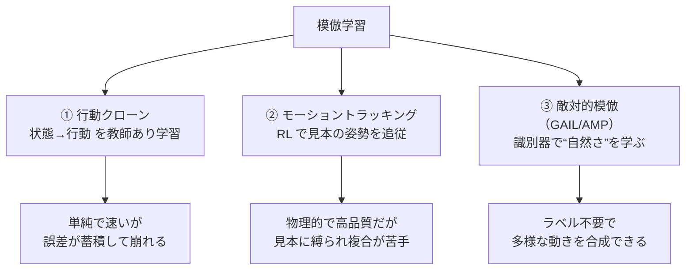

# 03. 模倣学習 — 見本の動きを真似させる

## この章でわかること

- 模倣学習（imitation learning）とは何か、なぜ使うか
- 行動クローン（behavior cloning）の仕組みと限界
- モーショントラッキング（DeepMimic 系）の発想
- GAIL（敵対的模倣学習）の考え方と、AMP への橋渡し

## 前提

- 第01章・第02章（RL の基本とPPO）

---

## 1. なぜ「報酬だけ」では足りないのか — 自然さの問題

第01章で触れたように、「前に進めば報酬」だけを与えると、キャラクタは跳ねたり転げたりしながら進む奇妙な動きを獲得します。目的地には着くけれど、**人間らしくない**。ゲームで使うには困ります。

「自然な動き」を報酬で細かく指定するのは至難の業です。手・足・体幹の連動、関節の可動域、重心の移動……これらを式で書くのは現実的ではありません。

そこで発想を変えます。

> **自然な動きの見本（モーションデータ）を用意し、それを真似させる。**

これが**模倣学習**です。MoCap のクリップやアニメーターが作った動きを「お手本」として与え、キャラクタに再現させます。

## 2. 3つの立場を整理する

模倣の方法は大きく3つに分かれます。本論文はこのうち 3 番目を発展させたものです。

## 3. 行動クローン（Behavior Cloning）

最も単純な模倣です。「見本の状態 $s$ での行動 $a$ をそのまま教師として、方策 $\pi_\theta(a\mid s)$ を教師あり学習する」だけです。

$$
\min_\theta\ \mathbb{E}_{(s,a)\sim \mathcal{D}}\!\left[-\log \pi_\theta(a\mid s)\right]
$$

- $\mathcal{D}$ … 見本の（状態, 行動）ペアの集合

ゲームエンジニアには親しみやすい発想でしょう。入力を記録して再生する「ゴーストカーデータ」に似ています。

### 限界: 誤差の蓄積（covariate shift）

行動クローンは、**見本にない状態**に弱いという致命的な弱点があります。

ゲームのたとえ: レースのゴーストカーは、コースから少し外れると立て直せません。見本には「外れた状態」が記録されていないからです。物理シミュレーションではこの崩れが転倒に直結します。

## 4. モーショントラッキング — RL で見本を追いかける

誤差蓄積への対策として、**強化学習で見本の姿勢を追従**させます。本論文の比較対象である **DeepMimic**（Peng et al. 2018）が代表例です。

> Xue Bin Peng, Pieter Abbeel, Sergey Levine, Michiel van de Panne.
> **DeepMimic: Example-Guided Deep Reinforcement Learning of Physics-Based Character Skills.**
> ACM TOG 37(4), 2018. <https://arxiv.org/abs/1804.02717>

やり方は、各時刻で「見本の関節角」と「今の関節角」の差を報酬にします。

$$
r_t^{\text{track}} = w_p\, r^{\text{pose}}_t + w_v\, r^{\text{vel}}_t + \cdots
$$

- $r^{\text{pose}}_t$ … 見本の姿勢にどれだけ近いか（例: 関節角の差の指数関数）
- $r^{\text{vel}}_t$ … 見本の関節速度にどれだけ近いか

**RL を使う理由**: 見本から外れた状態でも「見本に戻る」ように学習できる（誤差蓄積に強い）。**強い利点**です。DeepMimic は宙返りなど難度の高い技も再現します。

### 限界: 「1つの見本」への縛り

モーショントラッキングは、基本的に**1つの参照モーションに忠実**に追従します。そのため、

- 歩く→座る→立つ、のように**複数の技を切り替える**のが苦手。
- 新しい状況（いつもと違う高さの椅子など）に柔軟に適応しにくい。

複合的なタスク（本論文の sit / carry）には、追従のもっと緩い仕組みが欲しくなります。

## 5. GAIL — 敵対的模倣学習

そこで登場するのが **GAIL（Generative Adversarial Imitation Learning, Ho & Ermon 2016）** です。

> Jonathan Ho, Stefano Ermon.
> **Generative Adversarial Imitation Learning.**
> NeurIPS 2016. <https://arxiv.org/abs/1606.03476>

発想: **見本とそっくりな動きを生成するよう、識別器を使って方策を導く。**

- **識別器 $D$**: 「この（状態, 次の状態）の遷移は、見本のものか、方策が生成したものか」を見分ける。
- **方策 $\pi$**: 識別器を騙して「見本っぽい」と判定させる。その度合いが報酬になる。

GAN（第04章）を RL に移植した形です。行動クローンの「教師あり」ではなく、「**本物らしさを報酬として競わせる**」わけです。

### GAIL の報酬

方策への報酬は、識別器の出力から作ります。

$$
r^{\text{style}}_t = -\log\!\big(1 - D(s_t, s_{t+1})\big)
$$

- $D \to 1$ … 識別器が「見本っぽい」と判定 → 報酬が大きい
- $D \to 0$ … 「偽物っぽい」と判定 → 報酬が小さい（$-\log(1-0) = 0$）

これが本論文の**スタイル報酬 $r^S$** の原型です（式(6)）。第05章・第08章で詳しく扱います。

## 6. GAIL の利点: 「1つの動き」からの解放

GAIL がモーショントラッキングと大きく違うのは、**特定のクリップに追従しない**点です。

> 見本の**分布の中に**あればよい。クリップAの時刻10秒目でなくても、クリップBの歩き方でも、自然ならOK。

これにより、

- 歩く・座る・待つを**自由にブレンド**できる。
- 見本にない中間姿勢（移行）も自然に生成できる。
- ラベル付けが要らない（どのクリップがどの技か、を教えなくてよい）。

これが「**多様なスキルを組み合わせる**」ことを可能にし、本論文の sit / carry のような複合タスクに効きます。

## 7. 本論文の位置づけ

整理しておきます。

| 手法 | 見本の使い方 | 弱点 |
| --- | --- | --- |
| 行動クローン | 状態→行動を教師あり学習 | 誤差蓄積 |
| モーショントラッキング | 1つの見本に追従 | 複合・適応が苦手 |
| GAIL / AMP | 見本の分布に似せる | 環境・物体の条件付けが必要 |

本論文は **GAIL の系譜（AMP）** を土台に、「**シーン（物体）も識別器と方策に条件付ける**」ことで、キャラクタ―シーン相互作用へ拡張します。まさにこの章の延長線上にあります。

## 8. 用語の注意: 「報酬」が2種類ある

ここで混乱しやすい点を先に整理します。この後、報酬という言葉が2つの意味で出てきます。

- **タスク報酬 $r^G$**: 「座れたか」「目的地に運べたか」など、**目的達成**の報酬（人間が設計）。
- **スタイル報酬 $r^S$**: 「動きが自然か」を識別器が判定した報酬（見本から学習）。

本論文はこの2つを重み付きで足します（式(1)、第08章）。

$$
r_t = w^G\, r^G(\cdot) + w^S\, r^S(\cdot)
$$

タスク報酬だけだと不自然、スタイル報酬だけだと目的を果たさない。両方必要、というのが勘所です。

## まとめ

- 模倣学習は「自然さ」を報酬設計で書く代わりに、見本から学ぶ。
- 行動クローンは単純だが誤差が蓄積する。モーショントラッキングは頑健だが複合が苦手。
- GAIL は識別器で「本物らしさ」を報酬化し、見本の分布に似せる。1つのクリップに縛られない。
- 本論文は GAIL/AMP をシーン（物体）へ拡張する。タスク報酬とスタイル報酬を足し合わせる。

## 演習

1. 行動クローンの誤差蓄積を、レースゲームのゴーストカーに例えて説明してみましょう。
2. モーショントラッキングが「新しい高さの椅子」に弱いのはなぜか、見本との関係で述べましょう。
3. GAIL のスタイル報酬 $r^{\text{style}}_t = -\log(1-D)$ が、$D=0.9$ と $D=0.1$ でそれぞれいくつになるか計算し、直感を確認しましょう。

---

次章: [04. 敵対的学習と識別器](04_敵対的学習と識別器.md) ／ 前章: [02. 方策勾配とPPO](02_方策勾配とPPO.md)
