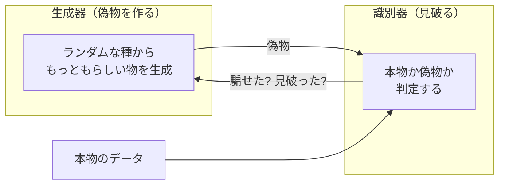

# 04. 敵対的学習と識別器

## この章でわかること

- GAN の基本的な仕組み（生成器と識別器のいたちごっこ）
- 識別器が「本物らしさ」を測るとはどういうことか
- 損失関数（クロスエントロピー）とロジットの読み方
- 勾配ペナルティという安定化テクニック
- なぜこれが「動きの自然さ」の学習に使えるのか

## 前提

- 第03章（模倣学習、GAIL の概要）

---

## 1. 敵対的学習のアイデア

**敵対的学習（adversarial learning）** の核心は、**2つのネットワークを競わせる**ことです。



- **識別器 $D$** は「本物と偽物を見分ける」ように訓練される。
- **生成器 $G$** は「識別器を騙せる偽物を作る」ように訓練される。

両者が競ううちに、生成器は本物と見分けがつかないものを作れるようになります。これが **GAN（Generative Adversarial Network, Goodfellow et al. 2014）** です。

> Ian Goodfellow, Jean Pouget-Abadie, Mehdi Mirza, Bing Xu, David Warde-Farley, Sherjil Ozair, Aaron Courville, Yoshua Bengio.
> **Generative Adversarial Networks.**
> NeurIPS 2014. <https://arxiv.org/abs/1406.2661>

## 2. 識別器の出力を読む

識別器 $D(x)$ は、入力 $x$ が「本物である確率」を 0〜1 で出力します。

| $D(x)$ | 意味 |
| --- | --- |
| $1$ に近い | 「本物だ」と判定 |
| $0.5$ | 判別不能（理想的なバランス） |
| $0$ に近い | 「偽物だ」と判定 |

内部では、$D$ はまず**ロジット**（実数）を出し、シグモイド関数で 0〜1 に潰しています。

$$
D(x) = \sigma(z) = \frac{1}{1 + e^{-z}}
$$

- $z$ … ロジット（生のスコア）。正で大きいほど「本物」。
- $\sigma$ … シグモイド。どんな実数も 0〜1 に変換。

ゲームエンジニア向けのたとえ: ロジットは「判定の自信度の生値」、シグモイドは「それを 0〜1 の確率に正規化する関数」です。内部のロジットのほうが勾配が扱いやすいため、実装では**ロジットのまま損失を計算**します（`BCEWithLogitsLoss` など）。

## 3. 識別器の損失 — クロスエントロピー

識別器を訓練するときの損失は次の通りです。

$$
\min_D\ \mathcal{L}_D = -\,\mathbb{E}_{x\sim p_{\text{data}}}\big[\log D(x)\big] - \mathbb{E}_{x\sim p_{\text{gen}}}\big[\log\big(1 - D(x)\big)\big]
$$

読み方:

- **第1項**: 本物 $x$ について、$D(x)$ を 1 に近づける（$\log D \to 0$）。本物を本物と正しく判定すると損が減る。
- **第2項**: 偽物 $x$ について、$D(x)$ を 0 に近づける（$\log(1-D) \to 0$）。偽物を偽物と判定すると損が減る。

これは「**二値分類のクロスエントロピー**」そのものです。本物にラベル1、偽物にラベル0を付けて、通常の分類問題として訓練しているのと同じです。

## 4. 「本物らしさ」が報酬になる

ここが RL との接点です。識別器が「本物らしい」と判定するほど、方策に高い報酬を与えます（第03章の GAIL の式）。

$$
r^{\text{style}} = -\log\big(1 - D(x)\big)
$$

つまり、**識別器は“報酬関数を自動生成する装置”** と見なせます。「自然な動きの報酬を人間が書く」代わりに、「本物らしさを識別器が点数化する」わけです。

### 本論文での $x$ は何か

重要なのは、識別器に入れる $x$ を何にするかです。本論文では**状態遷移**を使います。

$$
x = (\mathbf{s}_t, \mathbf{s}_{t+1})
$$

- 時刻 $t$ の状態と、その次の状態のペア。
- 「姿勢がどう変化したか」＝動きの1コマ分を表す。

本論文の識別器はこれに**物体の情報も含む**点が新しい（第08章）。「椅子があるときの座る動き」と「椅子がないときのその動き」を区別できるようにするのです。

## 5. 敵対的学習の難しさ

GAN は強力ですが、訓練が不安定という有名な弱点があります。

- **モード崩壊**: 生成器が多様性を失い、同じ出力ばかり作る。
- **振動・発散**: 2つのネットワークが競うため、収束しにくい。
- **勾配の消失**: 識別器が強すぎると、生成器に有益な勾配が流れなくなる。

## 6. 安定化テクニック: 勾配ペナルティ

本論文（と AMP）が使う安定化が **勾配ペナルティ（gradient penalty, Mescheder et al. 2018）** です。

> Lars Mescheder, Andreas Geiger, Sebastian Nowozin.
> **Which Training Methods for GANs do actually Converge?**
> ICML 2018. <http://proceedings.mlr.press/v80/mescheder18a.html>

識別器の出力が、入力のわずかな変化で激しく変わらないように、**勾配の大きさに罰則**を加えます。

$$
w^{\text{gp}}\ \mathbb{E}_{x}\!\left[\big\|\nabla_x D(x)\big\|^2\right]
$$

- $\nabla_x D(x)$ … 入力 $x$ を少し動かしたとき、識別器の出力がどれだけ変わるか。
- これを小さく保つ（平坦にする）ことで、判定が不安定になるのを防ぐ。

直感: 「判定の境界があまりカクカクしないように」平滑化する。これが学習を安定させます。本論文の式(5)がこれに当たります。

## 7. なぜ「偽物」が方策の出力なのか

ここまでの話を、RL の文脈に接続します。

| GAN の用語 | 本論文（AMP）での対応 |
| --- | --- |
| 本物のデータ $p_{\text{data}}$ | モーションデータセット（MoCap）の状態遷移 |
| 生成器 $G$ | 方策 $\pi$（キャラクタの動きを生成） |
| 偽物 $p_{\text{gen}}$ | 方策が生み出した状態遷移 |
| 識別器 $D$ | 本物らしさを判定するネットワーク |
| 「本物らしさ」 | スタイル報酬 $r^S$ |

つまり、**方策は「生成器」として、識別器を騙すように動きを洗練させる**。これが敵対的模倣学習です。

## 8. 実装のまとめ（擬似コード）

```pseudo
# 識別器 D と 方策 π を用意
for イテレーション:
    # --- 識別器の更新 ---
    x_real = モーションデータからランダムに (s_t, s_{t+1}) を取る
    x_fake = 方策のロールアウトから (s_t, s_{t+1}) を取る
    loss_D = -mean(log(sigmoid(D(x_real))))        # 本物を1に
             -mean(log(1 - sigmoid(D(x_fake))))    # 偽物を0に
             + w_gp * 勾配ペナルティ(D)             # 平滑化
    D ← D - lr * grad(loss_D)
    # --- 方策の更新（スタイル報酬を利用） ---
    for 各ステップ:
        r_style = -log(1 - sigmoid(D(s_t, s_{t+1})))
        r = w_G * r_task + w_S * r_style
    方策を PPO で更新（第02章）
```

識別器と方策を**交互に**更新するのがポイントです。どちらか一方だけを極端に訓練すると崩れます。

## まとめ

- 敵対的学習は生成器と識別器を競わせる。識別器は本物/偽物を二値分類する。
- 識別器の出力から「本物らしさ」を報酬として取り出せる（スタイル報酬）。
- 勾配ペナルティで識別器を平滑化し、訓練を安定させる。
- AMP では、方策＝生成器、モーションデータ＝本物、識別器＝自然さの判定者。

## 演習

1. 識別器 $D$ が「本物」に出力 0.9、「偽物」に出力 0.1 を出したとき、それぞれのクロスエントロピー損失を計算し、正しく判定できているほど損失が小さいことを確かめましょう。
2. モード崩壊を、ゲームの「敵の行動パターンが1種類しかない」状態に例えて説明してみましょう。
3. 勾配ペナルティが「判定境界をなめらかにする」とはどういうことか、2次元の散布図を思い浮かべて説明してみましょう。

---

次章: [05. Adversarial Motion Priors](05_Adversarial_Motion_Priors.md) ／ 前章: [03. 模倣学習](03_模倣学習.md)
