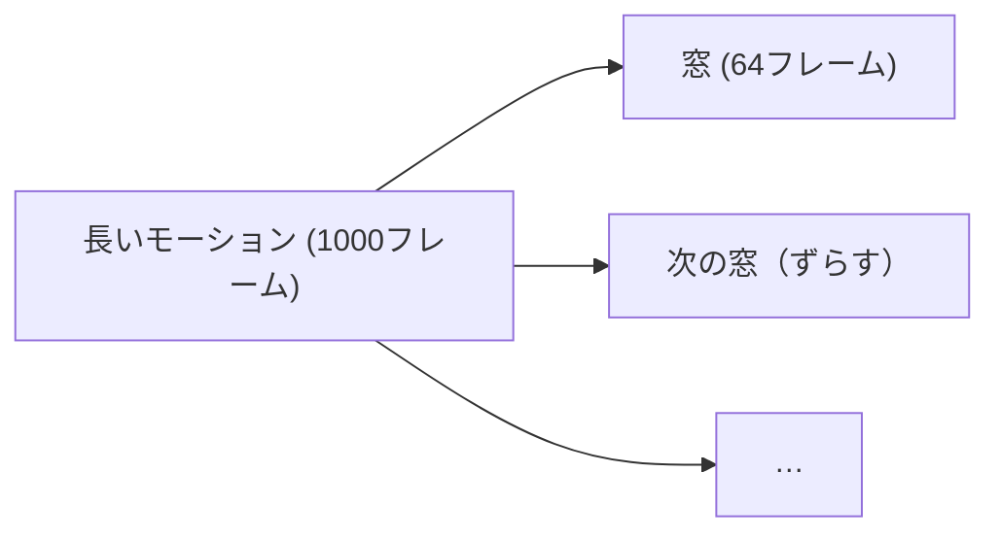
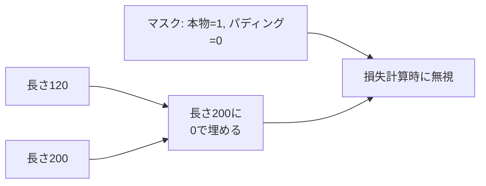

# 04. 時系列データの扱い — モーションは「時間」を持つ

## この章でわかること

- モーションを `(バッチ, 時間, 特徴)` の3次元で扱う理由
- フレームレート・サブサンプリング・窓（ウィンドウ）という概念
- 特徴ごとの正規化（スケール合わせ）
- 可変長データの扱い（パディングとマスク）
- データセットとミニバッチの作り方

## 前提

- 第01章（配列の形）、第03章（ミニバッチ学習）

## つながり

- この章のデータの形は、**拡散モデルによるモーション生成**（第08〜10章）でそのまま使います。
- 強化学習でも「ロールアウト＝時系列」（第17章）として同じ考え方が出てきます。

---

## 1. モーションは時間の系列

第01章で触れたとおり、アニメーションは**時系列データ**です。


- 1フレーム分の姿勢を**特徴ベクトル**（関節角など）にします。
- それが $T$ フレーム分並ぶと、1本のモーションになります。

```
単一モーション:  (T, F)          # Tフレーム、特徴F次元
バッチ:          (B, T, F)       # B本まとめて
```

| 記号 | 名前 | 意味 |
| --- | --- | --- |
| $B$ | batch | 同時に扱うモーションの本数 |
| $T$ | time | フレーム数（時間の長さ） |
| $F$ | feature | 1フレームの特徴量の次元 |

> **つながり**: 画像は `(C, H, W)`、動画は `(C, T, H, W)`。モーションは `(B, T, F)`。**時間の軸**があるのが決定的な違いです。

## 2. フレームレートとサブサンプリング

ゲームでおなじみの **fps（frames per second）** が、時系列データでも重要です。

- 60 fps のデータは 1秒に60フレーム。
- MoCap は 120 fps のこともある（高精細）。
- 学習では 30 fps に間引く（**サブサンプリング**）ことが多い（データ量削減・計算軽減）。

```python
# 120fps → 30fps に間引く（4フレームに1つ使う）
subsampled = motion[::4]
print(motion.shape, "->", subsampled.shape)   # (480, F) -> (120, F)
```

> 論文も MoCap を 30fps 相当に間引いています（第37章のリターゲット）。フレームレートを揃えるのは、複数データを混ぜるときの必須作業です。

## 3. 特徴ベクトルの中身

1フレームの特徴 $F$ は、何を入れるかで決まります。第01章の状態の話と同じです。

| 例 | 特徴 $F$ の中身 | 次元の目安 |
| --- | --- | --- |
| 関節角のみ | 各関節の回転 | 関節数 × 3〜6 |
| 位置＋速度 | 関節角＋関節速度 | 関節数 × 6〜12 |
| ルート込み | ルートの位置・向き＋関節 | +9 など |

```python
# 例: 22関節、各関節の回転(6D) + 角速度(3)
F = 22 * (6 + 3)     # 198
motion = torch.zeros(120, F)   # (120, 198)
```

> 「どこまでを特徴に入れるか」は、後の強化学習（第14章の状態設計）でも同じ問いです。入れる情報を変えると、学習の成否が変わります。

## 4. 正規化 — スケールを揃える

ニューラルネットは、入力のスケールがバラバラだと学習が不安定になります。**特徴ごとに正規化**します。

$$
\tilde{x} = \frac{x - \mu}{\sigma + \epsilon}
$$

- $\mu$ … 特徴ごとの平均、$\sigma$ … 標準偏差、$\epsilon$ … 0割り防止の小さな値。

```python
mean = data.mean(dim=(0, 1))     # バッチと時間をまたいで特徴ごとの平均
std = data.std(dim=(0, 1))
normalized = (data - mean) / (std + 1e-8)
```

**重要な注意**: 正規化の統計量（$\mu, \sigma$）は**訓練データから計算**し、検証・テストにも同じ値を使います。テストデータから計算すると「ズル」になります。

> **つながり**: シーン相互作用の論文でも、物体の位置と関節角でスケールが大きく違うため、特徴のスケール調整が重要でした（第36章）。

## 5. 窓（ウィンドウ）— 系列を切り出す

長いモーションを、学習しやすい長さの**窓**に切り出します。



```python
def make_windows(motion, window=64, stride=16):
    # (T, F) -> (num_windows, window, F)
    windows = []
    for start in range(0, len(motion) - window + 1, stride):
        windows.append(motion[start:start + window])
    return torch.stack(windows)
```

用途で長さを決めます。

- **拡散モデル**（第10章）: 軌道全体を1つの「データ」として扱うため、固定長の窓にする。
- **強化学習**（第14章）: エピソードを一定ステップずつサンプルする。

## 6. 可変長データ — パディングとマスク

モーションの長さはバラバラです。そのままでは `(B, T, F)` にまとめられません。そこで**パディング**（0埋め）と**マスク**（どこが本物か）を使います。



```python
def pad_batch(motions, max_len):
    padded = torch.zeros(len(motions), max_len, motions[0].shape[-1])
    mask = torch.zeros(len(motions), max_len)
    for i, m in enumerate(motions):
        n = len(m)
        padded[i, :n] = m
        mask[i, :n] = 1.0
    return padded, mask
```

- `mask` が 1 のところだけを損失に使う（パディングの 0 で学習しない）。
- ゲームの「可変長アニメのブレンド」に近い発想です。

## 7. データセットとミニバッチ

PyTorch にはデータをまとめて扱う仕組みがあります。

```python
from torch.utils.data import Dataset, DataLoader

class MotionDataset(Dataset):
    def __init__(self, windows):        # windows: (N, T, F)
        self.windows = windows

    def __len__(self):
        return len(self.windows)

    def __getitem__(self, i):
        return self.windows[i]

dataset = MotionDataset(windows)
loader = DataLoader(dataset, batch_size=32, shuffle=True)   # シャッフルしてバッチ化

for batch in loader:
    print(batch.shape)   # (32, 64, F)
```

- `Dataset` … 1サンプルを取り出す方法を定義。
- `DataLoader` … バッチ化・シャッフル・並列読み込みを担当。
- `shuffle=True` … 毎エポック順番を変える（過学習を防ぐ）。

> 時系列では、**シャッフルしてよいか**に注意します。モーションを独立なサンプルとして扱うなら OK ですが、時間的な順序に意味があるタスク（次フレーム予測など）では、シャッフルを工夫します。

## 8. 実装コード

- `src/ml_lern/foundations/timeseries.py`
  - `make_windows()` … 窓の切り出し
  - `normalize()` … 特徴ごとの正規化
  - `pad_batch()` … パディングとマスク
  - `MotionDataset` … データセット

```bash
uv run python scripts/f03_timeseries.py
```

## 9. つまずきやすいポイント

| 症状 | 対処 |
| --- | --- |
| 形が `(B, F, T)` と逆 | `transpose` で並べ替える。時間軸を明確に |
| 正規化で性能が落ちる | 統計量は訓練データのみから計算しているか確認 |
| パディングの0で学習してしまう | `mask` を損失に掛ける |
| fps の違うデータを混ぜると崩れる | フレームレートを揃える（サブサンプリング） |
| `DataLoader` が遅い | `num_workers` を増やす（CPU 環境では控えめに） |

## まとめ

- モーションは `(B, T, F)` の時系列。**時間の軸**が本質。
- fps を揃え、特徴ごとに正規化し、窓に切り出す。
- 可変長はパディング＋マスクで扱う。
- `Dataset`/`DataLoader` でミニバッチ化する。
- このデータの形が、拡散モデル（第09章）と強化学習（第17章）の共通土台。

## 演習

1. `(480, 198)` のモーションを 120fps → 30fps に間引くと、形はどうなりますか。
2. 特徴ごとの正規化で、統計量をテストデータから計算してはいけない理由を説明しましょう。
3. 3本のモーション（長さ 100, 150, 120、特徴 6）を `(3, 150, 6)` にパディングし、マスクを作るコードを書きましょう。
4. 窓の `stride` を大きくすると、サンプル数はどう変わりますか。

---

次章: [05. 系列モデル入門](05_系列モデル入門.md) ／ 前章: [03. ニューラルネットと学習](03_ニューラルネットと学習.md)
