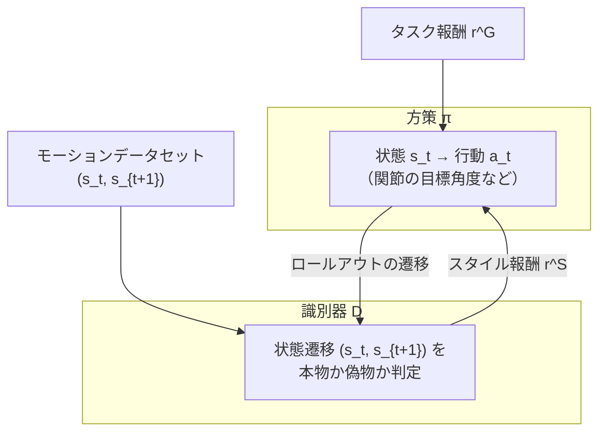

# 05. Adversarial Motion Priors (AMP)

## この章でわかること

- 本論文の土台である AMP（Adversarial Motion Priors）の全体像
- 識別器を「状態遷移」で訓練する理由
- スタイル報酬とタスク報酬の組み合わせ
- AMP の強み（ラベル不要・モーション合成）と限界（本論文が埋める穴）

## 前提

- 第02章（PPO）、第03章（模倣学習）、第04章（敵対的学習）

---

## 1. AMP とは

**AMP（Adversarial Motion Priors）** は、Peng et al. (2021) が提案した、物理キャラクタ制御のための模倣学習フレームワークです。

> Xue Bin Peng, Ze Ma, Pieter Abbeel, Sergey Levine, Angjoo Kanazawa.
> **AMP: Adversarial Motion Priors for Stylized Physics-Based Character Control.**
> ACM TOG 40(4), 2021. <https://arxiv.org/abs/2104.02180>
> プロジェクトページ: <https://xbpeng.github.io/projects/AMP/index.html>

一言で言うと:

> **「動きの自然さ」を、大規模でラベルなしのモーションデータから識別器で学ぶ。特定のクリップに縛られず、スキルを自律的にブレンド・遷移させる。**

「Motion Prior（動作の事前分布）」という名前は、「そのデータセットに典型的な動きの分布」を識別器が暗黙に学習する、という意味です。

## 2. AMP の構成

AMP は2つのネットワークからなります。



- **方策 $\pi$**: キャラクタを制御し、タスク報酬 $r^G$ を最大化しつつ、識別器を騙す。
- **識別器 $D$**: 状態遷移 $(s_t, s_{t+1})$ が、データセット由来か方策由来かを判定。

## 3. なぜ「状態遷移」を識別するのか

ここは本論文を理解する上で超重要なので、ていねいに説明します。

識別器の入力は「**連続する2フレームの状態のペア $(s_t, s_{t+1})$**」です。単一の状態 $s_t$ ではありません。理由はこうです。

- 単一の姿勢だけ見ても、「自然な動き」かどうかは判定できない。例えば「座った姿勢」は静止画なら自然だが、そこに至る過程が不自然かもしれない。
- **姿勢の“変化”（遷移）** を見ることで、「どう動いたか」を評価できる。

ゲームのたとえ: アニメーターが「この1フレームのポーズは変じゃない」と言っても、前後を再生すると「関節が瞬間移動している」ことがある。識別器はこの**動きの滑らかさ・力学的一貫性**を見ているのです。

これは**確率分布のマッチング**でもあります。識別器は「データセットの遷移の分布 $d^{\mathcal{M}}$」と「方策の遷移の分布 $d^{\pi}$」を区別しようとします。区別できないほど似ていれば、動きは自然です。

## 4. AMP のスタイル報酬

スタイル報酬は、識別器が「本物っぽい」と判定するほど大きくなります（第03・04章の式の再掲）。

$$
r^S(s_t, s_{t+1}) = -\log\big(1 - D(s_t, s_{t+1})\big)
$$

- 識別器が「偽物」と自信を持って判定（$D \to 0$）すると、報酬は $-\log(1) = 0$。
- 「本物」と判定（$D \to 1$）すると、$-\log(\epsilon) \to +\infty$ と大きくなる。

つまり、**データセットに似た動きほど、高いスタイル報酬**を得ます。

## 5. タスク報酬との組み合わせ

AMP でも、目的を果たすためのタスク報酬 $r^G$ は必要です。スタイル報酬だけでは「自然だが目的を果たさない」動きになります。

$$
r_t = w^G\, r^G(\mathbf{s}_t, \mathbf{g}_t, \mathbf{s}_{t+1}) + w^S\, r^S(\mathbf{s}_t, \mathbf{s}_{t+1})
$$

（本論文の式(1)と同形。$\mathbf{g}_t$ は目標）

- $w^G, w^S$ … 重み。タスク重視かスタイル重視かを調整。
- タスク報酬の設計は人間が行う（第12章で論文の具体例）。

## 6. 学習の流れ

AMP の学習を擬似コードでまとめます。

```pseudo
初期化: 方策 π, 価値関数 V, 識別器 D
モーションデータから観測 (s, s') を前計算しておく
for イテレーション:
    # 1) 方策でロールアウトを集める
    for 並列環境:
        一定ステップ 環境を進め、 (s, a, r_task, s') を保存
        (s, s') も識別器用に保存

    # 2) スタイル報酬を計算
    for 各サンプル:
        r_style = -log(1 - sigmoid(D(s, s')))
        r = w_G * r_task + w_S * r_style

    # 3) PPO で方策と価値関数を更新（第02章）

    # 4) 識別器を更新
    x_real = データセットから (s, s') をサンプル
    x_fake = ロールアウトから (s, s') をサンプル
    loss_D = -log(sigmoid(D(x_real))) - log(1 - sigmoid(D(x_fake)))
             + w_gp * 勾配ペナルティ(D)
    D ← 勾配で更新
```

## 7. AMP の強み

- **ラベル不要**: 「この部分は歩行、ここは座り」といったフェーズラベルが要らない。
- **スキルの自律合成**: 識別器は「データセット内の分布」しか見ないので、方策は自由にブレンド・遷移できる。歩く→座るを滑らかにつなげられる。
- **タスク適応**: タスク報酬を与えれば、自然さを保ったまま目的に近づく。
- **効率**: 大規模データから動きのスタイルを学べる。

## 8. AMP の限界 — 本論文が埋める穴

AMP は「キャラクタ単体」の動きを自然にします。しかし、**物体（シーン）** の扱いがありません。識別器は $(s_t, s_{t+1})$ しか見ないので、

- 「椅子のない場所で座る動き」でも、動き自体がデータセットに似ていれば「自然」と判定してしまう。
- 物体の存在・配置を考慮した判定ができない。

本論文の貢献はここにあります。


第08章で、識別器と方策の両方に**シーン文脈を条件付ける**方法を詳しく見ます。

## 9. AMP の発展形（参考）

AMP は多くの後続研究の基盤になっています。本論文もその1つです。

- **ASE（Adversarial Skill Embeddings, Peng et al. 2022）**: スキルを潜在空間に埋め込み、多様なスキルを制御。
- **CALM（Compositionally Augmented Latent Motion）**: 大規模モーションと潜在空間を組み合わせる。
- **MaskedMimic（Tessler et al. 2024）**: 部分的な目標から動きを統合。

これらはすべて「見本の分布に似せて、物理キャラを自然に動かす」という AMP の思想を共有しています。

## まとめ

- AMP は「動きの自然さ」を識別器で学ぶ模倣学習。ラベル不要でスキルを自律合成する。
- 識別器は状態遷移 $(s_t, s_{t+1})$ を本物/偽物に分類し、その出力がスタイル報酬になる。
- タスク報酬とスタイル報酬を重み付きで足し、PPO で方策を更新する。
- AMP は物体（シーン）を見ない。本論文はここに**シーン条件付け**を加える。

## 演習

1. AMP の識別器に単一の状態 $s_t$ ではなく遷移 $(s_t, s_{t+1})$ を入れる理由を、「アニメーションのポーズと動き」の違いに例えて説明しましょう。
2. スタイル報酬だけ・タスク報酬だけにした場合、それぞれどんな問題が起きるか述べましょう。
3. AMP が「椅子のない場所での座り」を自然と判定してしまう理由を、識別器の入力の観点から説明しましょう。

---

次章: [06. 物理キャラクタとPD制御](06_物理キャラクタとPD制御.md) ／ 前章: [04. 敵対的学習と識別器](04_敵対的学習と識別器.md)
