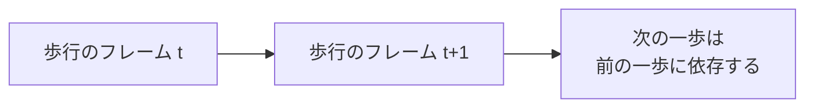
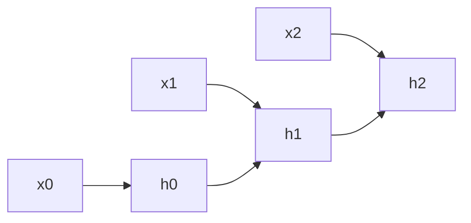
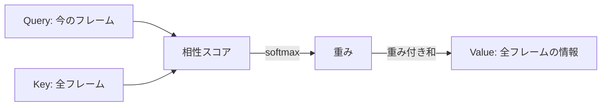
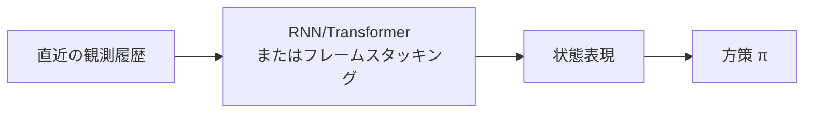

# 05. 系列モデル入門 — 時間の並びを扱うネットワーク

## この章でわかること

- 「順序」を扱うために必要な考え方
- RNN / LSTM の直感（隠れ状態で過去を覚える）
- 1次元 CNN で時間パターンを捉える
- Transformer / アテンションの基礎
- それぞれの使いどころと、モーション・制御への応用

## 前提

- 第03章（MLP と学習）、第04章（時系列データの形）

## つながり

- モーション生成（第10章）では、フレーム間のつながりをモデル化するのに系列モデルが使われます。
- 強化学習（第17章）でも、**直近の履歴**を状態に含めるため系列モデルが役立ちます。

---

## 1. なぜ MLP だけでは足りないのか

普通の MLP は、入力を**独立な1つのベクトル**として扱います。しかし時系列では、**順序**と**過去の影響**が重要です。



例: 「膝を曲げている」という1フレームだけ見ても、それが**振り上げ中**なのか**着地中**なのか分かりません。過去の流れ（文脈）が必要です。

MLP に「直前の数フレームをまとめて」入力する（**フレームスタッキング**）だけでもある程度対応できます。これはゲームでもよく使う手法です。

```python
# 直近4フレームをまとめて1入力にする
stacked = torch.cat([data[t-3], data[t-2], data[t-1], data[t]], dim=-1)
```

しかし、もっと長い依存を扱いたいときは、専用の**系列モデル**が便利です。

## 2. RNN — 隠れ状態で過去を覚える

**RNN（Recurrent Neural Network）** は、**隠れ状態 $h_t$** に過去の情報を要約しながら、1ステップずつ進みます。

$$
h_t = \tanh(W_x x_t + W_h h_{t-1} + b)
$$

- $x_t$ … 時刻 $t$ の入力（1フレーム分）。
- $h_{t-1}$ … 1つ前の隠れ状態（過去の記憶）。
- $h_t$ … 更新された記憶。



**直感**: 「今の見え方」＋「これまでの記憶」から「新しい記憶」を作る、を繰り返す。ゲームでいう「直近の入力履歴を内部状態に持つ有限状態機械」に近いです。

### LSTM / GRU

素の RNN は、長い系列で勾配が消えたり爆発したりします。これを改善したのが **LSTM** や **GRU** で、「何を覚え、何を忘れるか」をゲートで制御します。

```python
lstm = nn.LSTM(input_size=F, hidden_size=128, num_layers=2, batch_first=True)
out, (h, c) = lstm(x)     # x: (B, T, F) -> out: (B, T, 128)
```

- `batch_first=True` … 入力を `(B, T, F)` として扱う（第04章の形）。
- `h`, `c` … 最終的な隠れ状態とセル状態。

## 3. 1次元 CNN — 時間の局所パターン

**1次元 CNN（畳み込み）** は、時間方向の**局所的なパターン**を捉えます。

$$
y_t = \sum_{k=0}^{K-1} w_k\, x_{t+k}
$$

- $K$ … カーネル幅（何フレーム分見るか）。
- 「跳ねる」「止まる」といった短いパターンを検出するのに向きます。

```python
conv = nn.Conv1d(in_channels=F, out_channels=64, kernel_size=5, padding=2)
# 入力 (B, F, T) に注意: Conv1d は時間を最後の軸に取る
y = conv(x.transpose(1, 2))    # (B, F, T) -> (B, 64, T)
```

> 画像の CNN（2次元）を、時間の1次元にしたもの。物理キャラの AMP でも、参照モーションの特徴抽出に畳み込みを使う実装があります。

## 4. Transformer とアテンション — どこを見るかを学ぶ

**Transformer** は、系列の中の**どの部分に注目するか（アテンション）**を学習します。近年の画像・言語・モーション生成の主流です。

アテンションの核心は「各要素が、他のどの要素をどれだけ参照するか」を計算することです。

$$
\text{Attention}(Q, K, V) = \text{softmax}\!\left(\frac{QK^\top}{\sqrt{d}}\right) V
$$

- $Q$（Query）… 「私は何を探しているか」
- $K$（Key）… 「私は何を持っているか」
- $V$（Value）… 「私の内容」
- $QK^\top$ … 相性スコア。softmax で重み付けし、$V$ を混ぜる。



**直感**: 「今のフレームを決めるのに、過去のどのフレームが重要か」を自動で見つける。RNN が「記憶を順に更新」するのに対し、Transformer は「全フレームを一度に見て関係を計算」します。

```python
layer = nn.TransformerEncoderLayer(d_model=F, nhead=4, batch_first=True)
encoder = nn.TransformerEncoder(layer, num_layers=4)
out = encoder(x)     # x: (B, T, F)
```

## 5. 3つの比較と使いどころ

| モデル | 得意 | 苦手 | モーションでの例 |
| --- | --- | --- | --- |
| RNN/LSTM | 長い依存、逐次生成 | 学習が遅い、並列化しにくい | 逐次的なポーズ予測 |
| 1D CNN | 局所パターン、高速 | 超長距離の依存 | 短い動作の検出 |
| Transformer | 長距離の関係、並列 | データ・計算が多い | モーション生成、条件付け |

> **つながり**: 拡散モデル（第08章）も、モーション生成では Transformer をノイズ除去ネットに使うことが多くなっています（拡散 Transformer）。本教科書の実装では小さい MLP から始めますが、発展として Transformer 版を紹介します。

## 6. 制御での使われ方 — 履歴を状態に

強化学習の文脈では、系列モデルは「**過去の履歴を状態として持つ**」ために使われます。



- 物理キャラが「今どれだけ速く動いているか」は、1フレームでは分かりません。履歴から推定します。
- 手軽なのは**フレームスタッキング**、強力なのは RNN/Transformer です。

## 7. 実装コード

- `src/ml_lern/foundations/sequence_models.py`
  - `FrameStackMLP` … フレームスタッキングの MLP
  - `RNNPredictor` … LSTM
  - `ConvPredictor` … 1D CNN
  - `TransformerPredictor` … Transformer

```bash
uv run python scripts/f03_timeseries.py   # 系列モデルの簡単な動作確認も含む
```

## 8. つまずきやすいポイント

| 症状 | 対処 |
| --- | --- |
| `Conv1d` の形エラー | `(B, C, T)` を要求。`transpose` で合わせる |
| LSTM の形エラー | `batch_first=True` にする |
| 系列が長くてメモリ不足 | 窓を短くする、勾配チェックポイントを使う |
| 学習が不安定 | 正規化、学習率、系列長を見直す |

## まとめ

- 時系列は「順序」と「過去の影響」が本質。MLP だけでは扱いにくい。
- RNN/LSTM は隠れ状態で過去を記憶。1D CNN は局所パターン。Transformer はアテンションで関係を捉える。
- まずはフレームスタッキングで手軽に、必要なら RNN/Transformer。
- モーション生成と強化学習の両方で、この章の考え方が使われる。

## 演習

1. フレームスタッキングと LSTM の違いを、「記憶の持ち方」の観点で説明しましょう。
2. アテンションの $Q, K, V$ を、モーションの例でそれぞれ何に当たるか考えましょう。
3. 歩行のモーションで「今どちらへ進んでいるか」を知るには、どの程度の過去フレームが必要か考察しましょう。

---

次章: [06. 生成モデルの基礎](06_生成モデルの基礎.md) ／ 前章: [03. ニューラルネットと学習](03_ニューラルネットと学習.md)
