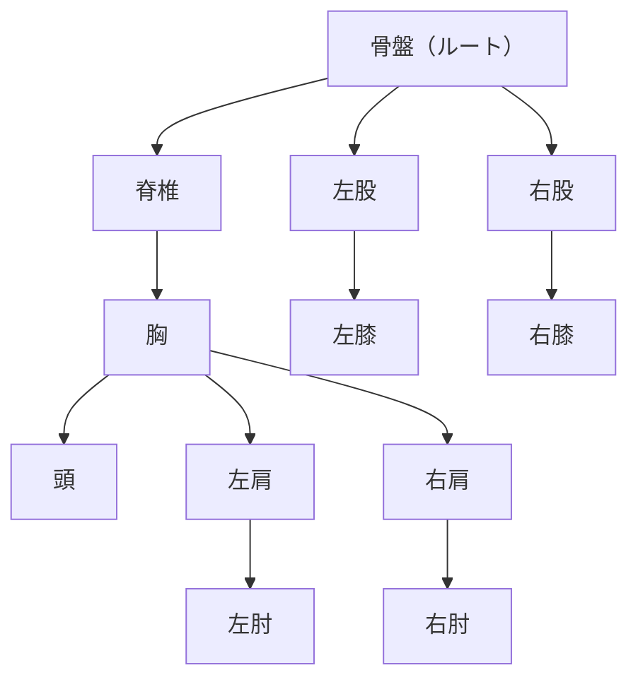
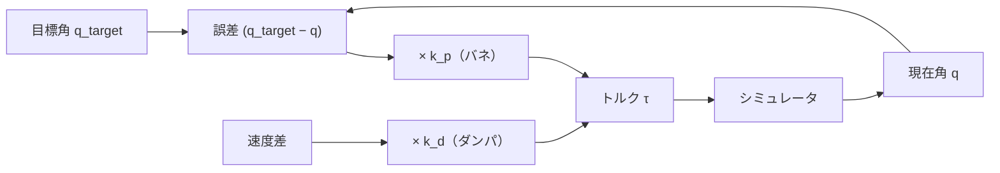
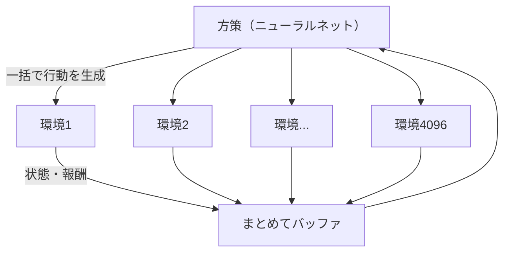
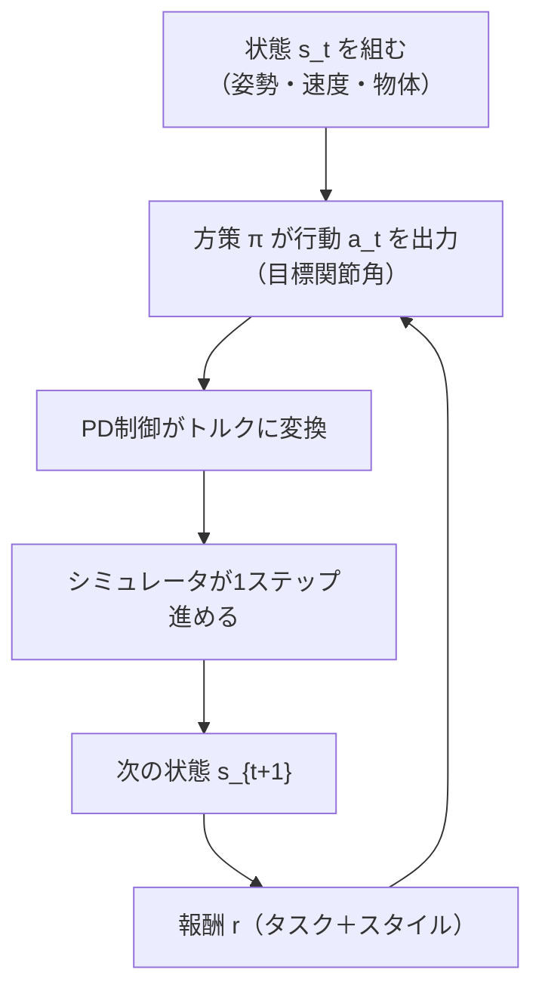

# 06. 物理キャラクタとPD制御

## この章でわかること

- 物理シミュレーション上のキャラクタがどう表現されるか（剛体リンク・関節・自由度）
- PD 制御の仕組みと、なぜ RL と相性がよいのか
- 状態（姿勢・速度）と行動（目標関節角）の意味
- シミュレータ（IsaacGym / MuJoCo）の役割と並列化

## 前提

- 第01章の「状態」と「行動」の概念

---

## 1. 物理キャラクタとは何か

物理シミュレーション上のキャラクタは、**剛体（rigid body）を関節（joint）でつないだ木構造**です。いわゆる「アーティキュレーテッド・ボディ（articulated body）」です。

- **ルート**（多くの場合、骨盤または胴体）が、キャラクタ全体の位置と向きを持ちます。
- 各関節は**自由度（Degrees of Freedom, DoF）**を持ちます。回転関節なら 1〜3 自由度。
- 関節を動かすには**トルク**を加えます。

ゲームエンジンで使うラグドールや物理アーマチュアと、基本的に同じものです。

## 2. シミュレーションの1ステップ

シミュレータは、毎ステップ「力を入れる → 加速度 → 速度 → 位置」を計算します。これは高校物理の運動方程式と同じです。

$$
m \ddot{\mathbf{x}} = \mathbf{F}, \qquad I \dot{\boldsymbol{\omega}} = \boldsymbol{\tau}
$$

- $m$ … 質量、$\mathbf{F}$ … 力、$\ddot{\mathbf{x}}$ … 加速度
- $I$ … 慣性モーメント、$\boldsymbol{\tau}$ … トルク、$\boldsymbol{\omega}$ … 角速度

シミュレータは、重力・接触力（地面や物体との衝突）・関節トルクをすべて足し合わせて、次のフレームの状態を求めます。ゲームエンジンの物理更新と同じ役割です。

## 3. 関節の制御: PD 制御

さて、キャラクタをどう動かすかです。関節に直接トルクを与えてもいいですが、それだと学習が難しい。そこで使うのが**PD 制御**です。

PD 制御は「**目標の関節角度に近づけ、目標の速度で動くようにトルクを出す**」制御です。

$$
\tau = k_p\,(q^{\text{target}} - q) + k_d\,(\dot{q}^{\text{target}} - \dot{q})
$$

- $q$ … 現在の関節角、$\dot{q}$ … 現在の関節角速度
- $q^{\text{target}}$ … 目標の関節角
- $k_p$ … 比例ゲイン（目標から離れているほど強いトルク）
- $k_d$ … 微分ゲイン（速度差に応じたブレーキ）

ゲームエンジニアにはおなじみの**バネ＋ダンパ**です。目標角へ引っ張るバネと、揺れを抑えるダンパの組み合わせです。

## 4. なぜ RL は「目標角」を出力するのか

ここが重要な設計判断です。本論文では、方策（RL）は**関節トルクを直接出すのではなく、PD 制御の「目標角」を出す**（式の上では行動 $a$ が関節の目標角になる、第09章）。

理由:

1. **探索空間が小さく、なめらか**: トルクを直接学ぶより、目標角を学ぶほうがずっと安定で学習が速い。
2. **物理的な意味が明確**: 「膝を45度にせよ」のほうが「膝にτのトルクを出せ」より直感的。
3. **ゲームエンジンとの整合**: 最近のゲームやロボット制御でも、位置目標＋PD は標準的。

ただし、目標角を急に大きく変えると、PD が大きなトルクを出して不安定になります。そこで実際には、**目標角の変化量を制限**したり、トルクに上限を設けたりします（実装の詳細）。

## 5. 状態（$s$）と行動（$a$）の中身

本論文の具体的な中身は第09章で詳しく扱いますが、ここで概要を示します。

| 種類 | 中身（例） | 次元の目安 |
| --- | --- | --- |
| 状態 $s$ | ルートの高さ・回転・速度、各関節の角度・速度、手足の位置、物体の位置・向き | 114 |
| 行動 $a$ | 各関節の目標角（PD 制御への指令） | 28 |

- 状態に**関節速度**まで含めるのがポイント（マルコフ性のため、第01章）。
- 物体の情報を状態に含めるのが本論文の特徴（第09章）。

## 6. シミュレータの役割: IsaacGym

本論文は **IsaacGym**（NVIDIA）を使います。

> Viktor Makoviychuk, et al.
> **Isaac Gym: High Performance GPU-Based Physics Simulation for Robot Learning.**
> arXiv:2108.10470, 2021. <https://arxiv.org/abs/2108.10470>

IsaacGym の特徴は、**GPU 上で何千もの環境を同時にシミュレートできる**ことです。

- 1つのニューラルネットの推論を、数千環境分まとめて（バッチで）実行。
- 各環境は違う初期状態・違う物体を持ち、多様な経験を同時に集める。

これがサンプル効率と学習速度の鍵です。第10章の「ランダム化」も、この並列環境があってこそ効きます。

> **このデバイスでは IsaacGym は動きません**（CUDA・NVIDIA GPU が必須）。第III部では CPU で動く MuJoCo を使います。考え方（並列環境・PD制御・状態/行動）は同じです。

## 7. MuJoCo について

第III部で使う **MuJoCo** は、ロボティクスで広く使われる物理シミュレータです（2021年にオープンソース化）。

- 精度の高い接触計算、関節モデルの扱いやすさが特長。
- CPU でも動くので、学習・検証に使いやすい。
- モデルは **MJCF（XML）** で記述する。

本論文のキャラクタは IsaacGym 上にありますが、MuJoCo の人型（`humanoid.xml`）でも同じ「剛体リンク＋PD制御」を体験できます。

## 8. Reference State Initialization の予告

第11章で扱う **RSI（Reference State Initialization）** は、「エピソード開始時に、見本モーションのランダムなフレームの状態から始める」テクニックです。物理キャラの学習で非常によく使われます。ここで名前だけ覚えておきましょう。

- 常に同じ初期状態から始めると、学習が遅く、局所解にはまりやすい。
- 見本の中間状態（座りかけ、歩きかけ）から始めると、難しい局面も学べる。

## 9. まとめ: 部品の全体像

第I部で学んだ部品（RL、PPO、模倣、敵対学習、AMP、PD制御）が、ここで1つのループに統合されます。第II部では、このループをシーン（物体）へ拡張する論文の中身を読みます。

## まとめ

- 物理キャラは剛体リンク＋関節の木構造。シミュレータが運動方程式を解く。
- 関節は PD 制御で「目標角」へ動かす。バネ＋ダンパ。
- 方策はトルクではなく**目標角**を出す。学習が安定する。
- IsaacGym は GPU で数千環境を並列化する。本論文の鍵。
- MuJoCo は CPU で動く代替で、第III部で使う。

## 演習

1. PD 制御で $k_p$ を大きくしすぎると何が起きるか、バネのたとえで説明しましょう。
2. 方策がトルクを直接出力する場合と比べて、目標角を出力する利点を2つ挙げましょう。
3. 並列環境が4096個あるとき、各環境に違う初期状態を与える利点を述べましょう。

---

第I部はここまで。次章: [07. 論文の全体像](07_論文の全体像.md) ／ 前章: [05. Adversarial Motion Priors](05_Adversarial_Motion_Priors.md)
