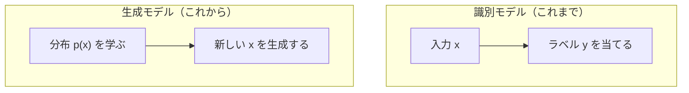
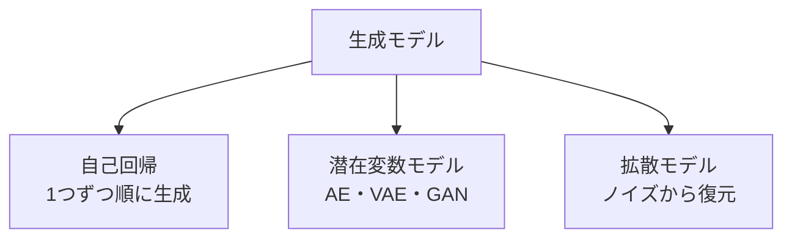
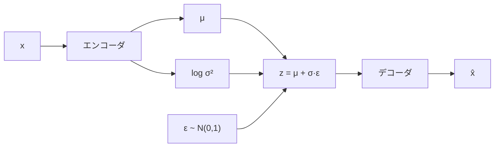

# 06. 生成モデルの基礎 — データの「分布」を学ぶ

## この章でわかること

- 生成モデルとは「データの分布 $p(x)$ を学ぶ」こと
- 識別モデルとの違い
- オートエンコーダ（AE）と、その仕組み（圧縮と復元）
- VAE（変分オートエンコーダ）の直感（潜在変数・再構成・KL）
- なぜモーション生成に生成モデルを使うのか

## 前提

- 第03章（ニューラルネットと学習）
- 確率の基礎（付録B 予定。平均・分散・正規分布が分かれば十分）

## つながり

- この章の「潜在変数」「分布を学ぶ」は、**拡散モデル**（第08章）と **識別器**（第07章）の前提になります。
- オートエンコーダの発想（圧縮→復元）は、モーションの生成・補間・補正に使われます。

---

## 1. 生成モデルとは

これまでは「入力 $x$ から正解 $y$ を当てる」**識別モデル**を学びました。**生成モデル**は逆に、**データ $x$ そのものがどういう分布から生まれるか**を学びます。



| 種類 | 学ぶもの | 例 |
| --- | --- | --- |
| 識別モデル | $p(y \mid x)$（入力から答え） | 分類、回帰 |
| 生成モデル | $p(x)$（データそのもの） | 画像生成、モーション生成 |

**なぜ分布が欲しいのか**: モーションは1つに決まりません。「歩く」動きにも無数のバリエーションがあります。1つの正解を当てるのではなく、**ありそうな動きの分布**を知り、そこから**新しい動きをサンプル**したいのです。

> **つながり**: 論文の AMP も「動きの分布に似せる」ことを目指します（第19章）。生成モデルは、その分布を扱う技術の一族です。

## 2. 生成モデルの3つのアプローチ

この後の章で学ぶものを含め、生成モデルの代表は次の3つです。



| アプローチ | 仕組み | この本での章 |
| --- | --- | --- |
| 自己回帰 | 前の要素から次を予測 | （第05章の系列モデル） |
| 潜在変数（AE/VAE/GAN） | 圧縮した潜在から生成 | 第06・07章 |
| 拡散 | ノイズを段階的に除去 | 第08〜10章 |

## 3. オートエンコーダ（AE）— 圧縮して復元する

**オートエンコーダ**は、データを**低次元に圧縮（符号化）**し、そこから**元に戻す（復号）**ネットワークです。


- **エンコーダ** $E$ … 入力 $x$ を潜在 $z$ に圧縮。
- **デコーダ** $D$ … 潜在 $z$ から ${\hat x}$ を復元。
- 学習目標は「復元誤差を小さくする」:

$$
\min\ \|x - D(E(x))\|^2
$$

```python
class Autoencoder(nn.Module):
    def __init__(self, in_dim, latent=32):
        super().__init__()
        self.encoder = nn.Sequential(nn.Linear(in_dim, 256), nn.ReLU(), nn.Linear(256, latent))
        self.decoder = nn.Sequential(nn.Linear(latent, 256), nn.ReLU(), nn.Linear(256, in_dim))

    def forward(self, x):
        z = self.encoder(x)
        x_hat = self.decoder(z)
        return x_hat, z
```

**直感**: モーションを「32個の数値」に要約できれば、その潜在 $z$ をいじることで**新しいモーションを作れます**。ゲームでいう「アニメのブレンドパラメータ」に近い発想です。

### AE の限界

AE は圧縮はうまくいきますが、**潜在 $z$ の分布が整っていない**ため、$z$ をランダムに選ぶと意味不明なモーションになります。そこで分布を整えるのが VAE です。

## 4. VAE — 潜在変数に分布を与える

**VAE（Variational Autoencoder）** は、潜在 $z$ が**正規分布に従う**ように学習します。

- エンコーダは、$z$ そのものではなく、**平均 $\mu$ と分散 $\sigma^2$** を出力します。
- そこから $z \sim \mathcal{N}(\mu, \sigma^2)$ をサンプルします。
- 復元誤差に加え、$\mu, \sigma$ が標準正規分布に近づくよう**KLダイバージェンス**で罰則を加えます。

$$
\mathcal{L} = \underbrace{\|x - {\hat x}\|^2}_{\text{復元}} + \beta\, \underbrace{D_{\text{KL}}\big(\mathcal{N}(\mu,\sigma^2)\,\|\,\mathcal{N}(0,1)\big)}_{\text{分布を整える}}
$$

- 復元項 … ちゃんと元に戻せるように。
- KL項 … 潜在の分布を正規分布に近づける（＝サンプルできる形にする）。

### 再パラメータ化トリック

$z \sim \mathcal{N}(\mu, \sigma^2)$ のサンプリングはそのままだと勾配が通りません。次のように書き換えます。

$$
z = \mu + \sigma \odot \epsilon, \qquad \epsilon \sim \mathcal{N}(0, 1)
$$

- $\epsilon$ は乱数（勾配不要）、$\mu, \sigma$ はネットワークの出力（勾配が通る）。
- これで**勾配を保ったままサンプル**できます。

```python
def reparameterize(mu, logvar):
    std = torch.exp(0.5 * logvar)
    eps = torch.randn_like(std)
    return mu + std * eps
```



> **つながり**: 拡散モデルも「正規分布から生成を始める」点で VAE と縁があります。VAE は1回で生成、拡散は段階的に生成（第08章）。

## 5. モーションに生成モデルを使う理由

| 用途 | 生成モデルがどう役立つか |
| --- | --- |
| モーションの生成 | 新しい動きを作る（歩行バリエーション等） |
| モーションの補間 | 2つの動きの間を自然につなぐ（潜在空間で補間） |
| ノイズ除去・補正 | 壊れた/欠けたモーションを復元 |
| 事前分布（prior） | 強化学習で「自然な動き」の基準を与える（AMP の発想に近い） |

ゲームのたとえ: たくさんのアニメクリップを学習して、「それらしいが新しい」動きを生成する。これがモーション生成のゴールです。

## 6. 実装コード

- `src/ml_lern/generative/autoencoder.py`
  - `Autoencoder` … AE 本体
  - `VAE` … VAE（再パラメータ化トリック込み）
  - `train_ae()` … 学習（2D データで動作確認）

```bash
uv run python scripts/g01_vae.py
```

## 7. つまずきやすいポイント

| 症状 | 対処 |
| --- | --- |
| 復元がぼやける | VAE の宿命。拡散や GAN では改善する |
| KL項が学習を妨げる | $\beta$ を小さくする（β-VAE） |
| 潜在が使えない | 正規化、次元数、学習不足を確認 |
| `logvar` が発散 | `clamp` で範囲制限する |

## まとめ

- 生成モデルは「データの分布 $p(x)$」を学び、新しいデータを作る。
- AE は圧縮→復元。潜在が整わないので、ランダム生成に向かない。
- VAE は潜在を正規分布に整え、サンプル可能にする。再パラメータ化が鍵。
- モーション生成・補間・事前分布に使われる。

## 演習

1. 識別モデルと生成モデルの違いを、$p(y\mid x)$ と $p(x)$ の記号を使って説明しましょう。
2. AE の潜在 $z$ をランダムに選ぶと、なぜ意味不明な出力になるか説明しましょう。
3. VAE の再パラメータ化トリックがなぜ必要か、勾配の観点で説明しましょう。
4. VAE と拡散モデルの生成の違いを、「何回で生成するか」の観点で比較しましょう。

---

次章: [07. 敵対的生成と識別器](07_敵対的生成_識別器.md) ／ 前章: [05. 系列モデル入門](05_系列モデル入門.md)
