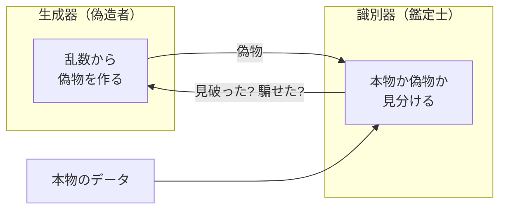
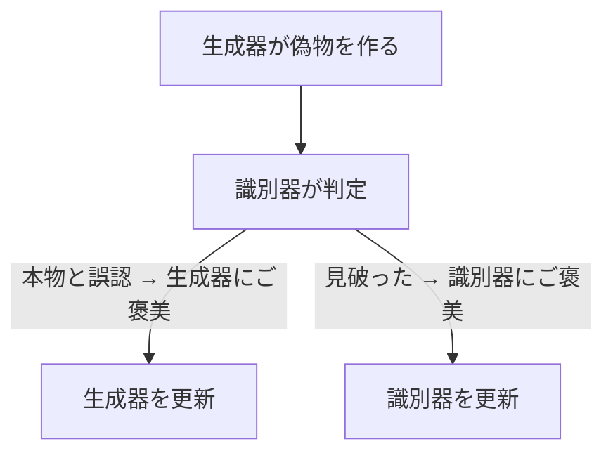
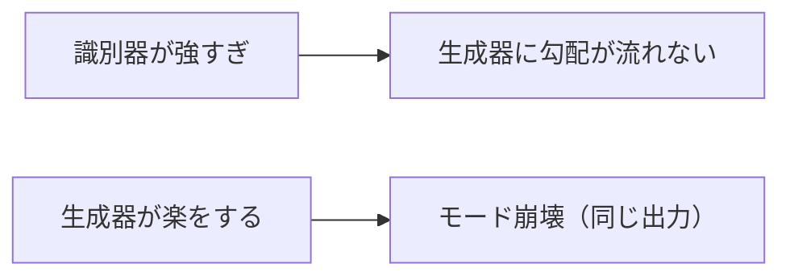
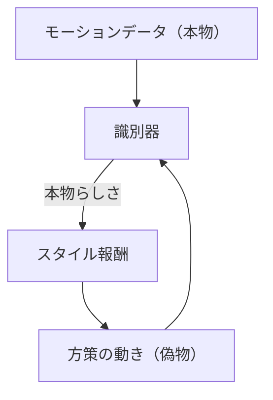

# 07. 敵対的生成と識別器 — 競わせて本物らしくする

## この章でわかること

- GAN（敵対的生成ネットワーク）の仕組み（生成器と識別器の競争）
- 識別器が「本物らしさ」をどう測るか（ロジット・シグモイド・クロスエントロピー）
- 学習が不安定になる理由と、勾配ペナルティによる安定化
- **この識別器の考え方が、後の AMP（第19章）にそのまま使われること**

## 前提

- 第03章（損失・学習）、第06章（生成モデル）

## つながり

- ここで作る**識別器**は、**模倣学習（AMP）の核**になります。第5部で「見本の動きを物理キャラに真似させる」ときに、識別器が「本物の動きかどうか」を判定し、その出力が報酬になります。

---

## 1. GAN のアイデア — 偽造者と鑑定士

**GAN（Generative Adversarial Network）** は、2つのネットワークを**競わせる**ことで、本物そっくりのデータを作らせます。



- **生成器 $G$**（Generator）: 乱数から偽物を作る。鑑定士を騙したい。
- **識別器 $D$**（Discriminator）: 本物と偽物を見分ける。騙されたくない。

ゲームのたとえ: 「偽札を作る側」と「偽札を見破る側」が競い、偽札の品質が上がっていく。

> Ian Goodfellow, et al. **Generative Adversarial Networks.** NeurIPS 2014. <https://arxiv.org/abs/1406.2661>

## 2. 識別器の出力を読む

識別器 $D(x)$ は、入力 $x$ が**本物である確率**を 0〜1 で出力します。

| $D(x)$ | 意味 |
| --- | --- |
| $1$ に近い | 「本物だ」と判定 |
| $0.5$ | 判別不能（理想的なバランス） |
| $0$ に近い | 「偽物だ」と判定 |

内部では、まず**ロジット**（実数スコア）を出し、シグモイドで 0〜1 に潰します。

$$
D(x) = \sigma(z) = \frac{1}{1 + e^{-z}}
$$

- $z$ … ロジット（生のスコア）。正で大きいほど「本物」。
- $\sigma$ … シグモイド。どんな実数も 0〜1 に変換。

ゲームのたとえ: ロジットは「鑑定の自信度の生値」、シグモイドは「それを確率に正規化する関数」。実装では**ロジットのまま損失を計算**します（数値的に安定）。

## 3. 識別器の損失 — クロスエントロピー

識別器は「本物を本物、偽物を偽物と判定する」二値分類を学習します。

$$
\min_D\ \mathcal{L}_D = -\,\mathbb{E}_{x\sim p_{\text{data}}}\big[\log D(x)\big] - \mathbb{E}_{x\sim p_{\text{gen}}}\big[\log\big(1 - D(x)\big)\big]
$$

読み方:

- **第1項**: 本物 $x$ について $D(x)$ を 1 に近づける。
- **第2項**: 偽物 $x$ について $D(x)$ を 0 に近づける。

これは**二値分類のクロスエントロピー**そのものです。ラベル1（本物）とラベル0（偽物）を付けた分類問題と同じです。

```python
bce = nn.BCEWithLogitsLoss()          # シグモイド込みのクロスエントロピー
loss_real = bce(D(real), torch.ones_like(...))     # 本物 → 1
loss_fake = bce(D(fake), torch.zeros_like(...))    # 偽物 → 0
loss_D = loss_real + loss_fake
```

> `BCEWithLogitsLoss` は「ロジット＋シグモイド＋クロスエントロピー」をまとめて、数値安定に計算してくれます。

## 4. 生成器の損失 — 識別器を騙す

生成器は、識別器に「本物」と言わせたい。そこで、識別器の出力を**逆手に取った損失**を使います。

$$
\min_G\ \mathcal{L}_G = -\,\mathbb{E}_{x\sim p_{\text{gen}}}\big[\log D(x)\big]
$$

- 偽物なのに $D(x)$ が大きいほど、損失が小さい。
- つまり「本物っぽく見える偽物」を作るほど得をする。



## 5. 学習ループ — 交互に更新する

GAN は「識別器を更新 → 生成器を更新」を交互に繰り返します。片方だけ極端に訓練すると崩れます。

```pseudo
for イテレーション:
    # --- 識別器の更新 ---
    real = 本物のデータをサンプル
    fake = 生成器が作った偽物（detach して勾配を切る）
    loss_D = BCE(D(real), 1) + BCE(D(fake), 0)
    識別器を更新
    # --- 生成器の更新 ---
    fake = 生成器が作った偽物
    loss_G = BCE(D(fake), 1)     # 本物と言わせたい
    生成器を更新
```

> **ポイント**: 識別器を更新するとき、偽物は `detach()` して生成器に勾配を流さないようにします（役割分担）。

## 6. なぜ不安定なのか — モード崩壊と振動

GAN は強力ですが、訓練が不安定で有名です。

- **モード崩壊**: 生成器が多様性を失い、同じ出力ばかり作る（例: 敵の攻撃パターンが1種類だけ）。
- **振動・発散**: 2つのネットワークが競うため、収束しにくい。
- **勾配消失**: 識別器が強すぎると、生成器に有益な勾配が流れない。



## 7. 安定化 — 勾配ペナルティ

本論文（と AMP）が使う安定化が**勾配ペナルティ（gradient penalty, Mescheder et al. 2018）** です。

識別器の出力が、入力のわずかな変化で激しく変わらないように、**勾配の大きさに罰則**を加えます。

$$
w^{\text{gp}}\ \mathbb{E}_{x}\!\left[\big\|\nabla_x D(x)\big\|^2\right]
$$

- $\nabla_x D(x)$ … 入力 $x$ を少し動かしたとき、識別器の出力がどれだけ変わるか。
- これを小さく保つ（平坦にする）ことで、判定が不安定になるのを防ぐ。

```python
def gradient_penalty(D, x):
    x = x.clone().requires_grad_(True)
    logits = D(x)
    grads = torch.autograd.grad(logits.sum(), x, create_graph=True)[0]
    return grads.pow(2).sum(dim=-1).mean()
```

**直感**: 「鑑定の基準をなめらかにする」。境界があまりカクカクすると、生成器への勾配が乱れます。

## 8. AMP への橋渡し（重要）

ここまでの話を、次のように読み替えると、そのまま AMP（第19章）になります。

| GAN の用語 | AMP（模倣学習）での対応 |
| --- | --- |
| 本物のデータ $p_{\text{data}}$ | モーションデータ（MoCap）の動き |
| 生成器 $G$ | 方策 $\pi$（キャラクタの動きを作る） |
| 偽物 $p_{\text{gen}}$ | 方策が生み出した動き |
| 識別器 $D$ | 「本物の動きらしさ」を判定するネット |
| 「本物らしさ」 | **スタイル報酬**（方策への報酬） |



つまり、**方策は「生成器」として、識別器を騙すように動きを洗練させる**。これが敵対的模倣学習です。

> **つながり（まとめ）**:
> 識別器 → 第19章の AMP の識別器
> スタイル報酬 → 第19章の $r^S$
> 勾配ペナルティ → 論文本体の式(5)（第22章）
> この章を理解していれば、AMP の核心はほぼ掴めたことになります。

## 9. 実装コード

- `src/ml_lern/generative/gan.py`
  - `Generator` / `Discriminator`
  - `gradient_penalty()`
  - `train_gan()` … 2D データ（例: 8つのガウス分布）で動作確認

```bash
uv run python scripts/g02_gan.py
```

## 10. つまずきやすいポイント

| 症状 | 対処 |
| --- | --- |
| 生成器が同じ出力ばかり | モード崩壊。勾配ペナルティ、学習率のバランスを見直す |
| 損失が暴れる | 識別器を更新しすぎない、勾配ペナルティを入れる |
| 何も学習しない | 識別器が強すぎる。識別器の学習率を下げる |
| 判定の正解率が1に張り付く | 識別器が強すぎる。バランス調整 |

## まとめ

- GAN は生成器と識別器を競わせる。識別器は本物/偽物を二値分類する。
- 出力はロジット＋シグモイド。損失はクロスエントロピー。
- モード崩壊・振動が起きやすく、勾配ペナルティで安定化する。
- **この識別器が、そのまま AMP（第19章）の核になる。**

## 演習

1. 識別器が「本物」にロジット $+2$、「偽物」に $-2$ を出したとき、それぞれのクロスエントロピー損失を計算しましょう。
2. モード崩壊を、ゲームの「敵の行動パターンが1種類」に例えて説明しましょう。
3. 勾配ペナルティが「判定境界をなめらかにする」とはどういうことか説明しましょう。
4. GAN の生成器を「方策」、本物を「モーションデータ」と読み替えて、AMP の仕組みを文章で説明してみましょう。

---

次章: [08. 拡散モデルの概念](08_拡散モデルの概念.md) ／ 前章: [06. 生成モデルの基礎](06_生成モデルの基礎.md)
