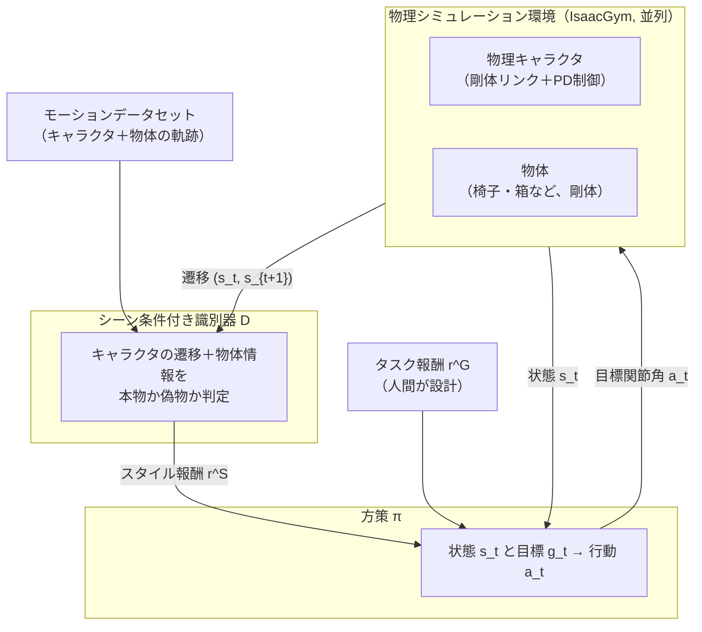
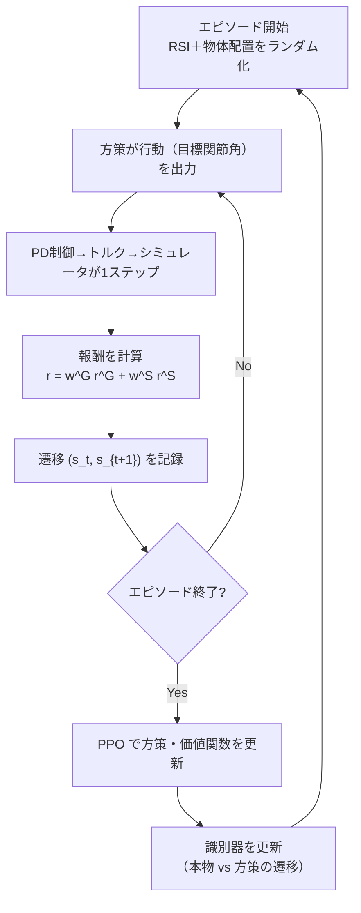

# 07. 論文の全体像

## この章でわかること

- 論文の3つの貢献
- パイプライン（図2）を、ゲームエンジニア向けに噛み砕いた説明
- 3つのタスク（sit / lie down / carry）がなぜ難しいか
- 全体の学習ループの流れ

## 前提

- 第I部の全章（特に第05章 AMP、第06章 PD制御）

---

## 1. 論文の主張を再確認

> **物理シミュレーションされたキャラクタが、シーンの中で自然に「座る／横になる／物を運ぶ」を学習する。ラベル付け不要。少数の実演から、形や大きさの違う多数の物体へ一般化する。**

## 2. 3つの貢献

論文が主張する貢献は次の3つです（第1章末尾より）。

1. **手動アノテーションなしで、物理キャラクタにシーン相互作用タスクを学習させる枠組み**。
2. **シーン条件付き識別器（scene-conditioned discriminator）**：キャラクタの動きを、環境中の物体の文脈で評価する。
3. **物体の物理的性質をランダム化する手法**：実演にない物体・配置への一般化を可能にする。

これらを、既存の部品（AMP、PPO、PD制御、ランダム化）の**新しい組み合わせ**として提示している点が、論文の立ち位置です。個々の部品は既存でも、シーン相互作用という文脈での組み合わせが新しい、と述べています。

## 3. パイプライン（図2）の読み解き

論文の図2は、この手法の全体像です。要素ごとに分解します。

ポイントは、**識別器に入るのが「キャラクタの遷移」だけでなく「物体の情報」も含む**ことです。AMP（第05章）との唯一にして決定的な違いです。

## 4. 論文のタスク: sit / lie down / carry

3つのタスクは、いずれも「キャラクタが物体と相互作用する」ものです。それぞれ何が難しいかを見ます。

### 4.1 Sit（椅子に座る）

- 物体（椅子・ベンチ・ソファ・ベッドなど）に近づき、**座面に腰を下ろす**。
- 難しい点: 高さ・奥行き・形が違う。肘掛けがあるかないか。座る動作は重心移動が大きく、バランスを崩しやすい。
- 論文での評価: 腰が目標位置から20cm以内なら成功。

### 4.2 Lie down（横になる）

- 物体に近づき、**体を横たえる**。
- 難しい点: 座るより姿勢変化が大きい。頭と腰の両方を支える必要がある。
- 評価: 腰と頭がそれぞれ目標から30cm以内なら成功。

### 4.3 Carry（箱を運ぶ）

- 箱に近づき、**持ち上げ、目的地まで運ぶ**。
- 難しい点: 箱は手に固定されていない。接触と摩擦で支える。箱の重さ・大きさで方策を変える必要がある。
- 評価: 箱が目標から20cm以内なら成功。

論文のFig.3がこの一連の流れを示しています。動画（補助資料）を見ると、キャラクタが歩く→移行→相互作用する様子が分かります。

## 5. 学習ループの全体

論文の学習は、次のループを大量の並列環境で回します。

第I部で作った部品が、このループのどこかに必ず出てくることを確認してください。

## 6. 論文の位置づけ（先行研究との関係）

| 系統 | 代表 | 本論文との関係 |
| --- | --- | --- |
| データ駆動運動学 | NSM, SAMP | 比較対象。物理なしで一般化に弱い |
| 物理＋模倣 | DeepMimic, AMP | 土台。シーンを見ない |
| 物理＋階層制御 | Chao et al. 2019 | 比較対象。不安定 |
| 手の操作 | MCP, Catch & Carry | 物体はあるが、シーン一般化は限定的 |

本論文は「AMP のシーン版」であり、「物理キャラクタのシーン相互作用」という比較的手薄だった領域に踏み込んでいます。

## 7. 本章のまとめと、次章への橋

- 貢献は「枠組み」「シーン条件付き識別器」「物体ランダム化」の3つ。
- 中核は識別器と方策を**シーン（物体）に条件付ける**こと。
- sit / lie down / carry は、いずれも物体との接触・適応が必要な難タスク。

次章（08）で、この中核であるシーン条件付き識別器の数式を読みます。

## まとめ

- 論文は物理キャラのシーン相互作用を、AMP の拡張として解く。
- 識別器に物体情報を入れるのが新規性。物体のランダム化で一般化する。
- 3タスクはいずれも物体との接触・重心制御が鍵。

## 演習

1. 3つの貢献のうち、最も「新しい」と論文が主張しているのはどれか、本文の表現から推測しましょう。
2. sit / carry それぞれで、物体のどの性質が難しさの主因か述べましょう。

---

次章: [08. 手法 — シーン条件付き識別器](08_手法_シーン条件付き識別器.md) ／ 前章: [06. 物理キャラクタとPD制御](06_物理キャラクタとPD制御.md)
