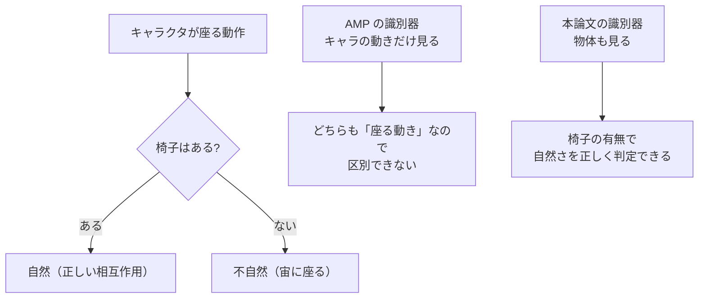
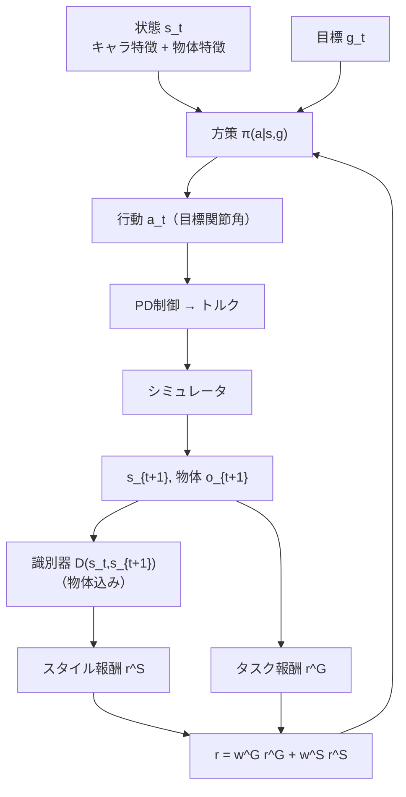

# 08. 手法 — シーン条件付き識別器

## この章でわかること

- 報酬の分解: タスク報酬 $r^G$ とスタイル報酬 $r^S$（式(1)(2)）
- 識別器の目的関数（式(3)〜(5)）と勾配ペナルティ
- スタイル報酬（式(6)）
- 「シーン条件付き」にするとは、具体的にどういうことか

## 前提

- 第02章（PPO）、第05章（AMP）、第06章（PD制御）

---

## 1. 報酬の全体像（論文 §3, 式(1)(2)）

論文は、方策が最大化すべき報酬を次のように定義します（式(1)）。

$$
r_t = w^{G}\, r^{G}(\mathbf{s}_t, \mathbf{g}_t, \mathbf{s}_{t+1}) + w^{S}\, r^{S}(\mathbf{s}_t, \mathbf{s}_{t+1})
$$

- $r^G$ … **タスク報酬**。目標達成の度合い（例: 座面に腰が近い）。
- $r^S$ … **スタイル報酬**。動きがデータセットにどれだけ似ているか。
- $w^G, w^S$ … それぞれの重み。
- $\mathbf{s}_t$ … 状態、$\mathbf{g}_t$ … 目標、$\mathbf{a}_t$ … 行動。

方策は、期待割引収益（式(2)）を最大化するように学習します。

$$
J(\pi) = \mathbb{E}_{p(\tau | \pi)}\!\left[\sum_{t=0}^{T-1} \gamma^t r_t\right]
$$

- $p(\tau|\pi)$ … 方策 $\pi$ のもとで軌跡 $\tau$ が生じる確率。
- $\gamma$ … 割引率、$T$ … 時間軸（ホライズン）。

式(1)(2)は、AMP と本質的に同じ形です（第05章）。**違いは、$r^G$ と識別器に物体情報が入ること**です。以下、順に見ます。

## 2. 識別器の目的関数（式(3)〜(5)）

識別器 $D$ は、状態遷移 $(\mathbf{s}, \mathbf{s}_{t+1})$ が「データセット由来か、方策由来か」を判定します。訓練の目的関数は、AMP に倣った次の形です（式(3)〜(5)をまとめて）。

$$
\arg\min_{D}\ \ 
\underbrace{-\mathbb{E}_{d^{\mathcal{M}}(\mathbf{s}, \mathbf{s}_{t+1})}\Big[\log D(\mathbf{s}, \mathbf{s}_{t+1})\Big]}_{\text{本物を1に}}
\underbrace{-\mathbb{E}_{d^{\pi}(\mathbf{s}, \mathbf{s}_{t+1})}\Big[\log\big(1 - D(\mathbf{s}, \mathbf{s}_{t+1})\big)\Big]}_{\text{偽物を0に}}
\underbrace{+\ w^{\text{gp}}\ \mathbb{E}_{d^{\mathcal{M}}}\Big[\big\|\nabla_\phi D(\phi)\big|_{\phi=(\mathbf{s}, \mathbf{s}_{t+1})}\big\|^2\Big]}_{\text{勾配ペナルティ（平滑化）}}
$$

それぞれの記号:

| 記号 | 意味 |
| --- | --- |
| $d^{\mathcal{M}}(\mathbf{s}, \mathbf{s}_{t+1})$ | データセット $\mathcal{M}$ における遷移の分布 |
| $d^{\pi}(\mathbf{s}, \mathbf{s}_{t+1})$ | 方策 $\pi$ が生む遷移の分布 |
| $D(\cdot)$ | 識別器の出力（本物らしさ、0〜1） |
| $w^{\text{gp}}$ | 勾配ペナルティの係数（人手で設定） |
| $\nabla_\phi D$ | 入力に対する識別器出力の勾配 |

これは第04章で説明した GAN のクロスエントロピー（＋勾配ペナルティ）そのものです。本論文独自の項はありません。**独自性は「何を入力するか（＝シーン条件）」にあります**（後述）。

## 3. スタイル報酬（式(6)）

識別器の出力から、方策のスタイル報酬を作ります（式(6)）。

$$
r^{S}(\mathbf{s}_t, \mathbf{s}_{t+1}) = -\log\big(1 - D(\mathbf{s}_t, \mathbf{s}_{t+1})\big)
$$

- $D \to 1$（本物っぽい） → $r^S$ 大
- $D \to 0$（偽物っぽい） → $r^S \to 0$

第03章の GAIL の式と同一です。「識別器を騙せるほど、高いスタイル報酬」という関係を、もう一度確認してください。

## 4. ここが「新規性」— シーン条件付け

AMP の識別器は、**キャラクタの遷移 $(s_t, s_{t+1})$** だけを見ます。本論文では、これに**物体（シーン）の情報**を加えます。

$$
D\!\left(\underbrace{\mathbf{s}_t, \mathbf{s}_{t+1}}_{\text{キャラクタ}},\ \underbrace{o_t, o_{t+1}}_{\text{物体の状態}}\right)
$$

- $o_t$ … 物体の位置・向きなど（第09章で詳細）。
- ここで $o$ は**状態 $\mathbf{s}$ に含める**形で実装されている（第09章）。つまり「シーン条件付き」は、**状態ベクトルに物体特徴を足すこと**で実現されます。

なぜこれが必要かを、具体的に考えます。

- 物体の文脈を入れることで、識別器は「**椅子があるからこの座り方は自然**」「椅子がないのに座ろうとしているから不自然」を区別できます。
- 同様に、「箱の位置に手が合っているか」「箱を落としていないか」も判定材料になります。

論文の表現（§3, 図2）:

> the discriminator receives information pertaining to both the character and the environment.
> （識別器は、キャラクタと環境の両方に関する情報を受け取る）

これが論文の中核です。

## 5. 方策側の条件付け

識別器だけでなく、**方策もシーンに条件付け**られます。方策の入力は状態 $\mathbf{s}_t$ と目標 $\mathbf{g}_t$ で、$\mathbf{s}_t$ には物体情報が含まれます。

$$
\mathbf{a}_t \sim \pi\!\left(\mathbf{a}_t \mid \mathbf{s}_t, \mathbf{g}_t\right), \qquad
\mathbf{s}_t \ni \{\text{キャラクタ特徴}, \text{物体特徴}\}
$$

- これにより、方策は「今、物体がどこにあるか」を見て行動を変えられます。
- 目標 $\mathbf{g}_t$ は、タスク指定（例: 座面のバウンディングボックス、目的地）です。

## 6. 物体は動く — 反応が必要

論文が強調する重要な点:

> Note that the object can move during the action and the agent must react appropriately.
> （物体は行動中に動きうるし、エージェントは適切に反応しなければならない）

- キャラクタが箱を押せば、箱は動く。その箱をまた支え続けなければならない。
- 椅子が横にずれれば、追従して座り直す必要がある。
- 状態に物体の**現在位置**を入れておけば、方策はこれに反応できる。

第13章の「外乱への頑健性」実験（物体を動かす）は、この設計の効果を確かめています。

## 7. まとめの図

## 8. 数式の再掲まとめ

$$
\begin{aligned}
r_t &= w^{G} r^{G}(\mathbf{s}_t, \mathbf{g}_t, \mathbf{s}_{t+1}) + w^{S} r^{S}(\mathbf{s}_t, \mathbf{s}_{t+1}) && \text{(1)}\\[4pt]
J(\pi) &= \mathbb{E}_{p(\tau|\pi)}\!\left[\sum_{t=0}^{T-1} \gamma^t r_t\right] && \text{(2)}\\[4pt]
\min_D\ & -\mathbb{E}_{d^{\mathcal{M}}}[\log D] - \mathbb{E}_{d^{\pi}}[\log(1-D)] + w^{\text{gp}}\mathbb{E}_{d^{\mathcal{M}}}[\|\nabla D\|^2] && \text{(3)-(5)}\\[4pt]
r^{S}(\mathbf{s}_t, \mathbf{s}_{t+1}) &= -\log\big(1 - D(\mathbf{s}_t, \mathbf{s}_{t+1})\big) && \text{(6)}
\end{aligned}
$$

## まとめ

- 報酬はタスク報酬 $r^G$ ＋ スタイル報酬 $r^S$（式1）。
- 識別器は AMP と同じ目的関数（式3-5）。勾配ペナルティで安定化。
- スタイル報酬は識別器出力から作る（式6）。
- **新規性は入力に物体情報を加えること**（シーン条件付け）。物体は動くので方策は反応が要る。

## 演習

1. 式(6)で $D = 0.5$ のとき $r^S$ はいくつか。また、$D$ が大きくなるにつれ $r^S$ がどう変化するか述べましょう。
2. 「シーン条件付け」を、状態ベクトルの観点から一言で説明しましょう。
3. 識別器に物体情報を入れない場合、箱を落としている動きを「自然」と誤判定するのはなぜか説明しましょう。

---

次章: [09. 状態と行動の表現](09_状態と行動の表現.md) ／ 前章: [07. 論文の全体像](07_論文の全体像.md)
