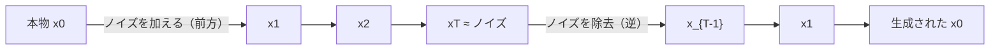
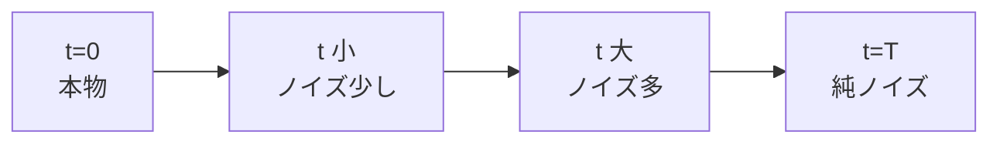
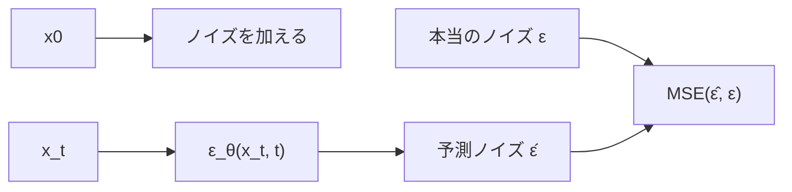
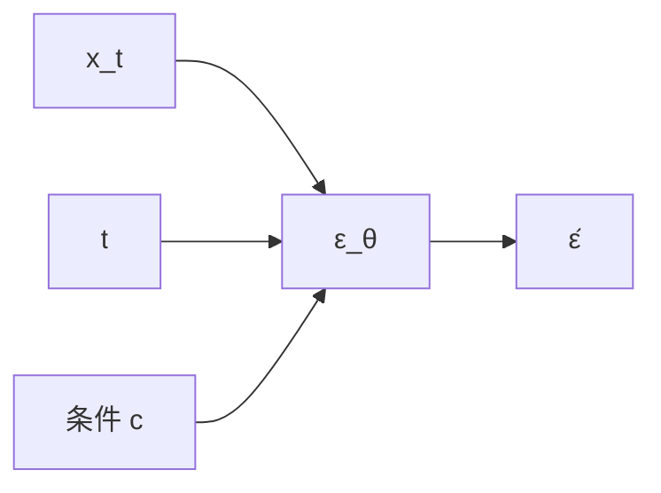

# 08. 拡散モデルの概念 — ノイズからデータを作る

## この章でわかること

- 拡散モデルの発想（ノイズを加えて、取り除く）
- 前方過程と逆過程
- 学習がなぜ「ノイズを当てる単純な回帰」になるのか
- ノイズスケジュール（$\beta, \alpha, \bar\alpha$）
- サンプリング手順と、条件付け（プロンプト・初期姿勢）
- モーション生成への応用

## 前提

- 第06章（生成モデル・正規分布）、第03章（MSE・回帰）

## つながり

- この章の拡散モデルは、**第09章で実装**し、**第10章でモーション生成へ拡張**します。
- GAN（第07章）と並ぶ生成モデルの代表で、モーションや制御（Diffusion Policy）の最新手法の土台です。

---

## 1. 拡散モデルのアイデア

拡散モデルの発想はシンプルです。

> **データに少しずつノイズを加えて完全なノイズにし、そこから少しずつノイズを取り除いてデータに戻す。**



- **前方過程**: 本物 $x_0$ にノイズを加えていく（これは数式で決まる、学習不要）。
- **逆過程**: ノイズからデータを復元する（**これをニューラルネットで学習**）。

> Jonathan Ho, Ajay Jain, Pieter Abbeel. **Denoising Diffusion Probabilistic Models (DDPM).** NeurIPS 2020. <https://arxiv.org/abs/2006.11239>

**なぜこれが生成になるのか**: 逆過程を学べば、**完全なノイズ（乱数）から始めて**、データらしいものを作れます。乱数が入力なので、毎回違う結果が出る＝多様な生成です。

## 2. 前方過程 — ノイズを加える（学習不要）

時刻 $t$ が大きいほどノイズが増えます。$t$ ステップ後のデータは**1回の式**で書けます。

$$
x_t = \sqrt{\bar\alpha_t}\, x_0 + \sqrt{1 - \bar\alpha_t}\, \epsilon, \qquad \epsilon \sim \mathcal{N}(0, I)
$$

- $x_0$ … 本物のデータ。
- $\epsilon$ … 加えるノイズ（正規分布）。
- $\bar\alpha_t$ … ノイズの残存率（時刻とともに 1 → 0 に減る）。
- $t = 0$ で $x_0$、$t = T$ でほぼ純ノイズ。



**ポイント**: 「どの $t$ でも、$x_t$ は $x_0$ から直接計算できる」こと。これが学習を簡単にします。

## 3. 逆過程 — ノイズを除去する（学習する）

逆過程は「$x_t$ から $x_{t-1}$ を求める」ステップです。これは、加えられた**ノイズ $\epsilon$ を予測する**ネットワーク $\epsilon_\theta$ があれば計算できます。

まず、ネットワークの学習目標は驚くほど単純です。

$$
\min_\theta\ \mathbb{E}_{t, x_0, \epsilon}\Big[\big\|\epsilon - \epsilon_\theta(x_t, t)\big\|^2\Big]
$$

> **「ノイズ付きデータ $x_t$ と時刻 $t$ を見せて、加えられたノイズ $\epsilon$ を当てさせる」**。それだけ。

- GAN のように2つのネットワークを競わせる必要はありません（第07章との対比）。
- 単純な**回帰（MSE）**なので、訓練が安定します。



## 4. なぜ「ノイズを当てる」で生成できるのか

ネットワークが $\epsilon$ を予測できれば、$x_t$ から $x_0$ を推定できます。

$$
\hat x_0 = \frac{x_t - \sqrt{1 - \bar\alpha_t}\,\hat\epsilon}{\sqrt{\bar\alpha_t}}
$$

これを各ステップで少しずつ行い、$\hat x_0$ を「ノイズ抜き」にして次の時刻へ進めます。1ステップの更新は次の通りです。

$$
x_{t-1} = \frac{1}{\sqrt{\alpha_t}}\left(x_t - \frac{1 - \alpha_t}{\sqrt{1 - \bar\alpha_t}}\, \hat\epsilon\right) + \sigma_t\, z, \qquad z \sim \mathcal{N}(0, I)
$$

- 前半 … 「予測ノイズを引いて、スケールを戻す」。
- $\sigma_t z$ … 残りのランダムさ（これが多様性を生む）。

> 初見では式が多く見えますが、やっていることは「**ノイズを少し引いて、次へ進む**」の繰り返しです。実装（第09章）を見ると、コードは驚くほど短いです。

## 5. ノイズスケジュール

ノイズの加え方（$\beta_t$）を**ノイズスケジュール**と呼びます。代表は線形スケジュールです。

$$
\beta_t: \text{小さな値から大きな値へ}（例: 1\times10^{-4} \to 2\times10^{-2}）
$$

これから次を計算します。

$$
\alpha_t = 1 - \beta_t, \qquad \bar\alpha_t = \prod_{s=1}^{t}\alpha_s
$$

- $\bar\alpha_t$ … 残存率。$t$ ステップ後の「どれだけ元データが残るか」。
- $\bar\alpha_T \approx 0$ になるようスケジュールを設計します。

```python
betas = torch.linspace(1e-4, 0.02, T)
alphas = 1 - betas
alpha_bars = torch.cumprod(alphas, dim=0)
```

> 実装は `src/ml_lern/generative/diffusion/schedule.py`（第09章）。

## 6. サンプリング — ノイズから生成する

生成は、**逆過程を $T$ から $0$ まで回す**だけです。

```pseudo
x = ランダムなノイズ                 # x_T
for t = T-1, T-2, ..., 0:
    eps_hat = model(x, t, 条件)       # ノイズを予測
    平均 = (x - (1-alpha_t)/sqrt(1-abar_t) * eps_hat) / sqrt(alpha_t)
    x = 平均 + sigma_t * ランダムノイズ
return x                              # 生成されたデータ
```


**計算コスト**: 生成に $T$ 回（例: 数百〜千）のネットワーク呼び出しが要ります。リアルタイム制御ではこれが課題になり、蒸留などの高速化研究があります（第10章）。

## 7. 条件付け — 「お題」を与える

無条件生成は乱数から好きなデータを作りますが、実際は**条件**を与えたいことが多いです。

- 画像: テキストプロンプト（「猫の絵」）
- モーション: 初期の姿勢、目標の軌道、スタイル

やり方: ネットワークの入力に条件を追加する。

$$
\hat\epsilon = \epsilon_\theta(x_t, t, c)
$$

- $c$ … 条件（テキストの埋め込み、初期姿勢など）。
- これを **classifier-free guidance** で強めることもできます（後述）。



### classifier-free guidance（補足）

条件あり／なしの両方を混ぜて、条件への忠実さを強める手法です。

$$
\hat\epsilon = \epsilon_\theta(x_t, t, \varnothing) + s\big(\epsilon_\theta(x_t, t, c) - \epsilon_\theta(x_t, t, \varnothing)\big)
$$

- $s$ … guidance の強さ。大きいほど条件に忠実（だが多様性は減る）。
- $\varnothing$ … 「条件なし」。

## 8. モーション生成への応用

拡散モデルは画像だけでなく**モーション**にも使われます。モーションは時系列データ（第04章）なので、データの形を `(フレーム, 特徴)` にすれば、同じ数学が使えます。

| 画像 | モーション |
| --- | --- |
| ピクセルの集合 | フレーム×特徴の時系列 |
| テキスト条件 | 初期姿勢・目標軌道・スタイル |
| 生成物 = 画像 | 生成物 = モーション |

> **つながり**: 論文は拡散モデルを使いません（AMP を使います）が、「動きの分布を学ぶ」という目的は共通です。拡散は生成モデルとして、モーション生成の強力な選択肢です。第10章で実装します。

## 9. VAE・GAN・拡散の比較

| 観点 | VAE（第06章） | GAN（第07章） | 拡散（本章） |
| --- | --- | --- | --- |
| 学習の仕組み | 再構成＋KL | 敵対的 | ノイズ除去の回帰 |
| 安定性 | 安定 | 不安定 | 安定 |
| 生成の回数 | 1回 | 1回 | 多数回 |
| 品質・多様性 | ややぼやける | 高品質だが多様性に難 | 高品質で多様 |
| 計算コスト | 低 | 低 | 高（生成時） |

## 10. つまずきやすいポイント

| 症状 | 対処 |
| --- | --- |
| 生成が完全なノイズのまま | スケジュール、学習不足、$t$ の埋め込みを確認 |
| 学習が進まない | データの正規化、時間埋め込み、学習率 |
| 生成が遅い | $T$ を減らす、DDIM などの高速サンプラを使う |
| 多様性がない | guidance を弱める、乱数のスケールを確認 |

## まとめ

- 拡散モデルは「ノイズを加えて、取り除く」生成モデル。
- 学習は**ノイズを当てる単純な回帰**（MSE）。GAN より安定。
- 前方過程は数式で決まり、逆過程をネットワークで学ぶ。
- 生成は $T$ 回の逆過程。条件付けでお題を与えられる。
- モーションにも応用できる（第10章）。

## 手を動かそう

> **一歩目**: 前方過程（ノイズを加える）を自分のデータで実行し、$t$ を 0→T へ動かすと何が起きるか目で見る。

```python
import torch
from ml_lern.generative.diffusion.schedule import NoiseSchedule
sched = NoiseSchedule(num_timesteps=100)
x0 = torch.zeros(32, 2); x0[:, 0] = torch.linspace(-1, 1, 32)   # 直線状の点
for t in [0, 10, 50, 99]:
    noise = torch.randn_like(x0)
    x_t = sched.q_sample(x0, torch.full((32,), t), noise)
    print(f"t={t}: 平均={x_t.mean():.2f} ばらつき={x_t.std():.2f}")
```

**いじってみる**: `beta_end` を大きくして、少ないステップでノイズに潰れるようにする。$t$ と「残っている構造」の関係を感じ取る。

**夢が広がる**:
- 自分のゲームのレベル形状を「ノイズから生成」する発想へ拡張する。
- 壊れたアセット（欠けたデータ）を拡散で修復する。
- 「お題（条件）」をプレイヤーの入力にして、動的なレベル生成をする。

**再現レシピ**: [レシピ09（付録E）](付録E_再現レシピ_AI側.md#recipe-09)（コメント付きの再現コードで試せます）

## 演習

1. 前方過程で $t$ が大きくなるほど $x_t$ はどうなるか説明しましょう。
2. 拡散モデルの学習が GAN より安定な理由を、「競争の有無」から説明しましょう。
3. 生成に $T$ 回の計算が必要なことが、リアルタイム制御でなぜ問題か考えましょう。
4. モーション生成で、条件 $c$ に何を入れると便利か3つ挙げましょう。

---

次章: [09. 拡散モデルの実装](09_拡散モデルの実装.md) ／ 前章: [07. 敵対的生成と識別器](07_敵対的生成_識別器.md)
