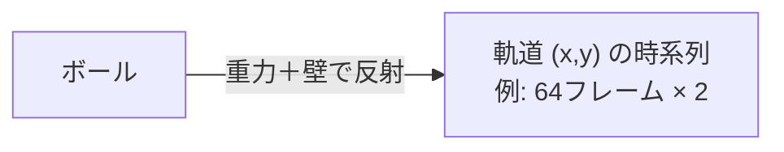
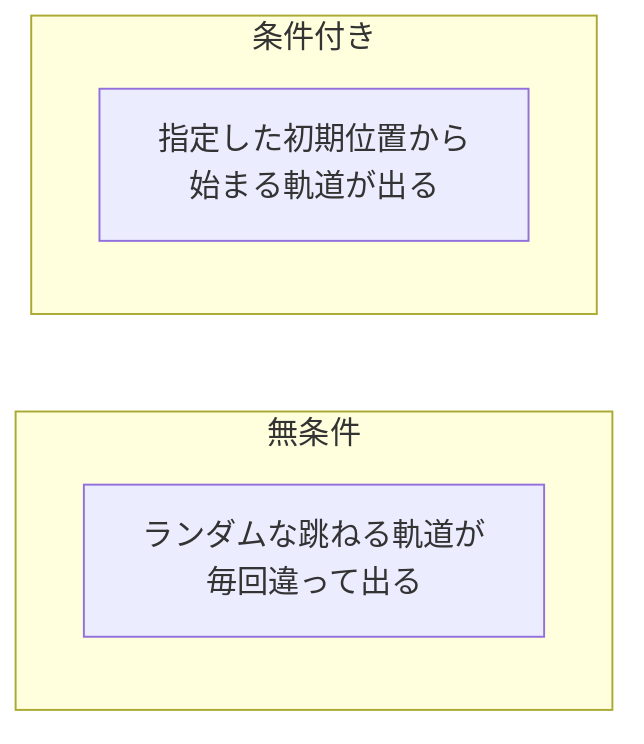

# 09. 拡散モデルの実装 — 2D バウンスボール

## この章でわかること

- 拡散モデルを実際に実装する（2D バウンスボール）
- ノイズスケジュール・ノイズ除去ネット・学習・サンプリング
- 無条件生成と条件付き生成（初期位置を指定）
- 生成結果の可視化

## 前提

- 第08章（拡散の概念）、第03章（学習ループ）

## つながり

- この章で作る拡散モデルが、**第10章のモーション生成**の土台になります。2D の点が「関節の軌道」に変わるだけです。

---

## 1. 題材: 2D バウンスボール

箱の中を跳ね回るボールの軌道（$x, y$ の時系列）を生成します。物理が単純（重力＋壁で反射）なので、**教師データを大量に作れ**、拡散モデルの練習台に最適です。



- 1本の軌道 = 1つのデータ $x_0$（例: $64 \times 2 = 128$ 次元のベクトル）。
- 「跳ねる軌道」の分布を拡散モデルで学びます。

## 2. データ生成

`src/ml_lern/generative/diffusion/dataset.py` で、物理シミュレーションでデータを作ります。

```python
def simulate_bounce(steps=64, dt=0.05, box=1.0, gravity=2.0, x0=None, v0=None):
    for _ in range(steps):
        vel[1] -= gravity * dt                 # 重力（y方向）
        pos = pos + vel * dt
        for d in range(2):                     # 壁で反射
            if pos[d] < 0: pos[d], vel[d] = -pos[d], -vel[d]
            elif pos[d] > box: pos[d], vel[d] = 2*box - pos[d], -vel[d]
        traj.append(pos.copy())
    return np.stack(traj)
```

> 第08章の「生成モデルで分布を学ぶ」前に、**物理でデータを作る**という構図が面白いところです。ゲームならアニメや物理からデータを作れます。

## 3. ノイズスケジュール

`schedule.py` で $\beta, \alpha, \bar\alpha$ を計算します。

```python
class NoiseSchedule:
    def __init__(self, num_timesteps=200, beta_start=1e-4, beta_end=0.02):
        self.betas = torch.linspace(beta_start, beta_end, num_timesteps)
        self.alphas = 1.0 - self.betas
        self.alpha_bars = torch.cumprod(self.alphas, dim=0)

    def q_sample(self, x0, t, noise):
        """前方過程: x_t = sqrt(abar) x0 + sqrt(1-abar) eps"""
        a_bar = self.alpha_bars[t].view(-1, 1)
        return a_bar.sqrt() * x0 + (1.0 - a_bar).sqrt() * noise
```

- `q_sample` が前方過程。学習で何度も使うので、ここにまとめます。

## 4. ノイズ除去ネットワーク

`model.py` の `Denoiser` は、ノイズ付きデータ $x_t$ と時刻 $t$ から、ノイズ $\epsilon$ を予測します。

```python
class Denoiser(nn.Module):
    def forward(self, x_t, t, condition=None):
        t_emb = sinusoidal_embedding(t, self.time_dim)   # 時刻を埋め込む
        inp = torch.cat([x_t.reshape(batch, -1), t_emb, condition], dim=-1)
        return self.net(inp).reshape_as(x_t)
```

### 時刻の埋め込み（sinusoidal embedding）

時刻 $t$ は 0〜199 の整数ですが、そのまま入れると「199 と 0 が遠い」という不自然さが出ます。そこで**正弦波で埋め込み**ます（Transformer と同じ手法）。

```python
def sinusoidal_embedding(t, dim):
    half = dim // 2
    freqs = torch.exp(-math.log(10000) * torch.arange(half) / half)
    args = t.float().unsqueeze(-1) * freqs
    return torch.cat([torch.sin(args), torch.cos(args)], dim=-1)
```

**直感**: 時刻を「周期的な波」に変換することで、近い時刻は近い表現に、遠い時刻は遠い表現になります。

## 5. 学習

`train.py` の学習ループは第08章の擬似コードそのままです。

```python
for epoch in range(num_epochs):
    for batch in data:
        x0 = batch                            # 本物の軌道
        t = torch.randint(0, T, (B,))          # 時刻をランダムに
        noise = torch.randn_like(x0)           # ノイズをサンプル
        x_t = schedule.q_sample(x0, t, noise)  # 前方過程
        eps_pred = model(x_t, t, cond)         # ノイズを予測
        loss = mse(eps_pred, noise)            # 当てる
        optimizer.zero_grad(); loss.backward(); optimizer.step()
```

> **3行が核心**: 時刻をランダムに選び、ノイズを加え、ノイズを当てる。これだけで拡散モデルが学習できます。

## 6. サンプリング（無条件生成）

`schedule.py` の `p_sample_step` で逆過程を1ステップ進めます。

```python
def p_sample_step(self, model, x_t, t, condition=None):
    eps_pred = model(x_t, t, condition)
    # 予測ノイズから平均を計算
    mean = (1/sqrt(alpha_t)) * (x_t - (beta_t/sqrt(1-abar_t)) * eps_pred)
    if t == 0:
        return mean
    return mean + sqrt(beta_t) * torch.randn_like(x_t)   # 残りのランダムさ
```

生成は $T \to 0$ へ回すだけです。

```python
def sample(model, schedule, steps, num_samples):
    x = torch.randn(num_samples, steps * 2)      # 乱数から開始
    for t in reversed(range(schedule.num_timesteps)):
        x = schedule.p_sample_step(model, x, t_batch)
    return x.reshape(num_samples, steps, 2)
```

## 7. 条件付き生成 — 初期位置を指定

初期位置 $x_0$ を条件 $c$ として与えると、**そこから始まる軌道**を生成できます。

```python
def sample_conditional(model, schedule, steps, start_positions):
    return sample(model, schedule, steps, condition=start_positions)
```


> **つながり**: これが **Diffusion Policy**（第10章）の入口です。制御では「今の状態」を条件に、これからの行動（系列）を生成します。

## 8. 実行と可視化

```bash
uv run python scripts/g03_diffusion_bounce.py
```

- 学習後、無条件生成と条件付き生成の軌道を生成します。
- `matplotlib` があれば `diffusion_bounce.png` に可視化します。



## 9. この章のコードの場所

```
src/ml_lern/generative/diffusion/
  schedule.py   ノイズスケジュール・前方/逆過程
  model.py      ノイズ除去ネット（時刻埋め込み）
  dataset.py    バウンスボールのデータ生成
  train.py      学習
  sample.py     生成（無条件・条件付き）
scripts/g03_diffusion_bounce.py
```

## 10. つまずきやすいポイント

| 症状 | 対処 |
| --- | --- |
| 生成がノイズのまま | 学習不足、$T$ が小さすぎ、スケジュールを見直す |
| 学習が遅い | データ数・バッチ・モデルサイズを調整（CPU では小さく） |
| 軌道が箱からはみ出す | データの正規化、生成後のスケール戻し |
| 条件付きが効かない | 条件の入力の仕方、学習時の dropout を確認 |

## まとめ

- 2D バウンスボールで拡散モデルを実装した。
- 学習は「時刻を選び、ノイズを加え、ノイズを当てる」だけ。
- 無条件生成は乱数から、条件付き生成は初期位置を指定して生成。
- このコードが、そのままモーション生成（第10章）に拡張できる。

## 演習

1. `num_timesteps` を 50 と 500 にしたとき、生成の質はどう変わるか試しましょう。
2. 条件付き生成で、初期位置だけでなく「初速」も条件にするとしたら、どう実装しますか。
3. 生成した軌道が物理的にあり得るか（壁の外に出ていないか）を確認するコードを書きましょう。

---

次章: [10. モーション生成への拡張](10_モーション生成への拡張.md) ／ 前章: [08. 拡散モデルの概念](08_拡散モデルの概念.md)
