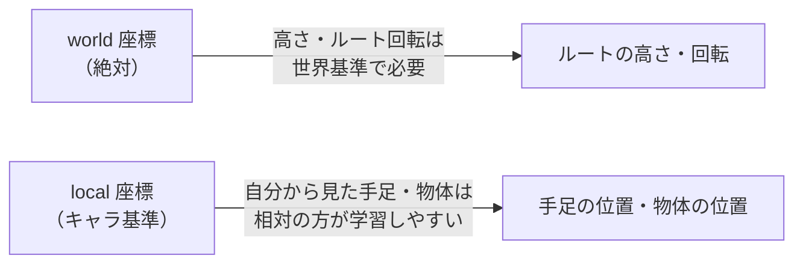
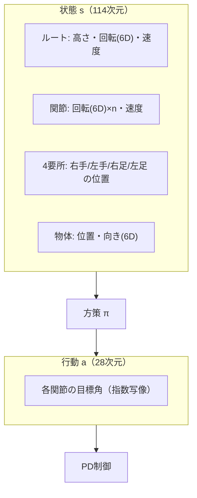

# 09. 状態と行動の表現

## この章でわかること

- 114次元の状態ベクトルの中身を1つずつ
- 28次元の行動ベクトルの中身
- 座標系（world / local）の使い分けと、その理由
- 6D 回転表現とは何か
- 物体特徴を状態に入れる意味

## 前提

- 第06章（物理キャラとPD制御）

---

## 1. なぜ表現の設計が重要か

機械学習では「**何を入力するか**」が性能を大きく左右します。RL では、状態に必要な情報が入っていないと、そもそも正しい行動が取れません。逆に余計な情報は学習を難しくします。

論文はこの設計を明示しています（§4）。順に見ましょう。

## 2. 状態ベクトルの全体像

論文が挙げる状態の特徴は次の通りです（§4）。

| # | 特徴 | 座標系 | 意味 |
| --- | --- | --- | --- |
| 1 | ルートの高さ | world | 骨盤（ルート）の高さ |
| 2 | ルートの回転 | world | 体の向き |
| 3 | ルートの線速度・角速度 | local | どれだけ進み、回っているか |
| 4 | 各関節の回転 | local | 関節の曲がり具合 |
| 5 | 各関節の速度 | local | 関節の動く速さ |
| 6 | 4つの要所の位置（右手・左手・右足・左足） | local | 手足の先端の位置 |
| 7 | 物体の位置 | local | 物体（椅子・箱）の位置 |
| 8 | 物体の向き | local | 物体の向き |

全体で **114次元** になります。

### なぜ world と local を使い分けるのか

これはゲームエンジニアなら直感的に理解できるでしょう。

- **world 座標**: 世界全体から見た位置・向き。ルートの「絶対的な」高さ・向き。
- **local 座標**: キャラクタ自身から見た相対位置・向き。

**理由**: キャラクタが世界のどこにいても、同じ「座り方」ができるべきです。手足や物体の位置を自分基準（local）にすれば、**位置に依存しない行動**を学べます。一方、ルートの高さは地面との関係で決まるので world で必要です。

これは「**並進・回転不変性**」を手で与えている、と見ることもできます。データの対称性を入力設計で活かすのは、機械学習の定石です。

## 3. 回転の表現 — 6D エンコーディング

回転を表す方法はいくつかあります。

| 表現 | 次元 | 問題点 |
| --- | --- | --- |
| オイラー角 | 3 | ジンバルロック、不連続 |
| クォータニオン | 4 | 制約（単位長）がある、符号の曖昧さ |
| 回転行列 | 9 | 冗長、制約がある |
| **6D 表現** | 6 | 連続で扱いやすい（本論文採用） |

本論文は **6D normal-tangent エンコーディング**（Zhou et al. 2019 由来、AMP でも使用）を使います。回転行列の最初の2列（正規直交なベクトル2本）をそのまま数値として使う方法です。

$$
R = [\mathbf{a}, \mathbf{b}, \mathbf{c}] \quad\Rightarrow\quad \text{6D} = [\mathbf{a}, \mathbf{b}]
$$

- 3×3 の回転行列のうち、2列だけ使う（3列目は外積で復元できる）。
- ニューラルネットにとって「連続で微分可能」なのが利点。

ゲームでのたとえ: クォータニオンの正規化や符号反転の面倒さを知っていれば、「6つの数値で素直に扱える」利点が分かるはずです。

## 4. 行動ベクトル（28次元）

行動は、**各関節の目標角**です（PD制御への指令、第06章）。

- 各関節の目標を**指数写像（exponential map）**という3次元の回転表現で表す（Grassia 1998）。
- 全体で **28次元**。

指数写像は、回転軸 $\times$ 角度 で回転を表す方法（軸角表現）です。

$$
\mathbf{a} \in \mathbb{R}^3 \quad (\text{回転軸} \times \text{角度})
$$

- 直感的で、0付近ではオイラー角のように振る舞う。
- PD制御がこの目標角へ関節を動かす。

> 補足: 状態の回転は 6D、行動の目標角は指数写像（3D）と、使い分けています。実装上の都合（PD制御は3次元の目標が扱いやすい、識別器は連続な6Dが扱いやすい）によるものです。

## 5. 物体特徴を状態に入れる意味

ここが本論文の核心に直結します。状態の最後に **物体の位置・向き** が入っています（#7, #8）。

- これにより方策は「物体がどこにあるか」を見て動ける。
- 識別器も物体情報を含む遷移を見て、自然さを判定できる（第08章のシーン条件付け）。
- 物体は行動中に動くので、毎ステップ更新された位置・向きが状態に入る → 方策が反応できる。

論文の表現:

> A key difference from prior work is the inclusion of object features in the state.
> （先行研究との重要な違いは、状態に物体特徴を含めることである）

## 6. 次元の内訳（推定）

論文は正確な内訳を全部は書いていませんが、標準的な人型（AMP の humanoid）をもとにすると、114次元はおおよそ次のように構成されます。

| 構成要素 | 概算次元 | 備考 |
| --- | --- | --- |
| ルートの高さ | 1 | |
| ルートの回転（6D） | 6 | |
| ルートの線速度・角速度 | 6 | |
| 関節の回転（6D × 関節数） | 6 × n | n は関節数 |
| 関節の速度 | n | |
| 4要所の位置 | 12 | 3次元 × 4 |
| 物体の位置 | 3 | |
| 物体の向き（6D） | 6 | |
| 合計 | 114 | n に依存 |

> 正確な関節数・内訳は著者実装やデータに依存します。実装するときは、自分のキャラクタの自由度に合わせて調整します（第25章で具体的に扱います）。

## 7. 目標 $g_t$ について

目標 $g_t$ はタスクによって異なります（§4 と付録A）。

- **sit / lie down**: 物体のバウンディングボックス（物体の範囲）。
- **carry**: 目的地の位置、箱の高さ・幅・奥行き。
- **重さ対応版（付録B）**: さらに箱の密度を目標に追加。

「目標をどう与えるか」が、タスクの難しさと学習のしやすさを左右します。詳しくは第12章（報酬）で扱います。

## 8. まとめの図

## まとめ

- 状態は114次元。ルート・関節・4要所・物体の情報を含む。
- world と local を使い分け、位置不変性を入力設計で確保する。
- 回転は 6D 表現（連続で扱いやすい）。行動は指数写像の目標角。
- **物体を状態に含める**のが本論文の鍵。物体は動くので方策は毎ステップ反応する。

## 演習

1. 物体の位置を world ではなく local（キャラクタ基準）で入れる利点を述べましょう。
2. 6D 回転表現がクォータニオンより学習しやすい理由を、連続性の観点から説明しましょう。
3. 状態に関節速度を入れないと、どんな問題が起きるか（マルコフ性の観点で）述べましょう。

---

次章: [10. モーションデータセット](10_モーションデータセット.md) ／ 前章: [08. 手法 — シーン条件付き識別器](08_手法_シーン条件付き識別器.md)
