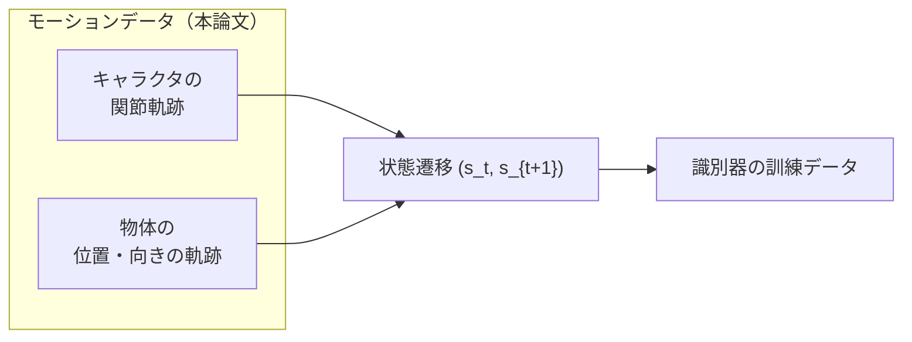
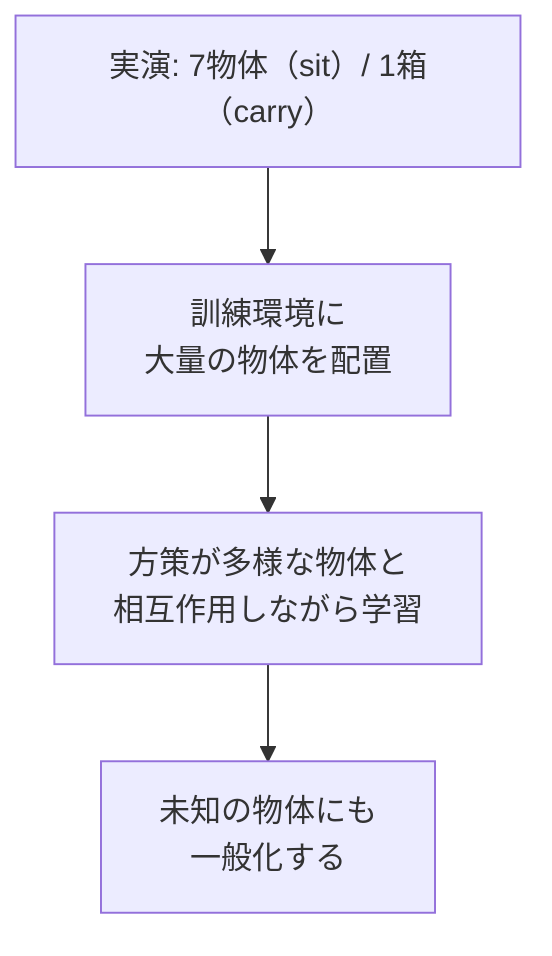
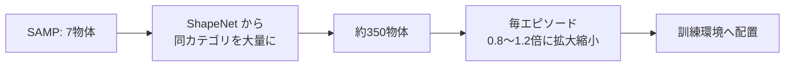

# 10. モーションデータセット

## この章でわかること

- 本論文が使う2種類のデータ（SAMP データセット／自作の箱運び MoCap）
- データが「キャラクタだけでなく物体の軌跡も含む」ことの意味
- 少数の物体から多数の物体へ一般化する仕組み（ShapeNet・スケーリング）
- データの限界と、それを学習側でどう補うか

## 前提

- 第05章（AMP の「ラベル不要」な模倣）、第08章（シーン条件付け）

---

## 1. この論文のデータは特殊 — 「キャラ＋物体」のペア

通常のモーションデータは、キャラクタの関節角度の系列です。ところが本論文は、**物体の位置・向きの軌跡も必要**とします。理由はシーン条件付け（第08章）です。

- 識別器は「キャラクタの動き」と「物体の状態」の両方を見るので、データにも両方が要ります。
- これは多くの既存 MoCap データには無い情報で、論文はこれを自作・流用で用意します。

## 2. sit / lie down 用: SAMP データセット

座る・横になるタスクには、**SAMP データセット**（Hassan et al. 2021）を使います。

> Mohamed Hassan, Duygu Ceylan, Ruben Villegas, Jun Saito, Jimei Yang, Yi Zhou, Michael Black.
> **Stochastic Scene-Aware Motion Prediction (SAMP).**
> ICCV 2021. <https://arxiv.org/abs/2108.08284>

- 内容: 座る・横になる動作の MoCap クリップ。**約100分**。
- 物体情報: シーン中の**7種類の物体**の位置・向き、および CAD モデルを含む。
- Mocap は SMPL 系の身体表現（詳しくは第28章）。

> 面白い接点: 本論文の共著者 Xue Bin Peng と Mohamed Hassan は、この SAMP の著者でもあります。つまり本論文は SAMP の「物理版」への発展と位置づけられます。

## 3. carry 用: 自作の箱運び MoCap

箱運び（carry）には、著者らが**自分で撮影**した MoCap を使います。

- **15クリップ**。被験者が箱へ歩いていき、持ち上げ、目的地へ運ぶ。
- 各クリップで箱の**初期位置と目標位置を変化**させる。
- 全身の MoCap に加え、**箱の動きも光学マーカーで計測**。

> 論文の表現: "we captured 15 MoCap clips of a subject carrying a single box."

つまり、**たった15クリップ・1種類の箱**の実演から始めて、後述の一般化で多様な箱に対応します。

## 4. 少数データからの一般化 — ここが本論文の妙

データは貧弱です。

- sit / lie down: 7種類の物体のみ
- carry: 1種類の箱のみ

にもかかわらず、論文は「**数百種類の物体**」で動くポリシーを学習します。どうやるのか。

> **方策を、訓練中に新しい物体にさらす（expose）。**

これが**ドメインランダム化（domain randomization）**の一種です。第11章で詳しく扱いますが、ここでデータの話として要点を押さえます。

## 5. 物体の水増し（sit / lie down）

座る・横になるタスクでは、元の物体を **ShapeNet** の同カテゴリ物体に置き換えます。

> Angel X. Chang, et al.
> **ShapeNet: An Information-Rich 3D Model Repository.**
> arXiv:1512.03012, 2015. <https://arxiv.org/abs/1512.03012>

- カテゴリ: 普通の椅子、アームチェア、テーブル、低いスツール、高いスツール、ソファ、ベッド。
- 合計 **約350個**のユニークな物体を訓練に使用。
- さらに、各訓練エピソードで **0.8〜1.2 倍**にランダムにスケーリング。

## 6. 物体の水増し（carry）

箱運びでは、**サイズをランダムにスケーリング**します。

- 訓練時: **0.5〜1.5倍**。
- 評価時: 縦25×横17.5×奥行15cm 〜 75×52.5×45cm の範囲でテスト。
- 重さ版（付録B）: 5〜26kg の範囲でサンプル。

実演は「1つの大きさの箱」だけなのに、方策は小さい箱・大きい箱・重い箱まで運べるようになります（第13章）。

## 7. なぜ「ラベル付け不要」が重要か

論文本体（§1）が強調する点を、データの文脈で整理します。

- 従来の運動学モデル（NSM, SAMP）は、**フェーズラベル**（この区間は歩行、この区間は座り）などの注釈が必要なことがある。
- 高品質な人間-シーン相互作用の 3D データは**希少で記録が難しい**。
- AMP 系はラベル不要なので、大量のクリップをそのまま投入できる。

> 論文 §2.1 の指摘: データ駆動の運動学的手法は高品質な人間-シーンデータを必要とするが、それは希少。学習データにないシナリオでは性能が落ちる。

## 8. このデバイスで再現する場合の現実

第III部では、以下の事情から**データの入手が難しい**点に注意します。

- SAMP データ・ShapeNet・AMASS は、いずれも**入手に登録やライセンス条件**がある（付録D）。
- 本格的な人型 MoCap は数 GB〜数十 GB。
- そのため第III部では、**手続き的に生成できる簡易な参照モーション**や、MuJoCo のサンプル運動を使う方針を取ります（第26章）。

データの入手方法と利用条件は付録Dにまとめます。

## 9. まとめ

| タスク | データ | 物体 | 一般化の手段 |
| --- | --- | --- | --- |
| sit | SAMP（約100分） | 7物体 | ShapeNet 約350物体＋スケーリング |
| lie down | SAMP（約100分） | 7物体 | 同上 |
| carry | 自作 MoCap 15クリップ | 1箱 | 0.5〜1.5倍スケーリング、重さ 5〜26kg |

- データは「キャラ＋物体」のペア。シーン条件付けに必須。
- 少数の実演から、訓練中の物体ランダム化で広く一般化する。
- ラベル不要な AMP 系だからこそ、データをそのまま大量投入できる。

## 演習

1. 識別器が物体情報を見るために、データに何が必要か述べましょう。
2. 「実演は1つの箱だけ」なのに多様な箱を運べるのはなぜか、訓練の工夫の観点で説明しましょう。
3. ラベル付け不要の利点を、データ収集コストの観点で述べましょう。

---

次章: [11. 訓練の実際](11_訓練の実際.md) ／ 前章: [09. 状態と行動の表現](09_状態と行動の表現.md)
