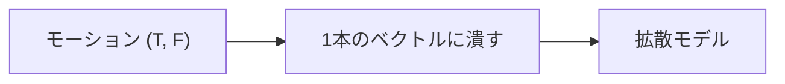
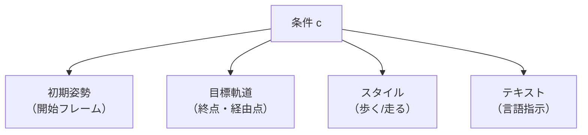
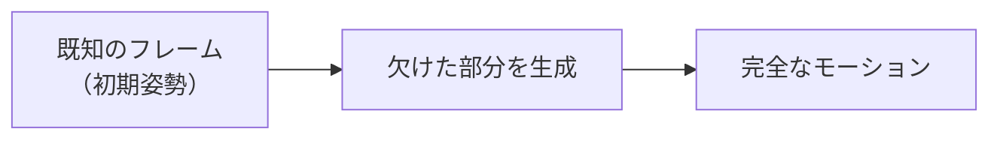
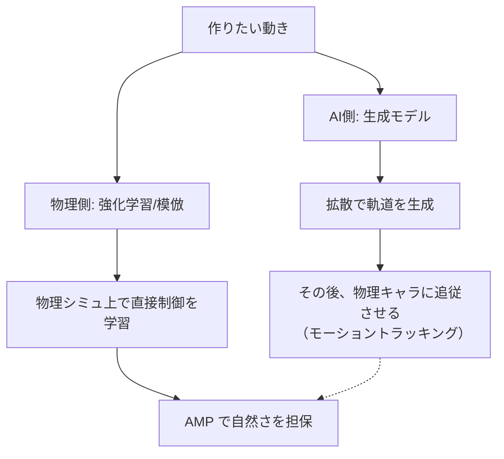

# 10. モーション生成への拡張 — アニメーションAIの到達点

## この章でわかること

- 2D バウンスボールの拡散モデルを、**モーション生成**へ拡張する方法
- データの形（`(フレーム, 関節×特徴)`）と、時系列向けのネットワーク
- 条件付け（初期姿勢・目標軌道・スタイル）の設計
- Diffusion Policy（制御への応用）
- 生成モデル（AI側）と物理制御（物理側）の関係

## 前提

- 第08〜09章（拡散モデル）、第04〜05章（時系列・系列モデル）、第07章（識別器）

## つながり

- この章は「AI側の学習」の到達点です。ここまでで、**PyTorch・時系列・生成モデル・拡散**を一通り経験しました。
- ここから先（第3部以降）は「物理側」に進み、最終的に論文（第6部）でキャラクタの物理制御に到達します。

---

## 1. 2D からモーションへ — 何が変わるか

第09章のバウンスボールは、データが `(64, 2)`（フレーム×xy）でした。モーションでも**同じ数学**が使えます。違いはデータの形だけです。

| 項目 | バウンスボール | モーション |
| --- | --- | --- |
| データ | `(64, 2)` | `(T, 関節数 × 特徴)` |
| 1次元に潰すと | 128次元 | `T × (関節数 × 特徴)` 次元 |
| 物理的な意味 | ボールの位置 | 関節の姿勢の系列 |

```python
# モーションを拡散モデルで扱う形に変換
motion = torch.randn(120, 22 * 6)          # (フレーム, 関節×特徴)
flat = motion.reshape(-1)                   # 1本のベクトル（拡散モデルの「データ」）
```



## 2. ただし「時系列」を意識する

単純に1本の巨大なベクトルにする方法は動きますが、**フレーム間の構造**を無視してしまいます。より良いのは、ネットワークで時間の構造を扱うことです。

| アプローチ | 内容 | 長所 |
| --- | --- | --- |
| 全結合（フラット） | 全フレームを1本のベクトルに | 実装が簡単（第09章のまま） |
| 時間方向 CNN | 時間の局所パターンを畳み込む | 局所的な動きに強い |
| Transformer | フレーム間の関係をアテンションで | 長距離依存・条件付けに強い |

```python
# フラット版（そのまま）
net_flat = Denoiser(data_dim=120 * 132, cond_dim=0)

# Transformer 版（発展）
net_tf = TemporalTransformer(dim=132, num_layers=4)   # (B, T, F) を扱う
```

> 発展研究では、モーション拡散は **Transformer**（拡散 Transformer）で実装されることが多くなっています。

## 3. 条件付け — お題をどう与えるか

モーション生成では、条件 $c$ が重要です。代表的なものを見ます。



| 条件 | 何を指定するか | 実装のヒント |
| --- | --- | --- |
| 初期姿勢 | 最初のフレーム | そのフレームを固定し、他を生成（inpainting 風） |
| 目標軌道 | ゴールや経由点 | ルート位置を条件に入力 |
| スタイル | 「歩く」「走る」 | スタイルの埋め込みベクトルを入力 |
| テキスト | 言語指示 | テキストエンコーダの埋め込みを入力 |

### inpainting（インペインティング）

「一部は与えられ、残りを生成する」手法は、拡散モデルが得意とするところです。



```python
# 条件: 0番目のフレームを固定する（概念的な擬似コード）
x = ノイズ
for t in reversed(range(T)):
    x = denoise_step(x, t, condition=initial_pose)
    x[0] = initial_pose        # 既知のフレームを上書き
```

**直感**: 「最初のポーズは与える。あとは“ありそうな続き”を生成しなさい」。ゲームの「この姿勢から自然につながるモーションを作って」に応えられます。

## 4. Diffusion Policy — 制御への応用

拡散モデルは**制御**にも使われます。**Diffusion Policy**（Chi et al. 2023）は、状態を条件に、**行動の系列**を生成します。

> Cheng Chi, et al. **Diffusion Policy: Visuomotor Policy Learning via Action Diffusion.** RSS 2023. <https://arxiv.org/abs/2303.04137>


- 「状態 $s_t$ を条件に、行動列 $a_{t}, a_{t+1}, \dots$ を生成」。
- 多様な行動（多峰性）を自然に表現できるのが強み。
- 第4部で学ぶ強化学習の「方策 $\pi$」を、**生成モデルで実現したもの**と見なせます。

| 通常の方策 | Diffusion Policy |
| --- | --- |
| 状態 → 行動（1ステップ） | 状態 → 行動の系列（生成） |
| ガウス分布を仮定 | 任意の分布を表現 |
| 推論1回 | 推論に複数ステップ |

> **つながり**: 論文は方策にガウス分布を使います（第24章の固定Σ）。Diffusion Policy は、そこを生成モデルに置き換えた発展形です。「将来の物理キャラ制御の選択肢」として位置づけられます。

## 5. 生成モデルと物理制御 — 2つの道

ここで「AI側」と「物理側」の関係を整理します。モーションを作るのに、2つの道があります。



| 道 | 手順 | 長所 | 短所 |
| --- | --- | --- | --- |
| AI側→物理 | 拡散で軌道を生成し、物理キャラで追従 | 多様な動きを作れる | 物理的に矛盾する軌道が出ることがある |
| 物理側 | RL/AMPで直接制御を学習 | 物理的に正しい | 自然さの担保に工夫が要る |

本論文は**物理側**の道（AMP の発展）を取り、物体との相互作用を扱います。拡散（AI側）は、この教科書で学んだもう1つの強力な道具です。

> 実際の研究では、**拡散で生成した動きを物理キャラに追従させる**という融合も進んでいます（モーショントラッキング＋生成モデル）。

## 6. 実装コード

- `src/ml_lern/generative/diffusion/motion.py`
  - `MotionDiffusion` … モーション用の拡散モデル
  - `make_motion_dataset()` … 手続き生成のモーション（関節の軌道）
  - `sample_conditional_pose()` … 初期姿勢を条件に生成

```bash
uv run python scripts/g04_diffusion_motion.py
```

> 第09章の 2D 実装を、データの形だけ `(B, T, F)` に拡張したものです。

## 7. つまずきやすいポイント

| 症状 | 対処 |
| --- | --- |
| 関節がガタガタ | 時間方向の構造を無視している。CNN/Transformer を使う |
| 条件が効かない | 条件の入力方法、inpainting の実装を確認 |
| 生成が物理的に変 | 生成後に物理的な補正（IK など）を入れる |
| 推論が遅い | サンプリングステップを減らす、蒸留を使う |

## 8. 第2部のまとめ

ここまでで「AI側」の基礎が一通り終わりました。

| 章 | 学んだこと | 使う場面 |
| --- | --- | --- |
| 01 | NumPy・配列 | すべての土台 |
| 02 | PyTorch・自動微分 | すべてのネット |
| 03 | ニューラルネット・学習 | 方策・識別器・拡散 |
| 04 | 時系列データ | モーション・ロールアウト |
| 05 | 系列モデル | 時間構造の扱い |
| 06 | 生成モデル・VAE | 分布を学ぶ |
| 07 | GAN・識別器 | **AMP の核** |
| 08 | 拡散の概念 | モーション生成 |
| 09 | 拡散の実装 | 実践 |
| 10 | モーション生成 | 到達点 |

次は「物理側」に進みます。第11章で MuJoCo を触り、第14章から強化学習、第19章で AMP（第07章の識別器が活きる）を学びます。

## まとめ

- 拡散モデルはモーション生成にそのまま拡張できる（データの形を変えるだけ）。
- 時間構造を扱うには CNN/Transformer を使う。条件付け（初期姿勢等）が重要。
- Diffusion Policy は「生成モデルによる方策」。制御の新しい選択肢。
- 論文は物理側の道（AMP）を取る。拡散は AI側の道で、融合も進んでいる。

## 手を動かそう

> **一歩目**: 自分のキャラの関節軌道（`(フレーム, 関節×特徴)`）で拡散モデルを学習し、初期姿勢を条件にモーションを生成する。

```bash
uv run python scripts/g04_diffusion_motion.py
```

初期姿勢を固定したまま、続きの動きが生成されます（inpainting）。

**いじってみる**: 条件に「ゴール姿勢」も加えて、始点と終点の間を生成させる。フレーム数を伸ばして長いモーションにする。生成結果を関節ごとにプロットしてガタつきを観察する。

**夢が広がる**:
- 「この2つのポーズの間を埋めて」と指示すると、中間モーションを自動生成する（アニメの補間）。
- プレイヤーの操作から、それに続く自然なモーションを予測する（予測入力）。
- 少量の実データから、NPC の動きを無限にバリエーション生成する。

## 演習

1. バウンスボールの実装を、データを `(B, T, 2)` に変えてモーション風にしてみましょう（本質は同じことを確認）。
2. モーション生成で「初期姿勢」を条件にするとき、inpainting をどう実装するか考えましょう。
3. Diffusion Policy と通常の方策の違いを、多峰性（複数の行動があり得る）の観点で説明しましょう。
4. AI側（拡散）と物理側（RL）の融合が、どんな場面で有効か考察しましょう。

---

第2部はここまで。次章（第3部）: [11. 物理エンジン入門 — MuJoCo](11_物理エンジン入門_MuJoCo.md)
