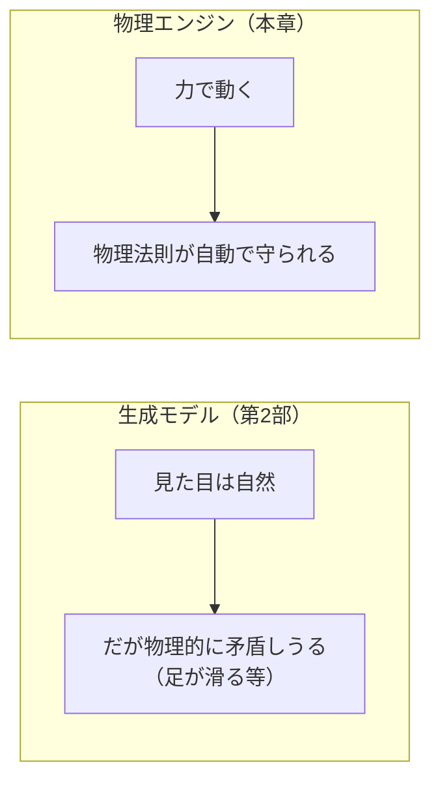
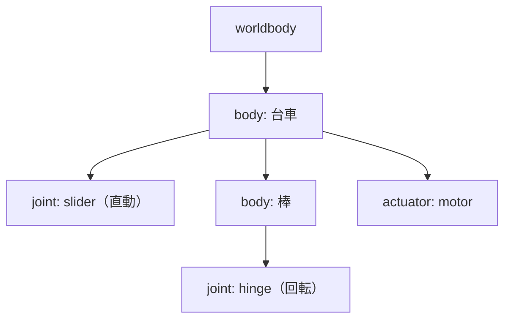
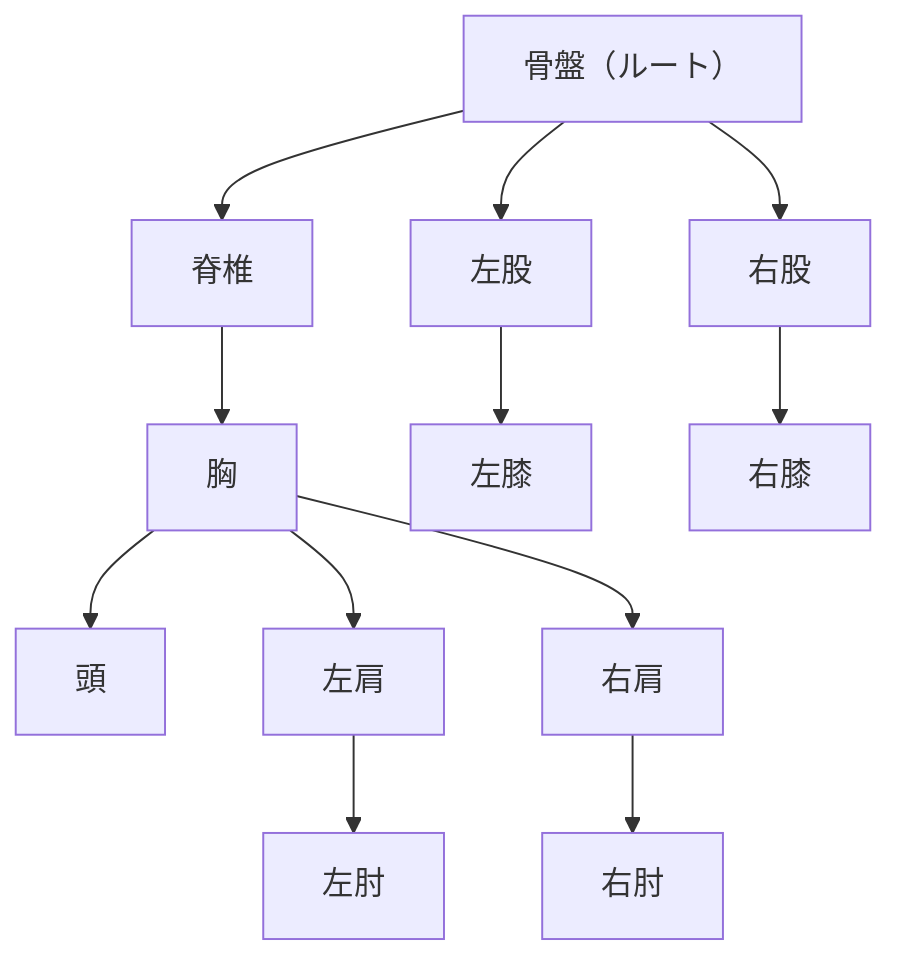

# 11. 物理エンジン入門 — MuJoCo

## この章でわかること

- 物理エンジンとは何か、なぜキャラクタ制御に必要か
- MuJoCo のモデル（MJCF/XML）の読み方
- 剛体（body）・関節（joint）・形状（geom）・アクチュエータ（actuator）
- モデルを作って Python から読み込む

## 前提

- 第02章（PyTorch のテンソル）※概念理解のみ
- 高校物理（力と運動のイメージ）

## つながり

- この章のモデルが、第4部の強化学習（RL）の**環境**になります。
- 第5部の AMP、第6部の論文は、すべてこの物理シミュレーションの上で動きます。

---

## 1. なぜ物理エンジンを使うのか

第2部で、拡散モデルで「それらしいモーション」を生成できることを学びました。しかし生成したモーションは、**物理法則を守っていない**ことがあります（足が滑る、体が地面に埋まる）。

物理エンジンを使うと、キャラクタは**力（トルク）で動き**、接触・摩擦・重力が自動で計算されます。結果として、**物理的に正しい動き**になります。



| エンジン | 特徴 | この本での扱い |
| --- | --- | --- |
| **MuJoCo** | ロボティクス標準。CPUで動く。接触計算が高精度 | 中心（本章〜） |
| IsaacGym | NVIDIA GPU で大規模並列 | 発展（第39章） |
| Genesis | 新しい多機能エンジン（GPU中心） | 参考（第39章） |

> 論文は IsaacGym を使います（GPU必須）。この本は CPU で動く **MuJoCo** を中心に、同じ考え方を学びます。

## 2. MuJoCo のモデル（MJCF）

MuJoCo では、キャラクタや物体を **MJCF（MuJoCo XML Format）** という XML で書きます。ゲームエンジンのシーンファイルに相当します。

```xml
<mujoco model="pendulum">
  <option timestep="0.01"/>                      <!-- 物理の刻み幅（秒） -->

  <worldbody>
    <body name="cart" pos="0 0 0">               <!-- 剛体: 台車 -->
      <joint name="slider" type="slide" axis="1 0 0"/>   <!-- 関節: 直動 -->
      <geom type="capsule" size="0.1" fromto="-0.1 0 0 0.1 0 0"/>  <!-- 形状 -->
      <body name="pole" pos="0 0 0">             <!-- 剛体: 棒（台車の子） -->
        <joint name="hinge" type="hinge" axis="0 1 0"/>  <!-- 関節: 回転 -->
        <geom type="capsule" size="0.05" fromto="0 0 0 0 0 0.6"/>
      </body>
    </body>
  </worldbody>

  <actuator>
    <motor joint="slider" ctrlrange="-1 1"/>      <!-- 台車を押す力 -->
  </actuator>
</mujoco>
```

### 主要な要素

| 要素 | 意味 | ゲームでの対応 |
| --- | --- | --- |
| `<worldbody>` | 剛体の木構造のルート | シーン |
| `<body>` | 剛体（リンク）。入れ子で親子関係 | ノード |
| `<joint>` | 関節。`hinge`（回転）/`slide`（直動）/`free`（自由） | ジョイント |
| `<geom>` | 形状（当たり判定と見た目） | コライダ |
| `<actuator>` | 力を加える装置（モータなど） | 制御入力 |
| `<option timestep>` | 物理の刻み幅 | 固定タイムステップ |



## 3. キャラクタは「剛体リンク＋関節」

前章までの状態ベクトル（第04章）の正体は、この**剛体リンクの木構造**です。



- **ルート**（多くは骨盤）が全体の位置と向きを持ちます。
- 各関節は**自由度（DoF）**を持ちます（回転なら1〜3）。
- 関節を動かすには**トルク**を加えます（次章）。

ゲームエンジンのラグドールやアーマチュアと、基本的に同じ構造です。

## 4. Python から読み込んで動かす

MuJoCo は Python API と、それをラップした gymnasium を提供します。まずは生の MuJoCo を触ってみます。

```python
import mujoco

model = mujoco.MjModel.from_xml_string(xml_string)   # モデルを読み込む
data = mujoco.MjData(model)                          # 状態データ

for _ in range(1000):
    data.ctrl[:] = 0.1     # アクチュエータに入力を与える
    mujoco.mj_step(model, data)   # 1ステップ進める

print("関節角:", data.qpos)     # 位置・角度
print("関節速度:", data.qvel)   # 速度
```

| 変数 | 中身 | 対応 |
| --- | --- | --- |
| `model` | モデル（構造・パラメータ） | 変わらない定義 |
| `data.qpos` | 関節の位置・角度 | 状態の「姿勢」 |
| `data.qvel` | 関節の速度 | 状態の「速度」 |
| `data.ctrl` | アクチュエータへの入力 | 行動 |

> **つながり**: `qpos`（姿勢）と `qvel`（速度）が、強化学習の「状態」の核になります（第14章）。

## 5. gymnasium 経由で使う

学習では、環境のインターフェースを揃えるため **gymnasium** を使います。MuJoCo の標準タスクがあらかじめ用意されています。

```python
import gymnasium as gym

env = gym.make("InvertedPendulum-v5")     # 倒立振子
obs, info = env.reset(seed=0)
print("obs_dim =", env.observation_space.shape)    # 状態の次元
print("action_dim =", env.action_space.shape)      # 行動の次元

for _ in range(100):
    action = env.action_space.sample()             # ランダムな行動
    obs, reward, terminated, truncated, info = env.step(action)
    if terminated or truncated:
        obs, info = env.reset()
env.close()
```

gymnasium が提供する MuJoCo 環境:

| 環境 | 内容 | 難易度 |
| --- | --- | --- |
| `InvertedPendulum-v5` | 倒立振子（バランス） | 易 |
| `Reacher-v5` | 腕で目標に届く | 易 |
| `Hopper-v5` | 片足で跳ねて前進 | 中 |
| `Walker2d-v5` | 二足歩行 | 中〜難 |
| `Ant-v5` | 四足歩行 | 中 |
| `Humanoid-v5` | 人型 | 難 |

> **つながり**: 第7部の「寄り道」（第29〜32章）で、これらを易しい順に使います。

## 6. 人型（humanoid）モデル

MuJoCo には標準で**人型モデル**があります。

```python
env = gym.make("Humanoid-v5")
print("obs_dim:", env.observation_space.shape)   # 300次元前後
print("action_dim:", env.action_space.shape)     # 17前後
```

- 人型は、骨盤をルートに、胴・頭・両腕・両脚の剛体リンクを持ちます。
- 関節の数だけ行動（目標角）があります。
- 論文のキャラクタ（IsaacGym）とはモデルが違いますが、**「剛体リンク＋PD制御」という構成は同じ**です。

> 論文のキャラクタは 114次元状態・28次元行動でした（第23章）。MuJoCo の humanoid はモデルが違うため次元も変わりますが、考え方は同じです。

## 7. 可視化

GUI 環境では `render_mode="human"` でウィンドウ表示できます。

```python
env = gym.make("Walker2d-v5", render_mode="human")
obs, _ = env.reset()
for _ in range(1000):
    obs, r, term, trunc, _ = env.step(env.action_space.sample())
    if term or trunc:
        obs, _ = env.reset()
```

headless 環境では `render_mode="rgb_array"` でフレームを取得し、動画や画像として保存します。

```python
env = gym.make("Walker2d-v5", render_mode="rgb_array")
frame = env.render()      # numpy 配列（H, W, 3）
```

## 8. 実装コード

- `src/ml_lern/core/mujoco_basics.py`
  - `load_and_step()` … 生の MuJoCo でモデルを読み込み、ステップ
  - `make_env()` … gymnasium の環境を作る
  - `inspect_spaces()` … 状態・行動の次元を確認

```bash
uv run python scripts/p01_mujoco_basics.py
```

## 9. つまずきやすいポイント

| 症状 | 対処 |
| --- | --- |
| `ModuleNotFoundError: mujoco` | `uv sync --extra train` |
| 形が合わない | `model.nq`, `model.nv`, `action_space.shape` を確認 |
| モデルが動かない | `mj_step` を呼んでいるか、`ctrl` を設定しているか |
| ウィンドウが出ない | headless。`render_mode="rgb_array"` を使う |
| 挙動が不安定 | `timestep` を小さくする（次章） |

## まとめ

- 物理エンジンは、キャラクタを「力で動かし」物理法則を守らせる。
- MuJoCo は MJCF（XML）でモデルを記述する。剛体リンク＋関節の木構造。
- `qpos`（姿勢）と `qvel`（速度）が状態の核。`ctrl` が入力。
- gymnasium 経由で標準タスク（倒立振子〜人型）が使える。
- この環境が、第4部以降の強化学習の舞台になる。

## 手を動かそう

> **一歩目**: 自分のゲームのオブジェクト（箱、坂、玉）を MuJoCo の XML で書いて、転がしてみる。

```xml
<mujoco model="my_scene">
  <option timestep="0.002"/>
  <worldbody>
    <geom name="floor" type="plane" size="5 5 0.1"/>
    <body name="box" pos="0 0 1">
      <geom type="box" size="0.2 0.2 0.2" rgba="1 0.5 0 1"/>
      <freejoint/>
    </body>
  </worldbody>
</mujoco>
```

`mujoco.MjModel.from_xml_string(...)` で読み込み、`mj_step` を回して、箱が落ちて跳ねるのを見る。

**いじってみる**: `size` や `density`、`friction` を変えて挙動を観察する。`freejoint` を `hinge` にすると「蝶番で回る板」になる。

**夢が広がる**:
- ゲームの物理挙動を MuJoCo で再現し、パラメータ調整に使う。
- 破壊オブジェクト（積み木、ドミノ）の挙動を事前検証する。
- 物理的なパズルの自動テストや、挙動バグの再現に使う。

## 演習

1. 上の XML を実行し、台車が動くことを確認しましょう。
2. `InvertedPendulum-v5` の `observation_space` と `action_space` の次元を答えましょう。
3. humanoid と倒立振子で、関節（行動）の数がどう違うか確認しましょう。
4. `render_mode="rgb_array"` でフレームを取得し、画像として保存してみましょう。

---

次章: [12. シミュレーションの1ステップ](12_シミュレーションの1ステップ.md)
