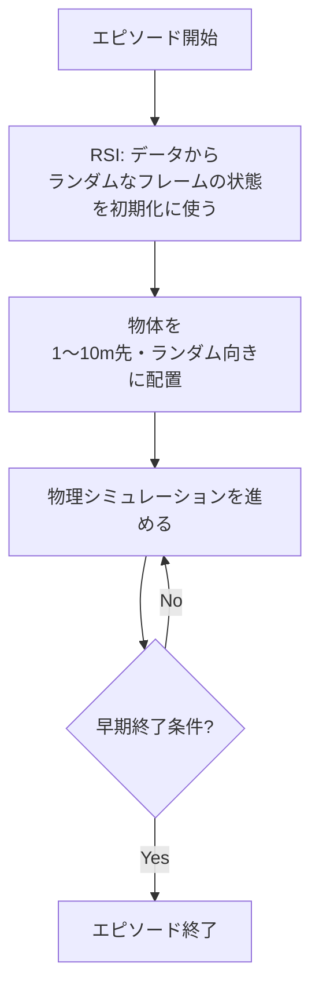
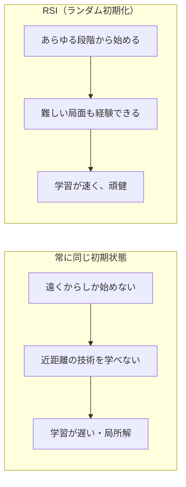
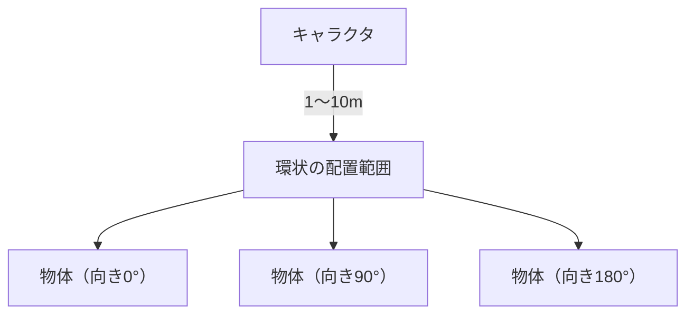
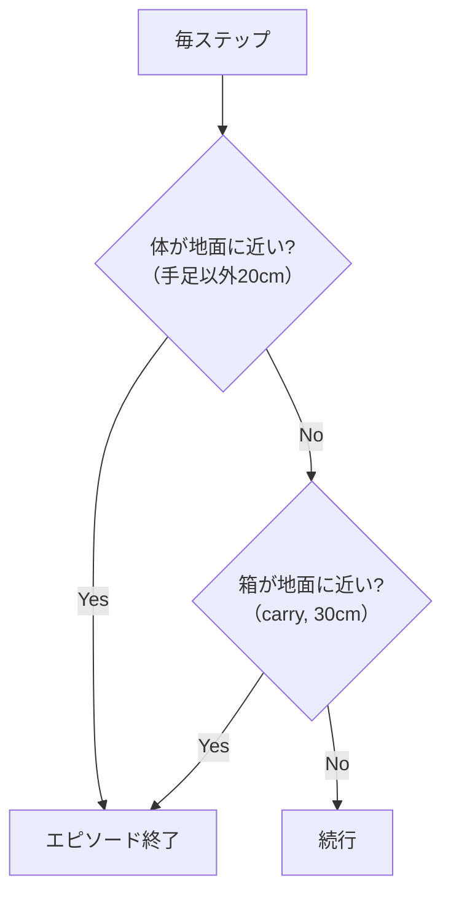
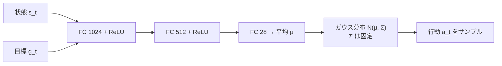

# 11. 訓練の実際

## この章でわかること

- Reference State Initialization（RSI）とは何か、なぜ効くのか
- 物体配置・向きのランダム化とその範囲
- エピソード長・早期終了条件
- ネットワーク構成（方策・価値関数・識別器）
- 学習を成功させる勘所

## 前提

- 第02章（PPO）、第06章（PD制御）、第10章（データ）

---

## 1. 訓練の全体像（論文 §6）

論文 §6「Training」のポイントを順に見ます。訓練は大きく3つの工夫で成り立っています。

1. **RSI（Reference State Initialization）**: エピソード開始状態をランダム化する。
2. **物体配置のランダム化**: 物体の位置・向きを毎エピソード変える。
3. **早期終了**: 失敗状態になったらエピソードを切る。

## 2. Reference State Initialization（RSI）

### 何をするか

エピソード開始時に、キャラクタと物体を**データセットからランダムにサンプルした状態**に初期化します（Peng et al. 2018 由来）。

- あるときは物体から遠くに初期化 → 「歩いて近づく」を学ぶ。
- あるときは座りかけの状態に初期化 → 「最後のひと押し」を学ぶ。
- あるときは座り終えた状態 → 「姿勢の維持」を学ぶ。

### なぜ効くか

- **カリキュラム効果**: 難しい局面（座りかけ）を最初から経験できる。
- **探索の効率化**: 遠くから歩いて到達する前に時間切れになる、という無駄を減らす。
- **多様な経験**: 1つの初期状態に過学習しない。

### ゲームのたとえ

ゲームのチュートリアルで、毎回ステージ1から始めるのではなく、**途中のチェックポイントから練習できる**ようなものです。難しいボス戦を何度も練習できるので上達が速い。

論文の表現:

> This Reference State Initialization approach has been shown to significantly speed up training progress and produce more realistic motions.
> （RSI は訓練を大幅に加速し、より自然な動きを生むことが示されている）

## 3. 物体配置のランダム化

RSI だけでは不十分です。参照モーションは限られた配置しか含まないので、あらゆる配置をカバーできません。そこで**物体の配置をランダム化**します（§6）。

| パラメータ | 範囲 |
| --- | --- |
| 物体の水平距離 | キャラクタから **1〜10 m** |
| 物体の向き | **[0, 2π]** から一様にサンプル |

これにより、方策は「物体がどこにあっても」「どの向きでも」タスクを遂行できるようになります。

これは第10章で述べた「一般化」の中心的な仕組みです。実演にない配置でも、訓練で経験するので対応できます。

## 4. エピソード長と早期終了

### エピソード長

- sit / lie down: **10秒**
- carry: **15秒**

### 早期終了条件

失敗とみなしてエピソードを切る条件:

- 手足を除く**いずれかの関節が地面から20cm以内**（＝転倒・体が地面に接触）。
- 箱が**地面から30cm以内**（＝箱を落とした）。

**早期終了の意味**: 失敗状態でダラダラ学習するのを防ぎ、学習効率を上げます。また「転倒したら終わり」という信号が、転倒を避ける行動を学ばせます。

## 5. ネットワーク構成

論文 §6 で明示されている構成です。

| ネットワーク | 構成 | 出力 |
| --- | --- | --- |
| 方策 $\pi$ | FC {1024, 512, 28} | ガウス分布の平均 $\mu$（28次元行動） |
| 価値関数 $V$ | FC {1024, 512, 1} | 状態価値（スカラー） |
| 識別器 $D$ | FC {1024, 512, 1} | 本物らしさ（スカラー） |

- **FC**: fully-connected（全結合）。中規模の MLP（多層パーセプトロン）。
- 活性化: **ReLU**。
- 方策の出力は、ガウス分布の平均 $\mu$。共分散 $\Sigma$ は**手動で指定し固定**。

### 方策の数式（§6）

$$
\pi(\mathbf{a}_t \mid \mathbf{s}_t, \mathbf{g}_t) = \mathcal{N}\!\big(\mu(\mathbf{s}_t, \mathbf{g}_t),\ \Sigma\big)
$$

> 補足: 固定の共分散は、学習を安定させ、探索の量を一定に保つ役割があります。共分散も学習させると、早々に探索をやめて局所解にはまりやすくなります。

## 6. 学習の勘所

本論文に限らず、物理キャラ RL でよく効く工夫をまとめます。

| 工夫 | 効果 |
| --- | --- |
| RSI | 難所を最初から経験、学習加速 |
| 物体ランダム化 | 未知配置への一般化 |
| 早期終了 | 無駄な学習を削減、転倒回避 |
| 固定の行動分散 | 安定した探索 |
| PD 制御（目標角） | 扱いやすい行動空間 |
| 並列環境（多数） | サンプル効率、多様性 |
| 勾配ペナルティ | 識別器訓練の安定化 |
| 報酬の正規化・スケーリング | 報酬バランスの調整 |

## 7. 訓練がうまくいかない典型パターン

| 症状 | 原因の候補 |
| --- | --- |
| 動くが不自然 | スタイル報酬の重みが小さい／識別器が弱い |
| 自然だが目的を果たさない | タスク報酬の重みが小さい／報酬設計が甘い |
| 転倒ばかり | 早期終了が厳しすぎ／報酬にバランス項がない |
| 学習が進まない | RSI なし／並列数不足／学習率ミス |
| 特定の物体だけ苦手 | ランダム化の範囲が狭い |

これは第29章（トラブルシューティング）でさらに掘り下げます。

## 8. まとめ

- RSI でランダムな段階から学習を始め、難所を経験させる。
- 物体の位置（1〜10m）・向き（0〜2π）を毎エピソードランダム化する。
- エピソードは sit/lie で10秒、carry で15秒。転倒・落下で早期終了。
- 方策・価値関数・識別器はいずれも {1024, 512} の MLP。方策は固定共分散のガウス。

## 演習

1. RSI がない場合、なぜ「近距離の技術」を学びにくいか説明しましょう。
2. 早期終了を入れずに学習させると、どんな問題が起きるか述べましょう。
3. 方策の共分散 $\Sigma$ を学習させると、どんなリスクがあるか考察しましょう。

---

次章: [12. 報酬関数を読む](12_報酬関数を読む.md) ／ 前章: [10. モーションデータセット](10_モーションデータセット.md)
