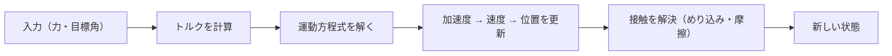
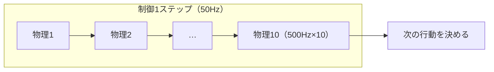
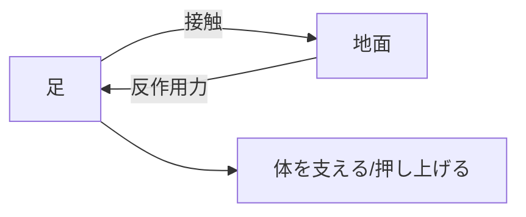
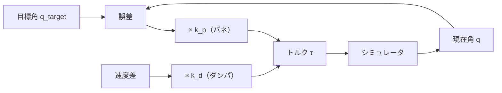

# 12. シミュレーションの1ステップ — 力から動きへ

## この章でわかること

- 物理シミュレーションの1ステップで何が起きるか
- 運動方程式（力→加速度→速度→位置）
- timestep・制御周波数・decimation（間引き）
- 接触と摩擦
- PD制御で関節を動かす（行動＝目標角）

## 前提

- 第11章（MuJoCo・剛体リンク）

## つながり

- 「行動＝目標角を PD 制御に渡す」という設計は、第4部の RL の**行動空間**、第5部の AMP、第6部の論文まで一貫して使われます。

---

## 1. シミュレーションの1ステップ

シミュレータは、毎ステップ次の順で計算します。



高校物理の運動方程式そのものです。

$$
m \ddot{\mathbf{x}} = \mathbf{F}, \qquad I \dot{\boldsymbol{\omega}} = \boldsymbol{\tau}
$$

- $m$ … 質量、$\mathbf{F}$ … 力、$\ddot{\mathbf{x}}$ … 加速度
- $I$ … 慣性モーメント、$\boldsymbol{\tau}$ … トルク、$\boldsymbol{\omega}$ … 角速度

重力・接触力・関節トルクをすべて足し合わせて、次のフレームの状態を求めます。

## 2. timestep — 物理の刻み幅

`timestep` は、1ステップで進む時間（秒）です。

- `timestep=0.002` … 1秒に500ステップ（正確・重い）
- `timestep=0.01` … 1秒に100ステップ（軽い・荒い）

小さくするほど正確ですが計算量が増えます。大きすぎると、接触が破綻して体がめり込んだり暴れたりします。

```xml
<option timestep="0.002"/>
```

ゲームの固定タイムステップ物理（`FixedUpdate`）と同じ考え方です。

## 3. 制御周波数と decimation（間引き）

物理の刻みと、**方策が行動を出す頻度（制御周波数）**は別ものです。

- 物理周波数: 500Hz（timestep=0.002）
- 制御周波数: 50Hz（方策は20msごとに判断）

1回の制御ステップの間に、物理を複数回回します。これを **decimation（間引き）** と呼びます。



```python
# decimation の実装（概念）
for _ in range(decimation):        # 例: 10
    data.ctrl[:] = action          # 同じ行動を保持
    mujoco.mj_step(model, data)
```

**なぜ分けるのか**: 人間も毎ミリ秒意思決定しているわけではありません。制御を遅くすると、計算が軽く、学習も安定します（行動が急変しない）。

## 4. 接触と摩擦

物理キャラの成否を分けるのが**接触（contact）**です。

- 足が地面に着く → 接触力が発生。
- 蹴り出しは、地面を押す反作用。
- 摩擦が、滑りを防ぐ。



接触を正しく扱えないと、足が滑ったり、体が地面に埋まったりします。これは第2部の生成モデルが苦手だった点です（第13章の比較参照）。

MuJoCo では摩擦係数を `geom` で指定します。

```xml
<geom type="capsule" size="0.05" friction="1.0 0.005 0.0001"/>
<!--                                   ↑滑り摩擦 ↑回転摩擦 ↑転がり摩擦 -->
```

## 5. PD制御 — 関節を目標角へ動かす

関節に直接トルクを出してもよいですが、それだと学習が難しい。そこで**PD制御**を使います。

$$
\tau = k_p\,(q^{\text{target}} - q) + k_d\,(\dot{q}^{\text{target}} - \dot{q})
$$

- $q$ … 現在の関節角、$\dot{q}$ … 関節角速度
- $q^{\text{target}}$ … 目標角
- $k_p$ … 比例ゲイン（バネの強さ）
- $k_d$ … 微分ゲイン（ダンパ、揺れを抑える）

ゲームエンジニアにはおなじみの**バネ＋ダンパ**です。



MuJoCo では `position` アクチュエータが内部で PD 制御を行います。

```xml
<actuator>
  <position joint="hinge" kp="20" kv="1"/>   <!-- 目標角へ PD 制御 -->
</actuator>
```

```python
target_angle = [0.5]
obs, reward, terminated, truncated, info = env.step(target_angle)   # 目標角を渡す
```

## 6. なぜ「行動＝目標角」なのか

論文も、方策（RL）は**関節トルクではなく目標角**を出力します。理由は次の通りです。

1. **探索空間がなめらか**: トルクを直接学ぶより安定・高速。
2. **物理的な意味が明確**: 「膝を45度に」の方が「膝にτ」より扱いやすい。
3. **ゲーム・ロボットとの整合**: 位置目標＋PD は標準的。

> **つながり**: 論文の行動は「各関節の目標角（28次元）」（第23章）。この章の PD 制御がその基礎です。行動の変化量を制限したり、トルクに上限を設けたりもします。

## 7. ランダムな行動で動かしてみる

学習の前に、ランダムな行動でシミュレータの挙動を観察します。

```python
import gymnasium as gym

env = gym.make("Walker2d-v5")
obs, _ = env.reset(seed=0)
for t in range(200):
    action = env.action_space.sample()          # ランダムな目標角
    obs, reward, terminated, truncated, info = env.step(action)
    if terminated or truncated:
        print(f"t={t} で終了")
        break
```

ランダムだとすぐ転びます。これを、学習で「転ばず歩く」ようにしていくのが次の部です。

## 8. 実装コード

- `src/ml_lern/core/mujoco_basics.py`
  - `step_loop()` … 生の MuJoCo でステップループ
  - `pd_control_demo()` … PD 制御のデモ
  - `random_rollout()` … ランダム行動のロールアウト

```bash
uv run python scripts/p01_mujoco_basics.py
```

## 9. つまずきやすいポイント

| 症状 | 対処 |
| --- | --- |
| 体が地面に埋まる | `timestep` を小さく、初期位置を上げる |
| 関節が暴れる | `kp` を下げる、行動をクリップ |
| 足が滑る | 摩擦係数を上げる、制御周波数を調整 |
| カクカクする | 制御周波数を上げる、decimation を減らす |

## まとめ

- 1ステップで「力→加速度→速度→位置→接触」を計算する。
- `timestep` は物理の刻み。制御周波数とは別。decimation で橋渡しする。
- 接触と摩擦が物理キャラの成否を分ける。
- 関節は PD 制御で目標角へ動かす。行動＝目標角が定番。

## 手を動かそう

> **一歩目**: PD ゲインを変えて、関節の挙動を観察する。

```bash
uv run python scripts/p01_mujoco_basics.py
```

`pd_control_demo` が「目標角」を渡して動かします。

**いじってみる**: `kp` を 200 にすると関節が振動・発散する。`timestep` を 0.02 にすると接触が破綻して体がめり込む。`friction` を 0 にすると滑る。それぞれ「なぜ起きるか」を本文の式で説明してみる。

**夢が広がる**:
- ゲームのキャラクタコントローラを、PD＋目標角で作り直す。
- ラグドールの「立て直し」挙動を、PD の調整で自然にする。
- 物理パズル（振り子、シーソー、坂道）の挙動を設計・検証する。

## 演習

1. `timestep` を 0.001 と 0.02 にしたとき、シミュレーションの挙動の違いを観察しましょう。
2. PD 制御の $k_p$ を大きくしすぎると何が起きるか、バネのたとえで説明しましょう。
3. 摩擦係数を 0 にすると、歩行がどうなるか予想しましょう。
4. 人間が毎ミリ秒意思決定しないことを踏まえ、制御周波数を下げる利点を説明しましょう。

---

次章: [13. シミュレータで人型を動かす](13_シミュレータで人型を動かす.md) ／ 前章: [11. 物理エンジン入門](11_物理エンジン入門_MuJoCo.md)
