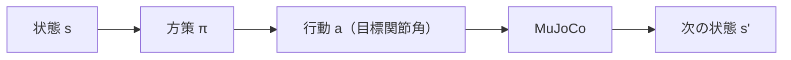
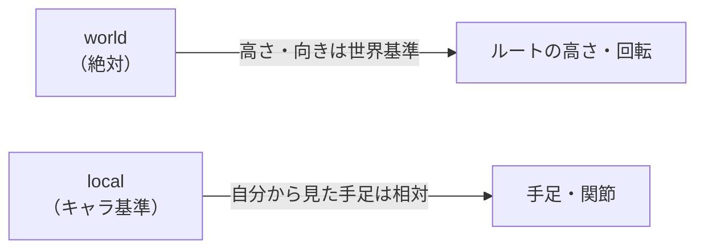
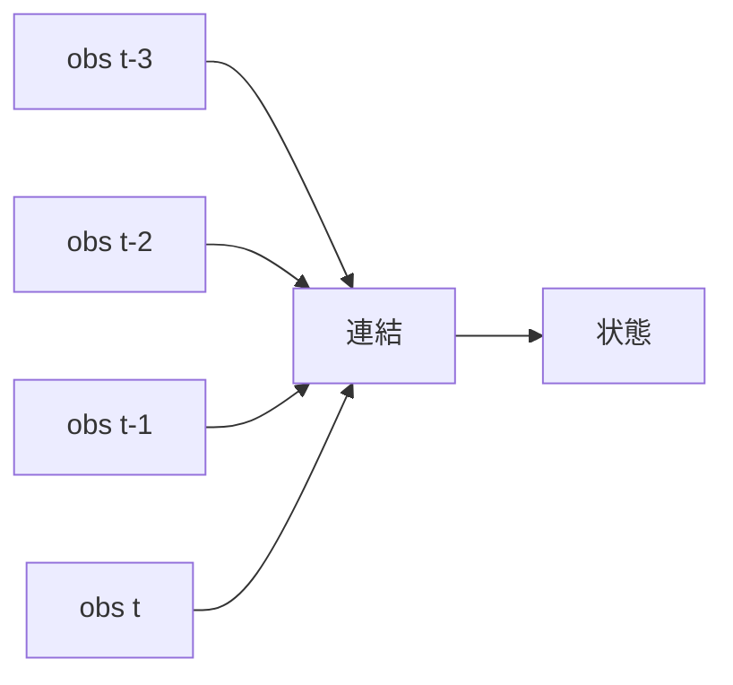
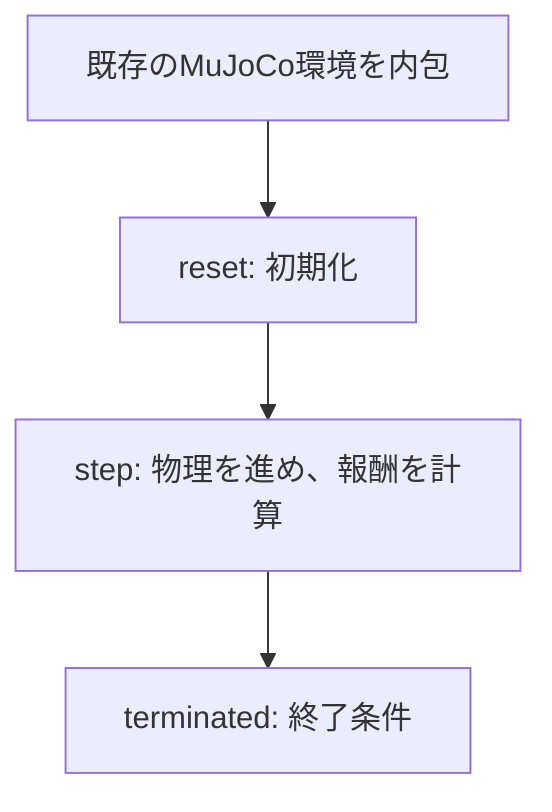

# 13. シミュレータで人型を動かす — 状態と行動を設計する

## この章でわかること

- シミュレータの「状態」と「行動」をどう設計するか
- 観測（observation）の中身と、world/local 座標の使い分け
- 履歴（フレームスタッキング）を状態に加える理由
- 自分で簡単なタスク（環境）を作る手順

## 前提

- 第11〜12章（MuJoCo・PD制御）、第04章（時系列データ）

## つながり

- この章の「状態設計」は、第14章の MDP、第17章の報酬設計、第23章（論文の114次元状態）に直結します。
- **何を状態に入れるかで学習の成否が決まる**、という感覚を持ってください。

---

## 1. 状態と行動を決める

シミュレータを強化学習の環境として使うには、次の2つを設計します。

- **状態 $s$**: 方策が意思決定に使う情報
- **行動 $a$**: 方策が出力する操作



## 2. MuJoCo humanoid の観測の中身

`Humanoid-v5` の観測は、おおよそ次の要素から成ります。

| 要素 | 内容 | 座標系 |
| --- | --- | --- |
| ルートの高さ | 骨盤の高さ | world |
| ルートの向き | 胴体の回転 | world |
| ルートの速度 | 線速度・角速度 | local |
| 関節角 | 各関節の角度 | local |
| 関節速度 | 各関節の角速度 | local |
| 手足の位置 | 手・足の先端 | local |
| 外力・接触 | （あれば） | — |

> これは論文の114次元状態（第23章）と、ほぼ同じ構成です。論文はこれに**物体の位置・向き**を足します（シーン条件付け）。

## 3. world と local を使い分ける理由

座標系の使い分けは重要です。

- **world 座標**: 世界全体から見た絶対的な値。**ルートの高さ・向き**はこれ。
- **local 座標**: キャラクタ自身から見た相対値。**手足の位置・関節**はこれ。



**理由**: キャラクタが世界のどこにいても、同じ動きができるべきです。手足を自分基準にすれば、**位置に依存しない行動**を学べます。これは「並進・回転不変性を入力設計で与える」という機械学習の定石です。

## 4. 履歴を状態に加える

1フレームの観測だけでは「今どれだけ速く動いているか」が分かりません。そこで**直近の履歴**を状態に加えます（第05章のフレームスタッキング）。

```python
# 直近4フレームをスタックする
def stack_obs(history, obs, stack=4):
    history.append(obs)
    if len(history) > stack:
        history.pop(0)
    return torch.cat(history, dim=-1)
```



> 論文の状態には速度（関節速度・ルート速度）が明示的に入っています。速度が入っていれば履歴は必須ではありませんが、履歴を加えると学習が安定することがあります。

## 5. 簡単な環境を作る手順

gymnasium の環境を自作する流れを押さえます。ここでは「関節を目標角に保つ」簡単なタスクを例にします。

```python
import gymnasium as gym
import numpy as np

class SimpleEnv(gym.Env):
    def __init__(self):
        super().__init__()
        self.sim = gym.make("InvertedPendulum-v5")      # 既存のMuJoCo環境を内包
        self.observation_space = self.sim.observation_space
        self.action_space = self.sim.action_space

    def reset(self, seed=None):
        obs, info = self.sim.reset(seed=seed)
        self.steps = 0
        return obs, info

    def step(self, action):
        obs, _, terminated, truncated, info = self.sim.step(action)
        reward = self._task_reward(obs)          # タスク報酬（第17章）
        self.steps += 1
        terminated = terminated or self.steps > 500
        return obs, reward, terminated, truncated, info

    def _task_reward(self, obs):
        # 例: 棒が立っているほど高い（第17章で詳述）
        return float(np.exp(-5.0 * obs[1] ** 2))
```



**ポイント**: いきなり複雑な環境を作らず、**既存の環境を内包して報酬だけ変える**のが定石です。第7部でもこの方法を使います。

## 6. 観測を確認する

自作環境を作る前に、既存環境の観測を確認します。

```python
import gymnasium as gym
import numpy as np

env = gym.make("Humanoid-v5")
obs, _ = env.reset(seed=0)
print("obs shape:", obs.shape)
print("obs の例:", np.round(obs[:10], 3))
print("action shape:", env.action_space.shape)
```

`data.qpos` / `data.qvel` と照らし合わせると、観測が何を表すか推測できます。

## 7. 可視化して確かめる

設計した状態・行動が妥当かは、実際に動かして確認します。

```python
env = gym.make("Humanoid-v5", render_mode="rgb_array")
obs, _ = env.reset(seed=0)
frames = []
for _ in range(300):
    action = env.action_space.sample()
    obs, r, term, trunc, _ = env.step(action)
    frames.append(env.render())
    if term or trunc:
        break
# frames を GIF に保存（imageio など）
```

## 8. 実装コード

- `src/ml_lern/core/mujoco_basics.py`
  - `inspect_spaces()` … 観測・行動の次元確認
  - `SimpleTaskEnv` … 既存環境を内包した自作環境の例
  - `frame_stack()` … フレームスタッキング

```bash
uv run python scripts/p01_mujoco_basics.py
```

## 9. つまずきやすいポイント

| 症状 | 対処 |
| --- | --- |
| 学習が進まない | 状態に必要な情報（速度・物体）が入っているか確認 |
| 位置に依存してしまう | 絶対座標を local に変換する |
| 履歴で次元が膨らむ | スタック数・特徴を絞る |
| 終了条件がない | `terminated` を適切に設定（転倒・時間切れ） |

## まとめ

- シミュレータを RL 環境にするには、状態と行動を設計する。
- 観測はルート（world）と関節・手足（local）を使い分ける。
- 履歴を状態に加えると、速度などの推定が楽になる。
- 自作環境は「既存環境を内包して報酬を変える」のが定石。

## 手を動かそう

> **一歩目**: 自分のゲームのキャラについて「学習の状態ベクトル」を設計する。何を world / local で入れるか、速度・物体・HP などを表にする。

```python
from ml_lern.core.mujoco_basics import frame_stack
import torch
hist = []
obs = torch.randn(50)
stacked = frame_stack(hist, obs)                 # 直近4フレームを連結
print(stacked.shape)                             # (200,)
```

**いじってみる**: 状態に「HP」「スタミナ」を足す／足さないで、学習しやすさが変わるかを想像する。絶対座標を local に直す変換を書く。

**夢が広がる**:
- 自分のゲームのキャラに、学習で制御できる「状態入力を設計」する。
- メニューや UI の状態を学習の入力にして、自動テストや操作補助を作る。
- 対戦ゲームの観測を設計し、AI が強いプレイを学べるようにする。

**再現レシピ**: [レシピ14（付録F）](付録F_再現レシピ_物理側.md#recipe-14)（コメント付きの再現コードで試せます）

## 演習

1. `Humanoid-v5` の観測の中身を、`qpos`/`qvel` と照らし合わせて推測しましょう。
2. 手足の位置を world ではなく local で入れる利点を説明しましょう。
3. フレームスタッキングのスタック数を 1 と 4 で比べ、学習への影響を考察しましょう。
4. 既存の環境を内包して、報酬だけ変えた自作環境を作りましょう。

---

第3部はここまで。次章: [14. 強化学習の基礎](14_強化学習の基礎.md) ／ 前章: [12. シミュレーションの1ステップ](12_シミュレーションの1ステップ.md)
