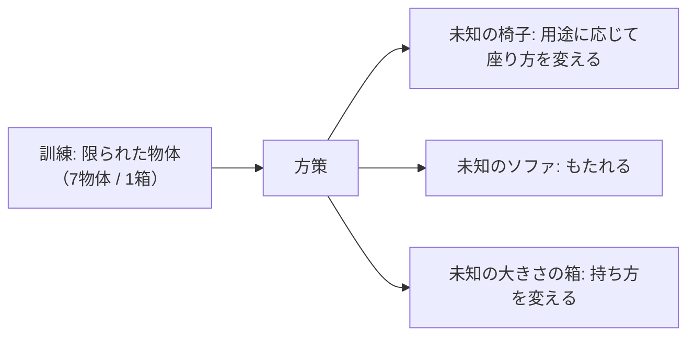
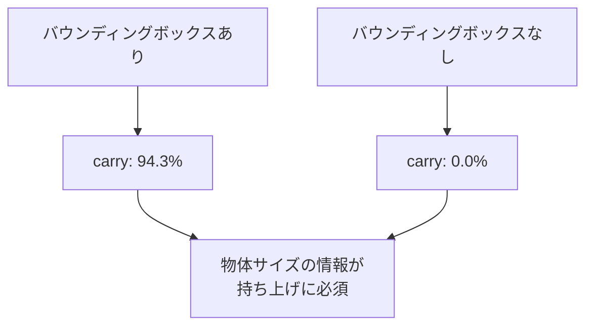

# 13. 結果と評価

## この章でわかること

- 論文の定量的な評価方法（成功率・実行時間・精度）
- 3タスク＋重さ版の結果
- 未知物体・未知配置への一般化
- 外乱（投射物・物体移動）への頑健性
- アブレーション（バウンディングボックスの重要性）

## 前提

- 第07〜12章

---

## 1. 評価の方法（§7.1）

論文は「うまくいったか」を数値で測ります。指標は3つです。

| 指標 | 意味 |
| --- | --- |
| 成功率（Success Rate） | タスク目標を達成した割合（%） |
| 実行時間（Execution Time） | 成功までの平均時間（秒）。短いほど良い |
| 精度（Precision） | 目標との平均ずれ（cm）。小さいほど良い |

### 成功の定義（タスク別）

- **sit**: 腰が目標位置から **20cm 以内**。
- **lie down**: 腰と頭がそれぞれ目標から **30cm 以内**。
- **carry**: 箱が目標位置から **20cm 以内**。
- いずれも **20秒以内**に満たなければ失敗。

### 評価の条件

- キャラクタは物体から **1〜10m** 離れたランダム位置・ランダム向きで初期化。
- 各タスク **4096トライアル**の平均。
- sit: 16個の未知物体、lie down: 5個の未知物体で評価（訓練に使っていない）。
- 物体は毎回 **0.8〜1.2倍**にランダムスケーリング。

## 2. 主要な結果（表1）

| タスク | 成功率 (%) | 実行時間 (秒) | 精度 (cm) |
| --- | --- | --- | --- |
| Sit | 90.4 | 5.0 | 6.7 |
| Lie down | 90.2 | 6.3 | 13.4 |
| Carry | 94.3 | 9.1 | 8.3 |
| Carry（重さ） | 97.2 | 8.7 | 10.3 |

読み方:

- すべて **90% 超**の成功率。多様な物体・配置でこの数字は高い。
- carry が最も成功率が高く（94.3%）、sit/lie より時間が長い（9.1秒）のは、歩く→持ち上げる→運ぶ、と段階が多いため。
- lie down の精度（13.4cm）が sit より悪いのは、頭と腰の2点を合わせる必要があり、より難しいため。

## 3. 未知物体への一般化（§7, 図4〜6）

論文の主張の要点は「**訓練にない物体でも動く**」ことです。

- sit/lie: 訓練 約350物体、テスト 21物体（未見）。
- carry: 訓練は1つの箱、テストはサイズを変えた箱（25×17.5×15 〜 75×52.5×45 cm）。

結果の観察（論文の記述）:

- 高い椅子には**飛び乗るように**座る。
- ソファでは**後ろにもたれる**。
- 肘掛けがあれば**腕を乗せる**。
- 非常に小さい箱も運べる（実演には無いサイズ）。

## 4. スタイルの多様性（図7）

同じ物体でも、**複数の座り方**をします。

- 普通に座る、後ろにもたれる、腕の動かし方を変える。

これは AMP 系の利点です。1つのクリップに追従しないので、分布内で多様な動きが自然に生まれます（第03・05章）。

## 5. 頑健性 — 外乱への反応（§7.1, 表2）

論文は、外部からの攪乱に対する頑健性も測ります。

### 投射物

- キャラクタに**1.2kg の投射物を20発**、ランダムな時刻に当てる。
- それでもタスクを続行・回復できる。

### 物体の移動

- タスク遂行中に**物体を動かす**（例: 座ろうとした瞬間に椅子を横にずらす）。
- 方策は追従して反応する（第08章の「物体は動く」設計の効果）。

表2（外乱下の成功率）:

| タスク | 成功率 (%) |
| --- | --- |
| Sit | 87.5 |
| Lie down | 82.0 |
| Carry | 89.4 |

- 外乱がない場合（表1）より下がるが、**依然として高い**。
- lie down が最も下がる（82.0%）のは、姿勢が崩れやすく回復が難しいため。

## 6. アブレーション — バウンディングボックスの重要性（付録B, 表S.1）

「物体のバウンディングボックスを目標から除くとどうなるか」を検証します。

| タスク | 成功率 (%) | 実行時間 (秒) | 精度 (cm) |
| --- | --- | --- | --- |
| Sit | 88.6 | 5.3 | 6.6 |
| Lie down | 81.9 | 6.2 | 14.7 |
| Carry | **0.0** | - | - |

> **衝撃的な結果**: carry は **成功率 0%**。

- 箱のサイズ情報（バウンディングボックス）がないと、**箱を持ち上げられない**。
- 「どこを掴めばいいか」「どのくらいの大きさか」が分からないため。
- sit/lie は影響が比較的小さい（物体の種類より、位置が重要）。

このアブレーションは、「**物体情報を状態に含めることが本質的に重要**」という論文の主張を裏付けます。

## 7. 参考文献の軌跡との比較（付録B, 図8, 図S.2）

- 参照モーションは物体から最大 **3m** までしか始まらない。
- しかし本手法は **10m** からでも遂行できる（ランダム化の効果）。
- 参照の軌跡は最短経路でないこともあるが、方策はしばしば最短経路を取る。

## 8. 結果から読み取れる設計原則

| 観察 | 設計原則 |
| --- | --- |
| 未知物体で高い成功率 | ランダム化が効く |
| 物体サイズ情報がないと carry 崩壊 | 物体特徴の明示的な入力が必須 |
| スタイルが多様 | クリップ追従でなく分布模倣 |
| 外乱に頑健 | 物体位置を状態に入れ、反応可能にする |
| 10m から遂行 | 訓練時の配置ランダム化 |

## 9. まとめ

- 3タスクすべて 90% 超の成功率。未知物体・配置・外乱にも対応。
- 物体サイズ情報（バウンディングボックス）は carry に不可欠（無いと 0%）。
- ランダム化と位置の状態入力が、一般化と頑健性の鍵。

## 演習

1. carry でバウンディングボックスを除くと成功率 0% になる理由を、報酬と状態の両面から説明しましょう。
2. 外乱下で lie down の成功率が最も下がる理由を考察しましょう。
3. 成功率・実行時間・精度の3指標のうち、ゲームに落とし込むときに最も重要なのはどれか、用途とともに論じましょう。

---

次章: [14. 比較と議論](14_比較と議論.md) ／ 前章: [12. 報酬関数を読む](12_報酬関数を読む.md)
