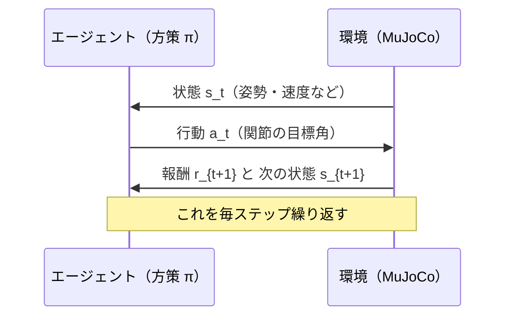

# 14. 強化学習の基礎 — 報酬を最大化する制御

## この章でわかること

- 強化学習（RL）の登場人物：エージェント、環境、状態、行動、報酬
- 方策 $\pi$、価値関数 $V, Q$、アドバンテージの意味
- エピソード・割引率・MDP という用語
- ゲームのループと RL のループの対応

## 前提

- 第13章（シミュレータの状態・行動）

## つながり

- ここまで「物理シミュレータでキャラクタを動かす」土台を作りました。この章から、**どう動かすかを学習**します。
- 方策・価値関数・報酬は、第16章の PPO、第17章の報酬設計、第19章の AMP に引き継がれます。

---

## 1. 強化学習とは何か

ゲームの AI はふつう「**ルールを人間が書く**」ものです。強化学習は発想が逆です。

> **人間は「何を達成したいか（報酬）」だけを書く。どう動くか（方策）は機械が試行錯誤で見つける。**

「前に進めば報酬」を与えるだけで、キャラクタが自分で歩き方を獲得します。

## 2. エージェントと環境

RL の世界は2つの主体でできています。



| 用語 | 記号 | 意味 | ゲームでの対応 |
| --- | --- | --- | --- |
| エージェント | — | 学習して上手くなる側 | キャラクタ本体 |
| 環境 | — | 応答を返す相手 | 物理エンジン＋マップ＋物体 |
| 状態 | $s_t$ | 時刻 $t$ の状況の数値のまとまり | 姿勢・速度・物体（第13章） |
| 行動 | $a_t$ | 時刻 $t$ の操作 | 関節の目標角（第12章） |
| 報酬 | $r_t$ | 行動の良さ（スカラー） | 「前進したら+1」など |
| 方策 | $\pi$ | 状態→行動 の決め方 | キャラクタの“思考ルーチン” |
| ステップ | $t$ | 時間の刻み（1フレーム相当） | ゲームの1フレーム |

## 3. エピソードと軌跡

RL は「**1回の挑戦（エピソード）**」を何度も繰り返します。

- **エピソード**: 初期状態から終了条件（目標達成・転倒・時間切れ）までの1区切り。
- **軌跡 $\tau$**: 1エピソード中の系列。

$$
\tau = (s_0, a_0, r_1, s_1, a_1, r_2, \dots, s_{T-1}, a_{T-1}, r_T)
$$

ゲームのたとえ: 「ステージ開始からクリア（またはゲームオーバー）まで」が1エピソードです。

## 4. 報酬と収益、割引

エピソード中の報酬を合計したものを**収益（return）**と呼びます。未来の報酬は**割引率** $\gamma \in [0,1)$ で少しずつ軽く見ます。

$$
G_t = r_{t+1} + \gamma\, r_{t+2} + \gamma^2\, r_{t+3} + \cdots = \sum_{k=0}^{\infty} \gamma^k r_{t+1+k}
$$

- $\gamma = 0$ … 目先の報酬しか見ない。
- $\gamma = 0.99$ … 未来の報酬もほぼ同等に重視。

直感: 「今日の100円」は「1年後の100円」より価値が高い。その目減りが $\gamma$ です。

## 5. 方策 $\pi$ — キャラクタの思考ルーチン

方策は「状態から行動を決める関数」です。本で扱うのは**ガウス分布に基づく確率的方策**です。

$$
a_t \sim \pi(\cdot \mid s_t), \qquad \text{例:}\quad \pi(a_t \mid s_t) = \mathcal{N}\!\big(\mu(s_t),\ \Sigma\big)
$$

- $\mu(s_t)$ … ニューラルネットが出力する平均（狙いの行動）。
- $\Sigma$ … ばらつき（探索の度合い）。論文では固定（第24章）。
- 確率的方策は、同じ状態でも少し違う行動を取り、探索を自然に実現します。

## 6. 価値関数 $V, Q$ とアドバンテージ

学習を効率化するために「状態の良さ」を評価する関数を使います。

- **状態価値 $V^\pi(s)$**: 状態 $s$ から方策 $\pi$ で進んだときの期待収益。
- **行動価値 $Q^\pi(s,a)$**: 状態 $s$ で行動 $a$ を取ったあとの期待収益。

$$
V^\pi(s) = \mathbb{E}_\pi[G_t \mid s_t = s], \qquad
Q^\pi(s,a) = \mathbb{E}_\pi[G_t \mid s_t = s, a_t = a]
$$

ゲームのたとえ: チェスの局面の「形勢判断」が $V$。良い手を打てば $Q$ が高い。

**アドバンテージ**は「平均より、どれだけ良い行動か」です。

$$
A^\pi(s,a) = Q^\pi(s,a) - V^\pi(s)
$$

- $A > 0$ … 平均より良い行動 → その確率を上げたい。
- $A < 0$ … 平均より悪い行動 → 確率を下げたい。

## 7. MDP — 問題の「型」

ここまでの設定を定式化したものが**マルコフ決定過程（MDP）**です。

$$
\mathcal{M} = (\mathcal{S}, \mathcal{A}, P, R, \gamma)
$$

- $\mathcal{S}$ … 状態の集合、$\mathcal{A}$ … 行動の集合
- $P(s' \mid s, a)$ … 遷移確率（物理シミュレータがこれに相当）
- $R(s,a)$ … 報酬関数、$\gamma$ … 割引率

「**マルコフ性**」とは、次にどうなるかが**今の状態だけで決まる**という仮定です。物理は、位置・速度・関節角がすべて状態に入っていれば、ほぼマルコフ的です（速度まで状態に入れるのはこのため。第13章）。物体を扱う場合も、**物体の位置・速度**を状態に入れる必要があります（第36章）。

## 8. RL のループ

```pseudo
方策 π と 価値関数 V を初期化する
繰り返し（エピソード）:
    状態 s を初期化する
    繰り返し（ステップ）:
        a ~ π(·|s)                # 方策で行動を選ぶ
        s', r = 環境.step(a)      # 物理を進め、報酬を計算
        バッファに (s, a, r, s') を記録
        s = s'
        終了条件で抜ける
    # 一定量ためてからパラメータを更新（→ 第16章 PPO）
    π, V ← 良かった行動を増やす向きに更新
```

「**貯めてからまとめて更新する**」のがポイントです。1ステップごとの更新は不安定になります。

## 9. 探索と活用のトレードオフ

- **活用**: 今わかっている一番良い行動を選ぶ。
- **探索**: あえて違う行動も試す。

確率的方策（ガウス分布の $\Sigma$）は、この探索を自然に実現します。$\Sigma$ が大きいほど大胆に探索します。

## 10. RL が「難しい」理由

1. **報酬設計**: 目的を報酬に翻訳するのが難しい（第17章）。
2. **報酬ハッキング**: 意図しない抜け道を学習する（例: 跳ねながら進む）。
3. **サンプル効率**: 何百万ステップも必要。
4. **局所解**: 「その場で足踏み」のような中途半端な解に落ち着く。

第5部の AMP は、主に 2・4 への対策です。「自然な動き」を報酬で細かく書く代わりに、**見本から学ばせます**。

## 11. 実装コード

- `src/ml_lern/core/rl_basics.py`
  - `ReplayBuffer` … 遷移のバッファ
  - `discounted_returns()` … 収益の計算
  - `rollout()` … ランダム方策のロールアウトで収益を確認

```bash
uv run python scripts/p02_rl_basics.py
```

## まとめ

- RL は「報酬だけ与えて、方策を試行錯誤で獲得させる」枠組み。
- 状態・行動・報酬・方策・価値・アドバンテージが基本語彙。
- 割引率で未来を軽く見る。マルコフ性を仮定して MDP に定式化する。
- 「貯めてから更新」「探索と活用」「報酬設計の難しさ」が勘所。

## 演習

1. 迷路探索を RL で解くとき、状態・行動・報酬を設計しましょう。
2. 「敵を倒せば報酬」だけを与えたとき、起こりうる報酬ハッキングを1つ考えましょう。
3. $\gamma = 0.9$ と $0.99$ で、実質的に何ステップ先まで重視するか $1/(1-\gamma)$ で比較しましょう。
4. 物理キャラで「マルコフ性」を保つには、状態に最低限何を入れる必要があるか述べましょう。

---

次章: [15. 方策勾配とアドバンテージ](15_方策勾配とアドバンテージ.md) ／ 前章: [13. シミュレータで人型を動かす](13_シミュレータで人型を動かす.md)
