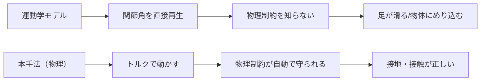
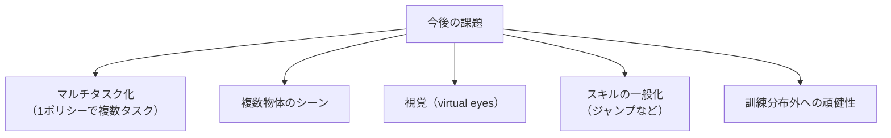

# 14. 比較と議論

## この章でわかること

- 先行手法（NSM, SAMP, Chao et al.）との定量的比較
- 運動学モデルと物理モデルの失敗の性質の違い
- 論文自身が認める限界
- 今後の課題と、この研究の位置づけ

## 前提

- 第07章（全体像）、第13章（結果）

---

## 1. 比較相手（§7.2）

論文は3つの先行手法と比較します。

| 手法 | 種類 | 一言 |
| --- | --- | --- |
| NSM（Starke et al. 2019） | 運動学 | Neural State Machine。シーン相互作用の運動学モデル |
| SAMP（Hassan et al. 2021） | 運動学 | Stochastic Scene-Aware Motion Prediction。確率的シーン認識 |
| Chao et al. 2019 | 物理（階層） | 座る動作を階層制御で合成 |

> Sebastian Starke, He Zhang, Taku Komura, Jun Saito.
> **Neural State Machine for Character-Scene Interactions.** ACM TOG 38(6), Article 209, 2019.
> <https://doi.org/10.1145/3355089.3356505>

## 2. 定量的比較（表3）

sit と lie down での比較です（成功率・時間・精度）。

| 指標 | Sit: NSM | Sit: SAMP | Sit: Chao | Sit: Ours | Lie: SAMP | Lie: Ours |
| --- | --- | --- | --- | --- | --- | --- |
| 成功率 (%) | 75.0 | 75.0 | 17 | 93.7 | 50 | 80 |
| 実行時間 (s) | 7.5 | 7.2 | - | 3.7 | 9.5 | 6.9 |
| 精度 (m) | 0.19 | 0.06 | - | 0.09 | 0.05 | 0.3 |

読み方:

- **sit**: 本手法 93.7% で最高。時間も最短（3.7s）。
- **lie down**: 本手法 80% で最高。SAMP の 50% を大きく上回る。ただし精度（0.3m）は SAMP（0.05m）より悪い点に注意。
- Chao et al. は 17% と極端に低い（後述）。

> 注: 表3の「Ours」の数値（sit 93.7%, lie 80%）は表1（90.4%, 90.2%）と少し異なります。比較用の設定・試行数が違うためです。

## 3. 運動学モデルの失敗の性質

論文が指摘する、NSM / SAMP の失敗:

- **foot-skating / floating**: 足が滑る／浮く（物理的でない接地）。
- **object penetration**: 物体へのめり込み（当たり判定の破綻）。

理由は明快です。運動学モデルは**環境との相互作用なしで**人間の実演から学習するため、物理的な制約（接触・摩擦）を知りません。ゲームエンジニアには身近な失敗でしょう。

## 4. 物理モデル（Chao et al.）の失敗

Chao et al. 2019 は階層制御を使いますが、論文の報告では:

- **対象物に座れず転倒することが多い**。
- 成功率 17%（sit）。
- 階層的な設計（サブタスク分割＋メタコントローラ）が、複雑な相互作用で破綻しやすい。

本手法の利点は、**非階層的**で、シーン条件付けとランダム化で直接学ぶことです（第07章の比較表）。

## 5. carry の比較（§7.2）

- 先行手法は**完全な carry をこなせない**。
- NSM: 箱へ歩いて持ち上げることはできるが、**目的地まで運ぶには手動操作が必要**。
- 本手法: 歩く→持ち上げる→運ぶを**自律的に**こなす。

> 論文の表現: "None of the baselines are capable of consistently completing the full carry task."

つまり carry は、本手法が先行研究を明確に超えた領域です。

## 6. 比較の公平性について（付録C）

論文は比較の条件を明記しています。

- NSM / SAMP には2モード（手動・目標駆動）があり、**目標駆動モード**で比較。
- 本手法・NSM・SAMP は**同じ入力**（望む行動＋対象物体）を受け取る。
- 全動作はアルゴリズムが生成し、手動・乱数制御は使わない。
- 本手法と SAMP は**同じデータセット**で学習。NSM の再学習は、フェーズラベルの欠落のため不可能。
- Chao et al. は**論文中の数値**を引用。

この透明性は、比較の説得力を高めています。

## 7. 論文自身が認める限界（§8 Discussion）

論文は正直に限界を述べています。

1. **単一タスクの方策**: タスクごとに別々のポリシーを訓練する。マルチタスク RL は未解決問題。
2. **物体は1つ**: 環境に1つの物体のみ。状態表現を拡張すれば複数物体も可能、と述べる。
3. **視覚なし**: キャラクタに「目」がない。複雑なシーンには視覚が必要、と将来課題に挙げる。
4. **失敗例**: 物体のそばで立ち尽くす、遠回りして時間切れ、など。
5. **サイズ・重さの射程**: 訓練分布から大きく外れると成功率が落ちると予想。
6. **スキルの一般化は未対応**: 物体への一般化は示したが、スキル（例: ジャンプ）への一般化は将来課題。

## 8. 今後の課題（論文の言葉から）

mermaid で整理します。

## 9. この研究の位置づけ

第07章の表を再掲しつつ、結論的にまとめます。

> 本論文は「AMP をシーンへ拡張する」という明確な一歩を踏み出し、物理キャラクタのシーン相互作用を実用に近づけた。

- 個々の部品は既存でも、**組み合わせとシーン条件付け**が新規。
- 物理ベースで、運動学モデルの弱点（接地・貫通）を克服。
- ランダム化で、少数データから広く一般化。
- 限界（単一タスク・単一物体・視覚なし）は、後続研究の出発点になっている。

## 10. 後続研究への広がり

本論文の思想は、その後の研究に引き継がれています。

- **視覚と言語の統合**: キャラクタが環境を知覚し、指示に従う方向。
- **大規模モーションと物理の融合**: 数千クリップを物理キャラで模倣する系譜（PHC, PULSE など。第30章）。
- **ゲーム・ツールへの応用**: 物理ベースアニメーション、インタラクティブなキャラクタ制御。

## まとめ

- 本手法は sit/lie で最高の成功率。特に carry は先行手法が全くこなせない。
- 運動学モデルは接地・貫通で失敗、物理階層モデルは転倒で失敗する。
- 論文は単一タスク・単一物体・視覚なしなどを限界として認める。
- シーン条件付けとランダム化が、この研究の核心的な貢献。

## 演習

1. 運動学モデルの「foot-skating」を、自分が知っているゲームの例に当てはめて説明しましょう。
2. 論文が「マルチタスクは未解決」と述べる理由を、報酬設計の観点から考察しましょう。
3. carry が先行手法で「手動操作が必要」だったのはなぜか、タスクの性質から説明しましょう。

---

第II部はここまで。次章: [15. 実装の全体像 — 何を作るか](15_実装の全体像_何を作るか.md)
