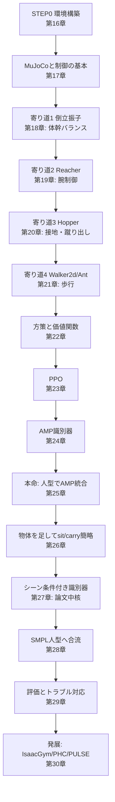

# 15. 実装の全体像 — 何を作るか

## この章でわかること

- 第III部で作るものの全体像（人型本線＋寄り道）
- 論文の本実装（IsaacGym）とこのミニ実装の違い
- 「何につながるか」という視点で各段階を位置づける
- 実行環境の注意

## 前提

- 第I部・第II部の全章

---

## 1. この部のゴール

> **MuJoCo と PyTorch（CPU）で、AMP による物理キャラクタ制御を小さく実装し、最後に「物体との相互作用（シーン条件付き識別器）」まで到達する。**

論文の完全な再現ではありません。**核となる考え方と実装を、手が届く規模で体験する**のが目的です。

## 2. 論文の本実装との違い（正直な比較）

| 項目 | 論文 | このミニ実装 |
| --- | --- | --- |
| シミュレータ | IsaacGym（GPU 必須） | MuJoCo（CPU で動く） |
| 並列環境数 | 数千 | 数十 |
| キャラクタ | 論文独自の剛体人型 | MuJoCo `humanoid.xml` → SMPL |
| データ | SAMP・AMASS 等の MoCap | 手続き生成の参照モーション、後に AMASS |
| タスク | sit / lie down / carry | 「物体へ近づいて合わせる」に簡略化 |
| 学習時間 | 数時間〜数日（GPU） | 数分〜数時間（CPU、縮小） |

> **このデバイス（CPU・メモリ約5GiB・CUDAなし）では、本実装は動きません。** 本文のコードは読者が自分の環境で動かす前提で書いています。本リポジトリでは実行・検証していません。

## 3. ロードマップ — 人型本線＋寄り道



## 4. 各寄り道は「何につながるか」

これがこの部の設計の核です。寄り道は無駄ではなく、**人型タスクの能力を1つずつ獲得**します。

| 寄り道 | 学ぶ能力 | 人型での対応 | 論文のどの概念に対応するか |
| --- | --- | --- | --- |
| 倒立振子 | 姿勢の維持 | 体幹バランス（立つ・座る） | 早期終了、直立報酬 |
| Reacher | 腕の目標追従 | 手を伸ばす・箱を持つ | シーン条件付け（物体を状態へ） |
| Hopper | 接地・蹴り出し | 歩行、立ち上がり | 接触、PD制御 |
| Walker2d / Ant | 周期運動と歩容 | 物体へ歩いて近づく | 速度報酬 $r^{\text{far}}$（式8） |
| 人型 AMP | 自然な歩行のスタイル | 動きの自然さ | スタイル報酬 $r^S$（式6） |
| 物体＋シーン条件 | 物体の文脈で判断 | sit / carry | シーン条件付き識別器（§3） |

## 5. コードの構成

```
src/ml_lern/
  mini_amp/
    config.py      ハイパーパラメータ
    models.py      方策・価値関数・識別器（第22・24章）
    buffer.py      ロールアウトバッファ（第23章）
    rollout.py     ロールアウト収集（第23章）
    ppo.py         PPO 更新（第23章）
    amp.py         AMP 識別器の更新・スタイル報酬（第24章）
    train.py       学習ループ
    envs/
      base.py         環境ラッパの基底（RSI・ランダム化）
      pendulum.py     寄り道1（第18章）
      reacher.py      寄り道2（第19章）
      locomotion.py   寄り道3・4（第20・21章）
      humanoid_env.py 本命（第25章）
      scene_env.py    物体＋シーン条件付き識別器（第26・27章）
      smpl_humanoid.py SMPL 人型（第28章）
  diffusion/        付録B（拡散モデル）
scripts/
  train_01_pendulum.py … train_07_smpl.py
  train_diffusion_bounce.py
```

## 6. 進め方の推奨

1. **第16〜17章**で環境を構築し、MuJoCo の制御の基本を押さえる。
2. **第18〜21章**の寄り道を回し、RL のループに慣れる。各章の「つながり」を意識する。
3. **第22〜24章**で部品（方策・PPO・AMP）を1つずつ実装する。
4. **第25〜27章**で人型に統合し、物体を足して論文の中核に到達する。
5. **第28章**で SMPL 人型へ合流する。

## 7. 前提ソフトウェア

- Python 3.13（このプロジェクトは uv で管理）
- PyTorch（CPU）
- MuJoCo と gymnasium
- （任意）mujoco-viewer、matplotlib

導入は第16章で扱います。

## まとめ

- 第III部は、AMP による物理キャラ制御を MuJoCo + PyTorch で小さく再現する。
- 人型を本線に、4つの寄り道で能力を積み上げる。各寄り道は人型の能力に対応する。
- 論文の本実装（IsaacGym）とは規模が違うが、核となる部品は同じ。
- このデバイスでは実行しない。読者の環境で動かす前提。

## 演習

1. 4つの寄り道を、それぞれ「人型のどの能力につながるか」とともに説明しましょう。
2. ミニ実装と論文の本実装の違いを3つ挙げ、それぞれ学習結果にどう影響するか考察しましょう。

---

次章: [16. 環境構築 — PyTorch と MuJoCo](16_環境構築_PyTorchとMuJoCo.md)
