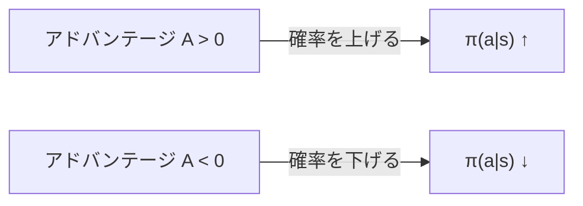
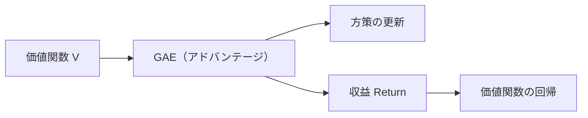

# 15. 方策勾配とアドバンテージ

## この章でわかること

- 方策勾配定理 — どうやって方策を良くするか
- アドバンテージと GAE（Generalized Advantage Estimation）
- 価値関数の学習
- 素朴な方策勾配の問題点

## 前提

- 第14章（MDP・方策・価値・アドバンテージ）

## つながり

- この章の「良い行動の確率を上げる」という原理が、第16章の PPO に発展します。
- GAE と価値関数は、そのまま第16章の実装で使います。

---

## 1. 問題: 方策のパラメータをどう更新するか

方策 $\pi_\theta$ は、パラメータ $\theta$（ニューラルネットの重み）で決まります。やりたいのは**期待収益を最大化する $\theta$ を見つける**ことです。

$$
\max_\theta\ J(\theta) = \mathbb{E}_{\tau \sim p(\tau|\pi_\theta)}\!\left[\sum_{t=0}^{T-1} \gamma^t r_t\right]
$$

障害は、報酬が**行動の結果として間接的に**決まることです。「重みをちょっと変えたら報酬がどう変わるか」を知る必要があります。

## 2. 方策勾配定理 — 「良かった行動の確率を上げる」

答えはシンプルです。

> **うまくいった（アドバンテージが正の）行動は確率を上げ、まずくいった行動は下げる。**

$$
\nabla_\theta J(\theta)
= \mathbb{E}_{\tau \sim p(\tau|\pi_\theta)}\!\left[\sum_{t=0}^{T-1} \nabla_\theta \log \pi_\theta(a_t \mid s_t)\ \hat{A}_t\right]
$$

- $\nabla_\theta \log \pi_\theta(a_t \mid s_t)$ … 「その行動の確率を上げる向き」
- $\hat{A}_t$ … その行動がどれだけ良かったか（アドバンテージの推定）
- 掛けて足す … 良かった行動の確率を上げる方向に $\theta$ を動かす



直感: ゲームで「勝てたプレイの選択を少し増やし、負けたプレイの選択を少し減らす」ことを、確率の世界で行っています。

## 3. アドバンテージの推定 — GAE

$\hat A_t$ の推定には工夫が要ります。素朴には $A_t = Q(s_t,a_t) - V(s_t)$ ですが、$Q$ を直接学ぶのは分散が大きく不安定です。そこで使うのが **GAE（Generalized Advantage Estimation）** です。

まず、1ステップごとの「予想外れ」を**TD誤差**と呼びます。

$$
\delta_t = r_{t+1} + \gamma V(s_{t+1}) - V(s_t)
$$

- 「実際に得た報酬＋次の状態の価値」と「今の状態の価値の予想」の差。
- プラスなら「思ったより良かった」。

GAE は TD誤差を複数ステップ分、指数関数的に重み付けして足します。

$$
\hat{A}_t^{\text{GAE}(\gamma,\lambda)}
= \sum_{l=0}^{\infty} (\gamma\lambda)^l\, \delta_{t+l}
$$

- $\lambda \in [0,1]$ … バイアスと分散のトレードオフ。
  - $\lambda = 0$ … 1ステップ TD誤差のみ（バイアス大、分散小）
  - $\lambda = 1$ … モンテカルロに近い（バイアス小、分散大）
- 実用上は $\lambda \approx 0.95$。

逆順に計算できるので実装は簡単です。

```python
# バッファを後ろから走査して GAE を計算する
gae = 0
for t in reversed(range(T)):
    delta = r[t] + gamma * V[s[t+1]] * (1 - done[t]) - V[s[t]]
    gae   = delta + gamma * lambda_ * (1 - done[t]) * gae
    A[t]  = gae
    Return[t] = A[t] + V[s[t]]     # 価値関数の教師信号
```

## 4. 価値関数の学習

価値関数 $V_\phi(s)$ は、実際に得られた収益に近づくように学習します（第03章の回帰）。

$$
\min_\phi\ \mathbb{E}\!\left[\big(V_\phi(s_t) - \hat{G}_t\big)^2\right]
$$

ここで $\hat G_t = \hat A_t + V(s_t)$ は「実績ベースの収益の推定」。価値関数が正確だと GAE も正確になり、方策更新が安定します。



## 5. 素朴な方策勾配の問題点

方策勾配をそのまま使うと、更新幅の調整が難しく、**1回の更新で方策が壊れる**ことがあります。方策が大きく変わると、集めたデータが「古い方策のデータ」になり、勾配の前提が崩れるからです。

そこで「**一度に大きく変えすぎない**」という制約を入れるのが PPO です（次章）。

## 6. 実装コード

- `src/ml_lern/core/rl_basics.py`
  - `compute_gae()` … GAE の実装
  - `value_loss()` … 価値関数の損失
  - `policy_gradient_loss()` … 素朴な方策勾配の損失（比較用）

```bash
uv run python scripts/p02_rl_basics.py
```

## 7. つまずきやすいポイント

| 症状 | 対処 |
| --- | --- |
| 学習が暴れる | アドバンテージを正規化する |
| 価値関数が当たらない | 割引率・GAEの λ・学習率を見直す |
| 方策が壊れる | 次章の PPO（クリップ）を使う |
| 勾配が小さすぎる | `log_prob` の符号・和の取り方（行動次元）を確認 |

## まとめ

- 方策勾配定理: 「良い行動の確率を上げる」方向にパラメータを動かす。
- アドバンテージは GAE で安定に推定する（$\lambda \approx 0.95$）。
- 価値関数は収益を回帰で学ぶ。正確だと学習が安定。
- 素朴な方策勾配は更新幅の制御が難しく、PPO が必要になる。

## 演習

1. GAE で $\lambda = 0$ と $\lambda = 1$ のとき、それぞれ何に近づくか述べましょう。
2. $1 - done$ を掛けるのはなぜか、エピソード境界の観点で説明しましょう。
3. 価値関数が不正確だと、GAE と方策更新にどう悪影響が出るか説明しましょう。
4. 素朴な方策勾配が「1回で壊れる」理由を、データの新旧の観点で説明しましょう。

---

次章: [16. PPO](16_PPO.md) ／ 前章: [14. 強化学習の基礎](14_強化学習の基礎.md)
