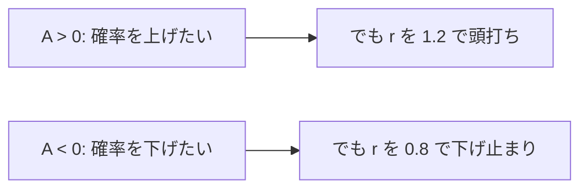
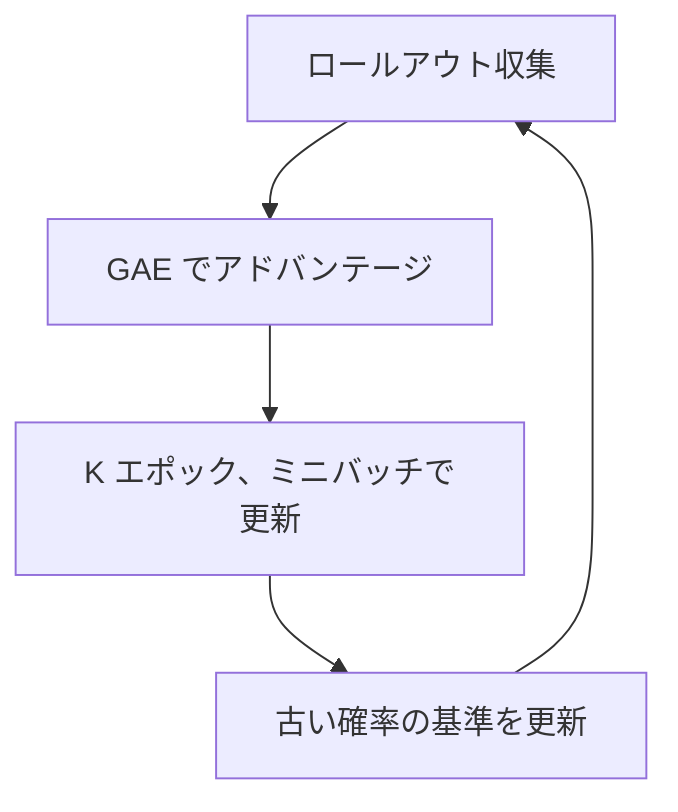

# 16. PPO — 安定した方策更新

## この章でわかること

- PPO の仕組み（クリップ付き目的関数）
- 確率比 $r_t(\theta)$ と $\epsilon$（クリップ幅）
- 価値関数損失とエントロピー項
- PPO のアルゴリズム全体

## 前提

- 第15章（方策勾配・GAE）、第02章（学習ループ）

## つながり

- PPO は、第17章の物理キャラ RL、第19〜20章の AMP の**土台となる学習アルゴリズム**です。
- この章を押さえれば、論文の「PPO で方策を更新する」が読めます。

---

## 1. PPO の考え方 — 一度に変えすぎない

第15章で、素朴な方策勾配は更新が大きすぎて壊れることがあると述べました。PPO（Proximal Policy Optimization）は、**新旧の方策の比**を導入して、更新を制限します。

$$
r_t(\theta) = \frac{\pi_\theta(a_t \mid s_t)}{\pi_{\theta_{\text{old}}}(a_t \mid s_t)}
$$

- $r_t(\theta) = 1$ … 新旧でその行動の確率が同じ
- $r_t(\theta) > 1$ … 新方策のほうがその行動を選びやすい

> John Schulman, et al. **Proximal Policy Optimization Algorithms.** 2017. <https://arxiv.org/abs/1707.06347>

## 2. クリップ付き目的関数

この比を使って、次の目的関数を**最大化**します。

$$
L^{\text{CLIP}}(\theta) = \mathbb{E}_t\!\left[\min\Big(r_t(\theta)\hat{A}_t,\ \ \mathrm{clip}\big(r_t(\theta), 1-\epsilon, 1+\epsilon\big)\hat{A}_t\Big)\right]
$$

- $\epsilon$ … クリップ幅（例: 0.2）。比を $[1-\epsilon, 1+\epsilon]$ に制限する。
- $\min$ … 良くなる方向でも「クリップを超えると得しない」ようにする。



直感: アドバンテージが正の行動の確率を上げたいが、**一度に $\epsilon$ 以上は上げさせない**。逆も同様。これで「行き過ぎ」を防ぎます。

```python
ratio = torch.exp(log_probs - old_log_probs)          # 確率比 r
surr1 = ratio * advantages
surr2 = torch.clamp(ratio, 1 - eps, 1 + eps) * advantages
policy_loss = -torch.min(surr1, surr2).mean()          # 最大化 → 負にして最小化
```

## 3. 完全な目的関数

実際には、価値関数の損失と、探索を保つためのエントロピー項を足します。

$$
L(\theta, \phi) = \underbrace{L^{\text{CLIP}}(\theta)}_{\text{方策}}
- c_1 \underbrace{\big(V_\phi(s_t) - \hat{G}_t\big)^2}_{\text{価値関数}}
+ c_2 \underbrace{\mathcal{H}\big[\pi_\theta(\cdot\mid s_t)\big]}_{\text{エントロピー（探索）}}
$$

- $c_1$ … 価値関数の重み（例: 0.5）
- $c_2$ … エントロピーの重み（例: 0.001）。大きいほど探索的。
- $\mathcal{H}$ … エントロピー（行動のばらつき）。

価値関数の項がマイナスなのは、誤差を**最小化**したいからです。

```python
loss = policy_loss + c1 * value_loss + c2 * entropy_loss
```

## 4. アルゴリズム全体

```pseudo
初期化: 方策 π_θ, 価値関数 V_φ
for イテレーション = 1..N:
    # 1) 現方策でデータを集める（複数環境でまとめて）
    for t = 1..T:
        a = π_θ(·|s) をサンプルして環境を step
        バッファに (s, a, r, s', done, log_prob, value) を記録
    # 2) アドバンテージを計算（GAE、第15章）
    A, Return = compute_gae(バッファ, V_φ)
    A = 正規化(A)
    # 3) 数エポック、ミニバッチで更新
    for epoch = 1..K:
        for minibatch in バッファをシャッフル:
            L = PPO目的関数（クリップ付き）
            θ, φ を勾配で更新
```

ポイントは「**同じデータで何度も（K エポック）更新する**」こと。クリップがあるからこそ、複数回の更新が安全になります。



## 5. なぜ本論文は PPO を使うのか

- **安定性**: 物理キャラの制御は報酬が暴れやすく、更新が不安定だと即転倒する。クリップが効く。
- **並列化との相性**: 大規模並列シミュレータで大量にサンプルを集め、まとめて更新する流れが自然。
- **実績**: AMP（第19章）をはじめ、物理キャラ制御のデファクト標準。

## 6. 学習がうまくいかないときの勘所

| 症状 | よくある原因 | 対処 |
| --- | --- | --- |
| 報酬が全く上がらない | 報酬設計ミス、状態に必要情報がない | 報酬を見直す、状態を増やす |
| 途中まで上がって急落 | 更新が大きすぎる | 学習率↓、クリップ幅↓、エポック数↓ |
| カクカクした動き | 報酬ハッキング | スタイル報酬（AMP）を入れる（第19章） |
| 学習が遅い | サンプル不足、並列数不足 | 並列環境を増やす |

## 7. 実装コード

- `src/ml_lern/core/ppo.py`
  - `compute_gae()` … GAE（第15章）
  - `PPOUpdater` … 方策・価値関数の更新
  - `RolloutBuffer` … ロールアウトバッファ

```bash
uv run python scripts/p03_ppo.py
```

> 実装の全体は第33章（PPO を実装する）で、MuJoCo 環境と組み合わせて扱います。

## まとめ

- PPO は確率比をクリップして「一度に変えすぎない」ようにする。
- 目的関数は「方策（クリップ）＋価値関数＋エントロピー」。
- 同じデータで数エポック更新するのが特徴。
- 物理キャラ制御のデファクト標準で、第19章以降の土台になる。

## 手を動かそう

> **一歩目**: 倒立振子を PPO で学習し、クリップ幅 $\epsilon$ を変えて安定性を観察する。

```bash
uv run python scripts/p03_ppo.py
```

学習ログの `kl`（方策の変化）が大きすぎ／小さすぎを確認します。

**いじってみる**: `config.py` の `clip_epsilon` を 0.05 / 0.5、`num_epochs` を 1 / 10 にして学習曲線を見比べる。`entropy_coef` を 0 にすると探索が減る。

**夢が広がる**:
- 自分のゲームのキャラ制御を PPO で学習させる。
- ボスの行動パターンを、PPO で自動生成する。
- バランス調整（敵の強さ）を、報酬で制御する。

## 演習

1. クリップ幅 $\epsilon = 0.2$ のとき、確率比 $r$ はどの範囲に制限されるか答えましょう。
2. アドバンテージが正の行動で、確率比が $1+\epsilon$ を超えたとき、目的関数はどちらの値（$r\hat A$ か $\mathrm{clip}(r)\hat A$）を選ぶか、$\min$ の働きから説明しましょう。
3. エントロピー係数を 0 にすると、探索はどうなるか述べましょう。
4. PPO が物理キャラ制御で使われる理由を3つ挙げましょう。

---

次章: [17. 物理キャラクタのRL](17_物理キャラクタのRL.md) ／ 前章: [15. 方策勾配とアドバンテージ](15_方策勾配とアドバンテージ.md)
