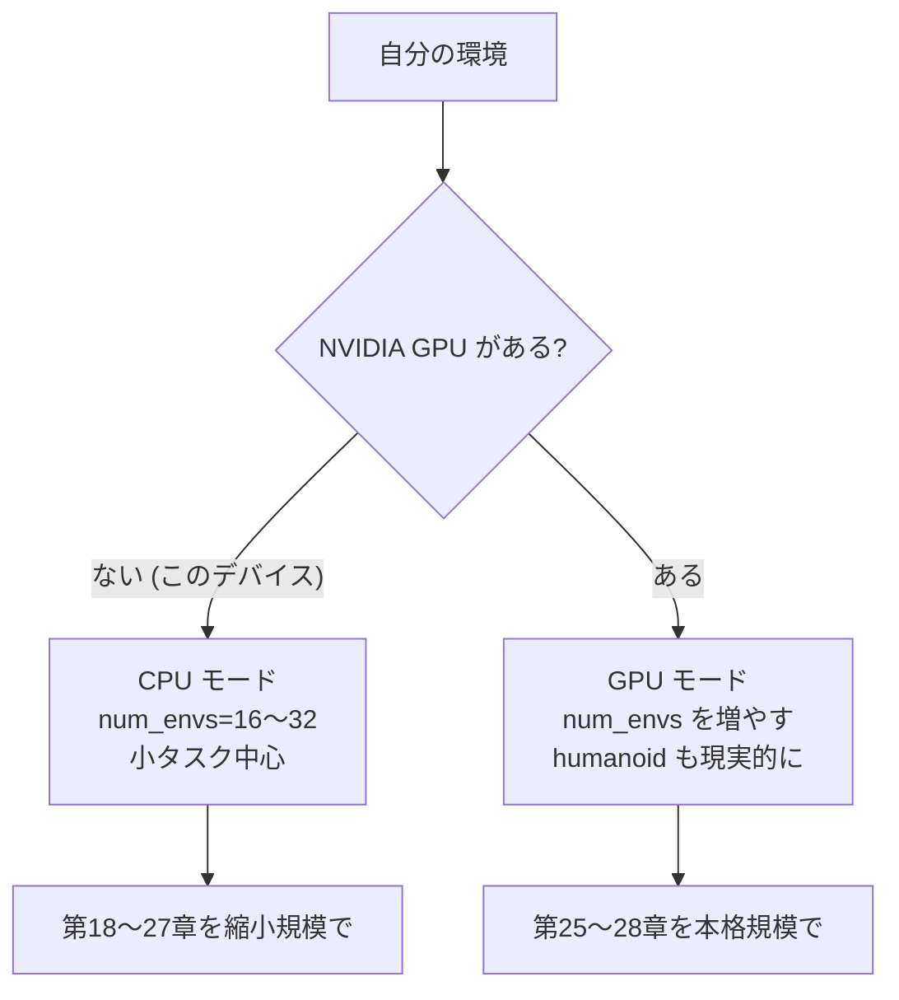

# 16. 環境構築 — PyTorch と MuJoCo

## この章でわかること

- このプロジェクトの依存関係と、`uv` での導入方法
- CPU・aarch64 環境での注意点
- 動作確認の手順
- つまずきやすいポイント

## 前提

- ターミナル操作の基本

---

## 1. このプロジェクトの依存関係

`pyproject.toml` に必要なパッケージを追加します。

```toml
[project]
name = "ml-lern"
version = "0.1.0"
requires-python = ">=3.13"
dependencies = [
    "html2text>=2025.4.15",
    "torch>=2.3",          # ニューラルネット・自動微分（第22章）
    "numpy>=1.26",         # 数値計算
    "mujoco>=3.1",         # 物理シミュレータ（第17章）
    "gymnasium>=1.0",      # 環境インターフェース
    # 可視化（任意）
    "matplotlib>=3.8",
]

[project.scripts]
ml-lern = "ml_lern:main"
```

## 2. uv での導入

AGENTS.md の方針どおり、`uv` を使います。

```bash
# 依存を同期する
uv sync

# 追加する場合
uv add torch mujoco gymnasium
```

> **このデバイスでは CPU 版のみ**。CUDA がないため、PyTorch は CPU ホイールが入ります。
> aarch64 でも `torch` と `mujoco` はホイールが提供されています（第00章の調査参照）。

## 3. CPU・aarch64 での注意

| 項目 | 注意 |
| --- | --- |
| CUDA | 使えない。`torch.device("cpu")` を使う（`config.device = "cpu"`） |
| メモリ | 約 5GiB。`num_envs` は小さく（16〜32） |
| 並列環境数 | 論文の数千は無理。数十で我慢し、学習は控えめに |
| 学習時間 | CPU では遅い。まず小さいタスク（倒立振子）で動作確認 |
| IsaacGym | 動かない（第30章で手順のみ紹介） |

## 4. 動作確認

### 4.1 ライブラリの確認

```bash
uv run python -c "import torch, mujoco, gymnasium; print(torch.__version__, mujoco.__version__, gymnasium.__version__)"
```

`torch 2.x.x`, `mujoco 3.x.x`, `gymnasium 1.x.x` のように表示されれば成功です。

### 4.2 MuJoCo の簡単な動作確認

```bash
uv run python - <<'EOF'
import gymnasium as gym
env = gym.make("InvertedPendulum-v5")
obs, _ = env.reset(seed=0)
for _ in range(100):
    obs, reward, terminated, truncated, _ = env.step(env.action_space.sample())
    if terminated or truncated:
        obs, _ = env.reset()
print("obs_dim =", env.observation_space.shape, "action_dim =", env.action_space.shape)
env.close()
EOF
```

`obs_dim` と `action_dim` が表示されれば、MuJoCo と gymnasium が動いています。

### 4.3 このプロジェクトのスクリプト

```bash
# 寄り道1（倒立振子）を少しだけ回す
uv run python scripts/train_01_pendulum.py
```

コンソールにログ（`ep_return`, `pi_loss` など）が流れ始めれば成功です（Ctrl-C で停止）。

## 5. 実行環境の選び方



> 本格的に humanoid や scene を学習させたいなら、**NVIDIA GPU のあるマシン**（またはクラウド）を推奨します。CPU でも動きますが、時間がかかります。

## 6. つまずきやすいポイント

| 症状 | 対処 |
| --- | --- |
| `ModuleNotFoundError: mujoco` | `uv sync` を実行。ホイールが無い場合はプラットフォームを確認 |
| `torch` のインストールが遅い/失敗 | CPU ホイールを明示。`uv add torch --index-url ...` など |
| 画面が開かない（可視化） | headless 環境では不可。ログだけで確認 |
| メモリ不足 | `num_envs` を減らす。`episode_length_s` を短くする |
| 学習が遅すぎる | まず倒立振子で動作確認してから人型へ |

## 7. ディレクトリの確認

```
ml-lern/
  docs/            この教科書
  src/ml_lern/     実装コード
    mini_amp/
    diffusion/
  scripts/         学習・生成のエントリ
```

## まとめ

- `uv sync` で依存を導入。`torch`, `mujoco`, `gymnasium` が核。
- このデバイスは CPU・CUDA なし。`num_envs` を小さくして進める。
- 倒立振子で動作確認してから、人型へ進む。
- 本格学習は GPU 機を推奨。

## 演習

1. 自分の環境に `torch`, `mujoco`, `gymnasium` を導入し、バージョンを確認しましょう。
2. `InvertedPendulum-v5` の obs と action の次元を調べ、それぞれ何を表すか推測しましょう。

---

次章: [17. MuJoCo と制御の基本](17_MuJoCoと制御の基本.md) ／ 前章: [15. 実装の全体像](15_実装の全体像_何を作るか.md)
