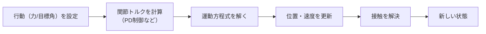
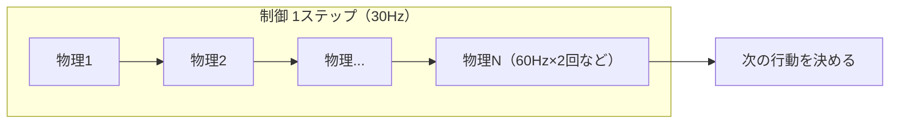

# 17. MuJoCo と制御の基本

## この章でわかること

- MuJoCo のモデル（XML/MJCF）の読み方
- シミュレーションの1ステップと timestep
- PD 制御を実際に動かす
- 「状態」と「行動」が MuJoCo でどう表現されるか
- 制御周波数と物理周波数の違い

## 前提

- 第06章（物理キャラとPD制御）、第16章（環境構築）

---

## 1. MuJoCo のモデルファイル（MJCF）

MuJoCo では、キャラクタや物体を **XML（MJCF: MuJoCo XML Format）** で記述します。ゲームエンジンのシーンファイルに相当します。

```xml
<mujoco model="inverted_pendulum">
  <option timestep="0.01"/>                <!-- 物理の刻み幅（秒） -->

  <worldbody>
    <body name="cart" pos="0 0 0">
      <joint name="slider" type="slide" axis="1 0 0"/>
      <geom type="capsule" size="0.1" fromto="-0.1 0 0 0.1 0 0"/>
      <body name="pole" pos="0 0 0">
        <joint name="hinge" type="hinge" axis="0 1 0"/>
        <geom type="capsule" size="0.05" fromto="0 0 0 0 0 0.6"/>
      </body>
    </body>
  </worldbody>

  <actuator>
    <motor joint="slider" ctrlrange="-1 1"/>  <!-- 台車に加える力 -->
  </actuator>
</mujoco>
```

読み方:

- `<worldbody>` … 剛体の木構造。`<body>` を入れ子にする（第06章の木構造）。
- `<joint>` … 関節。`slide`（直動）や `hinge`（回転）。
- `<geom>` … 形状（当たり判定と見た目）。
- `<actuator>` … アクチュエータ。力を加える対象。

## 2. シミュレーションの1ステップ

MuJoCo の中では、毎ステップ次が起きます。



`step()` を1回呼ぶと、`timestep` 秒だけ時間が進みます。

```python
import gymnasium as gym
env = gym.make("InvertedPendulum-v5")
obs, _ = env.reset(seed=0)
action = env.action_space.sample()   # 行動を決める
obs, reward, terminated, truncated, info = env.step(action)  # 1ステップ進める
```

## 3. timestep と制御周波数

物理の刻み幅 `timestep` と、方策が行動を出す頻度（制御周波数）は別物です。

- **物理周波数**（例: 60Hz）… シミュレーションの解像度。小さいほど正確。
- **制御周波数**（例: 30Hz）… 方策が行動を出す頻度。人間の意思決定間隔に近い。

1回の制御ステップの間に、物理を複数回（`sim_freq / control_freq` 回）回します。これを **decimation（間引き）** と呼びます。



本実装では `config.py` の `sim_freq=60`, `control_freq=30` としています。

## 4. PD 制御を実際に動かす

MuJoCo の `position` アクチュエータを使うと、内部で PD 制御がかかります。

```xml
<actuator>
  <position joint="hinge" kp="20" kv="1"/>   <!-- 目標角へ PD 制御 -->
</actuator>
```

- `kp` … 比例ゲイン（バネ、第06章）
- `kv` … 微分ゲイン（ダンパ）
- 行動として「目標角」を渡すと、MuJoCo がトルクに変換します。

```python
# 目標角 0.5 rad へ PD 制御で動かす
target = [0.5]
obs, reward, terminated, truncated, info = env.step(target)
```

本論文も、方策が PD 制御の目標角を出力します（第06・09章）。同じ発想です。

## 5. 状態と行動を MuJoCo で確認する

MuJoCo の環境からは、次のような情報が取れます。

```python
import gymnasium as gym
env = gym.make("Walker2d-v5")
print("obs shape:", env.observation_space.shape)
print("action shape:", env.action_space.shape)

# 生の物理データ（qpos: 位置, qvel: 速度）
qpos = env.unwrapped.data.qpos
qvel = env.unwrapped.data.qvel
print("qpos:", qpos.shape, "qvel:", qvel.shape)
```

| 記号 | 意味 | 対応 |
| --- | --- | --- |
| `qpos` | 関節の位置・角度 | 状態の「姿勢」部分 |
| `qvel` | 関節の速度 | 状態の「速度」部分 |
| `observation_space` | 方策に渡す状態の次元 | 第09章の状態 |
| `action_space` | 行動の次元 | 目標角 |

## 6. 人型（humanoid）の場合

MuJoCo には標準で人型モデルがあります。

```python
import gymnasium as gym
env = gym.make("Humanoid-v5")
print("obs_dim:", env.observation_space.shape)   # おおよそ 300+ 次元
print("action_dim:", env.action_space.shape)      # 17 関節 × ...
```

> 注意: MuJoCo の humanoid は**独自の簡易モデル**で、論文のキャラクタとは違います。第25章で使い、第28章で SMPL 由来のモデルへ差し替えます。

## 7. 可視化

`render_mode="human"` でウィンドウ表示できます（GUI 環境が必要）。

```python
env = gym.make("Walker2d-v5", render_mode="human")
```

headless 環境では、`render_mode="rgb_array"` でフレームを取得し、動画として保存します。

```python
frames = []
obs, _ = env.reset()
for _ in range(200):
    obs, r, term, trunc, _ = env.step(env.action_space.sample())
    frames.append(env.render())
    if term or trunc:
        break
# frames を GIF/MP4 に保存（imageio など）
```

## 8. つまずきやすいポイント

| 症状 | 対処 |
| --- | --- |
| 学習が不安定 | timestep を小さく、制御周波数を下げてみる |
| 関節が暴れる | `kp` を下げる、目標角の変化量を制限 |
| 前進しない | 報酬の速度項（第12章）を確認 |
| 転倒が早い | 早期終了条件（第11章）が厳しすぎないか確認 |

## 9. まとめ

- MuJoCo は MJCF（XML）でモデルを記述する。剛体リンク＋関節。
- 物理周波数と制御周波数を分け、間引き（decimation）で回す。
- `<position>` アクチュエータで PD 制御。行動は「目標角」。
- 状態は `observation_space`、行動は `action_space`。内部は `qpos`/`qvel`。

## 演習

1. `InvertedPendulum-v5` を実行し、`observation_space` と `action_space` の次元を確認しましょう。
2. `timestep` を 0.01 から 0.02 に変えると、シミュレーションの挙動がどう変わるか予想しましょう。
3. `<position>` の `kp` を 0 にすると何が起きるか、PD 制御の式(第06章)から考えましょう。

---

次章: [18. 寄り道1 — 倒立振子と体幹制御](18_寄り道1_倒立振子と体幹制御.md) ／ 前章: [16. 環境構築](16_環境構築_PyTorchとMuJoCo.md)
