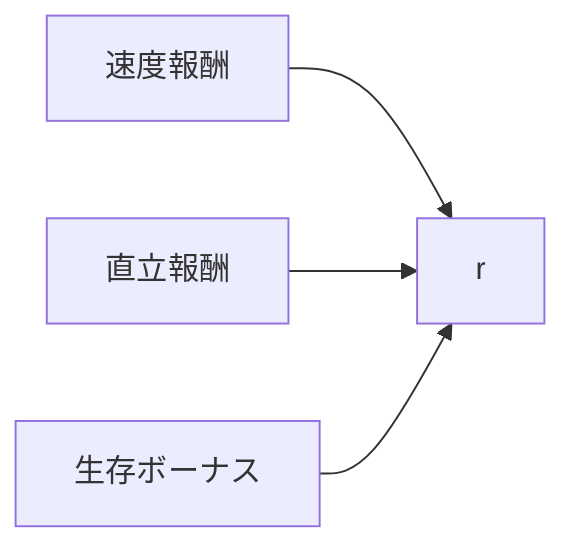
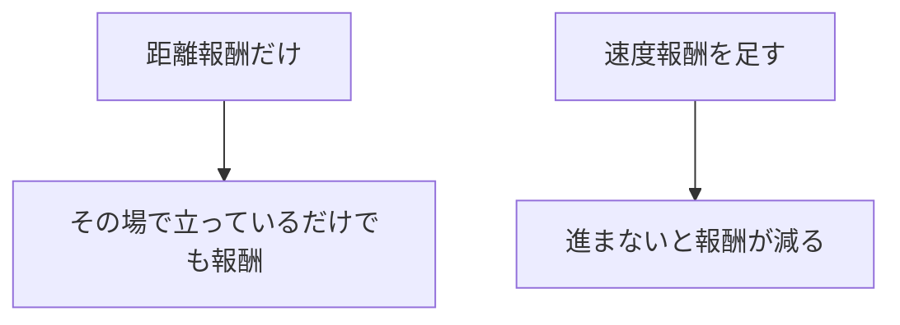
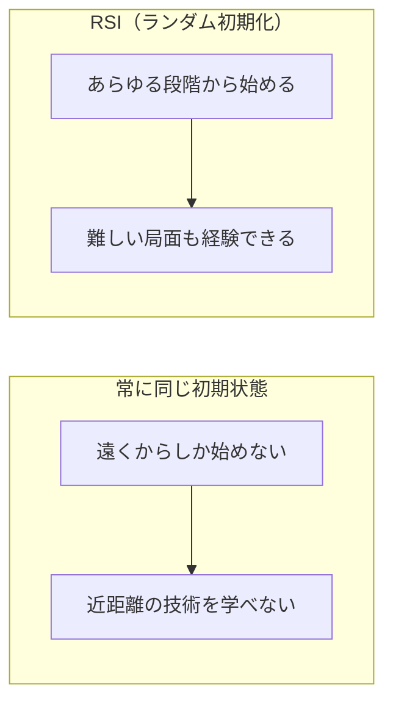

# 17. 物理キャラクタの RL — 報酬設計と訓練の勘所

## この章でわかること

- 物理キャラのタスク報酬の設計（速度・直立・生存）
- Reference State Initialization（RSI）と早期終了
- カリキュラム学習
- 報酬ハッキングと、それが AMP を必要とする理由
- ネットワーク構成

## 前提

- 第14〜16章（RL・PPO）、第11〜13章（MuJoCo）

## つながり

- この章で「報酬だけでは自然な動きにならない」ことを実感します。それが第5部の **AMP** の動機になります。
- RSI や早期終了は、論文の訓練設定（第24章）にそのまま出てきます。

---

## 1. タスク報酬の設計

物理キャラに「歩く」を学ばせるとき、報酬をどう設計するか。基本パターンは次の3つです。

$$
r = \underbrace{\exp(-k(v^* - v)^2)}_{\text{速度追従}} + \underbrace{w_u\,\exp(-k'\theta^2)}_{\text{直立}} + \underbrace{w_a}_{\text{生存}}
$$

- **速度追従**: 目標速度 $v^*$ に近いほど高い。
- **直立**: 体幹が立っているほど高い。
- **生存**: 生きているだけで少し与える（早期の転倒を避ける）。



```python
def task_reward(obs, target_speed=1.5):
    speed = obs[..., 0]                                  # 前進速度
    speed_r = torch.exp(-2.0 * (target_speed - speed) ** 2)
    upright = torch.exp(-5.0 * obs[..., 1] ** 2)         # 体幹の傾き
    alive = torch.ones_like(speed)
    return 1.0 * speed_r + 0.5 * upright + 0.1 * alive
```

## 2. 指数関数 $\exp(-k d^2)$ をよく使う理由

距離や誤差 $d$ に対する報酬は、$\exp(-k d^2)$ の形が定番です。

- $d = 0$ で満点（1.0）、離れるほど 0 に近づく。
- **なめらかで微分可能**（勾配が連続）。学習が安定する。
- $k$ で「どこまで厳しく合わせるか」を調整できる。

閾値でバッサリ切る（if 文）より、連続的な方が勾配が扱いやすいというのが理由です。

> **つながり**: 論文のタスク報酬（第25章）も、すべてこの形です。「遠くへ誘導（far）」→「近くで精密（near）」を、$k$ の大小で作り分けています。

## 3. じっとしている抜け道（報酬ハッキング）

距離報酬だけだと、**その場で動かない**方が安全で得になりえます。



そこで**速度項**を入れて「動くこと」を促します。これは報酬設計の基本的な防御です。

## 4. それでも残る問題 —「跳ねて進む」

速度報酬を入れると、今度は**跳ねながら進む**などの不自然な動き（報酬ハッキング）が出ます。

- 速度の条件は満たすが、人間らしくない。
- ゲームで使うには困る。

これは、**報酬だけで「自然さ」を書くのが難しい**ことの現れです。

> **つながり**: ここが AMP（第19章）の出発点です。「自然さ」を報酬で細かく書く代わりに、**見本の動きから学ばせる**。第5部で扱います。

## 5. Reference State Initialization（RSI）

エピソード開始時に、**見本モーションのランダムなフレーム**から始めるテクニックです（DeepMimic 由来、第18章）。



- あるときは立っている状態から、あるときは歩きかけから。
- 難しい局面（転びかけ、座りかけ）を最初から経験できる。
- 学習が速く、頑健になる。

ゲームのたとえ: 毎回ステージ1からではなく、途中のチェックポイントから練習できるようなもの。

> **つながり**: 論文も RSI を使います（第24章）。座りかけ、横になりかけの状態から学習を始めます。

## 6. 早期終了

失敗状態になったらエピソードを切ります。

- **転倒**: 手足を除く関節が地面に近い、など。
- **落下**: 運んでいる箱が地面に近い、など。
- **時間切れ**: 一定時間で終了。

**効果**: 失敗状態でダラダラ学習するのを防ぎ、「転倒を避ける」信号を与えます。

## 7. カリキュラム学習

難しいタスクは、易しい段階を経て学ばせます。

- 最初は目標速度を小さく、成功率が上がったら上げる。
- 最初は近くに物体を置き、慣れたら遠くへ。
- 地形を易しいものから難しいものへ。

ゲームのレベルデザインと同じ発想です。

## 8. ネットワーク構成（論文より）

論文の構成を先に置きます（第24章で再確認）。

| ネットワーク | 構成 | 出力 |
| --- | --- | --- |
| 方策 $\pi$ | 全結合 {1024, 512, 28} | ガウス分布の平均 |
| 価値関数 $V$ | 全結合 {1024, 512, 1} | 状態価値 |
| 識別器 $D$（AMP） | 全結合 {1024, 512, 1} | 本物らしさ |

- 活性化: ReLU。
- 方策はガウス分布。共分散は固定。

## 9. 学習の勘所まとめ

| 工夫 | 効果 |
| --- | --- |
| 速度＋直立＋生存の報酬 | 歩行を促し、転倒を避ける |
| RSI | 難所を経験、学習加速 |
| 早期終了 | 無駄な学習を削減 |
| カリキュラム | 難タスクを段階的に |
| 固定の行動分散 | 安定した探索 |
| 並列環境 | サンプル効率 |
| スタイル報酬（AMP） | 自然さの担保（第5部） |

## 10. 実装コード

- `src/ml_lern/core/rewards.py`
  - `task_reward_locomotion()` … 速度＋直立＋生存
  - `exp_reward()` … $\exp(-k d^2)$ のヘルパー
  - `reference_state_init()` … RSI の例

```bash
uv run python scripts/p03_ppo.py
```

## 11. つまずきやすいポイント

| 症状 | 対処 |
| --- | --- |
| 動かず立っている | 速度報酬を上げる、生存ボーナスを下げる |
| 跳ねる/滑る | スタイル報酬（AMP）を入れる（第19章） |
| 転倒ばかり | 直立報酬、早期終了の調整、RSI |
| 学習が進まない | カリキュラム、並列数、報酬スケール |

## まとめ

- 物理キャラの報酬は「速度＋直立＋生存」が基本。
- $\exp(-k d^2)$ でなめらかな報酬を作る。
- 報酬だけでは「自然さ」を書けない → 報酬ハッキングが起きる → それが AMP の動機。
- RSI・早期終了・カリキュラムが訓練の勘所。

## 演習

1. 距離報酬だけにしたとき、どんな抜け道を学習しうるか述べましょう。
2. 速度報酬を入れると「跳ねる」が起きるのはなぜか説明しましょう。
3. RSI がないとなぜ近距離の技術を学びにくいか説明しましょう。
4. 早期終了を入れないと学習が非効率になる理由を述べましょう。

---

第4部はここまで。次章: [18. 模倣学習と DeepMimic](18_模倣学習とDeepMimic.md) ／ 前章: [16. PPO](16_PPO.md)
