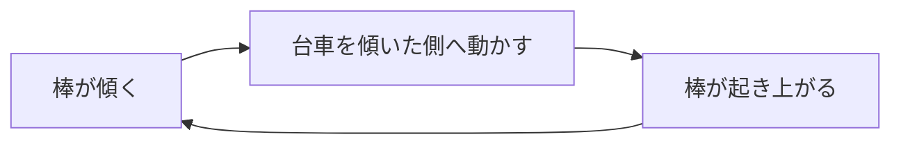
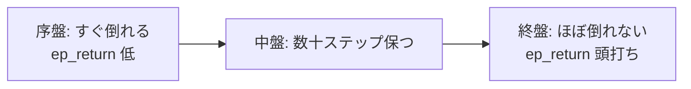

# 18. 寄り道1 — 倒立振子と体幹制御

> **この寄り道は何につながるか**
> 台車の上で棒を立て続ける＝**体幹バランス**。人型が「立つ」「座るときに上体を保つ」ための最小モデルです。
> 論文でいう早期終了（倒れたら終わり）と、姿勢維持の報酬（直立項）の原型を学びます。

## この章でわかること

- 最も簡単な RL タスクで、学習ループを一周させる
- 「姿勢を保つ」を報酬にどう書くか
- 学習曲線の読み方

## 前提

- 第01〜02章、第17章

---

## 1. タスク

台車（cart）を左右に動かして、その上の棒（pole）を垂直に保ちます。



ゲームでいう「綱渡り」や「一輪車」のバランスと同じ原理です。

## 2. 行動と状態

- **行動**: 台車を押す力（1次元の連続値）。
- **状態**: 台車の位置・速度、棒の角度・角速度。

これは人型の**体幹（胴体）**を1自由度に単純化したもの、と見なせます。

## 3. 報酬 — 「立てているほど高い」

第12章のパターン $\exp(-k d^2)$ をそのまま使います。$d$ は棒の傾きです。

$$
r = \exp(-5\, \theta^2) + 0.1
$$

- $\theta$（棒の角度）が 0 に近いほど高い。
- $+0.1$ は「生きているだけでも少し報酬」（alive bonus）。

実装は第III部のコードの `pendulum.py` にあります。

```python
def task_reward(self, obs, goal, action, next_obs):
    pole_angle = obs[..., 1]
    upright = torch.exp(-5.0 * pole_angle.pow(2))   # 立っているほど高い
    alive = torch.ones_like(upright)                 # 生存ボーナス
    return 1.0 * upright + 0.1 * alive
```

> **つながり**: この「姿勢が良いほど高い報酬」は、人型の直立報酬（第25章の `upright` 項）にそのまま発展します。座るときに上体を保つのも、同じ発想です。

## 4. 学習の実行

```bash
uv run python scripts/train_01_pendulum.py
```

AMP は使わず、素の PPO だけを回します（第23章で仕組みを作りますが、この章では既存の枠組みとして使って構いません）。

## 5. 学習曲線の読み方

学習が進むと、`ep_return`（エピソードの収益）が上がっていきます。



- **横軸**: 学習の進み（イテレーション）。
- **縦軸**: エピソード収益。
- 報酬が頭打ちになったら、そのタスクはほぼ解けた状態。

## 6. よくある失敗と対処

| 症状 | 対処 |
| --- | --- |
| すぐ倒れて収益が上がらない | alive ボーナスを増やす、探索の分散を増やす |
| 倒れてからも報酬がもらえる | 早期終了（倒れたら終了）を入れる |
| 激しく振動する | PD ゲインの調整、制御周波数を下げる |

**早期終了の重要性**: 倒れた後もダラダラ学習すると非効率です。人型でも同じで、転倒したらエピソードを切ります（第11章）。

## 7. 「つながり」のまとめ

| 倒立振子で学ぶこと | 人型タスクでの対応 |
| --- | --- |
| 姿勢の維持 | 立位・座位のバランス |
| 姿勢に基づく報酬 | 直立報酬（第25章） |
| 早期終了 | 転倒でエピソード終了（第11章） |
| PD 制御 | 全関節の制御（第06章） |

## まとめ

- 倒立振子は「体幹バランス」の最小モデル。
- 報酬は $\exp(-k\theta^2)$＋生存ボーナス。第12章のパターン。
- 早期終了で学習を効率化する。これは人型にも共通。
- 学習曲線が頭打ちになれば解決。

## 演習

1. alive ボーナスを 0 にしたら学習はどう変わるか予想しましょう。
2. 棒を2本にした「二重倒立振子」は人型の何に近づくか考察しましょう。
3. 早期終了を外すと、どんな「抜け道」を学習しうるか考えましょう。

---

次章: [19. 寄り道2 — Reacher と腕制御](19_寄り道2_Reacherと腕制御.md) ／ 前章: [17. MuJoCo と制御の基本](17_MuJoCoと制御の基本.md)
