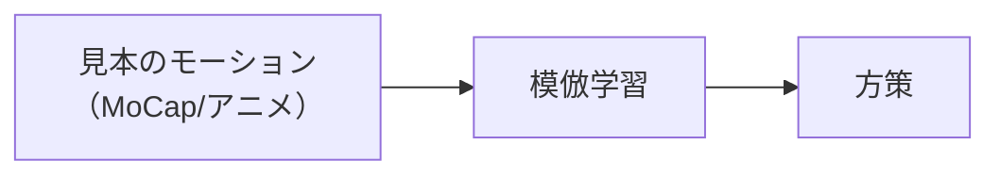
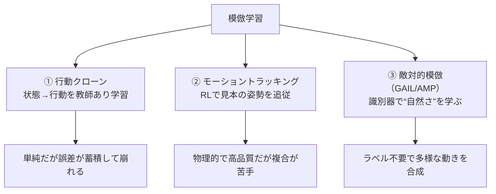
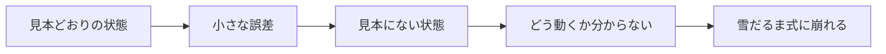
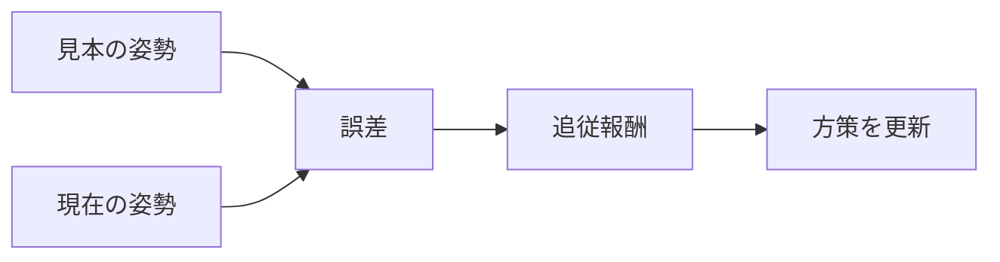

# 18. 模倣学習と DeepMimic — 見本の動きを真似させる

## この章でわかること

- 模倣学習（imitation learning）と、なぜ使うか
- 行動クローン（behavior cloning）の仕組みと限界
- モーショントラッキング（DeepMimic 系）の発想
- 誤差蓄積と、RL で見本を追う意義

## 前提

- 第14〜17章（RL・PPO・報酬設計）

## つながり

- 第17章で「報酬だけでは自然さを書けない」ことを見ました。この章から「見本から学ぶ」方法に入ります。
- モーショントラッキングの限界が、第19章の AMP への動機になります。

---

## 1. なぜ「見本から学ぶ」のか

第17章で、速度報酬だけだと「跳ねて進む」不自然な動きになると述べました。**自然な動きを報酬で細かく書くのは至難の業**です。

そこで発想を変えます。

> **自然な動きの見本（モーションデータ）を用意し、それを真似させる。**

これが**模倣学習**です。MoCap のクリップやアニメーターが作った動きを「お手本」として与えます。



## 2. 3つの立場の整理

模倣の方法は大きく3つ。本論文はこのうち3番目を発展させたものです。



## 3. 行動クローン（Behavior Cloning）

最も単純な模倣です。見本の（状態, 行動）ペアを教師あり学習します（第03章の分類回帰）。

$$
\min_\theta\ \mathbb{E}_{(s,a)\sim \mathcal{D}}\!\left[-\log \pi_\theta(a\mid s)\right]
$$

ゲームでいう「入力記録を再生するゴーストカーデータ」に近い発想です。

### 限界: 誤差の蓄積

行動クローンは、**見本にない状態**に弱いという致命的な弱点があります。



ゲームのたとえ: レースのゴーストカーは、コースから少し外れると立て直せません（見本に「外れた状態」がない）。物理シミュレーションでは、この崩れが転倒に直結します。

## 4. モーショントラッキング — RL で見本を追う

誤差蓄積への対策として、**強化学習で見本の姿勢を追従**させます。これが **DeepMimic**（Peng et al. 2018）です。

> Xue Bin Peng, Pieter Abbeel, Sergey Levine, Michiel van de Panne. **DeepMimic: Example-Guided Deep Reinforcement Learning of Physics-Based Character Skills.** ACM TOG 37(4), 2018. <https://arxiv.org/abs/1804.02717>

やり方は、各時刻で「見本の関節角」と「今の関節角」の差を報酬にします。

$$
r_t^{\text{track}} = w_p\, r^{\text{pose}}_t + w_v\, r^{\text{vel}}_t + \cdots
$$

- $r^{\text{pose}}_t$ … 見本の姿勢にどれだけ近いか（例: 関節角の差の $\exp$）。
- $r^{\text{vel}}_t$ … 見本の関節速度にどれだけ近いか。



**RL を使う理由**: 見本から外れた状態でも「見本に戻る」ように学習できる（誤差蓄積に強い）。DeepMimic は宙返りなど難度の高い技も再現します。

> **つながり**: RSI（第17章）は DeepMimic 由来のテクニックです。

### 限界: 「1つの見本」への縛り

モーショントラッキングは、基本的に**1つの参照モーションに忠実**に追従します。

- 歩く→座る→立つ、のように**複数の技を切り替える**のが苦手。
- 新しい状況（いつもと違う椅子など）に柔軟に適応しにくい。

複合的なタスク（論文の sit / carry）には、追従のもっと緩い仕組みが欲しくなります。

## 5. まとめと次章への橋

| 手法 | 見本の使い方 | 弱点 |
| --- | --- | --- |
| 行動クローン | 状態→行動を教師あり学習 | 誤差蓄積 |
| モーショントラッキング | 1つの見本に追従 | 複合・適応が苦手 |

次章では、**1つの見本に縛られず、動きの分布に似せる**方法（敵対的模倣 = AMP）を学びます。

## 6. 実装コード

- `src/ml_lern/core/imitation.py`
  - `behavior_clone_loss()` … 行動クローンの損失
  - `tracking_reward()` … モーショントラッキングの報酬
  - `ReferenceMotionBuffer` … 見本モーションの保持

```bash
uv run python scripts/p02_rl_basics.py
```

## 7. つまずきやすいポイント

| 症状 | 対処 |
| --- | --- |
| すぐ崩れる | 行動クローンの誤差蓄積。RL の追従に切り替える |
| 見本に固執しすぎる | 複合タスクには AMP（次章）を使う |
| 見本と体格が合わない | リターゲット（第37章） |
| 追従報酬の重み | 姿勢と速度のバランスを調整 |

## まとめ

- 模倣学習は「自然さ」を報酬で書く代わりに、見本から学ぶ。
- 行動クローンは単純だが誤差が蓄積する。
- モーショントラッキングは RL で見本を追従。頑健だが複合が苦手。
- 1つの見本に縛られない方法が、次章の AMP。

## 手を動かそう

> **一歩目**: 自分のゲームのアニメクリップを「見本」として、追従報酬を計算してみる。

```python
from ml_lern.core.imitation import tracking_reward
import torch
pose = torch.zeros(4, 6)
ref = torch.randn(4, 6) * 0.1
print(tracking_reward(pose, ref).round(3).tolist())   # 見本から遠いほど低い
```

**いじってみる**: 見本にわざとノイズを足し、追従報酬がどう下がるか観察する。姿勢だけでなく速度も入れると、動きの再現度がどう変わるか想像する。

**夢が広がる**:
- モーションキャプチャが無くても、アニメクリップから物理キャラの動きを作る。
- プレイヤーの操作を「見本」として、AI に真似させる（スタイル学習）。
- 既存アニメをリターゲットして、新しいキャラに流用する。

## 演習

1. 行動クローンの誤差蓄積を、ゴーストカーの例で説明しましょう。
2. モーショントラッキングが「新しい高さの椅子」に弱い理由を、見本との関係で述べましょう。
3. 追従報酬に姿勢だけでなく速度も入れる理由を説明しましょう。
4. モーショントラッキングと AMP の違いを、「何に似せるか」の観点で予想しましょう。

---

次章: [19. 敵対的模倣と AMP](19_敵対的模倣とAMP.md) ／ 前章: [17. 物理キャラクタの RL](17_物理キャラクタのRL.md)
