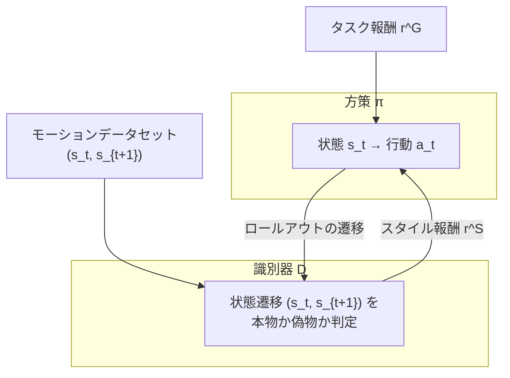
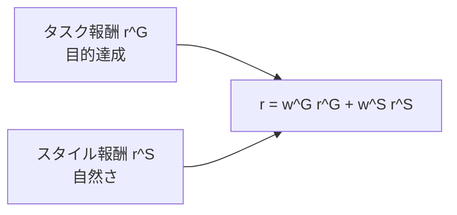

# 19. 敵対的模倣と AMP — 動きの分布に似せる

## この章でわかること

- GAIL（敵対的模倣学習）の仕組み
- AMP（Adversarial Motion Priors）の全体像
- 「状態遷移」を識別する理由
- スタイル報酬とタスク報酬の組み合わせ
- 論文（シーン相互作用）への橋渡し

## 前提

- 第07章（GAN・識別器）、第18章（模倣学習）、第16章（PPO）

## つながり

- 第07章で作った**識別器**が、ここで主役になります。
- この章の AMP が、論文（第6部）の直接の土台です。論文は AMP をシーン（物体）へ拡張します。

---

## 1. モーショントラッキングの限界を越える

第18章で、モーショントラッキングは**1つの見本に縛られる**と述べました。これを緩めるのが**敵対的模倣学習**です。

発想は第07章の GAN と同じです。

> **見本とそっくりな動きを生成するよう、識別器を使って方策を導く。**

- **識別器 $D$**: 「この動きは見本のものか、方策が生成したものか」を見分ける。
- **方策 $\pi$**: 識別器を騙して「見本っぽい」と判定させる。その度合いが報酬になる。

## 2. GAIL — 敵対的模倣学習

**GAIL（Generative Adversarial Imitation Learning, Ho & Ermon 2016）** が原型です。

> Jonathan Ho, Stefano Ermon. **Generative Adversarial Imitation Learning.** NeurIPS 2016. <https://arxiv.org/abs/1606.03476>

方策への報酬は、識別器の出力から作ります。

$$
r^{\text{style}}_t = -\log\!\big(1 - D(s_t, s_{t+1})\big)
$$

- $D \to 1$ … 「見本っぽい」 → 報酬が大きい
- $D \to 0$ … 「偽物っぽい」 → 報酬が小さい（$-\log(1-0) = 0$）

## 3. AMP — 物理キャラのための敵対的模倣

**AMP（Adversarial Motion Priors, Peng et al. 2021）** は、GAIL を物理キャラ制御に特化させたものです。

> Xue Bin Peng, Ze Ma, Pieter Abbeel, Sergey Levine, Angjoo Kanazawa. **AMP: Adversarial Motion Priors for Stylized Physics-Based Character Control.** ACM TOG 40(4), 2021. <https://arxiv.org/abs/2104.02180>

AMP は2つのネットワークからなります。



## 4. なぜ「状態遷移」を識別するのか

ここは AMP の理解で重要です。識別器の入力は**連続する2フレームの状態のペア $(s_t, s_{t+1})$** です。単一の状態ではありません。

理由: 単一の姿勢だけ見ても「自然な動き」かは判定できない。「座った姿勢」は静止画なら自然でも、そこに至る過程が不自然かもしれない。**姿勢の“変化”（遷移）**を見ることで「どう動いたか」を評価できます。

ゲームのたとえ: アニメーターが「この1フレームのポーズは変じゃない」と言っても、前後を再生すると「関節が瞬間移動している」ことがある。識別器はこの**動きの滑らかさ・力学的一貫性**を見ます。

これは**確率分布のマッチング**でもあります。識別器は「データセットの遷移分布 $d^{\mathcal M}$」と「方策の遷移分布 $d^{\pi}$」を区別しようとします。区別できないほど似ていれば、動きは自然です。

## 5. タスク報酬との組み合わせ

AMP でも、目的を果たすためのタスク報酬 $r^G$ は必要です。スタイル報酬だけでは「自然だが目的を果たさない」動きになります。

$$
r_t = w^G\, r^G(\mathbf{s}_t, \mathbf{g}_t, \mathbf{s}_{t+1}) + w^S\, r^S(\mathbf{s}_t, \mathbf{s}_{t+1})
$$

- $w^G, w^S$ … 重み。タスク重視かスタイル重視かを調整。
- $\mathbf{g}_t$ … 目標（第13章の状態設計、第17章の報酬設計）。



> **この式は、論文本体の式(1)と同じ形です**（第22章）。

## 6. 識別器の訓練と勾配ペナルティ

識別器は第07章と同じ二値分類です。データセットの遷移を本物、方策の遷移を偽物として訓練します。安定化のため**勾配ペナルティ**（第07章）を加えます。

AMP の学習ループは次の通りです。

```pseudo
初期化: 方策 π, 価値関数 V, 識別器 D
for イテレーション:
    方策でロールアウトを集める
    for 各サンプル:
        r_style = -log(1 - D(s, s'))         # スタイル報酬
        r = w_G * r_task + w_S * r_style     # 報酬の合成
    PPO で方策と価値関数を更新（第16章）
    識別器を更新（本物 vs 方策の遷移 + 勾配ペナルティ）
```

## 7. AMP の強み

- **ラベル不要**: 「この部分は歩行、ここは座り」といったフェーズラベルが要らない。
- **スキルの自律合成**: 識別器は「データセット内の分布」しか見ないので、方策は自由にブレンド・遷移できる。
- **タスク適応**: タスク報酬を与えれば、自然さを保ったまま目的に近づく。

## 8. AMP の限界 — 論文が埋める穴

AMP は「キャラクタ単体」の動きを自然にします。しかし、**物体（シーン）**の扱いがありません。

- 識別器は $(s_t, s_{t+1})$ しか見ないので、「椅子のない場所で座る動き」でも、動き自体がデータに似ていれば「自然」と判定してしまう。
- 物体の存在・配置を考慮した判定ができない。


> **つながり**: これが論文中核の「シーン条件付き識別器」です（第22章）。AMP の識別器に物体情報を足すのが、論文の貢献です。

## 9. 実装コード

- `src/ml_lern/core/amp.py`
  - `Discriminator` … 識別器（遷移を入力）
  - `style_reward()` … 式(6)相当
  - `gradient_penalty()` … 勾配ペナルティ
  - `AMPUpdater` … 識別器の更新

```bash
uv run python scripts/p04_amp.py
```

## 10. つまずきやすいポイント

| 症状 | 対処 |
| --- | --- |
| 識別器が強すぎる | 学習率・更新頻度を下げる（第07章） |
| スタイル報酬が0のまま | 重み・スケールを調整 |
| 動きが不自然なまま | 見本データの質を疑う（第10章） |
| 学習が崩壊 | 勾配ペナルティを調整 |

## まとめ

- 敵対的模倣は識別器で「本物らしさ」を報酬化する（GAN の発想、第07章）。
- AMP は物理キャラ向けで、状態遷移を識別する。1つの見本に縛られない。
- タスク報酬とスタイル報酬を重み付きで足す（式(1)と同形）。
- AMP は物体を見ない。論文はここにシーン条件付けを加える。

## 手を動かそう

> **一歩目**: 識別器を「本物の動き」「偽物の動き」で訓練し、スタイル報酬の値の変化を見る。

```python
import torch
from ml_lern.core.amp import AMPUpdater
from ml_lern.core.config import default_config
up = AMPUpdater(16, default_config())
real = torch.randn(256, 16) - 1.0
fake = torch.randn(256, 16) + 1.0
for _ in range(300):
    up.update(fake, real)
print("本物:", up.predict_style_reward(real[:3]).round(3).tolist())
print("偽物:", up.predict_style_reward(fake[:3]).round(3).tolist())
```

**いじってみる**: `real` と `fake` を近づけると、識別器が区別できなくなり（acc≈0.5）、報酬が近づく。これが「自然さを学ぶ」状態です。

**夢が広がる**:
- 自分のゲームの MoCap（またはアニメ）で AMP を学習し、自然な敵の動きを作る。
- プレイヤーの動きの癖を識別器に学ばせ、個性を再現する。
- 「このゲームらしい動き」をスタイルとして学習し、新キャラに移植する。

## 演習

1. AMP の識別器に単一の状態ではなく遷移を入れる理由を、ポーズと動きの違いで説明しましょう。
2. スタイル報酬だけ・タスク報酬だけにした場合の問題を、それぞれ述べましょう。
3. スタイル報酬の式で $D=0.9$ と $D=0.1$ のときの値を計算しましょう。
4. AMP が「椅子のない場所での座り」を自然と誤判定する理由を、識別器の入力から説明しましょう。

---

次章: [20. AMP の実装](20_AMPの実装.md) ／ 前章: [18. 模倣学習と DeepMimic](18_模倣学習とDeepMimic.md)
