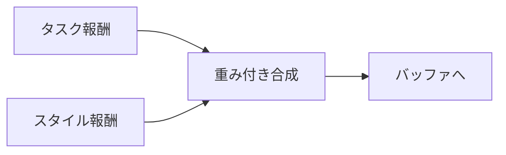
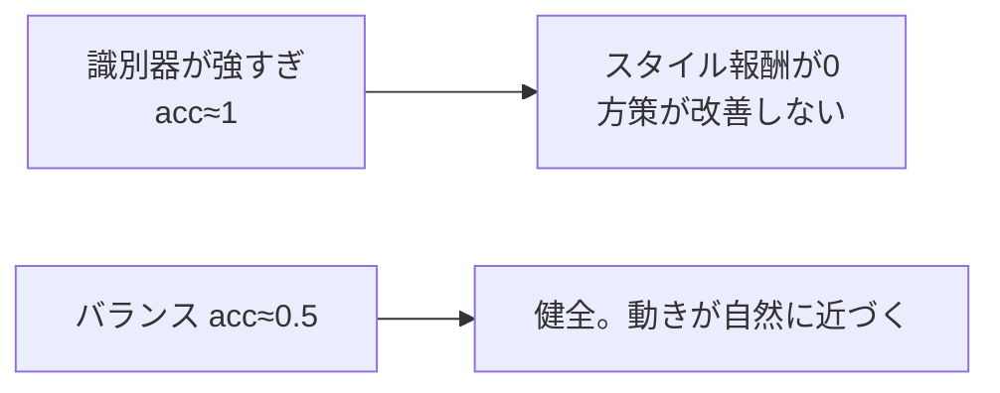

# 20. AMP の実装 — 識別器とスタイル報酬をコードで書く

## この章でわかること

- 識別器ネットワークの実装
- 勾配ペナルティの実装
- スタイル報酬の計算とロールアウトへの組み込み
- 識別器の更新（本物 vs 偽物）と健全性の監視

## 前提

- 第07章（GAN・識別器）、第19章（AMP）、第16章（PPO）

## つながり

- この章の実装が、第7部の AMP 実装（第34章）と、論文のシーン条件付き識別器（第36章）の土台になります。

---

## 1. 識別器ネットワーク

論文の構成 {1024, 512, 1} に合わせます（第17章）。

```python
class Discriminator(nn.Module):
    def __init__(self, amp_obs_dim, hidden_dims=(1024, 512)):
        super().__init__()
        self.net = _build_mlp(amp_obs_dim, hidden_dims, 1)

    def forward(self, amp_obs):
        return self.net(amp_obs).squeeze(-1)    # ロジット
```

- 出力は**ロジット**（シグモイド前）。`BCEWithLogitsLoss` と組み合わせます（第07章）。
- 入力 `amp_obs` は「状態遷移」（第19章）。物体を扱う場合、ここに物体が入ります（第36章）。

## 2. 勾配ペナルティ

第07章で学んだ安定化を実装します。

```python
@staticmethod
def gradient_penalty(logits, inputs):
    grads = torch.autograd.grad(
        outputs=logits.sum(), inputs=inputs,
        create_graph=True, retain_graph=True, only_inputs=True,
    )[0]
    return grads.pow(2).sum(dim=-1).mean()
```

- `inputs` は本物側の遷移にのみ適用（論文本体の式(5)）。
- 出力が入力の変化で激しく変わらないように平滑化する。

## 3. スタイル報酬

第19章の式を実装します（式(6)）。

```python
def style_reward(discriminator, amp_obs):
    with torch.no_grad():
        d = torch.sigmoid(discriminator(amp_obs))
        d = d.clamp(1e-4, 1 - 1e-4)       # log(0) を避ける
        return -torch.log(1.0 - d)
```

- $D \to 1$ で報酬大、$D \to 0$ で 0。
- `clamp` で数値安定化。

## 4. ロールアウトへの組み込み

タスク報酬とスタイル報酬を合成します（式(1)、第19章）。

```python
r_style = amp_updater.predict_style_reward(next_amp_obs)
reward = (cfg.task_reward_weight * task_reward
          + cfg.style_reward_weight * cfg.amp_reward_scale * r_style)
```

- `task_reward_weight = w^G`（例: 0.7）
- `style_reward_weight = w^S`（例: 0.3）
- `amp_reward_scale` … スタイル報酬のスケール調整（範囲が広いため）。



## 5. 識別器の更新

本物と偽物を二値分類します（第07章）。

```python
def update(self, policy_amp_obs, dataset_amp_obs):
    real = dataset_amp_obs[randperm(...)[:n]]
    fake = policy_amp_obs[randperm(...)[:n]]

    logits_real = self.discriminator(real)
    logits_fake = self.discriminator(fake)
    loss_real = self.bce(logits_real, torch.ones_like(logits_real))    # 本物→1
    loss_fake = self.bce(logits_fake, torch.zeros_like(logits_fake))   # 偽物→0

    gp = Discriminator.gradient_penalty(self.discriminator(real_gp), real_gp)
    loss = loss_real + loss_fake + cfg.gradient_penalty_weight * gp
    ...
```

## 6. 健全性の監視

識別器が強すぎると、方策に勾配が流れません（第07章）。正解率を監視します。

```python
acc_real = (torch.sigmoid(logits_real) > 0.5).float().mean()
acc_fake = (torch.sigmoid(logits_fake) < 0.5).float().mean()
```



## 7. ロールアウトから識別器データを作る

識別器には「状態遷移」が必要です。ロールアウト中に保存します。

```python
amp_obs = env.get_amp_obs(obs, goal)             # 物体込みの遷移（第36章）
# ... step ...
next_amp_obs = env.get_amp_obs(next_obs, goal_next)
buffer.add(..., amp_obs=amp_obs)                 # バッファに保存
```

- `get_amp_obs` が、シーン条件付けの有無を決めます（第19章）。
- 物体を入れるかどうかで、AMP かシーン条件付き識別器かが変わります。

## 8. 実装コードの場所

```
src/ml_lern/core/
  models.py    Discriminator（識別器）
  amp.py       style_reward / AMPUpdater / gradient_penalty
  buffer.py    amp_obs を含むバッファ
  rollout.py   報酬の合成
```

```bash
# （第7部で整備。MuJoCo 環境と組み合わせて回す）
uv run python scripts/train_05_humanoid_amp.py
```

## 9. つまずきやすいポイント

| 症状 | 対処 |
| --- | --- |
| 識別器が強すぎる | 識別器の学習率・更新頻度を下げる |
| スタイル報酬が0のまま | 重み・スケールを調整 |
| 学習が崩壊 | 勾配ペナルティの重みを調整 |
| 物体を無視している気がする | 物体特徴のスケールを正規化（第36章） |

## まとめ

- 識別器はロジットを出力し、二値分類で訓練する。
- 勾配ペナルティで安定化する（式(5)）。
- スタイル報酬は式(6)。タスク報酬と合成する（式(1)）。
- ロールアウトから (s, s') を集め、識別器の本物/偽物を作る。
- 第7部で MuJoCo 環境と組み合わせて実際に動かす。

## 演習

1. 勾配ペナルティの重みを 0 にすると、識別器の学習はどう不安定になるか予想しましょう。
2. `acc_real` と `acc_fake` が両方 0.9 のとき、何が起きているか説明しましょう。
3. `amp_reward_scale` を入れる理由を、報酬のスケールの観点で説明しましょう。
4. `get_amp_obs` に物体を足すと、識別器の役割がどう変わるか説明しましょう。

---

第5部はここまで。次章: [21. 論文の全体像](21_論文の全体像.md) ／ 前章: [18. 模倣学習と DeepMimic](18_模倣学習とDeepMimic.md)
