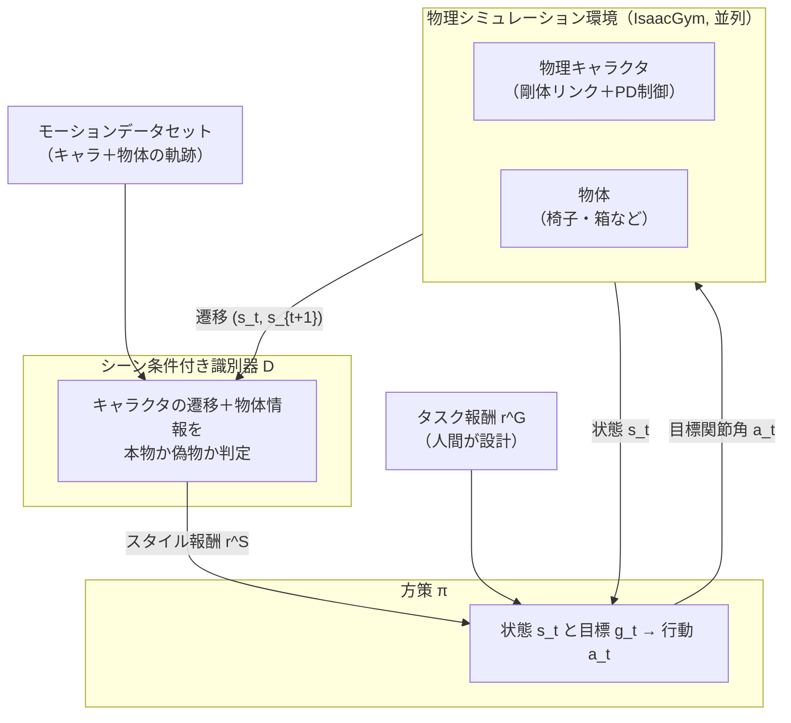
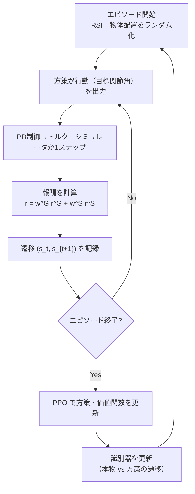

# 21. 論文の全体像 — 物理キャラのシーン相互作用

## この章でわかること

- 論文「Synthesizing Physical Character-Scene Interactions」の3つの貢献
- パイプライン（図2）の読み解き
- 3つのタスク（sit / lie down / carry）がなぜ難しいか
- 全体の学習ループ

## 前提

- 第19章（AMP）、第20章（AMP の実装）、第17章（物理キャラの RL）

## つながり

- 第5部までで、AMP（物理キャラを自然に動かす）を学びました。この部では、論文がそれを**物体（シーン）**へ拡張する様子を読みます。

---

## 1. 論文の主張

> **物理シミュレーションされたキャラクタが、シーンの中で自然に「座る／横になる／物を運ぶ」を学習する。ラベル付け不要。少数の実演から、形や大きさの違う多数の物体へ一般化する。**

> Mohamed Hassan, Yunrong Guo, Tingwu Wang, Michael Black, Sanja Fidler, Xue Bin Peng. **Synthesizing Physical Character-Scene Interactions.** arXiv:2302.00883, 2023. <https://arxiv.org/abs/2302.00883>

## 2. 3つの貢献

1. **手動アノテーションなしで、物理キャラクタにシーン相互作用タスクを学習させる枠組み**。
2. **シーン条件付き識別器**：キャラクタの動きを、環境中の物体の文脈で評価する。
3. **物体の物理的性質をランダム化する手法**：実演にない物体・配置への一般化を可能にする。

個々の部品（AMP・PPO・PD制御・ランダム化）は既存でも、**シーン相互作用という文脈での組み合わせが新しい**、と述べています。

## 3. パイプライン（図2）の読み解き

**第19章の AMP との唯一にして決定的な違い**: 識別器に入るのが「キャラクタの遷移」だけでなく**「物体の情報」も含む**ことです。

## 4. 3つのタスク

### 4.1 Sit（座る）

- 物体（椅子・ベンチ・ソファ・ベッドなど）に近づき、座面に腰を下ろす。
- 難しい点: 高さ・奥行き・形が違う。重心移動が大きく、バランスを崩しやすい。
- 評価: 腰が目標位置から20cm以内なら成功。

### 4.2 Lie down（横になる）

- 物体に近づき、体を横たえる。
- 難しい点: 座るより姿勢変化が大きい。頭と腰の両方を支える必要がある。
- 評価: 腰と頭がそれぞれ目標から30cm以内なら成功。

### 4.3 Carry（箱を運ぶ）

- 箱に近づき、持ち上げ、目的地まで運ぶ。
- 難しい点: 箱は手に固定されていない（接触と摩擦で支える）。重さ・大きさで戦略を変える必要がある。
- 評価: 箱が目標から20cm以内なら成功。

## 5. 学習ループの全体

第1〜5部で学んだ部品（PyTorch、生成モデル、MuJoCo、RL、PPO、AMP）が、このループのどこかに必ず出てくることを確認してください。

## 6. 先行研究との関係

| 系統 | 代表 | 本論文との関係 |
| --- | --- | --- |
| データ駆動運動学 | NSM, SAMP | 比較対象。物理なしで一般化に弱い |
| 物理＋模倣 | DeepMimic, AMP | 土台。シーンを見ない |
| 物理＋階層制御 | Chao et al. 2019 | 比較対象。不安定 |
| 手の操作 | MCP, Catch & Carry | 物体はあるが、シーン一般化は限定的 |

本論文は「**AMP のシーン版**」であり、「物理キャラクタのシーン相互作用」という比較的手薄だった領域に踏み込んでいます。

## 7. まとめ

- 貢献は「枠組み」「シーン条件付き識別器」「物体ランダム化」の3つ。
- 中核は識別器と方策を**シーン（物体）に条件付ける**こと。
- sit / lie down / carry は、いずれも物体との接触・適応が必要な難タスク。
- 学習ループは、第5部までの部品の組み合わせ。

## 手を動かそう

> **一歩目**: 論文の3タスク（sit/lie/carry）を、自分のゲームに置き換えて考える。「座る」→「操縦席に着く」、「運ぶ」→「旗を運ぶ」など。ノートに「物体」「キャラの動き」「成功条件」を書き出す。

**いじってみる**: 各タスクの「難しい点」（物体の形・動き・接触）を列挙し、どれが自分のゲームで問題になりそうか印をつける。

**夢が広がる**:
- 自分のゲームに「物理キャラが物体と相互作用する」場面を1つ設計する。
- 「これは学習で作りたい」タスクを3つ書き、難易度順に並べる。
- そのタスクを、この教科書のどの章で作れるかを地図にする。

## 演習

1. 3つの貢献のうち、論文が「最も新しい」と主張しているのはどれか、本文から推測しましょう。
2. sit / carry それぞれで、物体のどの性質が難しさの主因か述べましょう。
3. AMP と本論文の違いを、識別器の入力の観点で1文で説明しましょう。

---

次章: [22. 手法 — シーン条件付き識別器](22_手法_シーン条件付き識別器.md) ／ 前章: [20. AMP の実装](20_AMPの実装.md)
