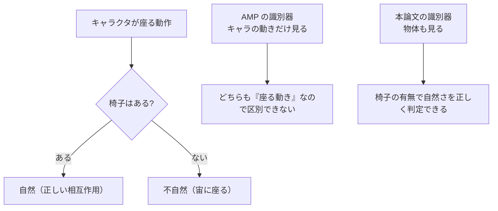

# 22. 手法 — シーン条件付き識別器

## この章でわかること

- 報酬の分解: タスク報酬 $r^G$ とスタイル報酬 $r^S$（式(1)(2)）
- 識別器の目的関数（式(3)〜(5)）と勾配ペナルティ
- スタイル報酬（式(6)）
- 「シーン条件付き」の具体的な意味

## 前提

- 第19章（AMP）、第20章（AMP の実装）、第16章（PPO）

## つながり

- ここが論文の中核です。第19章の AMP と、物体情報を条件付けるという1点だけが違います。

---

## 1. 報酬の全体像（論文 §3, 式(1)(2)）

論文は、方策が最大化すべき報酬を次のように定義します（式(1)）。

$$
r_t = w^{G}\, r^{G}(\mathbf{s}_t, \mathbf{g}_t, \mathbf{s}_{t+1}) + w^{S}\, r^{S}(\mathbf{s}_t, \mathbf{s}_{t+1})
$$

- $r^G$ … **タスク報酬**。目標達成の度合い（例: 座面に腰が近い）。
- $r^S$ … **スタイル報酬**。動きがデータセットにどれだけ似ているか。
- $w^G, w^S$ … それぞれの重み。
- $\mathbf{s}_t$ … 状態、$\mathbf{g}_t$ … 目標、$\mathbf{a}_t$ … 行動。

方策は、期待割引収益（式(2)）を最大化するように学習します。

$$
J(\pi) = \mathbb{E}_{p(\tau | \pi)}\!\left[\sum_{t=0}^{T-1} \gamma^t r_t\right]
$$

これは AMP（第19章）と同じ形です。**違いは、$r^G$ と識別器に物体情報が入ること**です。

## 2. 識別器の目的関数（式(3)〜(5)）

識別器 $D$ は、状態遷移 $(\mathbf{s}, \mathbf{s}_{t+1})$ がデータセット由来か方策由来かを判定します。目的関数は AMP に倣った形です（式(3)〜(5)をまとめて）。

$$
\arg\min_{D}\ \ 
\underbrace{-\mathbb{E}_{d^{\mathcal{M}}}\Big[\log D(\mathbf{s}, \mathbf{s}_{t+1})\Big]}_{\text{本物を1に}}
\underbrace{-\mathbb{E}_{d^{\pi}}\Big[\log\big(1 - D(\mathbf{s}, \mathbf{s}_{t+1})\big)\Big]}_{\text{偽物を0に}}
\underbrace{+\ w^{\text{gp}}\ \mathbb{E}\Big[\big\|\nabla_\phi D\big\|^2\Big]}_{\text{勾配ペナルティ}}
$$

| 記号 | 意味 |
| --- | --- |
| $d^{\mathcal{M}}(\mathbf{s}, \mathbf{s}_{t+1})$ | データセット $\mathcal{M}$ における遷移の分布 |
| $d^{\pi}(\mathbf{s}, \mathbf{s}_{t+1})$ | 方策 $\pi$ が生む遷移の分布 |
| $D(\cdot)$ | 識別器の出力（本物らしさ、0〜1） |
| $w^{\text{gp}}$ | 勾配ペナルティの係数 |

これは第07章で学んだ GAN のクロスエントロピー＋勾配ペナルティと、まったく同じです。**独自性は「何を入力するか（＝シーン条件）」にあります**。

## 3. スタイル報酬（式(6)）

識別器の出力から、方策のスタイル報酬を作ります（式(6)、第19章と同じ）。

$$
r^{S}(\mathbf{s}_t, \mathbf{s}_{t+1}) = -\log\big(1 - D(\mathbf{s}_t, \mathbf{s}_{t+1})\big)
$$

- $D \to 1$（本物っぽい） → $r^S$ 大
- $D \to 0$（偽物っぽい） → $r^S \to 0$

## 4. ここが「新規性」— シーン条件付け

AMP の識別器は、**キャラクタの遷移 $(s_t, s_{t+1})$** だけを見ます。本論文では、これに**物体（シーン）の情報**を加えます。

$$
D\!\left(\underbrace{\mathbf{s}_t, \mathbf{s}_{t+1}}_{\text{キャラクタ}},\ \underbrace{o_t, o_{t+1}}_{\text{物体の状態}}\right)
$$

- $o_t$ … 物体の位置・向きなど（第23章）。
- 実装では、物体特徴は**状態 $\mathbf{s}$ に含める**形で実現されます。つまり「シーン条件付き」は、**状態ベクトルに物体特徴を足すこと**で実現されます。

なぜこれが必要かを、具体的に考えます。



論文の表現（§3, 図2）:

> the discriminator receives information pertaining to both the character and the environment.

## 5. 方策側の条件付け

識別器だけでなく、**方策もシーンに条件付け**られます。方策の入力は状態 $\mathbf{s}_t$ と目標 $\mathbf{g}_t$ で、$\mathbf{s}_t$ に物体情報が含まれます。

$$
\mathbf{a}_t \sim \pi\!\left(\mathbf{a}_t \mid \mathbf{s}_t, \mathbf{g}_t\right), \qquad
\mathbf{s}_t \ni \{\text{キャラクタ特徴}, \text{物体特徴}\}
$$

- これにより、方策は「今、物体がどこにあるか」を見て行動を変えられます。
- 目標 $\mathbf{g}_t$ は、タスク指定（座面のバウンディングボックス、目的地など）。

## 6. 物体は動く — 反応が必要

論文が強調する点:

> Note that the object can move during the action and the agent must react appropriately.

- キャラクタが箱を押せば、箱は動く。その箱を支え続けなければならない。
- 椅子が横にずれれば、追従して座り直す必要がある。
- 状態に物体の**現在位置**を入れておけば、方策はこれに反応できる。

第26章の「外乱への頑健性」実験（物体を動かす）は、この設計の効果を確かめています。

## 7. 数式の再掲まとめ

$$
\begin{aligned}
r_t &= w^{G} r^{G}(\mathbf{s}_t, \mathbf{g}_t, \mathbf{s}_{t+1}) + w^{S} r^{S}(\mathbf{s}_t, \mathbf{s}_{t+1}) && \text{(1)}\\[4pt]
J(\pi) &= \mathbb{E}_{p(\tau|\pi)}\!\left[\sum_{t=0}^{T-1} \gamma^t r_t\right] && \text{(2)}\\[4pt]
\min_D\ & -\mathbb{E}_{d^{\mathcal{M}}}[\log D] - \mathbb{E}_{d^{\pi}}[\log(1-D)] + w^{\text{gp}}\mathbb{E}[\|\nabla D\|^2] && \text{(3)-(5)}\\[4pt]
r^{S} &= -\log\big(1 - D(\mathbf{s}_t, \mathbf{s}_{t+1})\big) && \text{(6)}
\end{aligned}
$$

## 8. まとめ

- 報酬はタスク報酬 $r^G$ ＋ スタイル報酬 $r^S$（式1）。
- 識別器は AMP と同じ目的関数（式3-5）。勾配ペナルティで安定化。
- スタイル報酬は識別器出力から作る（式6）。
- **新規性は入力に物体情報を加えること**（シーン条件付け）。
- 物体は動くので、方策は反応が必要。

## 手を動かそう

> **一歩目**: 識別器の入力を「キャラのみ」と「キャラ＋物体」で切り替えて、何が変わるかをコードで確認する。

```python
import torch
char = torch.randn(4, 30)
obj = torch.randn(4, 9)
print("AMP の入力次元:", char.shape[-1])                          # キャラのみ
print("シーン条件付きの入力次元:", torch.cat([char, obj], -1).shape[-1])  # キャラ＋物体
```

**いじってみる**: 物体を「座れる面がある」状態と「無い」状態で入力を作り、識別器が判定を変えるかを想像する。物体の次元を増減させて、識別器の入力を設計する。

**夢が広がる**:
- 自分のゲームの「自然さの判定器」に、環境情報をどこまで入れるかを設計する。
- 「この攻撃は壁の近くで自然か」のような、文脈依存の判定を作る。
- 物体を動かす外乱（プレイヤーが椅子をずらす等）に反応する制御を考える。

## 演習

1. 式(6)で $D = 0.5$ のとき $r^S$ はいくつか。$D$ が大きくなるにつれどう変化するか述べましょう。
2. 「シーン条件付け」を、状態ベクトルの観点から一言で説明しましょう。
3. 識別器に物体情報を入れない場合、箱を落としている動きを「自然」と誤判定するのはなぜか説明しましょう。
4. 式(3)-(5)の各項が、それぞれ何を実現しているか説明しましょう。

---

次章: [23. 状態と行動の表現](23_状態と行動の表現.md) ／ 前章: [21. 論文の全体像](21_論文の全体像.md)
