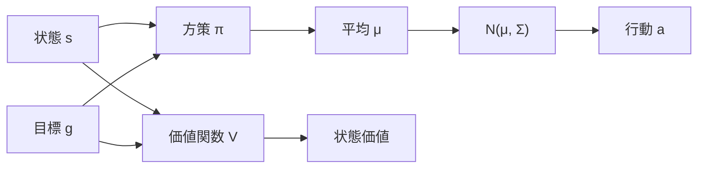

# 22. 方策と価値関数を書く

## この章でわかること

- ガウス方策（固定Σ）の PyTorch 実装
- 価値関数の実装
- 論文の MLP 構成（{1024, 512}）の意味
- 行動のサンプリングと対数確率

## 前提

- 第01〜02章、第06章、第09章

---

## 1. 全体像

この章では、第02章（PPO）で使う2つのネットワークを作ります。



コードは `src/ml_lern/mini_amp/models.py` にあります。

## 2. MLP を組む

論文の構成は {1024, 512, 出力} の全結合＋ReLU（第11章）。まずヘルパーを作ります。

```python
def _build_mlp(in_dim, hidden_dims, out_dim):
    layers = []
    prev = in_dim
    for h in hidden_dims:
        layers.append(nn.Linear(prev, h))
        layers.append(nn.ReLU())
        prev = h
    layers.append(nn.Linear(prev, out_dim))
    return nn.Sequential(*layers)
```

- `hidden_dims = (1024, 512)` が論文の構成。
- 入力は「状態＋目標」を連結したもの（第09章）。

## 3. ガウス方策（固定Σ）

方策は、行動分布の平均 $\mu$ を出力します。分散 $\Sigma$ は**学習せず固定**します（第11章）。

```python
class Policy(nn.Module):
    def __init__(self, obs_dim, goal_dim, action_dim, hidden_dims=(1024, 512), action_std=0.25):
        super().__init__()
        self.net = _build_mlp(obs_dim + goal_dim, hidden_dims, action_dim)
        # 固定の標準偏差（log 空間で保持）
        self.register_buffer("log_std", torch.full((action_dim,), float(torch.log(torch.tensor(action_std)))))
        self.action_dim = action_dim

    def forward(self, obs, goal):
        x = torch.cat([obs, goal], dim=-1)
        return self.net(x)                 # 平均 μ

    def distribution(self, obs, goal):
        mu = self.forward(obs, goal)
        std = torch.exp(self.log_std).expand_as(mu)
        return torch.distributions.Normal(mu, std)
```

### なぜ固定Σなのか

- 学習を安定させる（探索量が一定）。
- 分散も学習させると、早々に探索をやめて局所解にはまりやすい。

> **つながり**: 固定Σは、論文 §6 の「共分散は手動で指定し固定」に対応します。探索の量を一定に保つ設計です。

## 4. 行動のサンプリングと対数確率

```python
@torch.no_grad()
def act(self, obs, goal):
    dist = self.distribution(obs, goal)
    action = dist.sample()                          # 行動をサンプル（探索）
    log_prob = dist.log_prob(action).sum(dim=-1)    # 対数確率
    return action, log_prob
```

- `sample()` が探索の源。分散 $\Sigma$ の分だけランダムに行動を選ぶ。
- `log_prob` は PPO の確率比に必要（第02章）。

## 5. 価値関数

価値関数は状態価値を出力するスカラーのネットワークです。

```python
class Value(nn.Module):
    def __init__(self, obs_dim, goal_dim, hidden_dims=(1024, 512)):
        super().__init__()
        self.net = _build_mlp(obs_dim + goal_dim, hidden_dims, 1)

    def forward(self, obs, goal):
        x = torch.cat([obs, goal], dim=-1)
        return self.net(x).squeeze(-1)
```

- 出力は1次元（状態価値 $V(s)$）。
- PPO のアドバンテージ計算（GAE）に使う（第02章）。

## 6. PPO 更新で使う `evaluate_actions`

同じデータで方策を再評価する必要があります（PPO の複数エポック、第02章）。

```python
def evaluate_actions(self, obs, goal, actions):
    dist = self.distribution(obs, goal)
    log_prob = dist.log_prob(actions).sum(dim=-1)
    entropy = dist.entropy().sum(dim=-1)
    return log_prob, entropy
```

- `log_prob` … 新しい方策での対数確率。確率比に使う。
- `entropy` … 探索の度合い。エントロピー項に使う（第02章）。

## 7. 次元の確認

| 環境 | 状態次元 | 目標次元 | 行動次元 |
| --- | --- | --- | --- |
| 倒立振子 | 4 | 0 | 1 |
| Reacher | 10前後 | 2 | 2 |
| Walker2d | 17 | 1 | 6 |
| Humanoid | 300前後 | 1 | 17 |
| Humanoid（scene） | 300前後 | 6 | 17 |

> 論文のキャラクタは114次元状態・28次元行動でしたが、MuJoCo の humanoid はモデルが異なるため次元も変わります。設計の考え方（状態＋目標、固定Σ）は同じです。

## 8. 動作確認

```bash
uv run python - <<'EOF'
import torch
from ml_lern.mini_amp.models import Policy, Value

obs_dim, goal_dim, act_dim = 114, 6, 28
pi = Policy(obs_dim, goal_dim, act_dim)
v = Value(obs_dim, goal_dim)

obs = torch.randn(4, obs_dim)
goal = torch.randn(4, goal_dim)
action, logp = pi.act(obs, goal)
print("action:", action.shape, "logp:", logp.shape)  # (4,28), (4,)
print("value:", v(obs, goal).shape)                   # (4,)
EOF
```

## まとめ

- 方策は「状態＋目標 → ガウス分布の平均」。分散は固定。
- 行動はサンプリングし、対数確率を保存する。
- 価値関数は状態価値をスカラーで出力する。
- 次元は環境に依存するが、設計（状態＋目標、固定Σ）は論文と同じ。

## 演習

1. `action_std` を 0.25 から 0.5 に変えると、探索はどう変わるか述べましょう。
2. 方策の入力を「状態のみ」（目標なし）にしたら、どんな問題が起きるか述べましょう。
3. 価値関数の出力を多次元にすると、PPO の GAE 計算にどんな影響があるか考察しましょう。

---

次章: [23. PPO を実装する](23_PPOを実装する.md) ／ 前章: [21. 寄り道4](21_寄り道4_Walker2dとAntで歩行.md)
