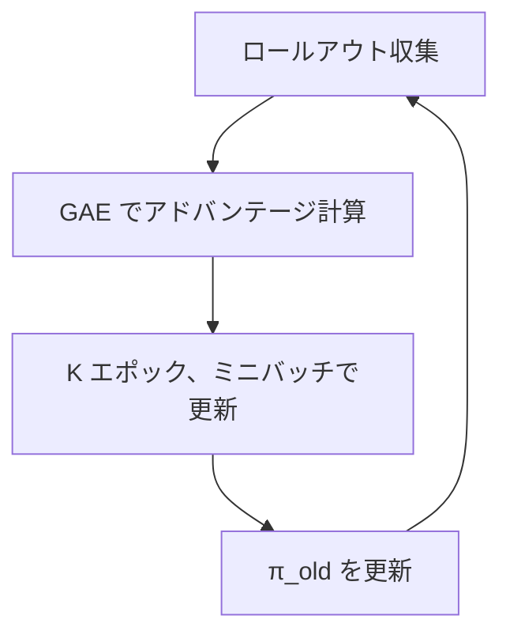

# 23. PPO を実装する

## この章でわかること

- ロールアウトバッファの実装
- GAE の実装（逆順走査）
- クリップ付き目的関数の実装
- 学習ループ全体の組み立て

## 前提

- 第02章（PPO）、第22章（方策・価値関数）

---

## 1. 全体の流れ

第02章の擬似コードを、コードに落とします。



対応するファイル:

- `buffer.py` … ロールアウトバッファ
- `ppo.py` … GAE と PPO 更新
- `rollout.py` … 収集ループ

## 2. ロールアウトバッファ

「貯めてから更新」の貯蔵庫です（第02章）。AMP 用に状態遷移も保持します。

```python
class RolloutBuffer:
    def __init__(self, num_steps, num_envs, obs_dim, goal_dim, action_dim, amp_obs_dim, device="cpu"):
        self.obs = torch.zeros(num_steps, num_envs, obs_dim, device=device)
        self.goal = torch.zeros(num_steps, num_envs, goal_dim, device=device)
        self.actions = torch.zeros(num_steps, num_envs, action_dim, device=device)
        self.log_probs = torch.zeros(num_steps, num_envs, device=device)
        self.values = torch.zeros(num_steps, num_envs, device=device)
        self.rewards = torch.zeros(num_steps, num_envs, device=device)
        self.dones = torch.zeros(num_steps, num_envs, device=device)
        self.amp_obs = torch.zeros(num_steps, num_envs, amp_obs_dim, device=device)
        self.next_obs = torch.zeros(num_steps, num_envs, obs_dim, device=device)
```

- `(num_steps, num_envs, ...)` の形で、時間と環境の2軸を持つ。
- `flatten()` で `(num_steps*num_envs, ...)` にしてから学習に使う。

## 3. GAE の実装

第02章の擬似コードをそのまま実装します。**時間方向に逆順**で走査するのがポイントです。

```python
def compute_gae(rewards, values, dones, gamma, gae_lambda, last_value):
    num_steps, num_envs = rewards.shape
    advantages = torch.zeros_like(rewards)
    last_gae = torch.zeros(num_envs, device=rewards.device)
    for t in reversed(range(num_steps)):
        next_value = last_value if t == num_steps - 1 else values[t + 1]
        not_done = 1.0 - dones[t]                       # 終了した環境は価値を0に
        delta = rewards[t] + gamma * next_value * not_done - values[t]
        last_gae = delta + gamma * gae_lambda * not_done * last_gae
        advantages[t] = last_gae
    returns = advantages + values
    return advantages, returns
```

- `not_done` で、エピソードが終わった環境の「未来の価値」を切り落とす。
- `returns = advantages + values` が価値関数の教師信号（第02章）。

## 4. PPO のクリップ付き目的関数

```python
log_probs, entropy = self.policy.evaluate_actions(mb_obs, mb_goal, mb_actions)
ratio = torch.exp(log_probs - mb_old_log_probs)          # 確率比 r_t(θ)
surr1 = ratio * mb_advantages
surr2 = torch.clamp(ratio, 1 - eps, 1 + eps) * mb_advantages
policy_loss = -torch.min(surr1, surr2).mean()            # 最大化 → 負にして最小化
```

- `ratio` … 新旧方策の確率比（第02章）。
- `clamp` … クリップ（一度に変えすぎない）。
- `-min(...)` … 目的関数を最大化したいので、符号を反転して最小化する。

## 5. 完全な損失

```python
value_loss = ((values - mb_returns) ** 2).mean()         # 価値関数の回帰
entropy_loss = -entropy.mean()                            # エントロピー（探索）
loss = policy_loss + c1 * value_loss + c2 * entropy_loss  # 第02章の式
```

- `c1 = 0.5`（価値関数の重み）
- `c2 = 0.001`（エントロピーの重み）

## 6. アドバンテージの正規化

学習を安定させる定石です。

```python
advantages = (advantages - advantages.mean()) / (advantages.std() + 1e-8)
```

- 平均0・分散1に揃える。報酬スケールの変動に強くなる。

## 7. 学習ループ

`train.py` の中心です。

```python
while True:
    # 1) ロールアウト収集
    buffer, obs, goal, ep_stats = collect_rollout(env, ppo.policy, ppo.value, amp, cfg, obs, goal)
    batch = buffer.flatten()
    # 2) GAE
    last_value = ppo.value(obs, goal).detach()
    advantages, returns = compute_gae(buffer.rewards, buffer.values, buffer.dones, cfg.gamma, cfg.gae_lambda, last_value)
    # 3) PPO 更新
    ppo_stats = ppo.update(batch, advantages.reshape(-1), returns.reshape(-1))
    # 4) 識別器更新（第24章）
    if amp is not None:
        disc_stats = amp.update(batch["amp_obs"], dataset_amp_obs)
```

## 8. 動作確認

```bash
# 倒立振子で PPO を回す（AMP なし）
uv run python scripts/train_01_pendulum.py
```

`ep_return` が増えていけば、PPO が機能しています。

## 9. つまずきやすいポイント

| 症状 | 対処 |
| --- | --- |
| 収益が上がらない | 学習率、エントロピー係数、報酬スケールを見直す |
| KL が大きすぎる | クリップ幅を下げる、エポック数を減らす |
| 学習が不安定 | アドバンテージ正規化、勾配クリップを確認 |
| すぐ局所解 | エントロピー係数を上げる（探索を増やす） |

## まとめ

- バッファに貯めて、GAE でアドバンテージを計算し、PPO で更新する。
- クリップ付き目的関数で「一度に変えすぎない」ようにする。
- 価値関数損失とエントロピー項を足す。
- この章の PPO が、次の AMP の土台になる。

## 演習

1. GAE の走査を「逆順」にする理由を、依存関係の観点から説明しましょう。
2. アドバンテージ正規化を外すと、学習がどう不安定になるか予想しましょう。
3. エントロピー係数を 0 にすると、探索はどうなるか述べましょう。

---

次章: [24. AMP 識別器を実装する](24_AMP識別器を実装する.md) ／ 前章: [22. 方策と価値関数を書く](22_方策と価値関数を書く.md)
