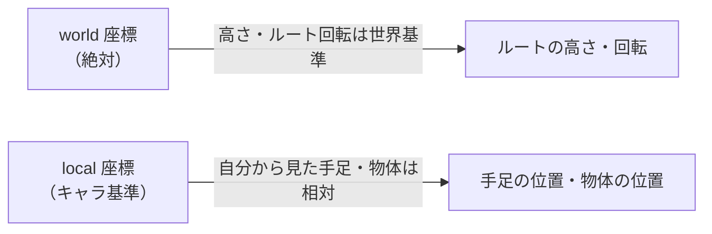
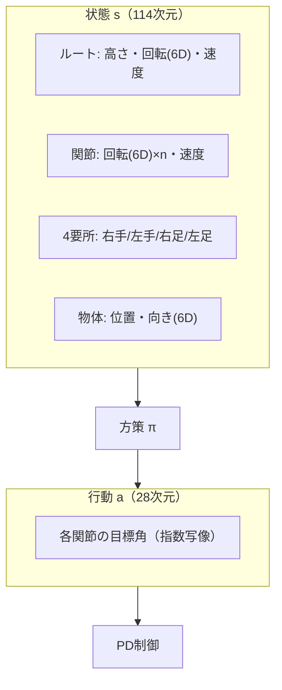

# 23. 状態と行動の表現

## この章でわかること

- 114次元の状態ベクトルの中身
- 28次元の行動ベクトルの中身
- 座標系（world / local）の使い分けと理由
- 6D 回転表現とは何か
- 物体特徴を状態に入れる意味

## 前提

- 第13章（状態設計）、第22章（シーン条件付け）

## つながり

- 第13章で「状態設計が学習の成否を決める」と述べました。論文の具体的な設計を、ここで見ます。

---

## 1. 状態ベクトルの全体像（論文 §4）

| # | 特徴 | 座標系 | 意味 |
| --- | --- | --- | --- |
| 1 | ルートの高さ | world | 骨盤の高さ |
| 2 | ルートの回転 | world | 体の向き |
| 3 | ルートの線速度・角速度 | local | どれだけ進み、回っているか |
| 4 | 各関節の回転 | local | 関節の曲がり具合 |
| 5 | 各関節の速度 | local | 関節の動く速さ |
| 6 | 4つの要所の位置（右手・左手・右足・左足） | local | 手足の先端の位置 |
| 7 | 物体の位置 | local | 物体（椅子・箱）の位置 |
| 8 | 物体の向き | local | 物体の向き |

全体で **114次元** です。

### world と local の使い分け

第13章で述べたとおりです。



キャラクタが世界のどこにいても同じ動きができるよう、手足・物体は自分基準（local）にします。これで**位置に依存しない行動**を学べます。

## 2. 回転の表現 — 6D エンコーディング

回転の表し方はいくつかあります。

| 表現 | 次元 | 問題点 |
| --- | --- | --- |
| オイラー角 | 3 | ジンバルロック、不連続 |
| クォータニオン | 4 | 単位長の制約、符号の曖昧さ |
| 回転行列 | 9 | 冗長、制約 |
| **6D 表現** | 6 | 連続で扱いやすい（論文採用） |

論文は **6D normal-tangent エンコーディング**を使います。回転行列の最初の2列（正規直交なベクトル2本）をそのまま数値として使う方法です。

$$
R = [\mathbf{a}, \mathbf{b}, \mathbf{c}] \quad\Rightarrow\quad \text{6D} = [\mathbf{a}, \mathbf{b}]
$$

- 3列目は外積で復元できるので、2列で十分。
- ニューラルネットにとって「連続で微分可能」なのが利点。

ゲームでのたとえ: クォータニオンの正規化・符号反転の面倒さを知っていれば、「6つの数値で素直に扱える」利点が分かるはずです。

## 3. 行動ベクトル（28次元）

行動は、**各関節の目標角**です（PD制御への指令、第12章）。

- 各関節の目標を**指数写像（exponential map）**という3次元の回転表現で表す。
- 全体で **28次元**。

指数写像は、回転軸 $\times$ 角度 で回転を表す方法（軸角表現）です。

$$
\mathbf{a} \in \mathbb{R}^3 \quad (\text{回転軸} \times \text{角度})
$$

- 直感的で、0付近ではオイラー角のように振る舞う。
- PD制御がこの目標角へ関節を動かす。

> 状態は 6D、行動は指数写像（3D）と使い分けています。実装上の都合（PD制御は3次元の目標、識別器は連続な6D）によります。

## 4. 物体特徴を状態に入れる意味

ここが論文の中核に直結します。状態の最後に**物体の位置・向き**が入っています（#7, #8）。

- これにより方策は「物体がどこにあるか」を見て動ける。
- 識別器も物体情報を含む遷移を見て、自然さを判定できる（第22章のシーン条件付け）。
- 物体は行動中に動くので、毎ステップ更新された位置・向きが状態に入る → 方策が反応できる。

論文の表現:

> A key difference from prior work is the inclusion of object features in the state.

## 5. 次元の内訳（推定）

| 構成要素 | 概算次元 | 備考 |
| --- | --- | --- |
| ルートの高さ | 1 | |
| ルートの回転（6D） | 6 | |
| ルートの線速度・角速度 | 6 | |
| 関節の回転（6D × 関節数） | 6 × n | n は関節数 |
| 関節の速度 | n | |
| 4要所の位置 | 12 | 3次元 × 4 |
| 物体の位置 | 3 | |
| 物体の向き（6D） | 6 | |
| 合計 | 114 | n に依存 |

> 正確な内訳は著者実装・データに依存します。実装時は自分のキャラクタの自由度に合わせて調整します（第7部）。

## 6. 目標 $g_t$ について

目標 $g_t$ はタスクによって異なります（論文 §4 と付録A）。

- **sit / lie down**: 物体のバウンディングボックス。
- **carry**: 目的地の位置、箱の高さ・幅・奥行き。
- **重さ対応版**: さらに箱の密度を追加。

## 7. まとめの図



## 8. まとめ

- 状態は114次元。ルート・関節・4要所・物体の情報を含む。
- world と local を使い分け、位置不変性を確保する。
- 回転は 6D 表現。行動は指数写像の目標角。
- **物体を状態に含める**のが論文の鍵。物体は動くので毎ステップ反応する。

## 手を動かそう

> **一歩目**: 自分のキャラの状態ベクトルの内訳を、表にする。ルート・関節・要所・物体を、world / local の別とともに書き出す。

```python
import torch
state = torch.zeros(114)
# 例: ルート高さ1 + 回転6 + 速度6 + 関節(6*n) + 4要所12 + 物体9
print(state.shape)
```

**いじってみる**: 自分のキャラの関節数で総次元を計算する。物体の向きに 6D を使うか、位置だけにするかを選ぶ。局所座標変換 `world_to_local` を自分で書く。

**夢が広がる**:
- 自分のゲームのキャラの「学習用の観測」を設計し、コードに落とす。
- 複数の物体・地形・状態を状態に含める拡張を考える。
- 観測を可視化して、AI が見ているものをデバッグする。

**再現レシピ**: [レシピ24（付録F）](付録F_再現レシピ_物理側.md#recipe-24)（コメント付きの再現コードで試せます）

## 演習

1. 物体の位置を world ではなく local で入れる利点を述べましょう。
2. 6D 回転表現がクォータニオンより学習しやすい理由を、連続性の観点で説明しましょう。
3. 状態に関節速度を入れないと、マルコフ性がどう崩れるか述べましょう。
4. 論文の状態と MuJoCo humanoid の観測（第13章）の共通点と相違点を整理しましょう。

---

次章: [24. データセットと訓練](24_データセットと訓練.md) ／ 前章: [22. 手法 — シーン条件付き識別器](22_手法_シーン条件付き識別器.md)
