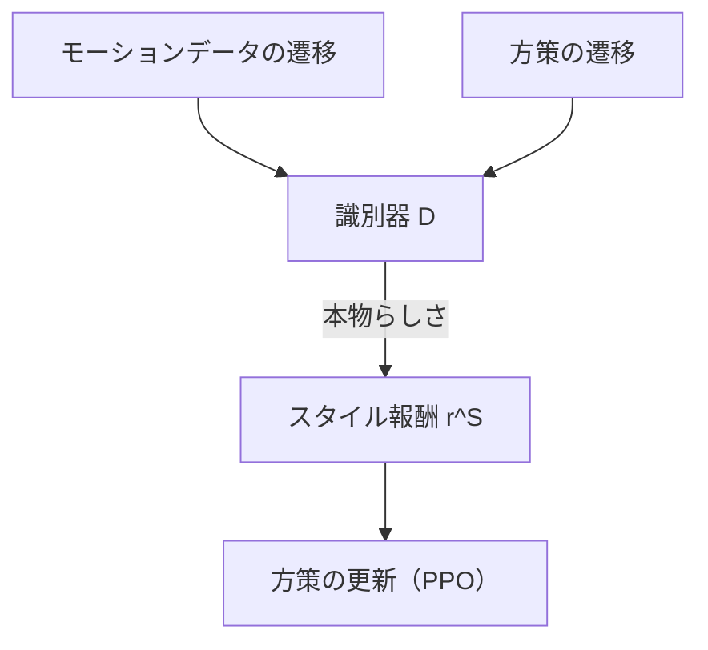
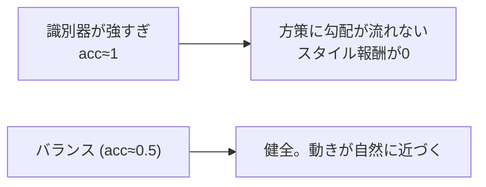

# 24. AMP 識別器を実装する

## この章でわかること

- 識別器ネットワークの実装
- 勾配ペナルティの実装
- スタイル報酬の計算とロールアウトへの組み込み
- 識別器の更新（本物 vs 偽物）

## 前提

- 第04〜05章（敵対的学習・AMP）、第08章（スタイル報酬）、第23章（PPO）

---

## 1. 識別器の役割を再確認

識別器は「状態遷移 $(s_t, s_{t+1})$ が本物（データセット）か偽物（方策）か」を判定します（第05・08章）。



コードは `src/ml_lern/mini_amp/amp.py` と `models.py` にあります。

## 2. 識別器ネットワーク

論文 §6 の構成（{1024, 512, 1}）に合わせます。

```python
class Discriminator(nn.Module):
    def __init__(self, amp_obs_dim, hidden_dims=(1024, 512)):
        super().__init__()
        self.net = _build_mlp(amp_obs_dim, hidden_dims, 1)

    def forward(self, amp_obs):
        return self.net(amp_obs).squeeze(-1)    # ロジット
```

- 出力は**ロジット**（シグモイド前）。`BCEWithLogitsLoss` と組み合わせる（第04章）。
- 入力次元 `amp_obs_dim` は、キャラクタ遷移＋物体（第27章）。

## 3. 勾配ペナルティ

第04・08章の安定化テクニックを実装します。

```python
@staticmethod
def gradient_penalty(logits, inputs):
    grads = torch.autograd.grad(
        outputs=logits.sum(), inputs=inputs,
        create_graph=True, retain_graph=True, only_inputs=True,
    )[0]
    return grads.pow(2).sum(dim=-1).mean()
```

- `inputs` は「物体なし」の遷移（AMP と同じく、本物側にのみ適用。式(5)）。
- 出力が入力の変化で激しく変わらないように平滑化する。

## 4. スタイル報酬

式(6)を実装します。

```python
def style_reward(discriminator, amp_obs):
    with torch.no_grad():
        logits = discriminator(amp_obs)
        d = torch.sigmoid(logits)
        d = d.clamp(1e-4, 1 - 1e-4)       # log(0) を避ける
        return -torch.log(1.0 - d)
```

- $D \to 1$ で報酬大、$D \to 0$ で 0。
- `clamp` は数値安定のため（$\log(0)$ や $\log$ の負数を避ける）。

## 5. ロールアウトへの組み込み

`rollout.py` で、タスク報酬とスタイル報酬を合成します（式(1)）。

```python
next_amp_obs = envs.get_amp_obs(next_obs, goal_next)
r_style = amp_updater.predict_style_reward(next_amp_obs)
reward = (cfg.task_reward_weight * task_reward
          + cfg.style_reward_weight * cfg.amp_reward_scale * r_style)
```

- `task_reward_weight = w^G`（例: 0.7）
- `style_reward_weight = w^S`（例: 0.3）
- `amp_reward_scale` … スタイル報酬のスケール調整（スタイル報酬は範囲が広いため）。

> **つながり**: 式(1)そのものです。重み $w^G, w^S$ のバランスが学習の質を左右します（第11・29章）。

## 6. 識別器の更新

式(3)〜(5)を実装します。

```python
def update(self, policy_amp_obs, dataset_amp_obs):
    # 本物（データセット）と偽物（方策）をミニバッチで取る
    real = dataset_amp_obs[randperm(...)[:n]]
    fake = policy_amp_obs[randperm(...)[:n]]

    logits_real = self.discriminator(real)
    logits_fake = self.discriminator(fake)
    loss_real = self.bce(logits_real, torch.ones_like(logits_real))   # 本物を1に
    loss_fake = self.bce(logits_fake, torch.zeros_like(logits_fake))  # 偽物を0に

    # 勾配ペナルティ
    real_gp = real.clone().detach().requires_grad_(True)
    gp = Discriminator.gradient_penalty(self.discriminator(real_gp), real_gp)

    loss = loss_real + loss_fake + cfg.gradient_penalty_weight * gp
    ...  # 逆伝播して更新
```

- `BCEWithLogitsLoss` にラベル1/0を渡す＝式(3)(4)のクロスエントロピー。
- 勾配ペナルティは本物側のみ（式(5)）。

## 7. 識別器の「正解率」を監視する

学習が健全かを見る指標です。

```python
acc_real = (torch.sigmoid(logits_real) > 0.5).float().mean()  # 本物を本物と判定した割合
acc_fake = (torch.sigmoid(logits_fake) < 0.5).float().mean()  # 偽物を偽物と判定した割合
```

- 理想は両方 0.5 前後（＝区別できない＝本物と偽物が似ている）。
- `acc_real ≈ 1, acc_fake ≈ 1` は「識別器が強すぎる」＝方策に勾配が流れにくい。



## 8. 動作確認

Walker2d などで AMP を有効にして回します（`train_04_walker.py` をベースに `use_amp=True` にした版）。

```bash
uv run python scripts/train_05_humanoid_amp.py   # 人型＋AMP（少し重い）
```

ログに `disc_loss`, `acc_r` が出ます。`acc_r` が 1 に張り付くなら、識別器が強すぎます（重み調整、第29章）。

## 9. つまずきやすいポイント

| 症状 | 対処 |
| --- | --- |
| 識別器が強すぎる | 識別器の学習率を下げる、更新頻度を下げる |
| スタイル報酬が 0 のまま | スタイル重みを上げる、`amp_reward_scale` を調整 |
| 動きが不自然なまま | データセット（参照モーション）を確認 |
| 学習が崩壊 | 勾配ペナルティの重みを調整 |

## まとめ

- 識別器は状態遷移を二値分類する。出力はロジット。
- 勾配ペナルティで平滑化する（式(5)）。
- スタイル報酬は式(6)。タスク報酬と合成する（式(1)）。
- 「本物 vs 偽物」の更新と、正解率の監視が勘所。

## 演習

1. `gradient_penalty_weight` を 0 にすると、識別器の学習はどう不安定になるか予想しましょう。
2. スタイル報酬の `clamp` を外すと、どんな数値問題が起きうるか述べましょう。
3. `acc_real` と `acc_fake` が両方 0.5 に近いとき、方策の動きはどうなっているか説明しましょう。

---

次章: [25. 人型で AMP を統合する](25_人型でAMPを統合する.md) ／ 前章: [23. PPO を実装する](23_PPOを実装する.md)
