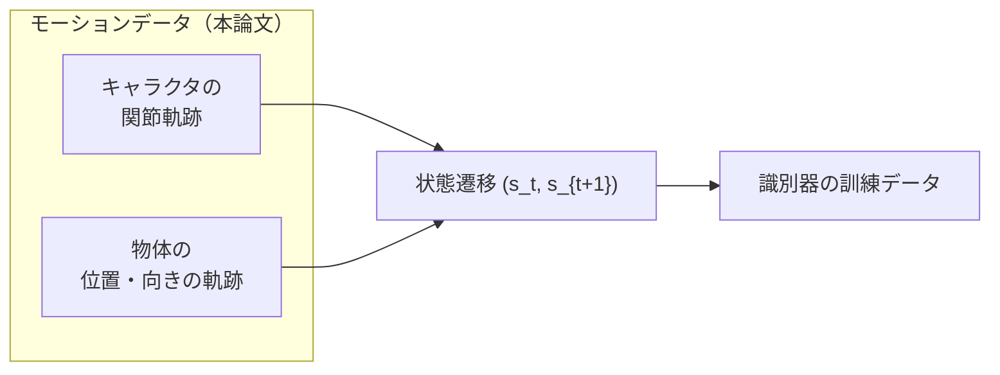
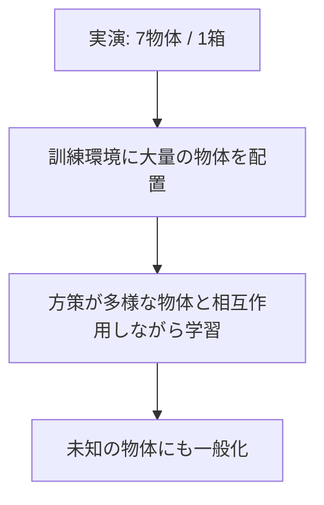
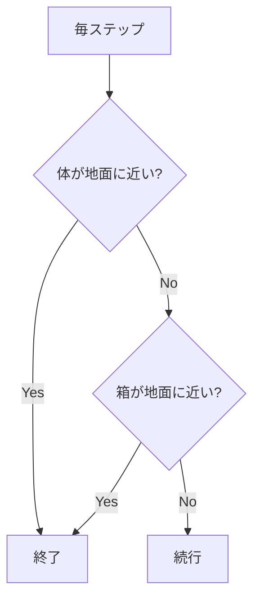

# 24. データセットと訓練

## この章でわかること

- 論文が使う2種類のデータ（SAMP データセット／自作の箱運び MoCap）
- 少数の物体から多数の物体へ一般化する仕組み（ShapeNet・スケーリング）
- Reference State Initialization（RSI）と物体配置のランダム化
- エピソード長・早期終了・ネットワーク構成

## 前提

- 第10章（時系列データ）、第17章（RSI・報酬）、第23章（状態）

## つながり

- 第17章で述べた RSI・早期終了が、論文の具体的な設定として現れます。

---

## 1. 「キャラ＋物体」のペアがデータ

通常のモーションデータは、キャラクタの関節角度の系列です。ところが本論文は、**物体の位置・向きの軌跡も必要**とします。理由はシーン条件付け（第22章）です。



## 2. sit / lie down 用: SAMP データセット

座る・横になるタスクには、**SAMP データセット**（Hassan et al. 2021）を使います。

> Mohamed Hassan, et al. **Stochastic Scene-Aware Motion Prediction (SAMP).** ICCV 2021. <https://arxiv.org/abs/2108.08284>

- 内容: 座る・横になる動作の MoCap クリップ。**約100分**。
- 物体情報: シーン中の**7種類の物体**の位置・向き、および CAD モデルを含む。
- MoCap は SMPL 系の身体表現（第37章）。

## 3. carry 用: 自作の箱運び MoCap

箱運びには、著者らが**自分で撮影**した MoCap を使います。

- **15クリップ**。被験者が箱へ歩いていき、持ち上げ、目的地へ運ぶ。
- 各クリップで箱の**初期位置と目標位置を変化**させる。
- 全身の MoCap に加え、**箱の動きも光学マーカーで計測**。

つまり、**たった15クリップ・1種類の箱**の実演から始めます。

## 4. 少数データからの一般化

データは貧弱です（sit/lie: 7物体、carry: 1箱）。にもかかわらず、論文は「**数百種類の物体**」で動くポリシーを学習します。鍵は次の通りです。

> **方策を、訓練中に新しい物体にさらす（expose）。**



これは**ドメインランダム化**の一種です。

### 物体の水増し（sit / lie down）

**ShapeNet** の同カテゴリ物体に置き換えます。

> Angel X. Chang, et al. **ShapeNet.** arXiv:1512.03012, 2015. <https://arxiv.org/abs/1512.03012>

- カテゴリ: 椅子、アームチェア、テーブル、低/高スツール、ソファ、ベッド。
- 合計 **約350個**のユニークな物体を使用。
- 各エピソードで **0.8〜1.2倍**にランダムスケーリング。

### 物体の水増し（carry）

- 訓練時: **0.5〜1.5倍**にスケーリング。
- 評価時: 25×17.5×15cm 〜 75×52.5×45cm の範囲でテスト。
- 重さ版: 5〜26kg の範囲。

## 5. 訓練の設定（論文 §6）

### RSI（Reference State Initialization）

エピソード開始時に、キャラクタと物体を**データからランダムにサンプルした状態**に初期化します（第17章）。

- 遠くから始めれば「歩いて近づく」、座りかけから始めれば「最後のひと押し」を学ぶ。
- 学習を大幅に加速し、より自然な動きを生む。

### 物体配置のランダム化

| パラメータ | 範囲 |
| --- | --- |
| 物体の水平距離 | キャラクタから **1〜10 m** |
| 物体の向き | **[0, 2π]** から一様にサンプル |

### エピソード長と早期終了

| 項目 | 値 |
| --- | --- |
| エピソード長（sit/lie） | 10秒 |
| エピソード長（carry） | 15秒 |
| 早期終了: 体の接触 | 手足を除く関節が地面から20cm以内 |
| 早期終了: 箱の落下 | 箱が地面から30cm以内 |



### ネットワーク構成（論文 §6）

| ネットワーク | 構成 | 出力 |
| --- | --- | --- |
| 方策 $\pi$ | 全結合 {1024, 512, 28} | ガウス分布の平均 $\mu$（28次元） |
| 価値関数 $V$ | 全結合 {1024, 512, 1} | 状態価値 |
| 識別器 $D$ | 全結合 {1024, 512, 1} | 本物らしさ |

- 活性化: ReLU。
- 方策の共分散 $\Sigma$ は**手動で指定し固定**（第17章）。

$$
\pi(\mathbf{a}_t \mid \mathbf{s}_t, \mathbf{g}_t) = \mathcal{N}\!\big(\mu(\mathbf{s}_t, \mathbf{g}_t),\ \Sigma\big)
$$

> 固定の共分散は、学習を安定させ、探索量を一定に保ちます。

## 6. 訓練がうまくいかない典型パターン

| 症状 | 原因の候補 |
| --- | --- |
| 動くが不自然 | スタイル報酬の重みが小さい／識別器が弱い |
| 自然だが目的を果たさない | タスク報酬の重みが小さい／報酬設計が甘い |
| 転倒ばかり | 早期終了が厳しすぎ／報酬にバランス項がない |
| 学習が進まない | RSI なし／並列数不足／学習率ミス |
| 特定の物体だけ苦手 | ランダム化の範囲が狭い |

## 7. まとめ

- データは「キャラ＋物体」のペア。sit/lie は SAMP（7物体）、carry は自作（1箱）。
- 少数の実演から、訓練中の物体ランダム化（ShapeNet・スケーリング）で広く一般化する。
- RSI でランダムな段階から学習。物体は1〜10m、向きは0〜2πでランダム化。
- エピソードは10〜15秒。転倒・落下で早期終了。ネットワークは {1024, 512} の MLP。

## 手を動かそう

> **一歩目**: RSI を自分で実装する。参照モーションのランダムなフレームからエピソードを始める。

```python
from ml_lern.core.rewards import reference_state_init
import torch
ref = torch.randn(500, 30)          # 参照モーション 500フレーム
start = reference_state_init(ref)
print("初期状態の形:", start.shape)
```

**いじってみる**: RSI を「常に同じ初期状態」に変えたとき、学習が遅くなる様子を（ログで）想像する。物体配置のランダム化の範囲（1〜10m）を変えてみる。

**夢が広がる**:
- 自分のゲームの MoCap/アニメを、学習データに変換するパイプラインを作る。
- 「チェックポイントから練習する」発想を学習に活かす。
- データが少ないときの「水増し（ランダム化）」を設計する。

## 演習

1. 識別器が物体情報を見るために、データに何が必要か述べましょう。
2. 「実演は1つの箱だけ」なのに多様な箱を運べる理由を、訓練の工夫から説明しましょう。
3. RSI がない場合、なぜ近距離の技術を学びにくいか説明しましょう。
4. エピソード長を10秒に設定する根拠として、何を考慮すべきか考察しましょう。

---

次章: [25. 報酬関数を読む](25_報酬関数を読む.md) ／ 前章: [23. 状態と行動の表現](23_状態と行動の表現.md)
