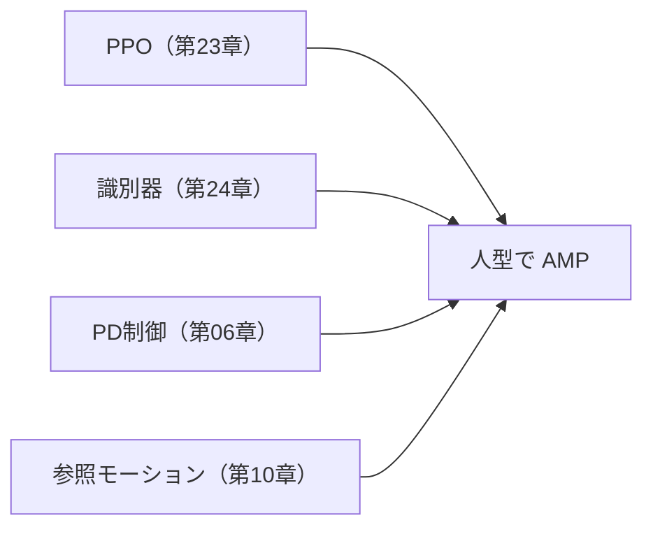

# 25. 人型で AMP を統合する

## この章でわかること

- MuJoCo の humanoid で AMP を回す
- 参照モーションをどう用意するか
- 自然な歩行がどう生まれるか
- 論文のセットアップとの対応

## 前提

- 第05章（AMP）、第23章（PPO）、第24章（識別器）

---

## 1. ここまでの到達点

寄り道で部品を作りました。この章で、それらを**人型**に統合します。



環境は `src/ml_lern/mini_amp/envs/humanoid_env.py` の `HumanoidLocomotionEnv` です。

## 2. MuJoCo humanoid の位置づけ

MuJoCo の `Humanoid-v5` は、関節付きの人型モデルです。

- 状態: ルートの高さ・向き、関節角・速度、など（第09章の考え方と同じ）。
- 行動: 各関節の目標角（PD制御、第06章）。

> 論文のキャラクタ（IsaacGym）とはモデルが違いますが、「剛体リンク＋PD制御＋AMP」という構成は同じです。第28章で SMPL 由来のモデルに差し替えます。

## 3. 参照モーションの準備

AMP には「本物の動き」が必要です（第05・10章）。論文は MoCap（SAMP）を使いますが、このミニ実装では次のどれかを使います。

1. **手続き生成**: 単純な歩行パターンを生成する（最も簡単）。
2. **サンプル運動**: MuJoCo 付属の歩行動作を利用。
3. **公開 MoCap**: 入手可能な歩行 MoCap をリターゲットする（第28章・付録D）。

```python
def _build_reference_motion(self):
    n = 2000
    self.ref_obs = torch.randn(n, self.obs_dim, device=self.device) * 0.1
    self.ref_amp_obs = self.ref_obs.clone()
```

- `ref_amp_obs` が識別器の「本物」データ。
- 実運用では `prepare_ref.py` で実データに差し替える。

> **正直な注意**: ランダムな参照モーションでは、識別器は「自然さ」を学べません。**質の良い参照モーションが AMP の要**です。この章の目的は、パイプラインを人型で通すことです。自然な歩容には実データが必要です。

## 4. タスク報酬 — 歩行

人型では、まず「歩く」を学ばせます（第21章の方針）。論文の sit/carry の報酬は第26章で扱います。

```python
def task_reward(self, obs, goal, action, next_obs):
    speed = self._forward_speed(next_obs)                     # 前進速度
    speed_reward = torch.exp(-2.0 * (self.target_speed - speed).pow(2))
    upright = torch.exp(-5.0 * next_obs[..., 1].pow(2))       # 直立
    alive = torch.ones_like(speed_reward)
    return 1.0 * speed_reward + 0.5 * upright + 0.1 * alive
```

- **速度追従**: 前進を促す（第12章の速度項）。
- **直立**: 体幹を立てる（第18・21章の直立報酬）。
- **生存**: 生きているだけで少し。

## 5. AMP を有効にする

`rollout.py` でスタイル報酬が合成されます（第24章）。`train.py` では `use_amp=True` で識別器を有効にします。

```bash
uv run python scripts/train_05_humanoid_amp.py
```

## 6. 学習の観察


- AMP なしだと、速度報酬に最適化して「跳ねて進む」などの不自然な動きが出ます（第21章）。
- AMP ありだと、参照モーションに似た動きに引き寄せられ、**自然な歩容**になります。

## 7. 論文との対応

| このミニ実装 | 論文 |
| --- | --- |
| MuJoCo humanoid | IsaacGym の剛体人型 |
| 手続き生成/サンプル運動の参照 | SAMP・AMASS の MoCap |
| 速度＋直立＋生存の報酬 | sit/carry のタスク報酬（付録A） |
| 識別器（物体なし） | 識別器（物体なし、AMP 本来） |
| 数十環境（CPU） | 数千環境（GPU） |

## 8. つまずきやすいポイント

| 症状 | 対処 |
| --- | --- |
| 歩かずその場で立つ | 速度報酬を上げる、目標速度を確認 |
| 跳ねる/滑る | AMP の重みを上げる、参照モーションを改善 |
| すぐ転ぶ | 直立報酬・早期終了の調整 |
| 学習が遅い | 環境数・ステップ数を見直す（CPU の限界） |

## 9. ここまでのまとめ

- 人型（MuJoCo humanoid）で AMP を統合した。
- タスク報酬（歩行）＋スタイル報酬（AMP）で、自然な歩行を目指す。
- 参照モーションの質が AMP の成否を左右する。
- 次章で物体を足し、論文のシーン相互作用に進む。

## 演習

1. `style_reward_weight` を 0（AMP なし）にしたときと、大きくしたときの挙動の違いを予想しましょう。
2. MuJoCo humanoid と論文のキャラクタの違いが、学習結果にどう影響するか考察しましょう。
3. 参照モーションがランダムだと AMP が機能しない理由を、識別器の観点で説明しましょう。

---

次章: [26. 物体を足して sit / carry 簡略版](26_物体を足してsit_carry簡略.md) ／ 前章: [24. AMP 識別器を実装する](24_AMP識別器を実装する.md)
