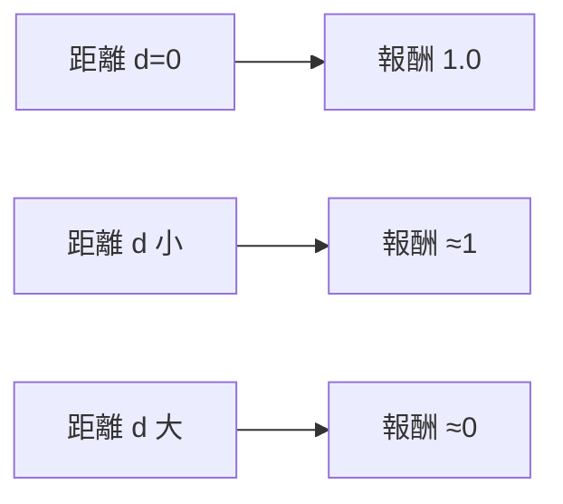
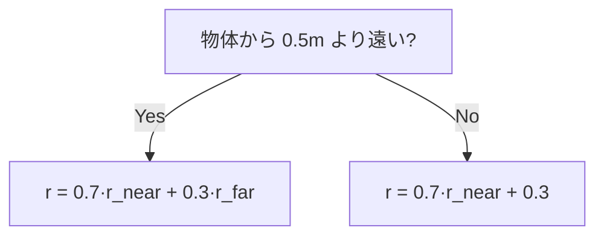
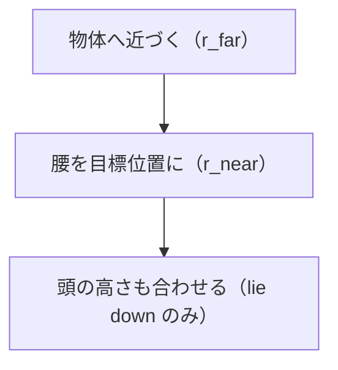

# 25. 報酬関数を読む（論文 付録A）

## この章でわかること

- タスク報酬 $r^G$ の設計思想（「遠くへ誘導」＋「近くで精密に」）
- sit / lie down / carry の報酬式（式(7)〜(15)）を1つずつ
- 指数関数 $e^{-d^2}$ を使う理由
- 「距離」「速度」「高さ」という3つの誘導の意味

## 前提

- 第17章（報酬設計）、第22章（報酬の分解）

## つながり

- 第17章で学んだ報酬設計のパターンが、論文の具体的な式として現れます。第7部で自分の報酬を設計するときの雛形になります。

---

## 1. 報酬設計の基本パターン

論文のタスク報酬には共通のパターンがあります。

> **遠いときは「近づけ」、近いときは「きっちり合わせろ」。**

これを実現するのが、**指数関数による滑らかな報酬**です（第17章）。

$$
r = \exp\!\big(-k \cdot d^2\big)
$$

- $d$ … 目標とのずれ、$k$ … 鋭さ。
- $d = 0$ で満点（1.0）、離れるほど 0 に近づく。

**なぜ指数関数か**: なめらかで勾配が連続、$k$ で厳しさを調整できる。閾値でバッサリ切るより学習しやすい。

## 2. 記号の準備

| 記号 | 意味 |
| --- | --- |
| $\mathbf{x}^{\text{root}}_t$ | キャラクタのルート位置 |
| $\mathbf{x}^{*}$ | 物体の位置 |
| ${\mathbf{x}^{\text{root}}}^{*}$ | 座る/横になる目標位置（腰を置くべき場所） |
| $\dot{\mathbf{x}}^{\text{root}}_t$ | ルートの線速度 |
| $\mathbf{d}^{*}$ | ルート→物体への水平単位ベクトル |
| $v^{*}$ | 目標歩行速度（1.5 m/s） |
| $h^{\text{head}}$ | 頭の高さ |
| $\mathbf{x}'_t$ | 箱の目的地 |
| $h^{\text{hand}}, h^{\text{box}}$ | 手・箱の高さ |

## 3. Sit の報酬（式(7)〜(9)）

距離に応じて2つのモードを切り替えます（式(7)）。

$$
r^{G}_t =
\begin{cases}
0.7\, r^{\text{near}}_t + 0.3\, r^{\text{far}}_t, & \|\mathbf{x}^{*} - \mathbf{x}^{\text{root}}_t\| > 0.5\,\text{m}\\[4pt]
0.7\, r^{\text{near}}_t + 0.3, & \text{otherwise}
\end{cases}
$$

- 物体から **0.5m より遠い**: 「近づく報酬 $r^{\text{far}}$」と「座る報酬 $r^{\text{near}}$」の両方。
- **0.5m 以内**: $r^{\text{far}}$ を満点（0.3）に固定。座ることに集中させる。

### $r^{\text{far}}$ — 歩いて近づく（式(8)）

$$
r^{\text{far}}_t = 0.5\exp\!\big(-0.5\|\mathbf{x}^{*} - \mathbf{x}^{\text{root}}_t\|^2\big)
+ 0.5\exp\!\big(-2.0\,\|v^{*} - \mathbf{d}^{*}_t \cdot \dot{\mathbf{x}}^{\text{root}}_t\|^2\big)
$$

1. **距離の項**: 物体に近いほど高い。
2. **速度の項**: 物体方向へ $v^* = 1.5$ m/s で進むほど高い。

$\mathbf{d}^{*}_t \cdot \dot{\mathbf{x}}^{\text{root}}_t$ は内積で、「物体方向の速度成分」です。速度を与えることで「じっとしている抜け道」を塞ぎます（第17章）。

### $r^{\text{near}}$ — 座る（式(9)）

$$
r^{\text{near}}_t = \exp\!\big(-10.0\,\|{\mathbf{x}^{\text{root}}}^{*} - \mathbf{x}^{\text{root}}_t\|^2\big)
$$

- 腰が目標位置に近いほど高い。係数 10.0 は大きめ（正確な位置合わせを要求）。

## 4. Lie down の報酬（式(10)）

横になるタスクは sit をほぼ流用し、$r^{\text{near}}$ だけ変えます。

$$
r^{\text{near}}_t = \exp\!\big(-10.0\|{\mathbf{x}^{\text{root}}}^{*} - \mathbf{x}^{\text{root}}_t\|^2 - 10.0\|{h^{\text{head}}}^{*} - h^{\text{head}}_t\|^2\big)
$$

- 腰に加えて**頭の高さ**も合わせる（横たわる姿勢を要求）。
- $r^{\text{far}}$ と $r^G$ の構造は sit と同じ。

## 5. Carry の報酬（式(11)〜(15)）

「箱へ歩く」→「箱を運ぶ」→「目的地に置く」の3段階です。

### 目標（式(11)）

$$
\mathbf{g}_t = (\tilde{\mathbf{x}}'_t,\ b_h,\ b_w,\ b_d)
$$

- $\tilde{\mathbf{x}}'_t$ … 箱を置く目的地（ローカル座標）
- $b_h, b_w, b_d$ … 箱の高さ・幅・奥行き（サイズごとに方策を変えるため）

### 全体（式(12)）

$$
r^{G}_t = r^{\text{walk}}_t + r^{\text{carry}}_t
$$

### $r^{\text{walk}}$ — 箱へ歩く（式(13)）

sit の $r^{\text{far}}$ と同型です。箱へ 1.5 m/s で歩き、0.5m 以内で満点（0.2）に固定します。

### $r^{\text{carry}}$ — 箱を運ぶ（式(14)(15)）

$$
r^{\text{carry}}_t =
\begin{cases}
r^{\text{carry-far}}_t + r^{\text{carry-near}}_t, & \|\mathbf{x}'_t - \mathbf{x}^{*}_t\| > 0.5\,\text{m}\\[4pt]
0.2 + r^{\text{carry-near}}_t, & \text{otherwise}
\end{cases}
$$

**$r^{\text{carry-far}}$（式(14)）**:

$$
r^{\text{carry-far}}_t
= 0.2\exp\!\big(-0.5\|\mathbf{x}'_t - \mathbf{x}^{*}_t\|^2\big)
+ 0.2\exp\!\big(-2.0\|v' - \mathbf{d}'_t \cdot \dot{\mathbf{x}}^{\text{box}}_t\|^2\big)
+ 0.1\exp\!\big(-10.0\|h^{\text{hand}}_t - h^{\text{box}}_t\|^2\big)
$$

3つの項:

1. 箱が目的地に近い。
2. 箱が目的地方向へ速度 $v' = 1.5$ m/s で動く。
3. **手と箱の高さが一致**（＝持ち上げている／支えている）。

3つ目が面白い点です。箱は手に固定されていないので（第21章）、「手と箱の高さが揃っている」＝「支えている」を報酬で表現します。

**$r^{\text{carry-near}}$（式(15)）**:

$$
r^{\text{carry-near}}_t = 0.2\exp\!\big(-10.0\|\mathbf{x}'_t - \mathbf{x}^{*}_t\|^2\big)
$$

- 箱を目標位置に正確に置く報酬。係数 10.0 で厳しく合わせる。

## 6. 報酬設計のまとめ表

| タスク | 遠距離フェーズ | 近距離フェーズ | 特徴的な項 |
| --- | --- | --- | --- |
| sit | $r^{\text{far}}$: 距離＋速度 | $r^{\text{near}}$: 腰の位置 | 0.5m でモード切替 |
| lie down | 同上 | 腰＋**頭の高さ** | 2箇所の位置合わせ |
| carry | $r^{\text{walk}}$: 箱へ歩く | $r^{\text{carry-near}}$: 精密配置 | 手と箱の高さ一致 |

## 7. 報酬設計から学べること

1. **段階的に誘導する**: 遠い→近い→精密。
2. **距離だけでなく速度も指定する**: 静止の抜け道を塞ぐ。
3. **物理的な手がかりを使う**: 「手と箱の高さ一致」＝「支えている」。
4. **滑らかな関数を使う**: 指数関数で連続な勾配を与える。
5. **モード切替を使う**: 0.5m を境に報酬の構成を変える。

## 8. まとめ

- タスク報酬は「遠くへ誘導（far/walk）」＋「近くで精密（near/carry）」の組み合わせ。
- 指数関数 $\exp(-k d^2)$ で、滑らかで調整可能な報酬を作る。
- 速度項で「動くこと」を、高さの一致で「支えている」を促す。
- 0.5m を境にモードを切り替え、フェーズを分離する。

## 演習

1. 式(9)で $k = 10$ のとき、腰のずれが 10cm と 30cm で報酬がいくらになるか計算し、$k$ の効果を確かめましょう。
2. carry で「手と箱の高さ一致」項を除くと、どんな問題が起きると予想されますか。
3. sit の far 項に速度項を入れる理由を、「じっとしている抜け道」の観点で説明しましょう。
4. 自分のタスク（例: ドアを開ける）の報酬を、far/near の構造で設計してみましょう。

---

次章: [26. 結果と比較](26_結果と比較.md) ／ 前章: [24. データセットと訓練](24_データセットと訓練.md)
