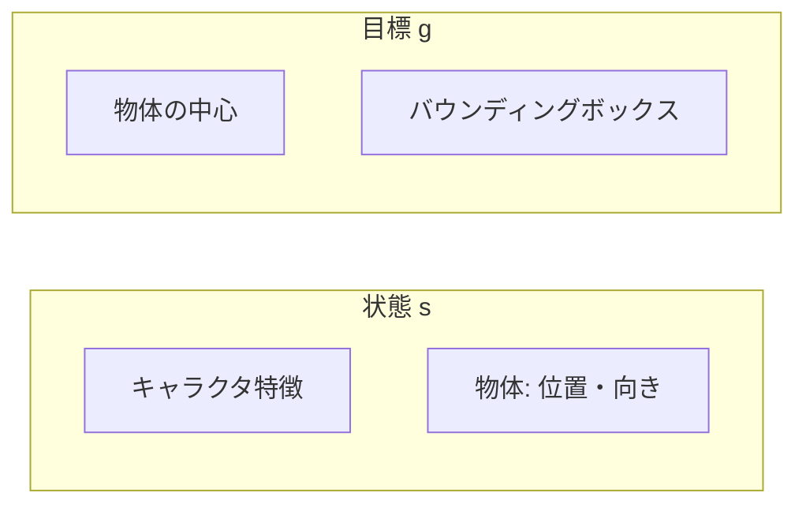

# 26. 物体を足して sit / carry 簡略版

## この章でわかること

- 人型に物体（椅子・箱に相当する剛体）を追加する
- 論文の sit / carry をミニ実装向けに簡略化する
- 物体の状態をどう持つか、物体が動くとはどういうことか
- RSI を AMP のデータ込みで使う

## 前提

- 第08章（シーン条件付け）、第10章（データ）、第11章（RSI・ランダム化）、第25章

---

## 1. 論文のタスクをどう簡略化するか

論文の sit / carry は、いずれも「物体へ近づく → 物体と相互作用する」構造です（第07・12章）。この構造を保ったまま、扱いやすいタスクに縮小します。

| 論文 | ミニ実装 |
| --- | --- |
| sit: 椅子の座面に腰を下ろす | 物体（台）の中心へ腰を合わせ、姿勢を保つ |
| lie down: 腰と頭を合わせる | （sit と同じ枠組みで頭の高さを加える） |
| carry: 箱を目的地へ運ぶ | 物体（箱）へ近づき、押して目標へ移動させる |

ポイントは **「タスク報酬の構造を保つ」** ことです。第12章の「遠くへ誘導（far）＋近くで精密（near）」をそのまま使います。

## 2. 環境に物体を追加する

MuJoCo のモデルに物体（剛体）を追加します。`scene_env.py` の `SCENE_XML` がその例です。

```xml
<mujoco model="humanoid_scene">
  <include file="humanoid.xml"/>          <!-- 人型を流用 -->
  <worldbody>
    <body name="object" pos="2 0 0.5">
      <geom name="object_geom" type="box" size="0.3 0.3 0.5"/>
      <freejoint name="object_joint"/>    <!-- 物体は自由に動ける -->
    </body>
  </worldbody>
</mujoco>
```

- `freejoint` により、物体は6自由度で動きます（押せば転がる）。
- 論文の「物体は手に固定されず、力で動く」に対応します（第07章）。

## 3. 物体の状態を状態ベクトルへ

論文の中核である「シーン条件付け」は、**物体の位置・向きを状態に入れる**ことから始まります（第09章）。

```python
# 物体: 位置(3) + 向き(6D) = 9次元
self.object_dim = 9
self._object_state = torch.zeros(self.num_envs, self.object_dim, device=device)

# 目標: 物体の中心(3) + バウンディングボックス半サイズ(3)
self.goal_dim = 6
```



## 4. 物体のランダム化（第11章）

毎エピソード、物体の位置・向きをランダム化します。

```python
def _maybe_randomize(self, obs):
    lo, hi = self.cfg.init_obj_dist_range        # (1.0, 10.0)
    dist = torch.empty(...).uniform_(lo, hi)
    theta = torch.empty(...).uniform_(0.0, 2 * np.pi)
    x, y = dist * torch.cos(theta), dist * torch.sin(theta)
    self._object_center = torch.stack([x, y, full_like(x, 0.5)], dim=-1)
```

- 物体はキャラクタから **1〜10m**、向きは **[0, 2π]**（第11章）。
- これが「未知の配置への一般化」の源です。

## 5. タスク報酬（第12章の簡略版）

sit の式(7)〜(9)を、ミニ実装向けに簡略化します。

$$
r^G = 0.7\, r^{\text{near}} + 0.3\, r^{\text{far}}
$$

- $r^{\text{near}} = \exp(-10\, d^2)$ … 腰を物体中心に合わせる（式(9)と同型）。
- $r^{\text{far}} = \exp(-0.5\, d^2)$ … 物体へ近づく（距離項、式(8)を簡略化）。
- $d$ … キャラクタのルートと物体中心の距離。

```python
def task_reward(self, obs, goal, action, next_obs):
    root_xy = next_obs[..., :2]
    obj_xy = self._object_center[:, :2]
    dist = (obj_xy - root_xy).norm(dim=-1)
    r_near = torch.exp(-10.0 * dist.pow(2))     # 精密に合わせる
    r_far = torch.exp(-0.5 * dist.pow(2))        # 近づく
    far_mask = (dist > 0.5).float()              # 0.5m でモード切替（式7）
    r_far_term = far_mask * r_far + (1 - far_mask) * 1.0
    return 0.7 * r_near + 0.3 * r_far_term
```

> **つながり**: 式(7)のモード切替（0.5m）をそのまま使っています。報酬設計の構造が論文と一致します。

## 6. RSI を AMP データ込みで使う

RSI（第11章）は、参照モーションのランダムなフレームから始める技術です。物体を持つ場合、**キャラクタと物体の両方**を参照状態から初期化します。

```python
def _build_reference_motion(self):
    n = 2000
    self.ref_obs = torch.randn(n, self.obs_dim) * 0.1
    self.ref_object_state = torch.randn(n, self.object_dim) * 0.1
    # 識別器用の参照遷移（キャラ＋物体を連結）
    self.ref_amp_obs = torch.cat([self.ref_obs, self.ref_object_state], dim=-1)
```

- `ref_amp_obs` が識別器の「本物」データ。ここに物体が含まれる点が、AMP との決定的な違いです（次章）。

## 7. 物体は動く — 反応が必要

論文の重要ポイント（第08章）を再確認します。

> 物体は行動中に動く。エージェントは適切に反応しなければならない。

- キャラクタが物体を押せば、物体は動く（`freejoint`）。
- 状態に物体の**現在位置**を毎ステップ入れておけば、方策は反応できます。
- 物体を移動させても追従できることが、第13章の頑健性実験に対応します。

```python
def _update_object_state(self):
    # 実運用では物体 joint の位置を環境から読み、反映する
    self._object_state[:, :3] = self._object_center
```

## 8. 実行

```bash
uv run python scripts/train_06_scene.py
```

> **正直な注意**: このミニ実装では、参照モーション（物体込み）はダミーです。論文レベルの自然な相互作用には、SAMP のような質の高いデータが必要です（第10章・付録D）。この章の目的は、**物体を状態に含めるパイプラインを通す**ことです。

## 9. まとめ

- 人型に物体（剛体）を追加し、論文の sit / carry を簡略化した。
- 物体の位置・向きを状態に入れることから、シーン条件付けが始まる。
- 物体の配置をランダム化し、未知配置への一般化を図る。
- タスク報酬は「近距離（near）＋遠距離（far）」の構造を保つ。

## 演習

1. 物体を状態に含めずに sit のタスク報酬だけ与えると、どんな問題が起きるか述べましょう。
2. 0.5m のモード切替（式7）を外すと、学習はどう変わるか予想しましょう。
3. 物体が動くことへの「反応」が、状態設計のどこで実現されているか説明しましょう。

---

次章: [27. シーン条件付き識別器に拡張](27_シーン条件付き識別器に拡張.md) ／ 前章: [25. 人型で AMP を統合する](25_人型でAMPを統合する.md)
