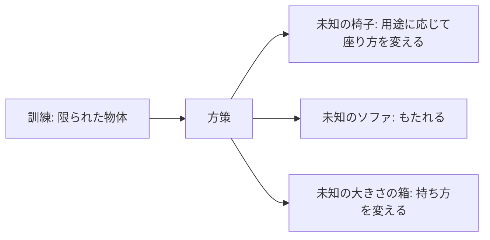
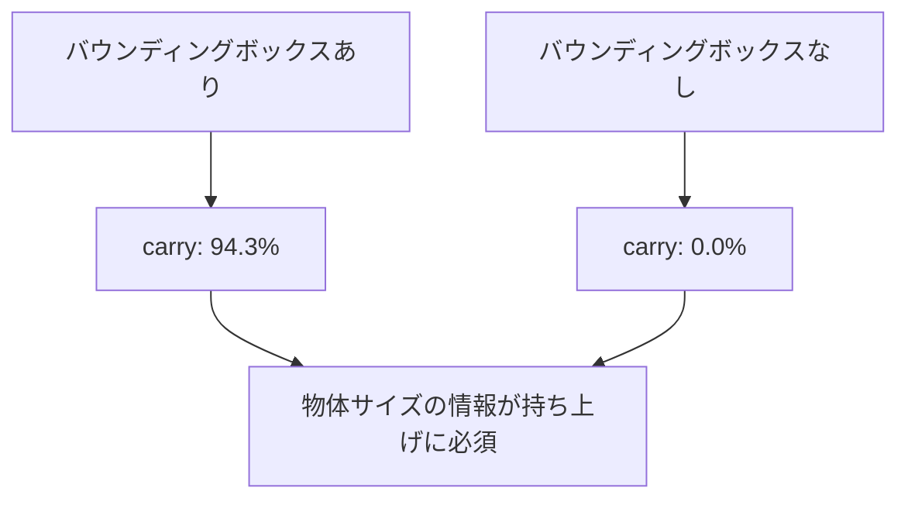
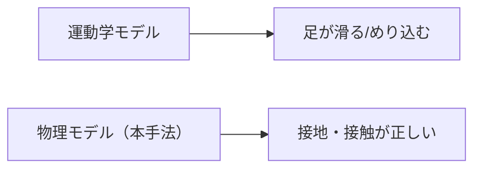

# 26. 結果と比較 — 論文は何を示したか

## この章でわかること

- 論文の評価方法（成功率・実行時間・精度）
- 主要な結果と、未知物体・外乱への頑健性
- アブレーション（バウンディングボックスの重要性）
- 先行手法（NSM, SAMP, Chao et al.）との比較
- 論文自身が認める限界

## 前提

- 第21〜25章（論文の手法・訓練・報酬）

---

## 1. 評価の方法（§7.1）

| 指標 | 意味 |
| --- | --- |
| 成功率 | タスク目標を達成した割合（%） |
| 実行時間 | 成功までの平均時間（秒）。短いほど良い |
| 精度 | 目標との平均ずれ（cm）。小さいほど良い |

### 成功の定義

- **sit**: 腰が目標から20cm以内。
- **lie down**: 腰と頭がそれぞれ目標から30cm以内。
- **carry**: 箱が目標から20cm以内。
- いずれも20秒以内に満たなければ失敗。

### 評価の条件

- キャラクタは物体から1〜10mのランダム位置・向きで初期化。
- 各タスク4096トライアルの平均。
- sit は16個、lie down は5個の**未知物体**で評価（訓練に未使用）。
- 物体は毎回0.8〜1.2倍にランダムスケーリング。

## 2. 主要な結果（表1）

| タスク | 成功率 (%) | 実行時間 (秒) | 精度 (cm) |
| --- | --- | --- | --- |
| Sit | 90.4 | 5.0 | 6.7 |
| Lie down | 90.2 | 6.3 | 13.4 |
| Carry | 94.3 | 9.1 | 8.3 |
| Carry（重さ） | 97.2 | 8.7 | 10.3 |

読み方:

- すべて **90% 超**。多様な物体・配置でこの数字は高い。
- carry が最も成功率が高く、sit/lie より時間が長い（段階が多い）。
- lie down の精度（13.4cm）が sit より悪いのは、頭と腰の2点を合わせる必要があるため。

## 3. 未知物体への一般化（§7, 図4〜6）

論文の主張の要点:

- sit/lie: 訓練 約350物体、テスト 21物体（未見）。
- carry: 訓練は1つの箱、テストはサイズを変えた箱。

観察（論文の記述）:

- 高い椅子には**飛び乗るように**座る。
- ソファでは**後ろにもたれる**。
- 肘掛けがあれば**腕を乗せる**。
- 非常に小さい箱も運べる。

## 4. スタイルの多様性（図7）

同じ物体でも、**複数の座り方**をします（普通に座る、もたれる、腕の動かし方を変える）。これは AMP 系の利点です（1つのクリップに追従しないので、分布内で多様な動きが生まれる。第19章）。

## 5. 頑健性 — 外乱への反応（表2）

### 投射物

- キャラクタに1.2kg の投射物を20発、ランダムな時刻に当てる。
- それでもタスクを続行・回復できる。

### 物体の移動

- タスク遂行中に物体を動かす（座ろうとした瞬間に椅子を横にずらす等）。
- 方策は追従して反応する（第22章の「物体は動く」設計の効果）。

表2（外乱下の成功率）:

| タスク | 成功率 (%) |
| --- | --- |
| Sit | 87.5 |
| Lie down | 82.0 |
| Carry | 89.4 |

- 外乱がない場合より下がるが、依然として高い。
- lie down が最も下がる（82.0%）のは、姿勢が崩れやすく回復が難しいため。

## 6. アブレーション — バウンディングボックスの重要性（表S.1）

「物体のバウンディングボックスを目標から除くとどうなるか」を検証します。

| タスク | 成功率 (%) | 実行時間 (秒) | 精度 (cm) |
| --- | --- | --- | --- |
| Sit | 88.6 | 5.3 | 6.6 |
| Lie down | 81.9 | 6.2 | 14.7 |
| Carry | **0.0** | - | - |

> **衝撃的な結果**: carry は成功率 **0%**。

- 箱のサイズ情報がないと、**箱を持ち上げられない**。
- 「どこを掴めばいいか」が分からないため。
- sit/lie は影響が比較的小さい。

このアブレーションは、「**物体情報を状態に含めることが本質的に重要**」という論文の主張を裏付けます。

## 7. 先行手法との比較（表3）

| 指標 | Sit: NSM | Sit: SAMP | Sit: Chao | Sit: Ours | Lie: SAMP | Lie: Ours |
| --- | --- | --- | --- | --- | --- | --- |
| 成功率 (%) | 75.0 | 75.0 | 17 | 93.7 | 50 | 80 |
| 実行時間 (s) | 7.5 | 7.2 | - | 3.7 | 9.5 | 6.9 |
| 精度 (m) | 0.19 | 0.06 | - | 0.09 | 0.05 | 0.3 |

- **sit**: 本手法 93.7% で最高。時間も最短。
- **lie down**: 本手法 80% で最高。ただし精度は SAMP より悪い点に注意。
- **Chao et al.**: 17% と極端に低い（階層制御が破綻）。

### 失敗の性質の違い

- **運動学モデル（NSM/SAMP）**: 足が滑る（foot-skating）、物体にめり込む（penetration）。環境との相互作用なしで学ぶため。
- **物理階層（Chao）**: 対象物に座れず転倒することが多い。
- **carry**: 先行手法は完全な carry をこなせない（NSM は手動操作が必要）。

## 8. 論文自身が認める限界（§8）

1. **単一タスクの方策**: タスクごとに別々のポリシー。マルチタスク RL は未解決。
2. **物体は1つ**: 環境に1つの物体のみ。状態を拡張すれば複数物体も可能。
3. **視覚なし**: キャラクタに「目」がない。複雑なシーンには視覚が必要。
4. **失敗例**: 物体のそばで立ち尽くす、遠回りして時間切れ。
5. **サイズ・重さの射程**: 訓練分布から大きく外れると成功率が落ちる。
6. **スキルの一般化は未対応**: 物体への一般化は示したが、スキル（ジャンプ等）は将来課題。

## 9. 結果から読み取れる設計原則

| 観察 | 設計原則 |
| --- | --- |
| 未知物体で高い成功率 | ランダム化が効く |
| 物体サイズ情報がないと carry 崩壊 | 物体特徴の明示入力が必須 |
| スタイルが多様 | クリップ追従でなく分布模倣 |
| 外乱に頑健 | 物体位置を状態に入れ、反応可能にする |
| 10m から遂行 | 訓練時の配置ランダム化 |

## 10. この研究の位置づけ

> 本論文は「AMP をシーンへ拡張する」一歩を踏み出し、物理キャラクタのシーン相互作用を実用に近づけた。

- 個々の部品は既存でも、シーン条件付けが新規。
- 物理ベースで、運動学モデルの弱点（接地・貫通）を克服。
- 限界（単一タスク・単一物体・視覚なし）は後続研究の出発点。

## 11. まとめ

- 3タスクすべて 90% 超。未知物体・配置・外乱にも対応。
- 物体サイズ情報は carry に不可欠（無いと0%）。
- 先行手法（運動学・物理階層）より高い成功率。
- 限界: 単一タスク・単一物体・視覚なし。

## 演習

1. carry でバウンディングボックスを除くと成功率0%になる理由を、状態と報酬の両面から説明しましょう。
2. 外乱下で lie down の成功率が最も下がる理由を考察しましょう。
3. 運動学モデルの foot-skating を、自分が知っているゲームの例に当てはめて説明しましょう。
4. 「マルチタスクは未解決」と述べる理由を、報酬設計の観点から考察しましょう。

---

第6部はここまで。次章: [27. 実装の全体像](27_実装の全体像.md) ／ 前章: [24. データセットと訓練](24_データセットと訓練.md)
